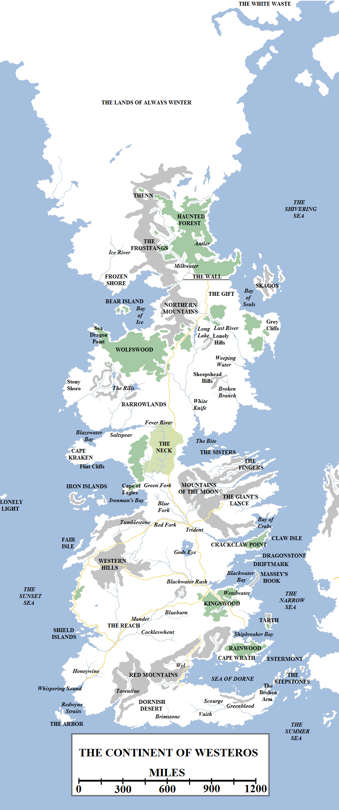
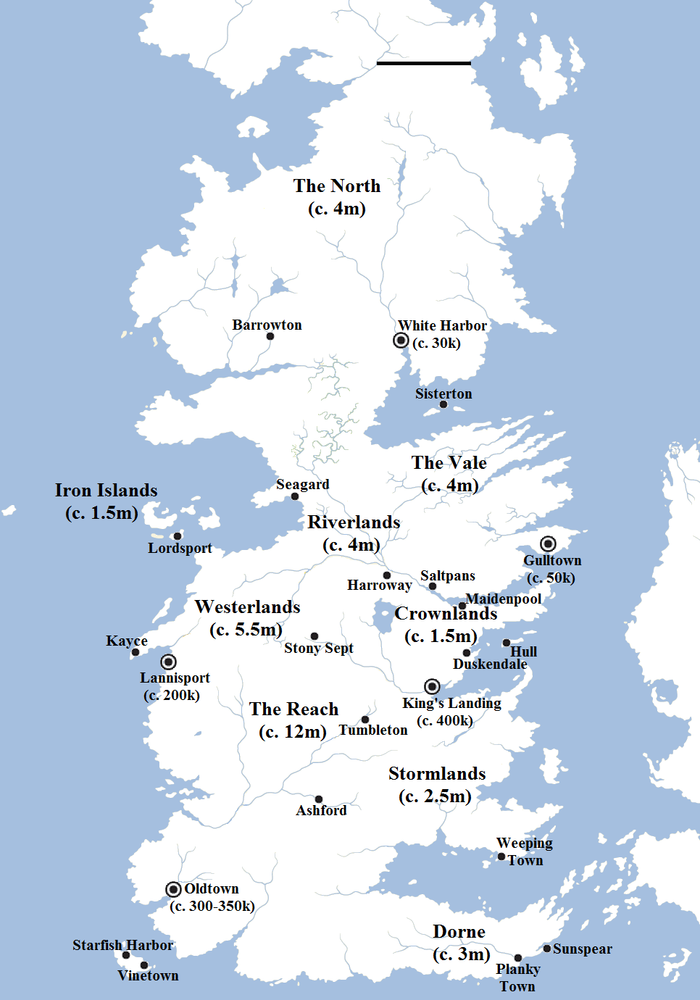

Westeros is the name given to the great continent located in the far west of the known world. To the peoples of Essos it is known as the Sunset Lands or Sunset Kingdoms. The Dothraki call it _Rhaesh Andahli_, the Land of the Andals, but pay it little heed for it lies beyond the poison water upon which their horses cannot ride.

Major geographic features of the continent of Westeros.

Westeros is known as a land of vast, fertile plains, beautiful mountains and fast-running rivers, but it is also known as a land of biting cold and immense snowfalls: the continent extends considerably further north than Essos or even Ib, up to the frozen wilderness beyond the Shivering Sea known as the White Waste. Some maesters claim that the continent extends all the way under the snow and ice to the north pole of the world, and maybe even beyond into the opposing hemisphere of the planet. The distance from the north pole to the Summer Sea is estimated at just over 5,000 miles.

The mapped portion of the continent starts approximately 600 miles north of the Wall, in the northern foothills of the Frostfangs, in the valley of Thenn and along the northern eaves of the Haunted Forest. These lands south to the Wall are known as the Lands of the Free Folk, or wildlings, or more simply the Lands Beyond the Wall. In the southron kingdoms, the Wall marks the end of the world and what is beyond is a mystery. The Night’s Watch knows better, that great mountains, forests, small villages and formidable tribesfolk can be found in those lands. But even that knowledge fails on the immense, inhospitable tundra that lies north of the Frostfangs and extends beyond the shimmering curtains of light circling the top of the world.

Everything south of the Wall to the Summer Sea – a distance of almost exactly 3,000 miles – is ruled from the Iron Throne in King’s Landing. This nation, by far the largest in the known world, is known as the Seven Kingdoms.

The Seven Kingdoms are divided into nine administrative regions: the **North** (ruled from **Winterfell**), the **Riverlands** (ruled from **Riverrun**), the **Vale** (ruled from **the Eyrie**), the **Westerlands** (ruled from **Casterly Rock**), the **Iron Islands** (ruled from **Pyke**), the **Reach** (ruled from **Highgarden**), the **Stormlands** (ruled from **Storm’s End**), **Dorne** (ruled from **Sunspear**) and the **Crownlands** (ruled from **King’s Landing**). The North is by far the largest of these regions, making up over a third of the realm by itself, whilst the Iron Islands are the smallest, consisting of several chunks of rock located in the Sunset Sea to the west of the continent. The Reach is the most heavily populated part of the realm, with vast, fertile fields and farmlands stretching for hundreds of miles, surrounding bustling market towns and fast-flowing rivers. Dorne, the western part of which is dominated by an arid desert, is the arguably the least-hospitable, except for the North during the direst winters.

The entire realm is ruled from the city of King’s Landing, located on the east coast of the continent, but each region has its own administrative centre which rules over numerous villages, towns, cities and holdfasts in the name of the King on the Iron Throne. Each region is also ruled by a single noble family, who in turn rule over many lesser houses who in turn command even smaller families, holdfasts and individual warriors. These **Great Houses** are: **House Stark**, rulers of the North; **House Tully**, rulers of the Riverlands; **House Arryn**, rulers of the Vale; **House Lannister**, the rulers of the Westerlands; **House Greyjoy**, the rulers of the Iron Islands; **House Tyrell**, the rulers of the Reach; **House Baratheon**, the rulers of the Stormlands; and **House Martell**, the rulers of Dorne. House Baratheon, as the ruling royal house of Westeros as of 298 AC, also rules the Crownlands from the city of King’s Landing and the island-fortress of Dragonstone. **House Targaryen** ruled the Seven Kingdoms for 283 years until its defeat in a major civil war, but two children of that house survive in exile in Essos and continue to claim the Iron Throne.

King’s Landing is the largest city in the realm, as well as its capital, with a population of around 400,000 (increasing sharply during feast days, tournaments or times of war). Oldtown, a considerably older city, is only slightly smaller. From there it is a considerable drop to Lannisport, the largest port and city on the west coast of the continent, and a further significant drop to Gulltown and White Harbor, the smallest of Westeros’s major cities with populations in the low-to-mid tens of thousands.

However, Westeros is home to many walled towns and holdfasts with populations comfortably in the thousands, even if they are not officially counted as cities. Such large, well-fortified towns include Duskendale, Stoney Sept, Tumbleton, Barrowton, Harroway, Hull, Vinetown, Starfish Harbor, Ryamsport, Lordsport, the Weeping Town, the Planky Town, Maidenpool, Saltpans, Fairmarket, Bitterbridge and many more. There are also castles with significantly-sized towns attached to them, such as Winterfell, Seagard, Ashford and Sunspear. Town and city-dwellers in Westeros are certainly in the minority, but not quite as small a population as it first appears.

A very approximate population map of Westeros, showing the major regions and settlements.

The population of Westeros [is estimated](https://atlasoficeandfireblog.wordpress.com/2016/03/06/the-population-of-the-seven-kingdoms/) by some maesters at around forty-five million souls, and may be considerably higher. The lands beyond the Wall are held to be incapable of supporting vast numbers, with the wildlings believed to consist of nothing more than a few clans or tribes of a few hundred individuals each, barely large enough to survive. However, the Night’s Watch and the people of the North disagree, since survival even in the harshest winters is possible as they themselves can attest, and believe that the lands beyond the Wall could sustain many tens of thousands. Since the destruction of the largest wildling town and trading post, Hardhome, some centuries ago it has become much harder to estimate such things.

Westeros has no large standing army. Instead, individual lords raise forces of men from their population at need, equipping and training them as required. How well each lord does this varies: the Lannisters, for example, equip their soldiers with the best armour and weapons available, whilst other regions send their basic troops into battle equipped with little more than farming equipment. Several standing military forces do exist, such as the City Watch of King’s Landing and Lannisport, the Night’s Watch, the sailors of the Royal Fleet and several well-trained formations of both crossbowmen and pikemen in the Westerlands, but these tend to be small. Smallest of all but most formidable (at least in theory) is the Kingsguard, which consists of seven elite warriors sworn to defend the king and the royal family.

Making up the backbone of any Westerosi army are the **knights**, who usually make up heavy cavalry formations. Knights are men sworn to the Faith of the Seven who have performed deeds of valour in combat and own their own horses, armour and weapons, which they maintain to a high standard. Some knights have younger men in their service, cleaning their armour and keeping their weapons in good repair in return for being trained in the arts of war. These trainee knights are known as **squires**. Knights are addressed with the honorific “Ser”, before their names. Most knights are nobly-born, but a those of low birth can also become knights if they are so honoured on the battlefield (any knight can make another knight). Low-born knights usually struggle for the funds required to maintain their station, often sleeping in ditches and hedges to save money on accommodation. These low knights are known as **hedge knights** and are often held in disdain by those of noble birth.

In the North, where people still worship the old gods, knights are less common, but northern noble sons (and some daughters) are often trained in battle and horse riding to a standard equalling that of the south.

The Seven Kingdoms are also home to the order of **maesters**. Based in the **Citadel** in the city of Oldtown, maesters are men of learning and wisdom. Almost every castle in the Seven Kingdoms has a maester, tasked with educating the noble children and organising communications between far-flung parts of the realm. Maesters also record the length of the days and report this back to the Citadel, so the Conclave of Archmaesters may determine when the seasons have turned. Maesters are also experts in law, astronomy, agriculture and strategy. Maesters are held to be loyal to their seat and the realm rather than individual lords and houses, and if one family inherits a seat or conquers one in a time of war, the maester is expected to transfer their allegiance to the new rulers. In practice this is easier said than done, and it is not unknown for the maester of a castle to be killed in its capture or sent back to the Citadel afterwards, in favour of a maester with less biases.

In terms of religion, the Seven Kingdoms are home to three distinct creeds. The most common and richest is the **Faith of the Seven**, which holds that there is one god split into seven aspects, the Father, the Mother, the Maiden, the Crone, the Warrior, the Smith and the Stranger (who represents death). The Faith is ruled by the High Septon and his administrative council, the Most Devout, from the Great Sept of Baelor in King’s Landing. Priests of the Seven are called _septons_ and priestesses as _septas_. The Faith’s holy book is _The Seven-Pointed Star_. Temples of the Seven are known as _septs_. Larger, monastery-like structures where devout followers worship and live together in peace, are known as _septries_. The Faith came to Westeros with the Andals.

Next most common is the religion of the **Old Gods of the Forest** (or simply old gods). A considerably less formal religion, the old faith is based around the worship of the nameless, countless spirits of the trees and of nature. This religion calls for prayers to be offered up to heart trees, enormous weirwood trees with faces cut into their barks. The old faith is followed very strongly in the North and in the lands beyond the Wall, although a few southern houses still maintain its worship. The First Men were converted to the old faith by the Children of the Forest after their invasion  and the signing of the Pact.

The smallest of the major religions is that of the **Drowned God**, an angry and harsh deity of the sea who demands supplication in the form of battle and raiding. The Drowned God is worshipped exclusively on the Iron Islands.

Small, fringe faiths of Essos, such as the worship of the red god **R’hllor**, Lord of Light or the **Moonsingers** of the Jogos Nhai and Braavos, are not very common in Westeros, but small pockets of worshippers of foreign gods can be found in the major ports.

There is significant contact between Westeros and Essos, which are separated only by the 300 or so miles of the Narrow Sea at its narrowest. The Free Cities of Braavos, Pentos, Myr and Tyrosh lie close to the shores of the Seven Kingdoms, and Lys, Lorath and Volantis are only slightly further away by sea. There is significant trade between the continents through the great ports of the Narrow Sea and the Summer Sea. There is also trade with the Summer Islands, which lie approximately 700 miles south of Dorne. The distinctive swan ships of the Summer Islanders are a common sight in the ports of Lannisport, Oldtown and King’s Landing. However, the true riches of trade come from those merchants brave enough to dare the Summer Sea and the Straits of Qarth to conduct the great trader’s circle around the Jade Sea to Asshai and back, a journey which can take two years. For those who manage it and survive, riches and fame awaits, but the dangers are considerable.

Journeys to the far ends of the world are beyond the comprehension of most of the smallfolk of Westeros, who may rarely venture more than ten miles from their place of birth in their lives. Westeros by itself is still vast enough to fill many lifetimes of exploration and adventure.
