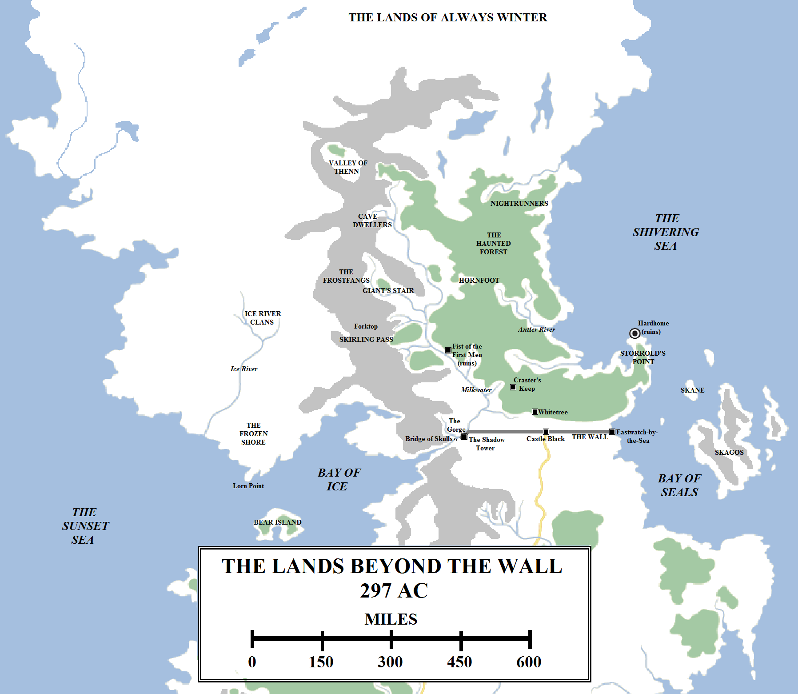
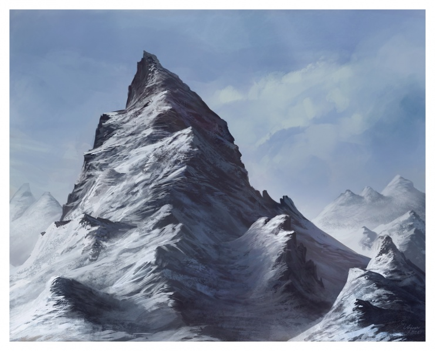
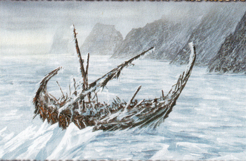
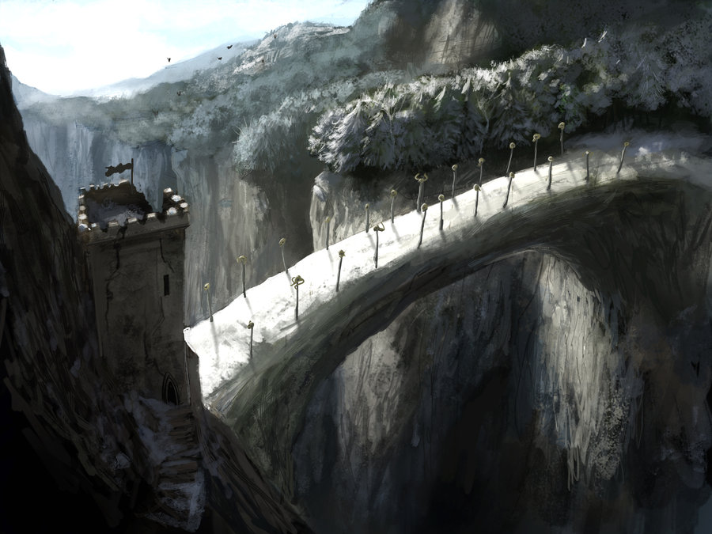

The lands north of the Wall are cold and remote from the warm cities of the south. To many, even learned maesters, the lands north of the Seven Kingdoms are inhospitable wastelands, their few inhabitants too savage, too primitive and too small in number to be concerned about. The men of the Night’s Watch know better, that the northern lands are vast and it is possible to survive and live there. It is a hard and tough life that breeds a hardy and tough people. They call themselves the Free Folk, but are known to the inhabitants of the Seven Kingdoms as the wildlings.

The northern lands can be divided into two broad regions: the Lands of Always Winter and the more temperate and warm lowlands to the south, the lands of the Free Folk.

The Lands Beyond the Wall, which are divided into three general regions: the Lands of Always Winter in the far north and extending for over a thousand miles to the north pole; the Ice River and Frozen Shore regions on the open, cold plains west of the Frostfangs; and the better-populated lands of the Milkwater Valley and the Haunted Forest to the east.

**The Lands of Always Winter**

The Lands of Always Winter are so-called because they lie in the shadow of permanent cold, ice and snow. The snow never melts, the ice never breaks and even in the warmest and longest summers the lands are still freezing, cold and inhospitable. The Lands of Always Winter consist of vast, frozen tundra and plains, covered in snow, extending for hundreds upon hundreds of miles from the northern-most foothills of the Frostfangs all the way to the north pole, perhaps even beyond into the opposite hemisphere of the world.

Very little can survive in this region and few, if any, geographic details are known. Some maesters estimate that it is approximately 600 miles from the Wall to the treeline, the part of the world where it gets too cold for trees to grow. The treeline lies along the northern edge of Thenn and the shadow of the northern Frostfangs, near the northern-most edge of the detailed maps of the lands beyond the Wall. But from the treeline to the north pole lies a staggering 1,500 miles (or more) of cold and wilderness. Crossing such a freezing landscape alive is simply not possible.

Even the coasts are hard to chart, for the water freezes and vast floes of ice dominate the Shivering Sea and the northern Sunset Sea, threatening ships with destruction. Repeated voyages by some of the greatest mariners in history (such as the voyage by Corlys Velaryon, the Sea Snake, two centuries ago in search of the fabled Northern Passage) have failed to find a path through the ice, apparently confirming that the continent of Westeros extends up over the top of the world. Furthermore, the entire northern polar region appears to be surrounded by a vast mass of ice, known as the White Waste. Northern sailors claim that huge ice dragons can be found in these lands and offshore, and screaming mountains can be seen from the sea (although whether these are actual inland mountains or ice formations remains unknown).

Sailors also, curiously, report that immense ribbons of shifting light can be seen in the skies over the uttermost north. Some maesters dismiss such stories as fanciful inventions, but the reports are numerous enough to make some think otherwise.\*

Somewhere along the ever-shifting coast of the White Waste lies Cannibal Bay, where ships that venture too close to the ice are trapped and slowly crushed over the course of decades, the surviving crew forced into acts of depravity to try to survive and escape.

According to myth and legend, the Lands of Always Winter are the home of the enigmatic Others, or white walkers, who come from a place called “the heart of winter”. Eight thousand years ago, according to tradition, under the cover of the longest and darkest winter in history, the Long Night, the Others invaded Westeros from out of this wilderness. Raising the dead to fight for them and riding great ice spiders, the Others pushed the forces of living men, the Children of the Forest and the giants back into the south before being defeated in the War for the Dawn and driven back into the far north of the world. The Wall was raised at the narrowest point of the continent to defend against their return. Maesters doubt this story, as the Lands of Always Winter are too inhospitable for any kind of life at all to survive.

**The Lands of the Free Folk**

The Lands of Always Winter terminate in a series of great lakes and rivers which, at least occasionally, thaw in the summer. They also end on the northern slopes of the Frostfangs, the greatest mountain range of the northern lands. These lands south to the Wall are considerably more hospitable than the frozen northern tundra, although they are still cold and growing crops is difficult in all but the longest and warmest summers.

The lands of the Free Folk are divided in two by the Frostfangs. The Frostfangs extend in a slightly north-easterly direction for about 750 miles before swinging north-east for about 300 miles. The Frostfangs are tall, jagged and cold. They are also beautiful, with frozen waterfalls that gradually thaw in the spring and high mountain meadows covered in wildflowers in the summer. But in the winter they are grey, dark and uninhabitable, save for a few rumoured valleys where shelter can be found. There are three principal passes through the Frostfangs: the Milkwater Valley, formed by that great river as it winds its way through the mountains from its source; the Giant’s Stair and the Skirling Pass. There are numerous mountains in the Frostfangs, but one of the largest and most distinctive is Forktop, so-called for the two peaks that crown it. Some maesters claim that the Frostfangs continue south of the Gorge as the Northern Mountains, whilst others hold them to be a separate range.

The lands to the west consist of cold, open plains and hills through which run a series of rivers. Although far more hospitable than the Lands of Always Winter to the north, these are still sparse and bare lands. Two groups of wildlings live in this region. The Ice River clans live around the great rivers, carrying out fishing and, during the winters, ice-fishing to survive. The Ice River clansmen are said to feast on human flesh (although it is unclear if this is reliable or just rumour).

A ship trapped off the Frozen Shore. Artwork by Franz Miklis for the **Song of Ice and Fire** card game by Fantasy Flight.

The Ice River (or rivers) flow south out of the heart of this region into the Sunset Sea west of Bear Island. The coastline around the mouth of the river and east to the Frostfangs, including the entire northern coast of the Bay of Ice, is known as the Frozen Shore. The Frozen Shore is inhabited by a different culture of wildlings, men and women who ride chariots made of walrus bone and pulled by gigantic dogs (reportedly as big as direwolves, although this may be exaggeration). They clad themselves in sealskins and breed reindeer. There are several Frozen Shore tribes: one adorns itself with walrus tusks, another with reindeer antlers. The “Great Walrus” is the name given to the leader of the walrus tusk tribe.

The tribes of the Frozen Shore do not get one with one another or the Ice River clans, and internal warfare is common. They are also known to build primitive boats to raid Bear Island and Sea Dragon Point to the south. According to some legends, the ironborn may have tried to conquer the Frozen Shore in ancient times but, if so, they were rebuffed.

A promontory on the Frozen Shore is known as Lorn Point. Its precise location is unclear, but some mappers identify this as the largest and southern-most peninsular on the shore, separating the Bay of Ice from the Sunset Sea. Redwyn, a ranger of the Night’s Watch, undertook a long journey from the Shadow Tower to Lorn Point during which he met and traded with the Children of the Forest. The report is considered fanciful; if Lorn Point is that promontory, it well over 500 miles (as the wolf runs) west of the Shadow Tower.

The lands to the east of the Frostfangs are more hospitable. The Frostfangs shelter the lands on their eastern side from the harsh winds and cold that lash the western slopes, and there are numerous sheltered valleys along the eastern mountain flanks that are more hospitable. The best-known of these is Thenn. Located near the northern end of the mountains in a bowl-shaped valley, local geographic and climactic conditions make Thenn warmer and more habitable than most of the other lands at that latitude. It is still a hard land and the people of Thenn, known simply as “Thenns”, are certainly fierce and unrelenting warriors. They are also more sophisticated than other wildlings, mining for tin and copper, forging weapons of bronze and engaging in trade. They are also close to the few surviving giants of the mountains, having won their trust in ancient times. The Thenns are led by a ruler known as the Magnar, who is considered more god than king. The Thenns’ belief in their Magnar makes them more disciplined and confident than other tribes. They are, arguably, the most formidable of the northern tribes and the one whose allegiance is most crucial for any warlord who would declare himself King-beyond-the-Wall.

Further south along the Frostfangs lie great caverns and cave complexes, some natural, some perhaps dug out in ancient times. Some wildlings make their home in these caves for their natural warmth and defensive benefits. The cave-dwellers file their teeth and paint themselves unusual colours. They are said to worship bizarre and dark gods.

Running along the feet of the Frostfangs is the Milkwater. The largest and longest river in the lands beyond the Wall, the river consists of two major tributaries. The northern river’s source is in the high Frostfangs, not far south of Thenn. The Milkwater proper is born in a valley north of the Giant’s Stair, a common meeting and gathering spot for the wildling tribes. The two rivers join near the Giant’s Stair and then proceed south-east before swinging south-west and flowing through the Gorge to meet the Bay of Ice. All-told, the river is over 650 miles in length. During the winters the river is a source of food for the wildling tribes, who engage in ice-fishing along its length. The only major crossing over the river is the Bridge of Skulls which stands in the shadow of the far western end of the Wall. The Bridge is held by the Night’s Watch and no crossing of the bridge against a determined opposition is possible. However, there are fords further north and crossing the river when it is frozen during the winter is certainly possible.

The Bridge of Skulls and the ruined Night’s Watch fortress that once guarded it, Westwatch-by-the-Bridge. Artwork by Marc Simonetti.

East of the Milkwater lies a vast canopy of trees: the Haunted Forest. This forest extends for almost 600 miles from the Wall to the northern lakes and rivers and is over 300 miles across at its thickest point. It is the largest woodland still extant on the continent of Westeros and is vast and foreboding. However, both the wildlings and the rangers of the Night’s Watch know their way through the woodland and its numerous rivers, valleys and tracks. The thick trees of the forest, particularly the weirwoods, block some of the worst of the freezing cold that runs from the north or off the Shivering Sea. Other trees in the forest include ironwood, sentinel and oak.

The forest is home to many more wildling tribes, such as the Nightrunners and Hornfoots, as well as many individual homesteads, such as the “keep” of the redoubtable Craster, and entire villages, such as Whitetree near the Wall. The forest is also the home to many dangerous animals. According to legend, direwolves can still be found in the deepest parts of the forest.

The forest is also home to ruins. The Children of the Forest lived in the woodlands for millennia, according to legend (according to some stories, they can still be found there but the Night’s Watch has reported no credible sightings of them for centuries), and the First Men also once dwelt there, raising ringforts for defence. The ruins of one such stronghold – the “Fist of the First Men” –  can be found on a tall hill in the western forest, overlooking the Milkwater. Many of the wildlings claim descent from the First Men and hence kinship with the people of the North in the Seven Kingdoms.

True civilisation in the lands beyond the Wall is hard to find. The Thenns have a rough kind of kingdom, but there are no settlements large enough to be really called towns, let alone cities. This was not always the case. The better part of a thousand years ago, an enterprising wildling chieftain founded a settlement at the northern tip of Storrold’s Point, a great peninsular in the eastern Haunted Forest. This settlement was located on a sheltered bay with a deep natural harbour, capable of keeping the biggest ships afloat. The waters are filled with fish and seals, and wood and stone supplies are plentiful. There are nearby caves providing natural shelter, although the wind had a tendency to run through these caves and make unnerving shrieking noises.

Before long the settlement had turned into a great boom town, Hardhome. Wildling tribes from the interior traded there with ships from the Seven Kingdoms and even the Free Cities (Braavos, located just a couple of weeks to the south and always in need of wood, was particularly well-suited to benefit from this trade). Great trade was made in lumber and fish and word of the town began to spread. Maester Wyllis travelled from the Citadel to Hardhome and established himself there as an advisor to Gorm the Wolf, one of the four warlords who had arisen to rule the settlement. After three years Gorm was murdered and Wyllis rapidly took ship back to Oldtown, where he wrote a respected account of his time amongst the wildlings.

Three centuries before Aegon’s Landing, Hardhome was destroyed. The cause of the devastation is unclear. It is known that the town was razed to the ground and the intensity of the  fire was so great that it could be seen from the Wall, almost 200 miles to the south. A vast swathe of surrounding forest was destroyed. Oddly, it appears that there were no survivors at all. What could cause the town to be destroyed so quickly and completely remains unknown.

The wildlings chose not to resettle the ruins, claiming that demons and ghosts prowled the area and the bay was too choked with corpses. Maesters would later theorise that slavers from Skagos or the Free Cities had raided the town and taken the survivors away in chains, but it seems implausible that they would be able to destroy the town so completely. The truth of the affair remains a mystery to this day.

The population of the lands beyond the Wall is unknown. Some believe that it must surely be low, given the cold, the difficulty in growing crops and the lack of roads and towns. But others point out that, not too long ago, these lands were large enough to support a town of several thousand people. In addition, on several occasions a King-beyond-the-Wall has unified the tribes and led armies numbering in the several thousands to attack the Wall (or, in the case of Raymun Redbeard, even bypass it to invade the North). The Night’s Watch certainly considers the risk of a large host in the thousands or even tens of thousands plausible, and constantly seeks to recruit new men to help increase its depleted ranks.

The Wall marks the boundary between the lands of the wildlings and the Seven Kingdoms proper, and we shall look at it and the surrounding lands in more detail next time.

**Notes**

\*The aurora borealis can be seen on Earth as far as south 35°N, occasionally even further south. This is considerably to the south of the latitude on the **ASoIaF** world of Winterfell and even Riverrun and the Eyrie, let alone the northern treeline in Thenn (which lies at approximately 70°N). The wildlings never mention the aurora either. Instead, it is only mentioned by Bran in his dream in _A Game of Thrones_ (as shimmering curtain of light surrounding the “Heart of Winter” in the uttermost north) and by certain sailors in _The World of Ice and Fire_, as shimmering lights that can be seen in the northern-most Shivering Sea. This suggests that either the planet’s magnetic field is significantly weaker than on Earth, or that the aurora serves a different and more magical function on this world.
