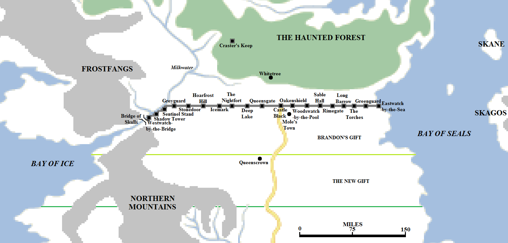
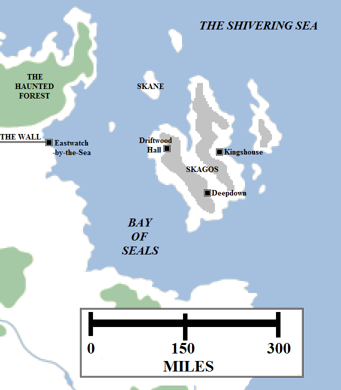

The maesters of the Citadel teach that magic is a myth, a story-telling convenience that has no relevance or bearing in the modern world. Some, more cautiously, will allow that perhaps once magic did exist but it died out a long time ago. These maesters forge links of Valyrian steel and look into ancient eastern texts or religious scrolls, but cannot light the ancient Valyrian candles or commune with the weirwoods as the Children of the Forest are said to have once done. Magic, they claim, no longer exists.

The Wall and the surrounding lands, c. 297 AC.

For those living along the northern border of the Seven Kingdoms, however, they have evidence that magic once did exist and was capable of feats dwarfing that of men today. A solid wall of ice stretches impossibly right across the continent. The Wall, according to tradition, was raised eight thousand years ago at the end of the War for the Dawn, to bar the return of the mysterious Others from out of the Lands of Always Winter. The sworn brotherhood of the Night’s Watch was formed to defend it and hold back the darkness beyond.

**The Wall & the Gift**

The Wall is almost exactly 300 miles long, extending from the Gorge of the Milkwater to the coast of the Bay of Seals. It is over 30 feet in width at the top, enough for a dozen men to ride abreast, and slightly thicker at the base. The Wall is over 700 feet tall, but in some parts of the east, where the landscape becomes more rugged, hills push the Wall to over 900 feet in height, out-topping even the High Tower of Oldtown. Only the fabled Five Forts of Yi Ti, at 1,000 feet, are said to be taller, and no construction anywhere in the known world can match its sheer size.

The Wall is made of solid ice, although compacted gravel and stone may also be found in its foundations. Some ancient records of the Night’s Watch may reference the Wall being considerably lower than it is now, and that the Wall has increased in height over the millennia as rainfall and snowfall has added to its mass. The sheer height of the Wall is indeed as much of an inconvenience to the defenders as it is to attackers, necessitating complex arrays of switchback stairs or rope-and-pulley lifts to get to the top of the Wall and making defensive fire difficult to coordinate effectively against small, manoeuvrable groups of enemies.

The face of the Wall is sheer, with no handholds. Climbing the Wall requires pinions to be inserted into the ice and ropes used to secure climbers. It is extremely hazardous, time-consuming and impractical for large armies to use, but small raiding parties often scale the Wall in this manner in the autumn and winter to raid into the North of the Seven Kingdoms. During the spring and summer, the Wall often “weeps”, never melting but instead the surface becomes slick and damp. This makes climbing far more difficult.

It is possible to outflank the Wall by sea, but the wildlings do not have a strong naval tradition. The tribes of the Frozen Shore have raiding vessels, but are not numerous enough to carry large armies. The tribes of the eastern Haunted Forest are even less adept at sea travel, and the Night’s Watch maintains a small defensive fleet at Eastwatch-by-the-Sea to challenge them. Again, small groups of raiders can land south of the Wall but not in sufficient numbers to seriously challenge the Night’s Watch.

The final way around the Wall is by land. The Wall extends to the south-eastern edge of the Gorge, the sheer canyon cut into the mountains by the passage of the Milkwater as it enters the Bay of Ice, but not across it. Spanning the Gorge at this point is a narrow stone bridge. Raiding parties could cross the bridge or scale the Gorge, but this weak point is defended by a stout keep, Westwatch-by-the-Bridge. Once a permanently-manned fortress with a garrison of hundreds of rangers, the castle today has fallen into disrepair and the garrison has withdrawn to the more formidable protection of the Shadow Tower several miles to the east. However, the Night’s Watch keep a watch on the bridge and can reinforce it quickly.

Nineteen castles run along the base of the Wall, but only three are now permanently-manned, a consequence of the declining manpower of the Night’s Watch. These are: the Shadow Tower near the western end of the Wall; Castle Black near the middle of the Wall, where it meets the Kingsroad; and Eastwatch-by-the-Sea at the far eastern end of the fortification. Of the remaining castles the largest and most notable is the Nightfort, once the primary stronghold of the Night’s Watch but it was abandoned at the urging of Queen Alysanne Targaryen two centuries ago when the cost of running it became ruinous. The Watch removed its main headquarters east to the far smaller and more practical Castle Black. Although the abandoned castles are no longer permanently manned, the Watch rotates small patrols through them to prevent them being used by bandits or wayfarers.

Each of the castles guards a gate and tunnel through the Wall, but the tunnels in all of the abandoned castles have been filled with rubble and ice to prevent them being used to pass under the Wall. The tunnels at the remaining castles are fortified with multiple gates and defensive positions, along with defences along the top of the Wall including siege weapons, catapults and archers. Although these defend each of the three main castles (and there are still fifteen to sixteen miles between each of even the abandoned fortresses), there are still long stretches of the Wall which are unmanned, allowing small raiding parties of wildlings to slip through the defences.

The Night’s Watch also controls all of the land south of the Wall, coast to coast, for 150 miles. Originally Brandon the Builder granted the Watch all the lands south for 75 miles as the Gift, or Brandon’s Gift, but this was doubled by Queen Alysanne and King Jaehaerys I, with the new stretch known as the New Gift. The Gift consists of a huge stretch of farmland, forest, pasture and, in the west, mountains. At one time this land was heavily farmed and home to many thousands of smallfolk toiling to support the Watch, sending grain and ale and milk up to the Wall. Centuries and millennia ago, the manpower of the Night’s Watch was comfortably counted in the tens of thousands, with men willingly choosing to serve with honour and distinction. When Aegon the Conqueror landed, ten thousand men stood guard on the Wall. But that number has dwindled and today only around a thousand men guard the entire length of the Wall, most of them criminals or exiles. With fewer men guarding the Wall, fewer farmers and blacksmiths are needed to supply them. However, fewer men guarding the Wall also means more raiders and wildlings able to attack farmsteads and smallholdings, discouraging settlers. As a result, the Gift is now largely empty and abandoned, the people moving south for warmer and more readily-defended climes.

There are some villages and farms still extant in the Gift, with the most well-known being Mole’s Town. Located a few hours’ march or ride south-east of Castle Black, the village helps with supplying the Watch and also provides one of the few opportunities for rest and relaxation away from the Wall.

During the long winters, the Wall itself provides significant shelter for the Night’s Watch from the northern storms. In addition, the freezing base of the Wall allows for vast stockpiles of food to be frozen and maintained for years at a time.

The island of Skagos, located in the Bay of Seals off the north-eastern coast of Westeros. Locations on Skagos are highly speculative and should not be relied upon.

**Skagos**

Off the far north-eastern coast of the Seven Kingdoms lies a foreboding cluster of islands. There are seven islands large enough to appear on maps and many smaller clusters of rocks dotting their shores. The largest island is known as Skagos.

From north to south Skagos measures about 225 miles. The island is about 145 miles wide at its widest point. The island is large and mountainous, with significant interior areas of highlands and mountains.

The island is windswept and grim, lashed by fierce storms in autumn and winter and effectively cut off from the outside world. It is, however, inhabited. The Skagosi, or “stoneborn”, are a hardy people, known for their ferocity and savagery in battle. In the distant past the Skagosi would cross the Bay of Seals on boats to raid and trade with the Kingdom of the North. They were defeated by King Brandon IX Stark who drove off their raiding parties, built a fleet and invaded Skagos itself. He routed their armies, destroyed their ships and shipyards and forbade them the sea. Unruly vassals at the best of times, the Skagosi rose again in rebellion during the reign of King Daeron II Targaryen, forcing Lord Barthogan Stark to re-invade the island. The Skagosi were defeated but Lord Barthogan was slain.

Locations on the island of Skagos are speculative. Three major Skagosi clans or houses control the main island: the Crowls of Deepdown, the Stanes of Driftwood Hall and the Magnars of Kingshouse. However, they disdain the presence of septons or maesters, so the fine details of the geography of the islands remains a mystery.

The Skagosi have limited contact with the mainland, although they remain vassals of the Starks of Winterfell. It is known that they honour the tradition of taking the black: a Crowl served as Lord Commander of the Night’s Watch a thousand years ago and a Stane served as First Ranger for a time.

Other details about the island are sparse. We know that the Skagosi are hairy and there is a suggestion of a contact with the distant eastern island of Ib. How plausible this is, with Ib located over three thousand miles to the east, is unclear. The Skagosi remain deeply immersed in the culture of the First Men, continuing to speak the Old Tongue and worshipping the old gods of the forest. The Skagosi are also known to trade in pelts and obsidian – dragonglass – blades and arrowheads, hinting at possible volcanic activity on the Skagosi islands. Another curious claim is that the Skagosi use “unicorns” as both steeds and beasts of burden. Some research by maesters suggest that these “unicorns” may be no more than a hardy species of goat with a single horn, but the truth of the matter remains unclear.

The other Skagosi islands appear to be lightly inhabited, if at all: Skane, a small island located to the north-west of Skagos, was raided and its entire population either killed or enslaved centuries ago.

The building of the Wall, artwork by Chase Stone for _The World of Ice and Fire_.

**Notes**

Assuming uniform dimensions of 700 feet tall by 30 feet wide by 300 miles long, the Wall would consist of 33,264,000,000 cubic feet of ice. At roughly 57.2 pounds per cubic foot, the Wall therefore weighs about 951,350,400 tons (or 863,050,565,273 kg).

The Greenland ice sheet loses 250 billion tons of ice per year (9 trillion in a century, raising sea levels by about 1 inch so far), or around 250 times the total volume of the Wall annually, so the Wall melting would make negligible impact on global sea levels. It would, however, likely result in extensive localised flooding along the coast and on Bear Island and Skagos.

The size of Skagos, when the smaller islands are added, appears to closely match that of the island of Ireland.
