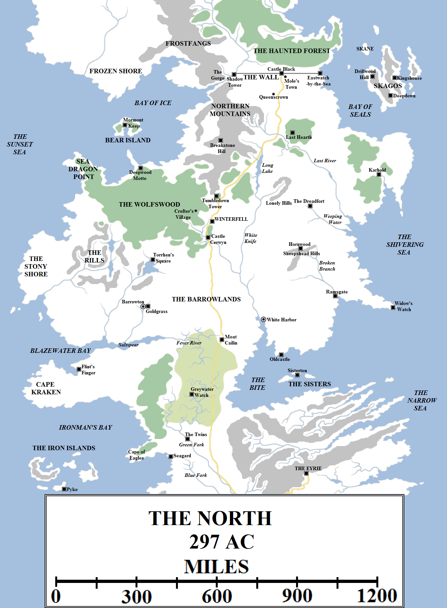
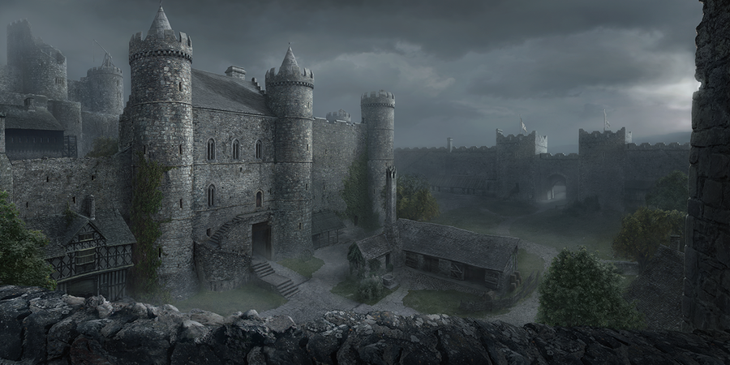
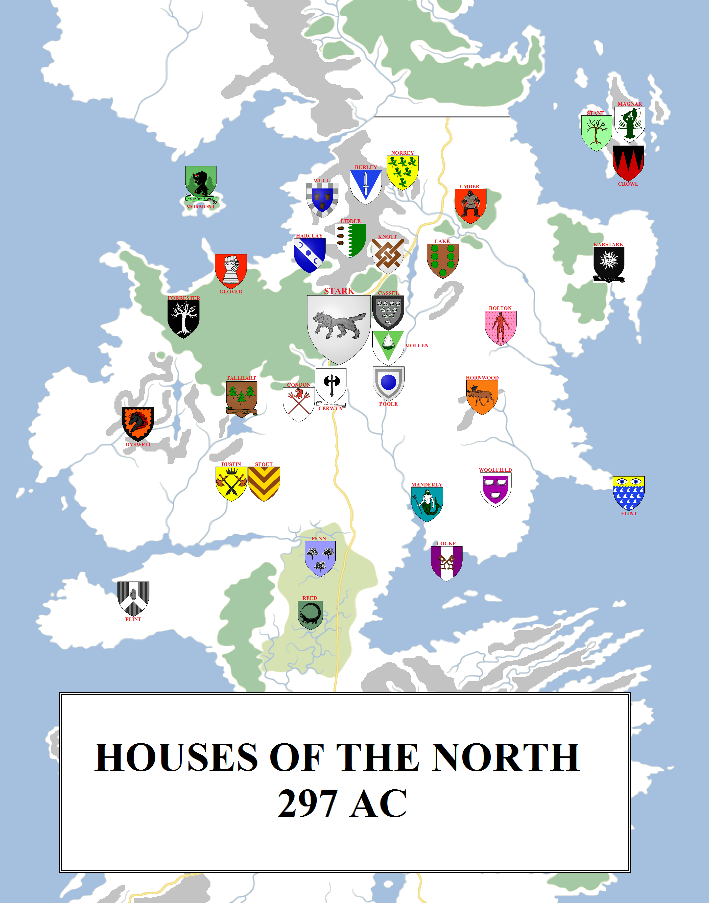

For those living in the south of Westeros, the North is regarded as a land apart: an endless wasteland of snow, cold, ice, rocks and dour people living at the miserable ends of the world. People who are brave and ferocious in battle, yes, but uncouth tree-worshipping heathens and not used to the nuances of civilised life, religion or politics.

The North in 297 AC. Some locations are speculative.

The North is indeed vast, making up over a third of the total size of the Seven Kingdoms, stretching for over a thousand miles from the Neck to the Wall and almost as far from coast to coast. It is also thinly populated. In the south there may be a few miles between towns and villages, but in the North there may be dozens of miles between points of habitation, and large stretches of forbidding, harsh countryside with no people at all. There are very few highways apart from the Kingsroad and a few other notable arteries linking major holdfasts, which slows travel to a crawl.

Some of the stories are exaggerated. The North is cooler than the rest of Westeros but it is certainly not covered in snow and ice year-around. During long summers, some of the North can be quite pleasant and there is widespread farming. But the North lives in the constant shadow and fear of winter. Food is stockpiled, salted, stored, even frozen where it is possible to do so. Some castles are built near or over hot springs or volcanic vents, employing greenhouses to grow food even in the heart of winter. If the ports stay ice-free and open, food supplies can be brought in from the south and from the Free Cities (for those merchantmen willing to brave the Narrow Sea in winter). But there are limits to all of this: during the coldest and longest winters, the North starves and people die.

**The Northern Mountains**

The north of the North is harsh and forbidding, stretching from the Wall – or more, accurately, the southern edge of the Gift, the lands granted for the sustenance of the Night’s Watch – to the vast and forbidding Wolfswood. This region is dominated in the west by the Northern Mountains, a tall region of craggy highlands and peaks linked to the Frostfangs to the north. These mountains, extending almost 400 miles from the Gorge to the forest, are the home to a number of mountain clans, hardy tribesfolk who at first glance may look similar to the wildlings or the clansmen of the Mountains of the Moon. However, they are counted as nobles of the North who hold fealty to Winterfell: the Wulls, Norreys, Burleys, Harclays, Liddles, Knotts and the First Flints. The Wulls are the largest and most powerful clan. These clan lands incorporate the mountains and the foothills west to the Bay of Ice and south into the Wolfswood.

**The Last River**

The Northern Mountains are the sources of two of the North’s largest rivers, the White Knife and the Last River. The Last River rises from several sources in the mountains before winding south and east through the foothills and out onto open fields and plains, with some woodlands on the north bank of the river. This territory, on both sides of the river, is held by the Umbers of the Last Hearth. The Last River winds its way for almost 500 miles from the mountains to the Shivering Sea. Some maps show the lower stretch of the river serving as the border between House Bolton of the Dreadfort and House Karstark of Karhold, although this tends to change depending on the age of the map and the power of each noble house at the time. The river serving as a border has prevented any major port or town building up near the river mouth.

East of the Last River lies a large peninsula, about 230 miles wide from west to east and some 250 miles from north to south. Most of this peninsula is controlled by the Karstarks, whose fortress of Karhold sits in a sheltered bay near the mouth of a short river. This area is heavily forested, but the coast is rocky and less hospitable, plunging down into the sea through the rugged landscape known as the Grey Cliffs.

**The East Coast**

South of the Last River the landscape becomes less mountainous and flatter, with a greater mixture of rivers, fields and low-lying hills. The eastern part of this region is held by the Boltons of the Dreadfort, arguably the most powerful family of the North except only for the Starks themselves. The Dreadfort itself, looming above the Weeping Water, is of volcanic origin, with vents under the castle helping warm it during the winter. The Weeping Water is a short river, extending for less than 200 miles from its source in the Lonely Hills to the Shivering Sea.

South of the Bolton lands lies the territory held by House Hornwood of Hornwood. The Hornwood lands start in the Sheepshead Hills and extend south for more than 150 miles along the Broken Branch to the Shivering Sea. The Boltons have long coveted the rich Hornwood lands and forests, and with the Dreadfort less than 200 miles from Hornwood the threat of military confrontation has raised its head several times, only to be put down by the Starks.

At the mouth of the Broken Branch the North becomes a bit more crowded, as the warmer climes make farming and survival easier. Just south of the river mouth lies Ramsgate, whilst to the east a peninsula extends for over 200 miles into the Shivering Sea. At the very tip of this peninsula sits Widow’s Watch, one of the seats of House Flint, a great fortress and watchtower.

West of the Broken Branch lies open countryside, consisting of plains, moors and fields, extending for almost a hundred leagues to the mouth of the White Knife. These lands hold fealty to House Manderly of White Harbor and help provide that city with its food and wealth.

**The White Knife and White Harbor**

The White Knife is the greatest river of the North. Its source is in the Northern Mountains just fifty miles south of the Last River. It flows out of the mountains and quickly turns south, where it wides into the Long Lake. At about 130 miles long from north to south, the Long Lake is one of the largest bodies of water in the North. During the worst winters, when the lake freezes over, ice-fishing becomes an essential source of food for those who live close to its shores.

The White Knife resumes south of the lake, strengthened by a tributary which comes in from the Lonely Hills. The river now flows south and slightly west for over 270 miles before it is joined by another tributary, this one sweeping in from the Wolfswood in the west. The combined river now has another 200 miles to flow before it finally meets the Bite. By the time the White Knife reaches the sea it has become a fast-flowing, wide river. Rapids are located at several points along the river, resulting in the white water the river is known and named for.

The White Knife presents a useful route for fast travel from deep in the heart of the North out to the Bite and the sea, but those several areas of rapids complicate the route. The northmen have devised a solution in the form of “river runners”, lean and shallow-draft longboats which can ride the rapids where larger cargo ships cannot travel. Although these small vessels cannot individually carry large amounts of cargo, several ships in tandem can transport a reasonable amount of goods and passengers up and down the White Knife in good – if somewhat bumpy – time. Hides and timber are particularly popular for this method of transit.

Sitting just above the mouth of the White Knife lies the North’s largest port and city. For over a thousand years, White Harbor has acted as the gateway for the North. Ships call here from the Vale, King’s Landing, Lorath and Braavos, even far-off Ib. Goods are unloaded and transferred to river runners for dispersal on the White Knife, or to be carried on road to the other great strongholds and smaller towns. House Manderly has ruled the town for a millennia, having been forced to flee the Reach and their ancestral castle of Dunstonbury following a long and bitter feud with House Peake. The Starks gave them succour, in return for the Manderlys taking the ancient and derelict castle known as the Wolf Den and building a new fortification around it to secure the White Knife.

The Wolf Den was too old and ruined to continue serving as a fortress, so the Manderlys instead erected the prosaically-named New Castle nearby. The Wolf Den became a prison instead. White Harbor spread out from the New Castle, with a mint, inns, merchants and townhouses being erected. Today several tens of thousands of people live in and around White Harbor.

Almost 200 miles south-east of White Harbor sits Oldcastle, the seat of House Locke overlooking the Bite proper and southwards towards the islands known as the Sisters.

**The Barrowlands and the Rills**

West of White Harbor and the White Knife, the land opens up in an immense landscape of flat countryside, fields and plains, extending for almost 400 miles to the rivers and hills of the Rills. The Kingsroad passes through the eastern part of this area. The countryside in between is dotted with occasional burial grounds and hills which may be the remnants of mass burial chambers from the age of the First Men. For this reason the region is known as the Barrowlands, and for all its relative fertility is only lightly settled. The vastness of the landscape and the lack of people is striking for visitors to the North not used to the wilderness.

At the far western end of the Barrowlands lies Barrowton. The second-largest town of the North, home to several thousand people, Barrowton is walled and commands the surrounding countryside from the Great Barrow, a large hill in the town said to be the tomb of the First King of the First Men, possibly a giant. Barrow Hall, the seat of House Dustin, sits atop the Great Barrow. Goldgrass, the seat of House Stout, sits just outside Barrowton near the eastern gate.

Not far to the west of Barrowton the area known as the Rills begins. This is a large area consisting of many rivers, streams and ponds, extending for around 200 miles to the north-west (between two large rivers) and for between 200 and 300 miles north to the Wolfswood. The Rills are damp but fertile, ruled by House Ryswell. To the west the land abruptly gives way to stone hills and cliffs, a forbidding grey area of coastline known as the Stony Shore. The Stone Shore forms the west coast of the North for around 250 miles. In ancient times the ironborn raided the Stony Shore and the Rills, but there have been no such raids for several centuries.

North-east of the Rills, about 170 miles due north of Barrowton, lies Torrhen’s Square, the seat of House Tallhart. A formidable, stout keep sitting on the shore of a large lake, Torrhen’s Square commands the lands north into the Wolfswood.

**The Wolfswood and Bear Island**

The Wolfswood is the largest forest in the Seven Kingdoms, outstripped in size on the continent of Westeros only by the Haunted Forest beyond the Wall. The Wolfswood extends from its far south-eastern eaves to its north-western tip on Sea Dragon Point for about 550 miles. The forest is home to wild wolves, as the name implies, but crofters, hunters and woodsmen make their home there as well. Hills, dales, valleys, streams and small rivers snake through the woods, whilst a major tributary of the White Knife has its source in the deep forest.

Just beyond the northern Wolfswood lies Deepwood Motte, the seat of House Glover. Located fifteen miles from the sea – the immense tidal flats to the north make closer settlement impractical – Deepwood is a large motte-and-bailey castle. In ancient times it defended against ironborn raiders, but again there have been no such raiders for a long time. These days the Glovers mostly patrol the Wolfswood (aided by vassals such as the Forresters, Woods, Branches and Boles) and engage in trade with Bear Island to the north-west.

Bear Island sits in the middle of the Bay of Ice, between Sea Dragon Point and the Frozen Shore. It is a wild land of forests and bears, controlled by House Mormont, who are said to have received the island as a boon from the Starks who’d won it in a wrestling match from the ironborn. The island appears small on maps but is actually of respectable size: 100 miles from west to east and 50 miles from north to south, with a large, sheltered bay in the middle (presumably where the bulk of the settlements lie).

East of the Wolfswood, the Kingsroad draws near to both the woods and the large tributary of the White Knife. At this point can be found Castle Cerwyn, held by the family of the same name and loyal vassals, such as the Condons. The castle marks the beginning of the heartlands of the North. Fifty miles to the north, a fairweather day’s ride with strong and rested horses along the Kingsroad, lies Winterfell.

Winterfell, by [Scharborescus on DeviantArt](http://chrisarchy.deviantart.com/art/Winterfell-309510783).

**Winterfell**

Winterfell sprawls for acres across the hillscape. No attempt has been made to flatten the lands, so the castle grounds undulate like a snake. The outer walls are 80 feet high, the inner about 100 feet, with a wide moat between and thirty watch-towers guarding them. The walls are made of granite and, according to tradition, have never been breached. Also according to tradition, Winterfell was founded over eight thousand years ago after the Long Night and the War for the Dawn. Almost nothing of the original castle survives, with the structures visible today being much more recent (although still centuries to millennia old). Some parts of the castle have been abandoned due to the fear of collapse.

The Great Keep is the main castle complex, consisting of a large tower, the Great Hall, a covered bridge linking it to an armoury and a small sept. Other structures inside the castle include the long-abandoned First Keep (which, despite its name, does not predate the Andal invasion and is millennia younger than the castle itself), a broken tower destroyed by lightning, an ancient godswood, the glass gardens (greenhouses heated by natural springs, used to grow food), a bell tower, the maester’s turret, the library tower and the guard hall. There are extensive crypts located under the First Keep, where the dead of House Stark are buried.

Just outside the gates lies the winter town. During winter, the crofters, hunters and farmers of the Wolfswood and surrounding lands retreat into the winter town to try to outlast the snows. This swells the population of Winterfell temporarily by thousands of people.

**The Neck**

The region known as the Neck is still counted as part of the North, although it is separated from the rest of the North by significant geographic barriers. In the west Blazewater Bay divides the Rills from Cape Kraken, whilst in the east it is covered by a vast swampland which makes travel through the region almost impassable apart from along the raised causeway that carries the Kingsroad into the North.

Cape Kraken lies to the north of Ironman’s Bay and the Iron Islands, and was under the occupation of the ironborn for centuries before it was liberated by the northmen and given to the keeping of House Flint (another branch of the same family that holds Widow’s Watch). This was a serious blow for the ironborn, as Cape Kraken contains more land than all of the Iron Islands put together. The Flint Cliffs make attacking the peninsula from the south difficult and the castle of Flint’s Finger defends the best landing on the north coast. Further east the land gives way to deep forests. It is possible to thread through the forests along the coast and reach the far north-western Riverlands and the castle of Seagard (located a formidable 400 miles south-east of Flint’s Finger), but this is mostly desolate and uninhabited land.

The marshlands of the Neck proper are enormous. They stretch for 350 miles from north to south and extend from east to west for 200 miles. The marsh is fed by two rivers, the Fever River from the north and the Green Fork of the Trident from the south. The Neck consists mainly of marsh, swamp and drowned forests, with trees growing out of the water. Snakes and lizard-lions infest the waters, and pools of quicksand are commonplace. The Neck is seen as a deathtrap, completely impassable by those unfamiliar with the landscape.

The Neck is inhabited by a race of diminutive people called the crannogmen. They used to have their own ruler, the Marsh King, until he was defeated by Rickard Stark, the King in the North. Since that time the crannogmen have been ruled by House Reed of Greywater Watch and are among the fiercest allies and vassals of the Starks.

The crannogmen live on islands in the swamp, in houses and holdfasts that are said to move by means unknown. Greywater Watch itself is said to exist on one of these islands and move at random. Only the crannogmen know how to find it.

The only way through the Neck is the Kingsroad and that causeway, and this is protected by a formidable bottleneck. At the northern end of the Neck the causeway passes under the ruined towers of Moat Cailin, located close to the headwaters of the Fever River and the Saltspear. The only way north is to pass under the towers. This is fine in peacetime, but in times of war the towers can be garrisoned with a few hundred archers. These can pick off an army having to march in a very narrow file up the causeway. If an army tried to fan out, it would flounder into the swamp and disaster would result. The natural chokepoint has led to the fact that no army has ever taken Moat Cailin from the south, despite (according to tradition) armies trying for ten thousand years.

That, then, is the North. Utterly vast, lightly inhabited and ancient beyond reckoning.

The noble houses of the North (click for larger version).

**Houses of the North**

The North is not well-populated compared to the southron kingdoms, which means that the noble families control substantially larger amounts of land and territory than their southern kindred. However, this also means they have less people to populate and work these lands. The northern houses are spread thin.

**House Stark** rules from Winterfell as the Wardens of the North. The next tier of powerful houses consists of **House Bolton**, **House Manderly** (the richest house), **House Dustin**, **House Karstark**, **House Ryswell**, **House Umber**, **House Glover**, **House Mormont**, **House Reed**, **House Wull** and **House Magnar**, arguably in that order. Many of these houses have their own vassals as well. The Starks’ closest and most reliable allies are **House Cerwyn**, along with their own vassals, **House Condon**. The Starks also have close vassals living in Winterfell itself, such as **House Poole**, **House Cassel** and **House Mollen**.

The Manderly vassals include **House Locke** and **House Woolfield**, whilst **House Stout** holds fealty to the Dustins. House Glover commands the fealty to the Wolfswood families: **House Forrester**, **House Branch**, **House Wood** and **House Bole**. House Reed commands the houses of the Neck: **House Blackmyre**,  **House Boggs**, **House Cray**, **House Fenn**, **House Greengood**, **House Peat** and **House Quagg**. **House Marsh** may also be affiliated with the Neck. House Wull is the strongest and most powerful of the mountain clans, but it is not considered to be the overlord of the other clans, who instead act in concert. The other mountain clans consist of **House Burley**, **House Flint** (or the First Flints), **House Harclay**, **House Knott**, **House Liddle** and **House Norrey**. House Magnar may be the strongest or most formidable family or tribe on the island of Skagos, but this could be disputed by **House Crowl** and **House Stane**. Lack of contact with Skagos makes the internal politics of that island unknown to us.

Lesser houses and families of the North include **House Ashwood**, **House Holt**, **House Ironsmith**, **House Lake**, **House Lightfoot**, **House Long**, **House Moss**, **House Overton**, **House Slate** (of Blackpool), **House Waterman**, **House Whitehill** and **House Wells** (not believed to be related to the Dornish family of the same name).

**Credit**

The map above uses heraldry designs (under [Creative Commons](https://creativecommons.org/licenses/by-sa/3.0/)) from the excellent [Wiki of Ice and Fire](http://awoiaf.westeros.org/index.php/Main_Page) and [La Garde de Nuit](http://www.lagardedenuit.com/wiki/index.php?title=Accueil), the ultimate English and French-language guides to the **Song of Ice and Fire** novels.
