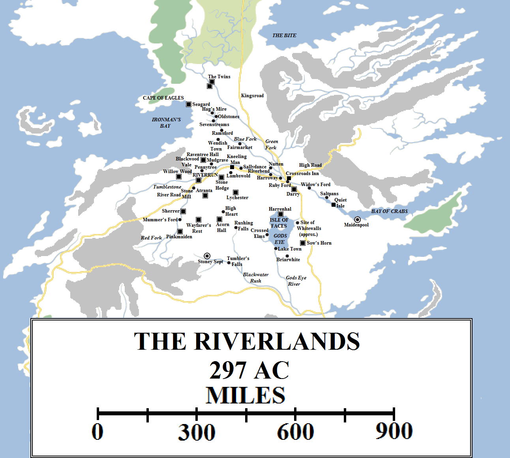
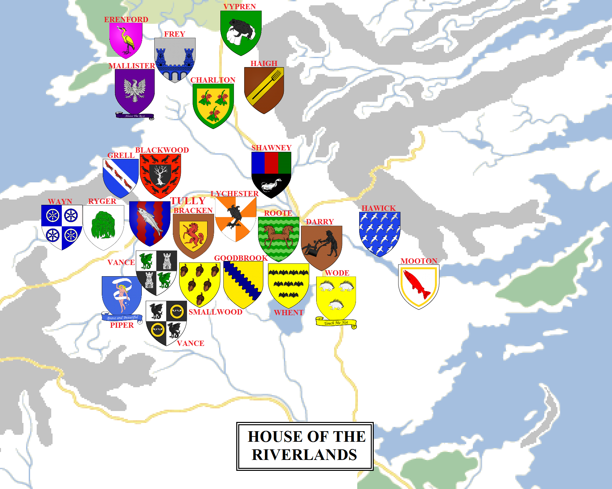

The Riverlands lie at the very heart of the Seven Kingdoms. They are sometimes said to be “halfway to anywhere” or “halfway to everywhere”. Travellers and merchants from one of the end of the kingdom pass through them to get to the other and they have been divided between other powers many times in their past. Many of the great wars of Westeros have been fought in the Riverlands, and their soil has been bloodied by many battles.

The Riverlands in 297 AC (click for a larger version). Some locations are speculative.

The Riverlands sprawl for over 600 miles from the lower end of the Neck to the shores of the Blackwater Rush, with a maximum east-west distance of just over 500 miles. Their borders have changed over the years, but today they are generally held as the Neck to the north, the Mountains of Moon and the Bay of Crabs to the east, the Blackwater Rush to the south and the western hills and mountains to the west. The Riverlands has borders with the North, the Vale of Arryn, the Crownlands, the Reach and the Westerlands, along with naval borders with the Iron Islands; counting the latter, it borders more other regions than any other part of the Seven Kingdoms. The border with the Westerlands is arguably the most porous, especially as the hills and mountains north of the Red Fork are also held by the Lannisters, forming a salient into Riverlands territory.

Apart from the North, the Riverlands is the only region of Westeros with territory on both the east and west coast of the continent (on Ironman’s Bay and the Bay of Crabs, and also a small stretch of the Bite in the far north-east), and the only one to have ports to take advantage of that.

As the name suggests, the Riverlands are dominated by lakes, rivers and streams. The most notable of these is the massive Trident and its three tributaries, the Red, Green and Blue Forks. Also notable are the Tumblestone and the headwaters of the Blackwater Rush. Most maps of the Riverlands show only these major waterways, but countless smaller streams criss-cross the region and more detailed and more local maps show a much more complex array of rivers, including the Big and Little Willow, the Maiden, the Greenapple and the Bitter River. The largest lake, by far, is Gods Eye, out of which more rivers and streams pour, including the Rippledown Rill and a very large river known simply as the Gods Eye River.

**The Northern Riverlands**

The northern Riverlands are less-densely populated than the southern. This region is bordered by the marshlands of the Neck to the north, the Mountains of the Moon to the east, Ironman’s Bay to the west and the Red Fork of the Trident to the south. This area is dominated by House Frey, which rules from the Twins, and House Mallister, which rules from Seagard. The area measures over 250 miles (maybe closer to 300 miles) from north to south and between 200 and 250 miles from north east to west.

This region is relatively lightly inhabited due to the clans of the foothills of the Mountains of the Moon in the east. Unable to enter the Vale of Arryn due to the fortified passes and the Bloody Gate, they instead frequently raid passing merchants and travellers. They have not been eliminated because they are more of a nuisance than a genuine long-term threat and spend more time fighting one another. The river lords also tend to regard them as a Vale problem and the Vale lords tend to regard them as a Riverlands problem.

West of the Trident there are more signs of habitation, such as the town of Fairmarket and a plethora of small villages such as Hag’s Mire. The west coast also tended to be less inhabited in ancient times due to the threat of ironborn raids.

The Blue and Green Forks of the Trident provide trade and transport to the region, leading to the immense wealth of House Frey. Six centuries ago they built a toll bridge and two castles on the Green Fork, putting a stranglehold on trade and travel from the Westerlands and the western Riverlands up to the North. The construction of the Kingsroad significantly to the east of the Twins negated this slightly, although the cost of going right round the Trident and avoiding the Twins is still greater than paying the toll.

**The Trident**

The River Trident may be one of the most famous rivers in Westeros, but the river itself is rather short: significantly less than 150 miles from its mouth to where the river breaks up into its three major tributaries. However, the term “Trident” not only applies to the river itself, but also all three of its tributaries and, indeed, the entire region.

The **Red Fork** rises in the western hills near Hornvale (in the Westerlands) and flows north and slightly east for roughly 250 miles until it meets the Tumblestone, which rises about the same distance to the west, near Ashemark. The two rivers meet at a junction just north of Stone Mill, located near a series of fords over the Red Fork.  Centuries ago, House Tully turned the junction of the two rivers into an effective island through the construction of an artificial channel and sluice gates. On that island they built the castle of Riverrun to dominate the surrounding lands. In times of war the gates can be opened and Riverrun turned into an island stronghold, very difficult to attack.

The Red Fork flows east through the heart of the Riverlands for about another 250 miles until it meets the other rivers and forms the Trident. The lands the Red Fork flows through are the most densely-populated part of the Riverlands with small fishing villages such as Riverbend dotting the banks. The Inn of the Kneeling Man, marking the spot where the last King in the North, Torrhen Stark, surrendered to Aegon the Conqueror, can be found on the south bank. The river also forms the sometimes-contentious boundary between the territories of House Bracken, located at Stone Hedge south of the river east of Riverrun, and House Blackwood, located north of the river and east of Riverrun at Raventree Hall. House Lychester also controls lands along the western Red Fork (presumably south of the river), near the village of Sallydance.

The **Blue Fork**, the shortest of the three rivers, rises just south and east of Seagard, in an area of fens and marshes. Hag’s Mire is one of several villages in this region, along with Sevenstreams, Ramsford and the larger settlement of Wendish Town. The ruins of Oldstones, the ancient seat of House Mudd, can also be found near the headwaters. The Blue Fork then flows south and east past Fairmarket before meeting the rest of the Trident some 300 miles upriver.

The **Green Fork** rises in the marshes of the Neck a good 200 miles north of the Twins. The upper river is technically within the boundaries of the North, with Greywater Watch located near the headwaters. The river flows south and east from the Twins for 300 miles before joining the rest of the river.

The largest town along the Trident proper is Lord Harroway’s Town, controlled by House Roote, which is located just upriver of the junction of the three rivers. A few miles downriver of Lord Harroway’s Town is the ruby ford. This is the only major crossing over the Trident south of the Twins and east of Riverrun. It was here that Prince Rhaegar Targaryen was slain during the Battle of the Trident during Robert’s Rebellion.

A few miles north of the ford is a great crossroads, where the Kingsroad crosses the old high road leading down from the Vale of Arryn into the northern Riverlands. The storied Inn at the Crossroads is located here, famed for its hospitality and for its location on the main highways leading to the North, the Vale, the Riverlands and the Crownlands. There has been an inn on this site for centuries, leading to the occasional name “The Old Inn”. It was formerly known as the Two Crowns, the Clanking Dragon and the Bellringer Inn. Several centuries ago the inn sat on the Trident itself and was called the River Inn, but the course of the river has shifted south since then.

80 to 90 miles south-east of the inn the Trident wides appreciably into a huge estuary, many miles wide. Where this estuary becomes the Bay of Crabs is hotly disputed between maesters (those who care about such things, anyway). The town and small port of Saltpans is located on the north side of the river mouth, whilst the larger port and town of Maidenpool is located roughly a hundred miles to the south-east, across the mouth. In between, on a nearly-inaccessible speck of land known as the Quiet Isle, is a septry, a religious retreat and place of quiet contemplation. The Quiet Isle can only be reached in certain tidal conditions via a causeway, rendering it almost impossible to attack.

East of Maidenpool the river mouth becomes the Bay of Crabs, dividing the south coast of the Vale of Arryn from the north coast of the Crownlands.

**Gods Eye and the Southern Riverlands**

The most striking feature of maps of the Riverlands is the immense lake lying near its south-eastern edge. Gods Eye is the largest lake on the continent of Westeros, (at least south of the Wall), over 100 miles across from north to south. Its width varies from about 50 miles at its narrowest point to over 80 miles at its largest.

The lakeshore is dotted with villages and fishing grounds. The southern shore is heavily forested, whilst the northern is more densely populated, especially close to Harrenhal.

The lake contains only one island, located in its northern half (giving the lake its eye-like appearance and thus its name). The island is several miles wide and, according to those who’ve sailed close enough, it is heavily forested. According to legend the forest is made up of weirwoods, every single one carved with a face in recognition of the Pact between the First Men and the Children of the Forest that was signed there almost twelve thousand years ago. The order of green men was established, men who studied the ways of the old gods of the forest under the tutelage of the children.

The Isle of Faces, as it is known, has a strange reputation. The island and its weirwoods survived the Long Night, the Andal invasion and millennia of religious strife and wars that have raged all around the lake – and occasionally above it, on the backs of dragons – but left the island at its heart completely untouched. Some men have taken counsel with the green men, as recently as the Year of False Spring, suggesting that their order remains intact and extant despite having no contact with the rest of the Seven Kingdoms at all.

North of the Isle of Faces, on the northern lakeshore, rises the five forbidding towers and titanic walls of the largest single castle in the known world. Harrenhal stretches for several miles along the lakeshore and more inland, consisting of five huge towers, the enormous walls and fortified gates, and huge stretches of open land between. Harrenhal, King Harren’s Folly, was built over decades by House Hoare when they ruled the Iron Islands and Riverlands both, and it proved utterly useless for it was completed on the very day Aegon the Conqueror stepped ashore with his dragons, who feared no walls.

Seven houses have held Harrenhal, each falling into despair, ruin and madness. House Whent inherited the castle over seventy years ago and has so far not suffered the same fate.

Harrenhal is significant not just for the sheer size of the castle but for the wide lands it commands, extending east to the border with the Crownlands (where vassals such as House Wode command lands) and north towards the Red Fork of the Trident.

West of Gods Eye lies a wide stretch of land, extending well over 200 miles to the upper stretch of the Red Fork and for 300 miles between the lower Red Fork and the Blackwater Rush. Houses Piper, Vance, Smallwood and many others command these lands, which are fertile and populous. The fortified town of Stony Sept lies at the southern extremity of this region, just across the Blackwater from the Reach, whilst castles such as Wayfarer’s Rest, Atranta, Pinkmaiden and Acorn Hall dot the landscape.

This then is the Riverlands: extensive and populous but fractious and divided, easily influenced by outsiders and often ravaged by war.

The noble houses of the Riverlands (click for a larger version). Some house locations are speculative.

**Houses of the Riverlands**

**House Tully** rules the Riverlands from the castle at Riverrun, as it has for three centuries. The Tullys are a relatively young house, former vassals of the Vances who became stronger and more powerful over time, mainly due to their near-impregnable stronghold. The Tullys command several vassal houses directly, possibly **House Grell**, **House Pemford**, **House Ryger** of Willow Wood and **House Wayn** (as members of these families are prominent in Riverrun’s offices, similar to the Mollens and Cassels of Winterfell).

Below the Tullys in power and strength is **House Frey**, which commands the upper stretches of the Green Fork from the Twins. Houses **Charlton**, **Erenford** and **Haigh** are all vassals of the Freys. **House Mallister** of Seagard, **House Blackwood** of Raventree Hall, **House Bracken** of Stone Hedge, **House Mooton** of Maidenpool, **House Piper** of Pinkmaiden, **House Roote** of Lord Harroway’s Town, **House Vance** of Wayfarer’s Rest and Atranta (and their vassal, **House Smallwood**) and **House Whent** of Harrenhal (along with their vassals, **House Wode**) are all notable and powerful houses.

Lesser houses of the Riverlands include **House Blanetree**, **House Cox** of Saltpans, **House Darry** of Darry, **House Deddings**, **House Goodbrook**, **House Hawick** of Saltpans, **House Keath**, **House Lolliston**, **House Lychester** of Lychester, **House Nayland** of Hag’s Mire, **House Shawney** (probably located at the junction of the three forks, due to their arms), **House Terrick** and **House Vypren** (possibly sworn to House Frey, as their frog banner may indicate a location near the Twins in the southern Neck).

**Notes**

The location of Wendish Town appears anomalous, far from Sherrer and the Mummer’s Ford. However, the location of the town is derived from the HBO **Game of Thrones** map, which in turn was based directly on George R.R. Martin’s map. In addition, Green Ronin RPG places the town further east on the Green Fork and _A Game of Thrones_ itself suggests that it may be close to Darry territory, making it implausible that the Lannisters were able to attack it without being detected as they travelled through hundreds of miles of Riverlands territory. However, this may be explained by the new “salient” of the Westerlands along the south coast of Ironman’s Bay, which was revealed in _The World of Ice and Fire_. It appears to exist so the Lannisters would control all the hills and mines in the region and not allow the Riverlands to gain any mines for itself. It also provides an explanation for how Gregor Clegane’s outriders were able to attack Wendish Town, as the end of the salient is quite close to Wendish Town.

The location of Whitewalls is open to question: it is closer to Maidenpool then King’s Landing, was located close to a large lake (probably Gods Eye, but curiously not named as such) and Dunk and Egg could travel there within a few days of Stoney Sept. However, these directions are contradictory. In addition, there is a road leading from the ruby ford to Harroway and then Whitewalls, which suggests putting it considerably to the north of Harrenhal, which seems even more incompatible with the distances given.

**Credit**

The map above uses heraldry designs (under [Creative Commons](https://creativecommons.org/licenses/by-sa/3.0/)) from the excellent [Wiki of Ice and Fire](http://awoiaf.westeros.org/index.php/Main_Page) and [La Garde de Nuit](http://www.lagardedenuit.com/wiki/index.php?title=Accueil), the ultimate English and French-language guides to the **Song of Ice and Fire** novels.
