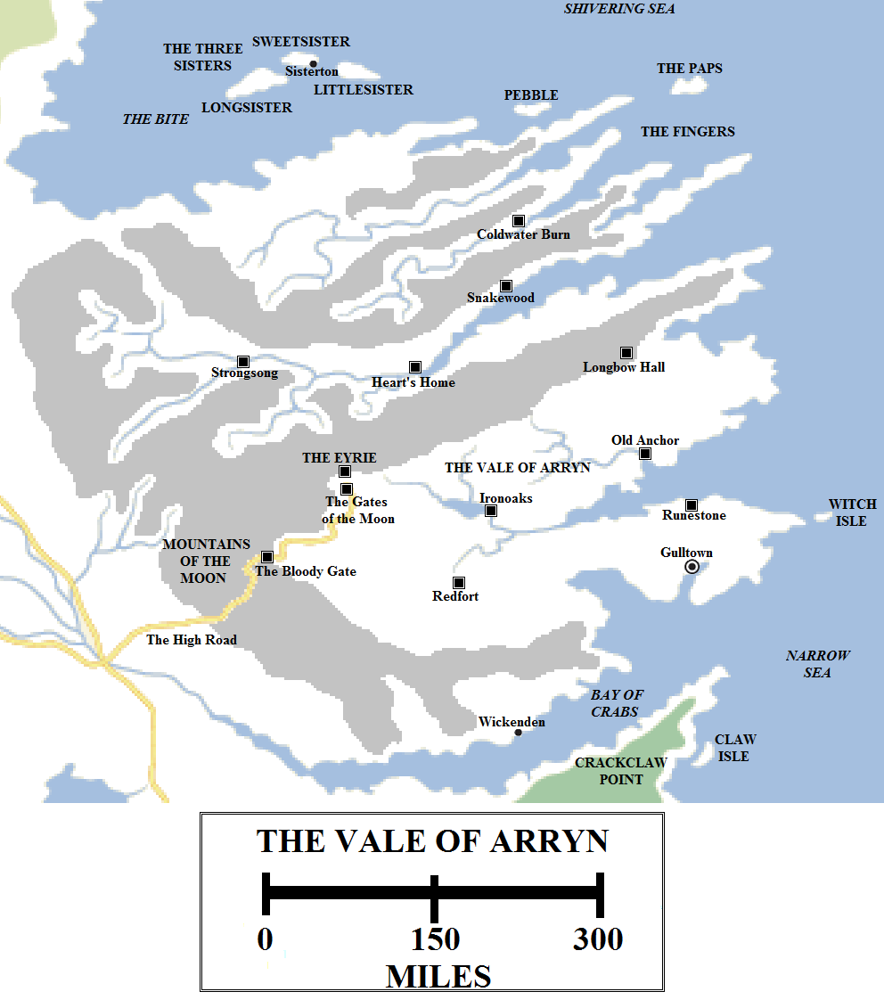
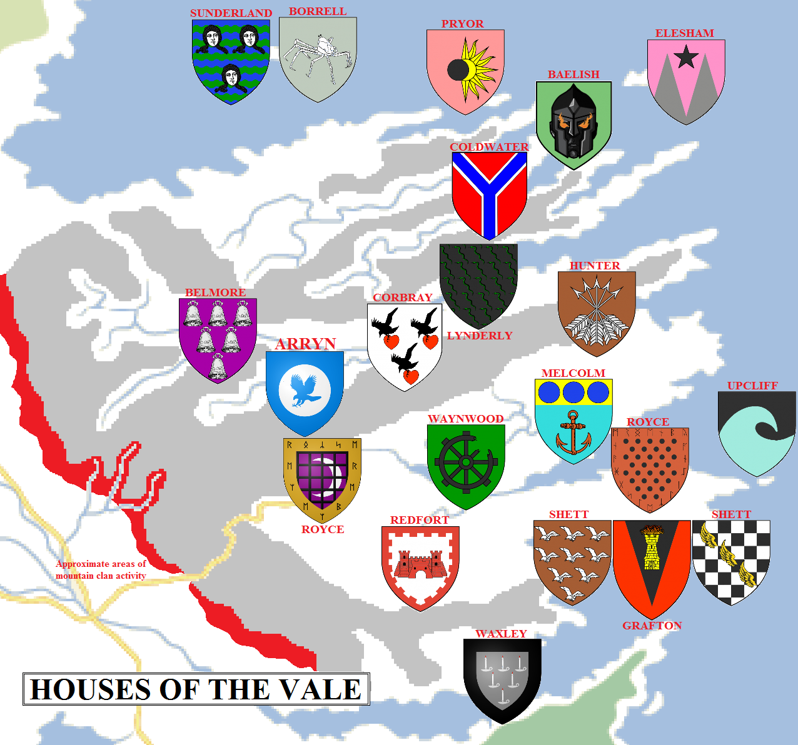

Located along the eastern coast of Westeros is a land of towering mountains, fertile valleys, rocky coastlines and rugged hillscapes. Squeezed between the mountains and the sea, the people of this region are hardy, brave and honourable. It was in this land that the Andals first landed in the Sunset Lands and brought the concept of chivalry and the worship of the Seven with them.

The Vale of Arryn in 297 AC (click for a larger version).

The Vale of Arryn is the name of both a specific location and also the entire region. The region extends for roughly 500 miles from the Bite in the north to the Bay of Crabs in the south, and for roughly 550 miles from the Mountains of the Moon in the west to the Narrow Sea in the east. However, the east coast is heavily indented, with numerous bays and rivers cutting into the coast. The actual inhabitable land area of the Vale is significantly less than the Riverlands. This gives the Vale lords a greater sense of unity and identity compared to their fractious western neighbours.

That said, the Vale is fertile and populous, rivalling the Riverlands or the North in total population. Winding tracks link villages perched on hillsides to castles located on mountain peaks to coastal towns. Unlike the North, which is ravaged by harsh winters every decade or so, or the Riverlands, which has been ravaged by numerous wars due to its position in the very heart of the Seven Kingdoms, the Vale has largely steered clear of major conflict for thousands of years. The Mountains of the Moon act as a shield, defending the Vale from outside invasion or attack. Indeed, no invading army has made it through the mountains for many centuries and even the Targaryens were only able to secure the Vale by flying over them on their dragons.

**The Mountains of the Moon**

The Mountains of the Moon form one large, unbroken chain starting just south of the Bite and extending south and east for well over 500 miles until they meet Narrow Sea at the mouth of the Bay of Crabs. The mountains are tall, towering over the surrounding landscape, and their foothills are thick and difficult to traverse for those not familiar with the region. The mountains have many splinter ranges, breaking off and running in parallel chains down to the sea.

The western foothills are home to numerous valleys and dales. These are home to a warrior culture which refuses to swear fealty to the Iron Throne. These clansmen are considered more of a nuisance then a genuine threat, as they lack the numbers to truly challenge the Iron Throne. Every few generations they grow large and bold enough to endanger travel in and out of the Vale and then the Lord of the Eyrie will ride out to put them back in their place. But wiping them out in such challenging terrain would be difficult.

The known mountain clans include the **Black Ears**, **Burned Men**, **Howlers**, **Milk Snakes**, **Moon Brothers**, **Painted Dogs**, **Redsmiths**, **Sons of the Mist**, **Sons of the Tree** and **Stone Crows**.

There is only one major stronghold of the Vale located outside of the Mountains of the Moon: Wickenden. This castle and small town sits on the northern shore of the Bay of Crabs, 130 miles or so north-east of Maidenpool on the opposite shore.

The High Road connects the Riverlands to the Vale. It traverses the Mountains of the Moon through a wide pass. This pass has been massively fortified over the millennia, with the road passing through a stronghold known as the Bloody Gate, where small groups of defenders can hold the road against much larger formations of attackers. Armies have dashed themselves senseless against the Bloody Gate for centuries to no avail.

Beyond the Bloody Gate lies the Vale of Arryn itself.

**The Vale**        

The entire region is known as the Vale of Arryn, but there is also a very specific valley of the same name. The Vale proper starts at the Bloody Gate and extends east to the sea, over 350 miles away, whilst extending for roughly 100 miles in width. This is the most fertile part of the Vale, not to mention its largest open area, and is dotted with holdfasts, villages and towns.

The northern edge of the Vale is made up of a splinter range of the Mountains of the Moon. Near where the two mountain ranges meet sits the Giant’s Lance, possibly the tallest mountain on the continent of Westeros (certainly the tallest south of the Wall). The Lance is massive, towering three and a half miles (just shy of 18,500 feet, or twenty-six times the height of the Wall) into the sky. Over one shoulder of the mountain pours the waterfall known as Alyssa’s Tears, often frozen in winter. On another shoulder, far below the peak but still towering above the valley floor, sit the seven towers of the Eyrie.

The Eyrie is the ancestral summer castle of House Arryn. Given its remoteness, its construction is a feat of staggering engineering by itself. Every block of stone had to be carried up a hazardous switchback road leading up the mountainside and constructed with great care. The result is the smallest of the major castles of Westeros, but the most impregnable. Attacking the Eyrie would be impossible: the switchback ascent is guarded by three way-castles (Stone, Snow and Sky), each difficult to capture. Most of the ascent is also open to missile fire and rocks or burning oil dropped down from the Eyrie above. The Eyrie is small but its storage cellars, built into the mountain, are huge, allowing the castle to withstand siege for a long time.

The Eyrie’s formidable location is also a weakness. Even during the summer it can be a chilly castle given its altitude, and during autumn and the onset of winter it starts to become uninhabitable. A lack of firewood would make it very difficult to keep the castle habitable across a years-long winter. As the season turns, the household have to leave the castle and retreat to the Gates of the Moon, a much larger and more hospitable castle located at the foot of the Giant’s Lance.

Other major strongholds dot the Vale itself. Ironoaks lies a hundred miles or so to the south-east, on the shores of a large lake. Eighty miles or so south-west of Ironoaks lies Redfort. East of Ironoaks, about 120 miles away, is Old Anchor, which sits on the Narrow Sea itself. And about eighty miles north of Old Anchor sits Longbow Hall, which is located at the far eastern end of the mountainous spur forming the northern edge of the Vale itself.

**Gulltown**                            

East of Redfort lies a peninsula extending into the Narrow Sea. This spit of land is quite large: almost 200 miles long and around 50 miles wide, and unlike the Fingers to the north is not mountainous. This peninsula offers some of the best anchorages on the coast and is the site of the Vale’s only true city.

Gulltown is home to around 40,000 souls (maybe one-tenth the population of King’s Landing), but its true population is hard to discern because so much of its population is transient. Gulltown is a brisk and breezy port, large but not squalid, bustling but not tawdry. The city’s rulers, House Grafton, two branches of House Shett and a cadet branch of the Arryns, keep the city orderly and the trade flowing. Gulltown is the nearest Westerosi port to the Free City of Braavos, just 450 miles to the north-east, and takes advantage of that proximity to re-provision passing ships and grow rich on trade.

Just north of Gulltown sits Runestone, the seat of House Royce, the most powerful house in the Vale after only the Arryns. The Gulltown peninsula is one of the longest-settled parts of the Vale, early Andal invaders finding it easier to swarm ashore here than elsewhere. They were met with blood and fire from the Royces and their First Men ancestors, with runes scrabbled into the rocks attesting to the ancient history of this land.

Just off the eastern tip of the Gulltown Peninsula lies Witch Isle, a remote and forbidding rock ruled by the fiercely independent Upcliffs who finally only deigned to join the Vale when King Alester II Arryn offered Lady Arwen his hand in marriage.

**The Northern Vale**

North of the Eyrie and the Giant’s Lance, other, lesser mountain ranges split off from the Mountains of the Moon and flow into the sea. Many smaller valleys and dales can be found in this region, dominated by strong castles such as Strongsong and Heart’s Home. This region extends to the Bite, where tiny fishing villages cling to the rocky coast.

**The Fingers**

North of Longbow Hall, the far north-eastern coast of the Vale tumbles into the sea in a series of long peninsulas, deep bays and river mouths. There are five major peninsulas, so they have been dubbed “The Fingers”.

The Fingers are remote, harsh and wild. They lack trees, are bracketed by harsh winds blowing off the Narrow Sea and are sparsely populated.

The most notable feature of the area is the Snakewood, a forested area extending inland from the southern-most of the Fingers. This area is ruled from a castle also called Snakewood. To the north lies Coldwater Burn. On the smallest of the Fingers lies the towerhouse held by House Baelish, on a particularly bleak and featureless stretch of coast, aside from a few ancient stones chiselled with runes from the days of the Andal Invasion.

Two islands lie off the coast of the Fingers: Pebble (held by House Pryor) and the Paps (held by House Elesham), located where the Narrow Sea meets the Shivering Sea. These islands are small, remote and windswept, but occasionally service passing ships.

**The Sisters**

The most northerly-held of the Vale’s territories are the Sisters, or the Three Sisters. These are three large islands located approximately sixty miles off the northern coast of the Vale (and about seventy miles south of Oldcastle and the south coast of the North). Longsister is the western island, Sweetsister is the central one and Littlesister lies furthest to the west. All three islands are inhabited, with the largest port located at Sisterton. Sisterton has grown large as it services ships passing from White Harbour to Gulltown and Braavos, or for parts further north.

The islands, famously, were disputed between the Kingdom of the North and the Kingdom of Mountain and Vale for a thousand years in the War Across the Water until the Vale finally secured them permanently. However, the Arryns rule the islands with a light touch, allowing them a measure of autonomy for their remoteness. The Sisters are held to be a den of avarice and piracy by some, with their ports having a low reputation.

The three islands are jointly ruled by House Sunderland of Sisterton. Its three primary vassals are House Longthorpe of Longsister, House Borrell of Sweetsister and House Torrent of Littlesister.

The noble houses of the Vale of Arryn (click for a larger version).

**Houses of the Vale**

**House Arryn** rules the Vale from the Eyrie (during the summer) and the Gates of the Moon (during the winter). The Arryns are the oldest family of Andal nobility, claiming six thousand years of descent from the earliest days of the Andal Invasion. Almost as storied are **House Royce** of Runestone, who are descended from the First Men the Andals displaced. The Bronze Kings of Runestone were defeated by the Arryns and forced to swear fealty. Since then, the Royces have been mostly stalwart and loyal to the Kings of Mountain and Vale. An offshoot of House Royce also holds the Gates of the Moon as stewards of House Arryn.

Houses **Coldwater** of Coldwater Burn, **Shett** of Gull Tower and **Tollett** of Grey Glen are all vassals of House Royce.

**House Grafton** is also a powerful and rich house of the Vale, as it holds and apparently rules Gulltown, the greatest city of the Vale. **House Shett** of Gulltown (a related but distinct knightly house from House Shett of Gull Tower) and **House Arryn** of Gulltown (a distant cadet branch of House Arryn of the Eyrie) may owe their allegiance to the Graftons, but the relationship is unclear.

**House Sunderland** rules over the Three Sisters from the town of Sisterton on Sweetsister. Their sworn vassals are **House Borrell** of Sweetsister, **House Longthorpe** of Longsister and **House Torrent** of Littlesister. The Sunderlands appear to have a degree of autonomy from the Vale given their distance and main concern with naval matters.

The other primary powers of the Vale are **House Belmore** of Strongsong, **Corbray** of Heart’s Home, **Elesham** of the Paps, **Grafton** of Gulltown, **Hunter** of Longbow Hall, **Lynderly** of Snakewood, **Melcolm** of Old Anchor, **Pryor** of the Pebble, **Redfort** of Redfort, **Templeton** of Ninestars, **Upcliff** of Witch Isle and **Waynwood** of Ironoaks (along with their vassals, **House Hardyng**).

Lesser houses of the Vale include **House Baelish** of the Fingers, **House Donniger**, **House Egen**, **House Hersy** of Newkeep, **House Moore**, **House Ruthermont**, **House Wydman** and **House Waxley** of Wickenden.

**Notes**

The Vale of Arryn is the most consciously unoriginal part of Westeros in actual layout. The Vale is, in fact, the island of Ireland turned upside down and bolted onto the side of Westeros. The Fingers, for example, are the south-western flukes of Ireland (Mizen Head, the Beara Peninsula and the Iveragh Peninsula), with the Dingle Peninsula as the Gulltown Peninsula (and King’s Landing as Galway).

The Eyrie is also very closely based on Neuschwanstein Castle in Bavaria, Germany.

The location of Witch Isle is speculative, but _Lands of Ice and Fire_ (2012) added an island off the tip of the Gulltown Peninsula. There really isn’t any other candidate for the island, so it has been added as such on the maps above.

A long-running error was when the mapmakers for _A Storm of Swords_ misread “Snakewood” as “Sunkenwood” and added it as such to the maps. This was corrected in later editions of the book.

It was previously assumed that Littlefinger’s house originated on the northern-most of the Fingers. However, _Lands of Ice and Fire_ identifies the smallest of the central Fingers as his home instead. This may suggest that the northern-most of the Fingers is not actually counted as part of the region.

**Credit**

The map above uses heraldry designs (under [Creative Commons](https://creativecommons.org/licenses/by-sa/3.0/)) from the excellent [Wiki of Ice and Fire](http://awoiaf.westeros.org/index.php/Main_Page) and [La Garde de Nuit](http://www.lagardedenuit.com/wiki/index.php?title=Accueil), the ultimate English and French-language guides to the **Song of Ice and Fire** novels.
