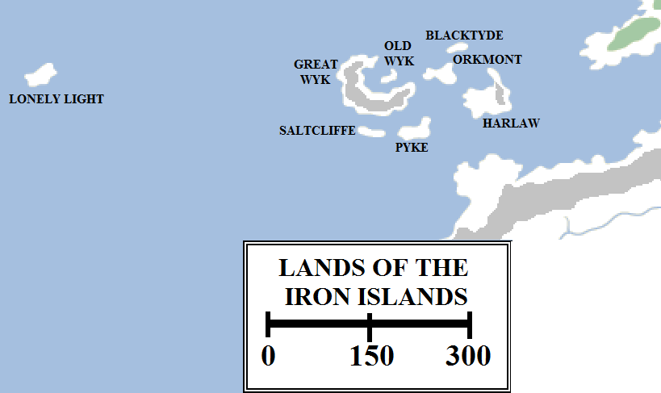
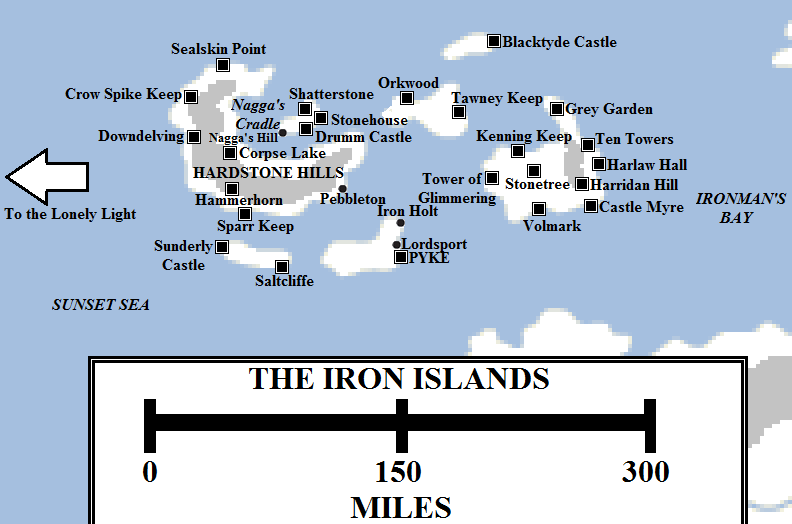
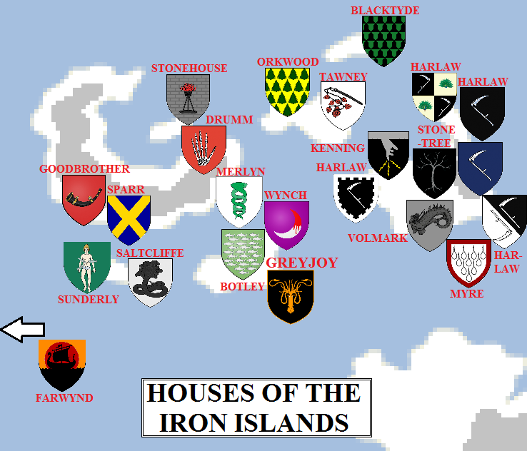

The most fiercely independent people of the Seven Kingdoms are the ironborn. Worshipping the savage Drowned God and preferring to raid and pillage from the decks of their longships, the ironborn have caused the Iron Throne more rebellions and more strife than almost any other part of the realm.

A map showing both clusters of the Iron Islands, with the Lonely Light located far to the west of the main archipelago.

The smallest and least-populous of the Seven Kingdoms, the Iron Islands span forty-four small islands located in two distinct archipelagos in the Sunset Sea to the west of Westeros. Most of these islands are too small to appear on maps, but eight are large enough to hold reasonable populations.

The larger archipelago consists of thirty-one islands, seven of them large and well-known: Pyke, Harlaw, Great Wyk, Old Wyk, Saltcliffe, Orkmont and Blacktyde. This archipelago is located about 130 miles west of the Cape of Eagles (in the Riverlands), 90 miles north-west of Banefort (in the Westerlands) and 200 miles south of the Flint Cliffs (in the North). This larger island grouping spans approximately 275 miles from west to east and over 150 miles from north to south.

The smaller archipelago consists of thirteen islands, but only one large enough to be named: the Lonely Light. The Lonely Light lies approximately 450 miles due west of Great Wyk.

The Iron Islands in 297 AC (click for larger version). Some locations are speculative.

**Pyke**

Pyke is the seat of House Greyjoy, the rulers of the Iron Islands, and is also the closest island to the mainland, with the Westerlands lying less than a hundred miles to the south and east. The island lies at the mouth of Ironman’s Bay, where it meets the Sunset Sea. Roughly fifty miles wide from west to east and thirty from north to south, the island is not as large, populous or fertile as Great Wyk or Harlaw, but it is more difficult to attack, with rocky shores and, in Pyke Castle sitting atop its seastacks and linked by rope bridges, a formidable stronghold. Nevertheless, the island was conquered by King Robert Baratheon’s armies during the Greyjoy Rebellion of 289 AC.

There are two ports of note on Pyke: Lordsport, located close to Pyke, acts as the port for the main castle. Further along the coast lies Iron Holt, which competes with Lordsport for trade and commerce.

**Saltcliffe**

Located to the west of Pyke, Saltcliffe is one of the smaller islands. It is approximately forty-five miles long from east to west whilst only being about a dozen miles wide from north to south.

The island is dominated by two castles, the strongholds of Houses Saltcliffe and Sunderly.

**Orkmont**

Located north of Pyke and west of Harlaw, Orkmont is the most central of the Iron Islands. Although comparable in size to Pyke, it is much more fertile and more populous. In the past it produced two houses who went on to rule the entire Iron Islands before being wiped out: Greyiron and Hoare.

There are mountains and mines on Orkmont, producing metals for use in trade and for the making of ships and weapons. There also used to be extensive woodlands, but these were cut down for shipbuilding.

There are three major strongholds on the island, belonging to Houses Orkwood, Tawney and a cadet branch of the Goodbrothers.

**Blacktyde**

Blacktyde is the northern-most of the Iron Islands, located north of Orkwood and Harlaw. It is also one of the smallest, extending for roughly thirty-five miles from west to east and less than a dozen miles from north to south. It is dominated by the house and castle of the same name.

**Great Wyk**

Great Wyk is the largest island controlled by the ironborn. It extends for 125 miles from west to east and for almost 100 miles from north to south. It is very hilly and mountainous, the interior dominated by the towering Hardstone Hills, so it is not as populous as Harlaw.

The hills form a chain curving around the length of the island, which is roughly crescent-shaped. The northern and eastern coasts of the island form the shores of a large bay known as Nagga’s Cradle, with the island of Old Wyk located in the middle of the bay.

Great Wyk is dominated by the Goodbrothers, who hold castles at Hammerhorn, Crow Spike Keep, Downdelving and Corpse Lake. Another notable family are the Farwynds, who hold Sealskin Point as well as the Lonely Light far to the west. The largest port on the island is Pebbleton, located on the east coast near the very centre of the Iron Islands, which is ruled by House Merlyn.

**Old Wyk**

Old Wyk is the smallest of the Iron Islands, only a bit more than twenty miles from one end to the other and barely ten miles wide. Despite its small size, it is well-populated with three castles located on its shores: Shatterstone, Stonehouse and Drumm Castle.

At the south-western tip of the island, overlooking Nagga’s Cradle, is Nagga’s Hill. The hill is dominated by the Grey King’s Hall, formed out of the ribs of an immense sea dragon named Nagga, killed many thousands of years ago. In ancient times the ironborn gathered here to select their next king in the Kingsmoot, an archaic practice that has not been undertaken for many centuries. Old Wyk is counted as the holiest of the Iron Islands and an important centre in the religion of the Drowned God.

**Harlaw**

Harlaw is the second-largest and easternmost island in the grouping. It is almost eighty miles across from west to east and fifty from north to south, with a peninsula at the north-eastern corner of the island extending a further twenty-five miles to the north. Aside from some tall hills in the east, it is flatter and more fertile than the other islands and is the most heavily-populated island in the archipelago.

The island is ruled by the numerous House Harlaw, who control no less than five castles (Grey Garden, Harlaw Hall, Harridan Hill, the Tower of Glimmering and their chief stronghold, Ten Towers). Other important castles include those belonging to the houses Stonetree, Volmark, Kenning and Myre.

**The Lonely Light**

The Lonely Light is located some 450 miles to the west of Great Wyk. Less than forty miles across, the island is the western-most location in the entire Known World. Beyond the Lonely Light lies the imposing vastness of the Sunset Sea. The ironborn of the Lonely Light, led by a lesser branch of House Farwynd, tend to be quieter and more contemplative than their eastern kin, most interested in exploring the deep ocean than in raiding and bloodletting.

Occasionally, rumours spread that the Farwynds have found more land far out to sea, either more islands or even other continents, but so far these rumours have never been substantiated.

The noble houses of the Iron Islands in 297 AC (click for a larger version). Some house locations are speculative.

**Houses of the Iron Islands**

**House Greyjoy** rules the Iron Islands from the castle at Pyke. They also rule the island of Pyke as well. Their immediate vassals are **House Botley** of Lordsport and **House Wynch** of Iron Holt.

**House Saltcliffe** rules the island of the same name. It is presumed that **House Sunderly**, who also hold lands on the island, are their vassals.

**House Orkwood** appear to be the strongest house on Orkmont, capable of fielding a fleet of twenty longships. **House Tawney** of Orkmont are also listed as one of the most powerful ironborn houses, so it is unclear if one house has dominance over the other or if they both rule the island together. A cadet branch of **House Goodbrother** of Great Wyk also resides on Orkwood.

**House Blacktyde** rules the island of the same name. Lord Baelor Blacktyde is a follower of the Faith of the Seven, a rarity in the islands, and septons are welcome on this island.

**House Goodbrother** rules Great Wyk from Hammerhorn. The family is numerous, so has several cadet branches ruling from Crow Spike Keep, Downdelving and Corpse Lake. They also have brances on Orkmont and Old Wyk. **House Farwynd** is also a very powerful house, ruling both Sealskin Point on Great Wyk and also, via a cadet branch, the Lonely Light far to the west. **House Sparr** and **House Merlyn** are also strong houses on the island, the latter ruling the port and town of Pebbleton (pop. 7,000).

**House Drumm** and **House Stonehouse** dominate the island of Old Wyk, along with the Goodbrothers of Shatterstone.

**House Harlaw** of Ten Towers rules the island of Harlaw. There are cadet branches of the Harlaws located at the Tower of Glimmering, Grey Garden, Harlaw Hall and Harridan Hill. Other powerful houses on the island include **Kenning**, **Volmark** and **Myre**.

Minor houses of the Iron Islands include **Codd**, **Humble**, **Ironmaker**, **Netley**, **Sharp**, **Shepherd** and **Weaver**.

**Notes**

In _A Feast for Crows_ Prince Doran Martell says that Dorne is the most lightly-populated of the Seven Kingdoms. However, it seems unfeasible that the very large Dorne, no matter how arid, can be less populous than the tiny Iron Islands. Elsewhere in **A Song of Ice and Fire** we see that the ironborn are often forgotten about or left out of counts (such as being left off the chalice Prince Joffrey receives as a wedding gift), and are especially disregarded by those they cannot threaten. With its rocky and sparsely-populated coastlines, the Dornish do not appear to have ever been particularly troubled by the ironborn. It is therefore much more likely that Doran was referring to the mainland Seven Kingdoms and, in particular, their traditional enemies in the Reach.

The impression given in _A Feast for Crows_ is that the Lonely Light is quite small. However, it would be difficult for a very small island to sustain itself eight days from the rest of the archipelago, not to mention that if the island is tiny there’s not much point to holding it. _Lands of Ice and Fire_ suggests that the island is quite big, comparable to the bigger islands in size.

**Credit**

The map above uses heraldry designs (under [Creative Commons](https://creativecommons.org/licenses/by-sa/3.0/)) from the excellent [Wiki of Ice and Fire](http://awoiaf.westeros.org/index.php/Main_Page) and [La Garde de Nuit](http://www.lagardedenuit.com/wiki/index.php?title=Accueil), the ultimate English and French-language guides to the **Song of Ice and Fire** novels.
