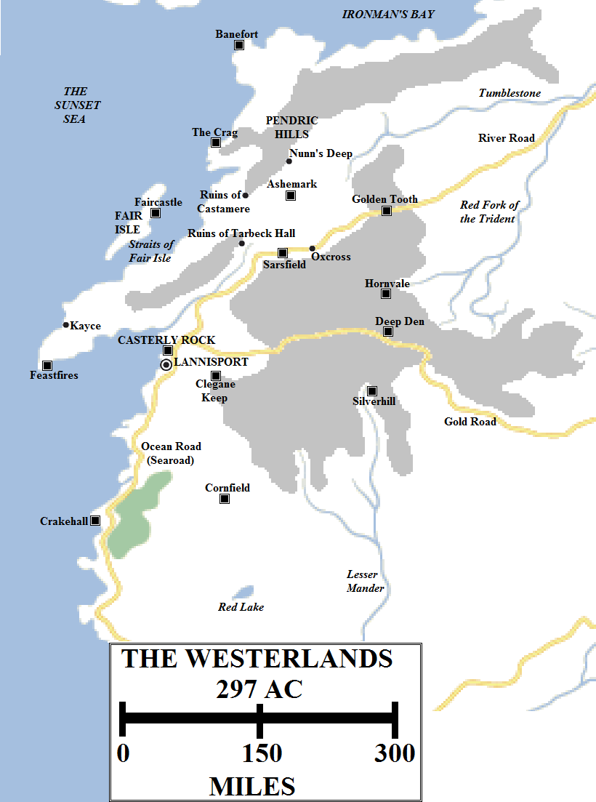
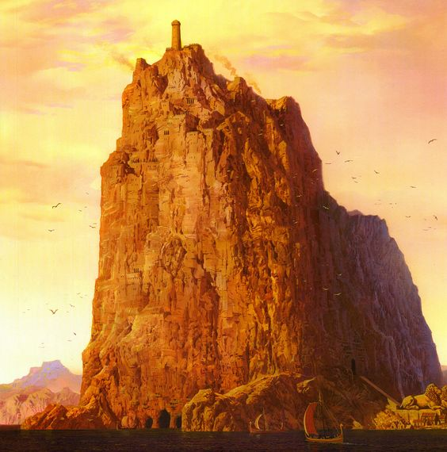
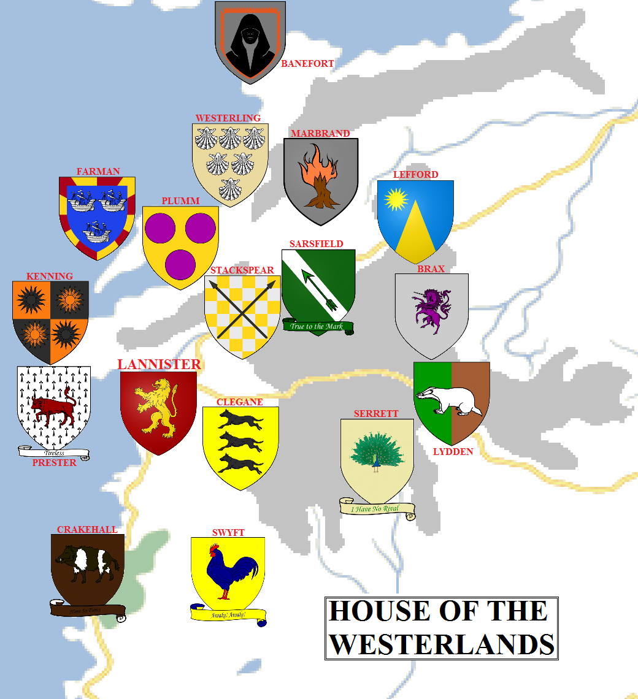

Located along the far western coast of the Seven Kingdoms is a land of hills and low mountains, riddled with mines. Gold and silver is mined here in vast quantities, enriching numerous families, none moreso than the Lannisters of Casterly Rock. The Westerlands roughly match the Vale in size, but are more populous, more fertile and, by far, form the richest lands on the continent in terms of wealth.

The Westerlands in 297 AC (click for a larger version). Some locations are speculative.

The Westerlands occupy a stretch of the west coast of the continent, with Ironman’s Bay located to the north and the Sunset Sea to the west. The region’s borders to the east are formed by the headwaters of the Red Fork of the Trident and to the south by the headwaters of the Lesser Mander\* and the northern plains of the Reach. The eastern and southern borders are somewhat flexible, resulting in frequent and long-standing border wars with the Riverlands and the Reach in ancient times, although since the Targaryn Conquest the borders have been settled. The Westerlands measure roughly 300 miles from east to west (with the Kayce Peninsula adding another 140 or so miles to that) and about 550 miles from north to south.

More vicious still are the Westerlands’ relationship with the Iron Islands, located less than a hundred miles off the north-west coast. The riches of the Westerlands made them a tempting target for ironborn raiders in the years before the Conquest, and during both the Red Kraken’s reign of terror and the Greyjoy Rebellion the Westerlands suffered significant raids and loss of life before the ironborn were defeated.

The Westerlands are roughly estimated as being home to between five and six million people, making them the second-most populous region of the Seven Kingdoms, behind only the Reach to the south. They can also field the second-largest (but easily the best-equipped) army, with a strong emphasis on heavy cavalry, pikes and crossbowmen.

**The Hills and Mountains**

The Westerlands are dominated by a series of highlands, hills and mountains, but these are not unified in large chains like the Red Mountains of Dorne or the Mountains of the Moon in the Vale. The Westerlands are much easier to traverse, as the hills and gradients are less severe. However, the hills are large enough where the River Road crosses the highlands into the Riverlands to form a significant bottleneck, where the Golden Tooth is located.

There are several distinct highland areas. The largest and most notable extends from the headwaters of the Tumblestone down to the Lesser Mander, and from just east of Casterly Rock to the headwaters of the Blackwater Rush. Most of the main mines and strongholds are located in this large area. A slightly smaller region of uplands is located to the north of the Tumblestone, extending east almost to Seagard and Wendish Town, forming a significant salient into Riverlands territory. Numerous smaller hill chains can be located across the region.

**The North Coast**             

The coast of Ironman’s Bay is rugged, mountainous and sparsely populated. The largest castle in this area is Banefort, located on the north-west coast. Located close to the Iron Islands, Banefort is heavily fortified against attack, the distrust of the ironborn never fully leaving the area.

Ninety miles or so to the south lies the Crag, the seat of the once-great House Westerling. Once a much more imposing and impressive castle, it suffered when the nearby mines ran dry and left the family without resources or funds.

**The Northern Vale**

A densely-populated area can be found in the north of the Westerlands, between the mountains to the north and east. This region is dominated in the north by Ashemark, in the east by the Golden Tooth and to the south by Sarsfield. The houses Marbrand, Lefford and Sarsfield are the most powerful in this area.

The Golden Tooth is the second-largest castle in the Westerlands. It straddles the River Road as it makes its way through the mountains, presenting both a formidable obstacle to Riverlands armies attempting to invade from the east and a splendid jumping-off point for western armies heading into the Riverlands. A large, armed host would have to travel considerably far to the south to the Gold Road to find another suitable route into the Westerlands, or risk a more dangerous trek around the headwaters of the Tumblestone which is not suitable for large numbers of men.

The River Road skirts the mountains as it heads south-west. Here, not far from the Golden Tooth and a very optimistic three days’ hard ride from Casterly Rock, can be found the town of Oxcross, not far from the castle of Sarsfield.

In the west of the region, not far south-east from the Crag, can be found the ruins of Castamere and Tarbeck Hall. Formerly great castles belonging to mighty houses, the Reynes and Tarbecks, both castles were destroyed by the then-Ser Tywin Lannister after they rebelled against his weak-willed father.

Many mines dot the region. As well as the Golden Tooth, the exhausted mines of the Crag and the flooded galleries of Castamere, the most notable mines include Nunn’s Deep and the Pendric Hills.

**The West Coast**

The west coast is dominated by two major geographic features. In the north is Fair Isle. Just shy of a hundred miles long, it is has long been coveted by the ironborn. The island was conquered several times by the ironborn in ancient times, until they were either driven off by the Lannisters or the native people (a strong-willed folk) threw off the yolk of foreign rule. Eventually the ruling family of the island, the Farmans, aligned themselves with Casterly Rock permanently through marriage. Even so, both Dalton Greyjoy and Balon Greyjoy attacked the island during their respective rebellions.

House Farman controls the largest part of the Westerland fleet, which is primarily designed to defend the island and the coast from raids. During the Greyjoy Rebellion, the Iron Fleet was trapped in the Straits of Fair Isle, between the island and the Kayce Peninsula, and destroyed in detail by the fleet of Stannis Baratheon and Paxter Redwyne. This huge victory allowed King Robert Baratheon to invade the Iron Islands a few weeks later and end the war.

The Kayce Peninsula lies to the south of Fair Isle and north-west of Casterly Rock. 150 miles long and almost 50 miles across for much of its length, the peninsula extends into the Sunset Sea. The peninsula is dotted with watchtowers from the days of frequent ironborn raids. Kayce, the second-largest port of the Westerlands, can be found on the west cost of the peninsula. The castle, watchtower and lighthouse of Feastfires can be found near the tip of the peninsula, about 140 miles west of Casterly Rock.

Casterly Rock. Artwork by Ted Nasmith for _The World of Ice and Fire_.

**Casterly Rock and Lannisport**

The jewel of the Westerlands may just be the single most imposing and impressive sight on the entire continent: Casterly Rock.

Casterly Rock is a solid chunk of rock six miles long, extending for just over 2,400 feet into the sky (three times the height of the High Tower of Oldtown). Separated from the other mountains of the region by dozens of miles, the Rock is less impressive for its size (the Giant’s Lance of the Vale dwarfs it) but for its sheer imposing bulk, standing alone overlooking the Sunset Sea, and for the fact that over the course of thousands of years it has been gradually shaped by men. Giant harbours have been cut into the Rock where it meets the sea, two immense bastions of stone at the base have been shaped so they look like paws and the crest of the rock bristles with battlements, walkways and defensive weapons. At sunset the Rock resembles a lion at repose.

The Rock is exceeded in terms of exterior dimensions by Harrenhal, but even that castle cannot match the Rock for height or sheer living space. Even conservative estimates have the Rock being inhabited for over six thousand years. During that time countless galleries, tunnels and chambers have been carved out, so many that no-one has mapped them all. These extend through the Rock and deep below it into the bowels of the earth, where the Rock’s great gold mines still ring to the sound of excavations.

The Rock has never been taken in battle and rarely suffered attack: it would be pointless, since the castle is almost too large to besiege and then occupy with a land army and would need to be cut off from the sea as well.

Located a few miles to the south of the Rock lies the sprawling city of Lannisport. The third-largest city on the continent of Westeros and by far the largest port on the west coast of the entire continent, Lannisport is home to between 200,000 and 300,000 people, varying by the season. The city is located around an excellent natural harbour, close to rich fishing grounds. The River Road, Ocean Road and Gold Road meet not far from the city, providing superb transport links to the Reach, the Riverlands and, a thousand miles to the east, King’s Landing. A huge amount of gold and silver trading goes on in the city, attracting ships from the Free Cities, the Summer Isles and even points further east, giving the city a cosmopolitan feel.

Lannisport is as rowdy as you’d expect for such a large port, but it is quite orderly. The Lannisport City Watch is excellently trained and equipped and keeps the peace effectively.

The city is ruled by House Lannister of Lannisport, a cadet branch of the main branch of the family. Off-shoots of the family in the city include the Lantells, Lannetts and Lannys.

A number of noble families are sworn directly to Casterly Rock and have their keeps within a few days’ ride of the castle. The most notorious of these, although not the most powerful, are the Cleganes of Clegane Keep. Located south and east of Lannisport, this is the stronghold of the terrifying Ser Gregor Clegane, the Mountain That Rides, and is reportedly a grim place.

**The Southern Border**

The Lannisters command the fealty of all the coastlands south of Lannisport for over 200 miles. The most notable stronghold on the coast is Crakehall, held by the family of the same name. Just inland from Crakehall is the largest stretch of woodland in the Westerlands, the home of the wild boars that give the Crakehalls their banner.

About 150 miles inland from Crakehall is Cornfield, the seat of House Swyft. Cornfield sits at the far north-western edge of the Reach, the absolutely immense region of plains and fertile plains sweeping south and east for many hundreds of miles to the Red Mountains of Dorne, fed by the Mander and its mighty tributaries. Large farmlands can be found in this region, helping feed the rest of the Westerlands. This immense area of flatlands and plains is also prime breeding ground for horses, and the likely source of the Westerlands’ immense cavalry formations in battle (and potentially one of the sources for House Swyft’s name).

**The Highlands**

South of the Golden Tooth and south-east of Oxcross is a large area of highlands and valleys, dotted with mines (the played-out and still-operational) and strongholds. The Gold Road crosses this area on its way from Lannisport to King’s Landing.

The strongest castles in this area are Hornvale, located above the headwaters of the Red Fork of the Trident; Deep Den, where the Gold Road crosses the hills; and Silverhill, located above a rich silverlode near the headwaters of the Lesser Mander.

The noble houses of the Westerlands in 297 AC (click for a larger version). Some house locations are speculative.

**Houses of the Westerlands**

**House Lannister** rules the Westerlands from its impregnable stronghold of Casterly Rock. A cadet branch controls the city of Lannisport, whilst **Houses Lantell**, **Lannett** and **Lanny** are vassal off-shoots of the main house. There are numerous smaller and knightly houses in the surrounding region directly sworn to the Lannisters, including **House Clegane**.

**House Lefford** commands the Golden Tooth, making it one of the richest families of the region, behind only the Lannisters. The Leffords also have strategic strength, commanding the defence of the main pass into the Westerlands. Nearby are **House Marbrand** of Ashemark, another extremely influential and rich family who have mines in the nearby Pendric Hills. **House Sarsfield** of Sarsfield command a strong castle overlooking the River Road and are also a principal house sworn to the Lannisters. Less powerful, although of ancient lineage, are **Houser Westerling** of the Crag, whose once-immense influence has dwindled along with their wealth.

**House Brax** of Hornvale, **House Lydden** of the Deep Den and **House Serrett** of Silverhill are other rich families who hold mines and strongholds in the hills and mountains.

**House Banefort** of Banefort is charged with the defence of the far northern coast from ironborn attack, and is a strong, martial house. **House Farman** of Faircastle, the rulers of Fair Isle, likewise are charged with the defence of the west coast. There are several other families on the island, vassals of the Farmans. The most notable of these are **House Clifton**.

**House Kenning** of Kayce is another strong house on the west coast. The Kennings are descended from ironborn invaders who decided to swear fealty to the Lannisters rather than remain vassals of the Iron Islands. Known as hardy warriors, the Kennings are also famed for the Horn of Herrock, a mighty warhorn and heirloom of the house, which they sound before giving battle. **House Prester** commands the nearby castle of Feastfires and are likewise a renowned and powerful family.

The most notable southern families of the Westerlands are **House Crakehall** of Crakehall and **House Swyft** of Cornfield, who command the wide open plains of the north-western Reach, good country for both farming and horses.

Lesser families of the Westerlands include **Houses Algood**, **Bettley**, **Broom**, **Doggett**, **Drox**, **Estren** of Wyndhall, **Falwell**, **Ferren**, **Foote**, **Garner**, **Greenfield** of Greenfield, **Hamell**, **Hawthorne**, **Hetherspoon**, **Jast**, **Lorch**, **Moreland**, **Myatt**, **Parren**, **Payne**, **Peckledon**, **Plumm**, **Ruttiger**, **Spicer**, **Stackspear**, **Turnberry**, **Vikary**, **Westford**, **Yarwyck** and **Yew**.

**Notes**

\*The large tributary of the Mander which runs from Silverhill past Goldengrove almost to Highgarden is resolutely unnamed in the books. I use the term “Lesser Mander” here but its real name is likely something else.

Casterly Rock is based on the Rock of Gibraltar but, as with so much else in Westeros, it is considerably larger (about three times the size).

**Credit**

The map above uses heraldry designs (under [Creative Commons](https://creativecommons.org/licenses/by-sa/3.0/)) from the excellent [Wiki of Ice and Fire](http://awoiaf.westeros.org/index.php/Main_Page) and [La Garde de Nuit](http://www.lagardedenuit.com/wiki/index.php?title=Accueil), the ultimate English and French-language guides to the **Song of Ice and Fire** novels.

_Thank you for reading The Atlas of Ice and Fire. To help me provide better content, please consider contributing to [my Patreon page](https://www.patreon.com/home) and [other funding methods](http://thewertzone.blogspot.co.uk/2017/01/support-wertzone-on-patreon.html), which will also get you exclusive content weeks before it goes live on my blogs._
