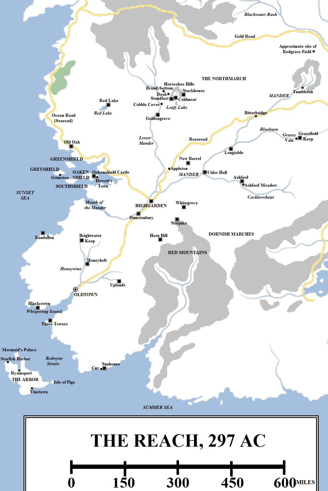
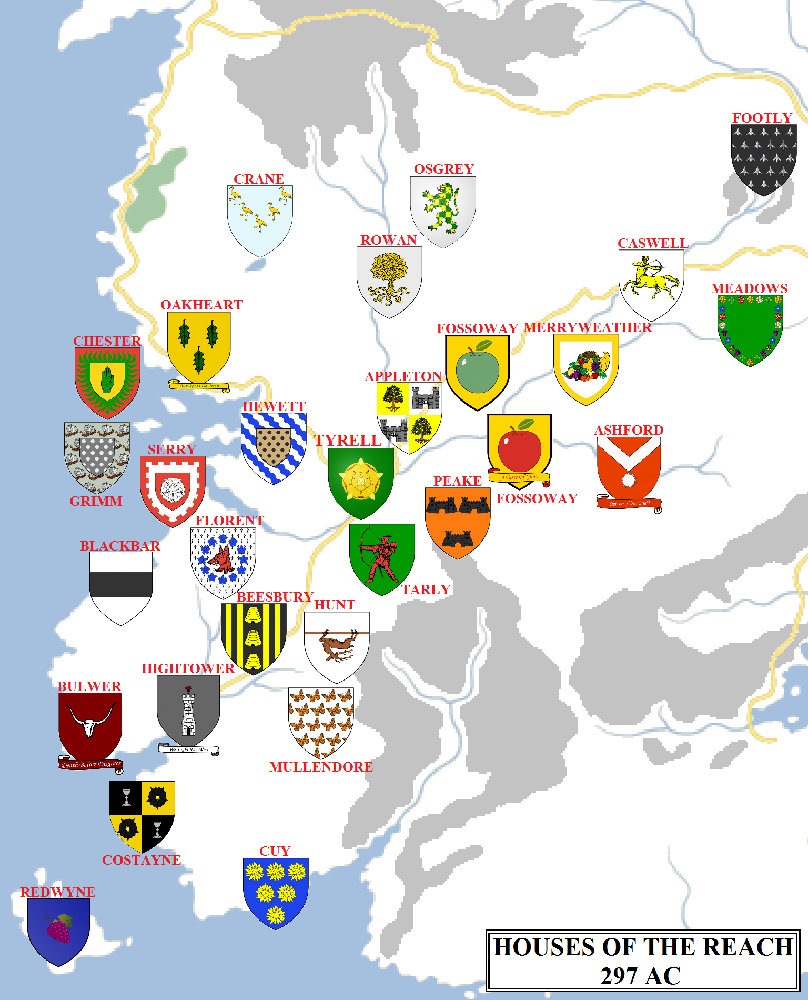

Sprawling across much of the southern half of Westeros is an immense plain, made up of huge fields of wheat, corn and barley, dotted with small forests and watered by rivers both large and small. The countryside is dotted with towns, holdfasts, castles and small villages. Hot in the summer, still moderately warm in all but the worst winters, the Reach is paradise compared to the cold, windswept North or the rocky, barren Iron Islands.

The Reach in 297 AC (click for a larger version). Some locations are speculative.

The Reach is the most populous part of the Seven Kingdoms. Conservative estimates place the population at around ten million and maybe as high as twelve million, more than twice that of any other region. It is also the second-largest, after the North, and the second-richest, after the Westerlands. It also claims the title of the most honourable and chivalrous (although this is disputed by the Vale, where the first Andals and Seven-worshippers came ashore on the continent), where the rules of tournaments and knightly comportment have evolved over many centuries. It is also the ancestral home of the Faith of the Seven on the continent, who were based in the Starry Sept of Oldtown before transferring their authority to the Great Sept of Baelor in King’s Landing.

The Reach measures approximately 1,200 miles along its longest axis (from the Arbor to the Blackwater Rush near King’s Landing). At its widest the region extends for about 800 miles from east to west and about 600 miles to north and south (with a significant southward extension west of the Red Mountains). The borders of the region are held to be the Sunset Sea in the west, the Redwyne Straits, Red Mountains to the south and south-east, the Kingswood to the east and the Blackwater Rush and Westerland hills to the north. The Reach counts several offshore islands as part of its territory, most notably the Shield Islands off the western coast and the Arbor to the south-west.

**The North-Western Reach**

The north-western Reach borders the Westerlands. Several Westerland castles are located very close to the Reach, or even on the plain itself, most notably Cornfield. The border is located some miles to the south of that castle. The north-western-most major strongholds of the Reach are Red Lake, located on the lake of the same name, and Old Oak, located on the coast between Crakehall and Highgarden.

Like most of the Reach proper, this region is fertile and populous. It is a little more varied geographically, with large forests in the north-west, a big lake in the north and hills rising to low mountains in the north. This informal region is bordered by the Lesser Mander to the east and the sea to the south-west.

**The Lesser Mander**

The Lesser Mander is an informal name for the river that rises in the Westerland hills and flows south for nigh on 450 miles before it joins the Mander proper. By any standards this is a significant river, but it is dwarfed by the Mander itself.

The Lesser Mander feeds the northern Reach, with numerous streams and rivers splitting off to water immense fields and grassplains stretching to the horizon. Located roughly halfway down the Lesser Mander and dominating the entire region is the castle of Goldengrove, held by House Rowan of the Northmarch. The Rowans, one of most powerful families of the Reach, hold the fealty of scores of lesser houses and landed knights, not to mention hundreds of villages and towns spread across a vast distance. From Goldengrove it is 250 miles to Bitterbridge to the west and over 220 miles to Highgarden to the south, granting the Rowans rule (under the Tyrells) over a large stretch of territory.

Among the notable and interesting castles of this region are Standfast and Coldmoat, located not too far from Goldengrove around a river known as the Chequy Water, which rises in the Horseshoe Hills and flows into Leafy Lake. These two castles, held formerly by Houses Osgrey and Webber, had a long-standing territorial dispute, complicated by claims from Houses Conklyn and Stackhouse. The matter was eventually settled by a marriage between the Osgreys and Webbers. Territorial disputes of this nature are more common in the Reach: although its vast, it also very densely populated with numerous houses controlling relatively small areas with territorial disputes and claims going back in some cases for thousands of years.

**The Upper Mander and its Tributaries**

The Mander is the greatest river on the continent of Westeros. It rises in the hills around Tumbleton, south-west of King’s Landing, and flows for over 700 miles south and west before curving northwards as it flows into the Sunset Sea via a huge river mouth. On its long journey it is joined by the Blueburn (which flows out of the Kingswood 300 miles to the east) and the Cockleswhent (which rises in the far north of the Dornish Marches), both of which add to the river’s size and width immensely.

The banks of the Mander are dotted with fishing villages, trade ports and holdfasts. The river provides a rapid means of transport from the sea to Tumbleton, from where cargoes can be loaded onto wagons for the last leg of their journey to King’s Landing.

Tumbleton is the largest town of the north-eastern Reach, growing fat on its position on the main trade routes north-west to the Riverlands, north-east to the capital and south along the river to Highgarden. The town sits in the midst of hills and ridge country. To the north lies the infamous Weeping Ridge and the Redgrass Field, where the armies loyal to King Daeron II Targaryen crushed the First Blackfyre Rebellion.

160 miles or so to the south-west lies Bitterbridge. Formerly known as Stonebridge for its large bridge spanning the Mander (the river widens significantly to the south of the town, making bridges impractical), the town was the site of a horrific battle and massacre during the Faith Militant Uprising. The Mander ran red with blood for twenty leagues, resulting in the town being renamed. The town suffered additional battles, riots and great loss of life in the Dance of Dragons. Since then the town has been rebuilt and continues to benefit from trade, both along the Mander and along the Roseroad. For those unable to afford water transport, Bitterbridge is the largest town and waystop between Highgarden and King’s Landing.

Seventy miles or so south of Bitterbridge, the Mander is joined by the Blueburn, which flows in from the Kingswood. The lands of the Blueburn are dominated by House Meadows, which rules from the castle at Grassfield Keep, near the town of Grassy Vale. Another powerful house in this region is House Merryweather, which rules from Longtable, located at the confluence of the Mander and the Blueburn.

A hundred miles or so south-west of Longtable is the castle of Cider Hall, seat of the red-apple Fossoways. This is located at the confluence of the Mander and the Cockleswhent. This is prime apple-growing country, with the castle of New Barrel (held by the green-apple Fossoways, the family splitting due to an argument during the Ashford Tourney of 209 AC) and the town of Appleton not too far away.

The Cockleswhent flows north and west from the foothills of the Red Mountains through some very beautiful countryside before joining the Mander. The castle and town of Ashford is the largest settlement on the Cockleswhent. The castle is notable for its role in history, as it was on the nearby Ashford Meadow that Prince Baelor “Breakspear” Targaryen was slain in a tourney mishap. Robert Baratheon also suffered his largest military defeat here during his rebellion, when he was defeated outside the town by the army of Lord Randyll Tarly.

130 miles south-west of Cider Hall, the Mander and the Lesser Mander combine and the river becomes truly immense, flowing south and west towards the sea.

**Highgarden**

Highgarden is the seat of House Tyrell, the rulers of the Reach, and for thousands of years before that was the seat of House Gardener. The castle sits on top of a hill overlooking the Mander. It has two walls, between which is a famous briar maze, whilst numerous halls, towers and an extensive sept are located around the inner keep, whilst the castle’s godswood is large and impressive, containing no less than three weirwoods.

Highgarden makes a claim to be the most aesthetically pleasing of the major castles of Westeros. The countryside surrounding the castle may be the most impressive, with immense fields of golden roses, melons, peaches and fireplums stretching to the horizon.

The Mander here has grown to be at least a couple of miles wide, with pleasure barges and boats sailing up and down the river. Overall, the scene is, especially in summer, idyllic and tranquil.

**The Shield Islands**

Located just west and north of the mouth of the Mander, the four large Shield Islands form an effective defence against any naval force planning to use the Mander to attack Highgarden and invade the heart of the Reach. There are four islands: Greenshield in the north-west, Oakenshield in the north-east, Greyshield in the south-west and Southshield in the furthest south.

The islands were originally known as the Misty Islands. Two thousand years ago, the ironborn were free to invade the Reach using bases and outposts on the Misty Islands. The Gardeners eventually drove out the invaders and settled troops from the Reach on the islands. Eventually these defenders were ennobled and made loyal vassals of Highgarden. The Shield Islands were given a significant and powerful fleet of ships to defend themselves. This fleet acquitted itself well during Robert’s Rebellion, slaying Lord Quellon Greyjoy when the ironborn attacked during the Battle of the Mander.

**The Southern Marches**

South-west of Highgarden lies a stretch of territory which, although ultimately ruled from Highgarden, holds most of its immediate loyalty to Oldtown, either as direct vassals or influenced by proximity to the city. This stretch of land is significant in size, measuring 400 miles from north to south and 300 miles from west to east.

This region is densely populated. Major strongholds along the coast include Bandallon and Blackcrown on the Sunset Sea, Three Towers on the Redwyne Straits and Sunhouse (with its surrounding port town, Cuy) in the far south on the Summer Sea, less than 200 miles from the Dornish castle of Starfall. Inland can be found Uplands, in the foothills of the Red Mountains east of Oldtown, and the castles of Honeyholt and Brightwater Keep, located up the Honeywine River from Oldtown.

At the far north-eastern edge of this region, less than a hundred miles from Highgarden, can be found Horn Hill, the seat of the extremely powerful and martial House Tarly.

**Oldtown and the High Tower**

Oldtown is the second-largest and oldest city on the continent of Westeros. No historian or maester has been able to determine when the first settlement was built at the mouth of the Honeywine, where it meets Whispering Sound, but it was many thousands of years before the Andal Invasion and almost certainly long before the Long Night. What records have survived indicate that settlers found an already-extant stronghold or ruins on Battle Isle, built from a curious, oily black stone. This was expanded to build the first stronghold and lighthouse on the isle by the Hightower family, or their ancient ancestors. Over the course of centuries, several successive wooden towers were built on the isle until the Hightowers replaced them with a proper, stone tower. Over the course of many centuries this tower was expanded, made higher and rebuilt until the modern tower was completed several centuries ago, reaching a height of 800 feet, taller than the Wall. In Westeros the High Tower is said to be the tallest artificial structure in the world, matched only by the Great Pyramid of Meereen, but legend speaks of the Five Forts of Yi Ti which may top a thousand feet.

The mainland near Battle Isle surrounds a great natural harbour. A town or fishing village was established here, braving ironborn raids or pirates from the Stepstones to expand, fortify and become richer and stronger. The city’s original name is unknown, but at some point it simply became known as “Oldtown”, a city that had stood since time immemorial. The city’s security was secured when King Lymond Hightower and King Garland II Gardener made an alliance through marriage, the Hightowers swearing fealty to Highgarden and making Oldtown the chief city and port of the Kingdom of the Reach. Some centuries later the order of maesters were allowed to establish their base of operations, the Citadel, in Oldtown, increasing the city’s prestige further.

During the Andal Invasion the Hightowers submitted to the invaders and retained control of the city. They secured their position by taking up the worship of the Seven and donating funds to help the Faith build a massive place of worship in the city. The Starry Sept became the centre of the Faith in Westeros for thousands of years. There are also many other septs in the city, including the Sailor’s Sept, the Lord’s Sept and the Seven Shrines, as well as a motherhouse for the training and education of septas. A cosmopolitan and open-minded city, Oldtown is also unusual in Westeros for hosting places of worship for foreigners, including a temple to the gods of the Summer Islanders and one to R’hllor, the Lord of Light, both relatively small and located in the dockland district.

The city of Oldtown is remarkable for its age and civilised beauty. The city is paved and mostly kept clean. The Oldtown City Watch is well-disciplined and effective. The city is a winding labyrinth of narrow, cobbled lanes and streets, broken up by estates and mansions. Some of the discipline in the city may be down to numerous guilds, who take in young people as apprentices and help keep lawlessness down on the streets.

The Citadel is located on the eastern side of the Honeywine, but extends onto the Isle of Ravens in the middle of the river, where the Ravenry is located. The original structure of the Citadel, when it was much smaller than today, it now serves as the place where ravens are kept, fed and dispatched on missions to maesters all over the Seven Kingdoms.

**The Arbor**

Lying off the south-western coast of Westeros, between the Sunset Sea (to the west and north), the Redwyne Straits (to the east) and the Summer Sea (to the south), the Arbor is a large island (over 100 miles long and about 60 miles wide) blessed by an excellent climate. The island is known for its shipyards, ports and its extensive vineyards, giving rise to excellent wines which are sold across the known worlds. The island is home to three notable settlements: Starfish Harbour, Ryamsport and Vinetown.

The noble houses of the Reach in 297 AC (click for a larger version). Some house locations are speculative.

**Houses of the Reach**

**House Tyrell** rules the Reach from the castle at Highgarden. The Tyrells inherited the castle from the Gardeners when they were destroyed by Aegon the Conqueror on the Field of Fire. The Tyrells had been serving as the stewards of Highgarden and Aegon awarded them the castle for wisely choosing submission. However, the Tyrells’ relatively modest blood made this a controversial decision, with the Florents and Rowans (among others) occasionally noting their superior blood descent from Garth Greenhand.

The second-most-powerful family is **House Hightower**, who rules the city of Oldtown and a vast swathe of surrounding countryside from the High Tower, sitting on Battle Isle in Oldtown harbour. House Hightower, who in other circumstances would be a Great House in their own right, are loyal allies and vassals of the Tyrells. They also hold the allegiance of **House Beesbury** of Honeyholt, **House Bulwer** of Blackcrown, **House Costayne** of the Three Towers, **House Cuy** of Sunhouse (who also rule the port town of Cuy) and **House Mullendore** of Uplands.

The next tier of powerful houses include **House Redwyne** of the Arbor and **House Rowan** of Goldengrove. House Redwyne commands one of the largest fleets of warships in Westeros, based at the Arbor, whilst House Rowan rules the Northmarch, a vast swathe of the northern Reach stretching for hundreds of miles from Goldengrove to the Blackwater Rush. Vassals of the Rowans include **House Osgrey** and possibly **House Durwell**, **House Stackhouse** and **House Conklyn**.

Other major mainland houses of the Reach include **House Ambrose**, **House Appleton** of Appleton, **House Ashford** of Ashford, **House Blackbar** of Bandallon, **House Caswell** of Bitterbridge, **House Cockshaw**, **House Cordwayner** of Hammerhal, **House Crane** of Red Lake, **House Cuy** of Sunhouse, **House Florent** of Brightwater Keep, **House Meadows** of Grassfield Keep and Grassy Vale, **House Merryweather** of Longtable, **House Oakheart** of Old Oak, **House Peake** of Starpike, **House Shermer** of Smithyton, **House Tarly** of Horn Hill (and their vassals, **House Hunt**), **House Varner** and **House Vyrwel** of Darkdell.

Also significant are the four houses that command the Shield Islands: **House Chester** of Greenshield, **House Grimm** of Grimston (on Greyshield), **House Hewett** of Oakenshield and **House Serrer** of Southshield.

Lesser houses of the Reach include **Houses Ball**, **Bridges**, **Bushy**, **Dunn**, **Footly** of Tumbleton, **Fossoway** of Cider Hall (the “red apple” Fossoways), **Fossoway** of New Barrel (the “green apple Fossoways), **Graceford** of Holyhall, **Graves**, **Hastwyck**, **Hutcheson**, **Inchfield**, **Kidwell** of Ivy Hall, **Leygood**, **Lowther**, **Lyberr**, **Middlebury**, **Norcross** (possibly a vassal of the Florents, but unconfirmed), **Norridge**, **Oldflowers**, **Orme**, **Pommingham**, **Redding**, **Rhysling**, **Risley**, **Roxton** of the Ring, **Sloane**, **Uffering**, **Westbrook**, **Willum**, **Woodright**, **Wythers** and **Yelshire**.

**Notes**

The Reach seems to be very consciously influenced by medieval France. Like France, the Reach is huge, with mostly pleasant weather, fertile soil and lots of farms and villages, and liked to think of itself as the home of honour and chivalry. The Reach’s huge population also seems to be inspired by France’s: circa 1300 AD France had a population of 17 million, utterly dwarfing most of Europe’s other countries and certainly its key enemy England, whose population at the time was only 3 million. The somewhat lacklustre support for the Tyrells (who are seen as upjumped stewards) mirrors the sometimes half-hearted support for the French crown by its vassals during the medieval period.

Despite the French influence on the Reach, Oldtown seems to be more influenced by large English university towns like Oxford and Cambridge.

The status of House Osgrey and House Webber at the time of the novels is unknown. During the time of _The Sworn Sword_ they were notable but minor houses in the region. They were unified when the aged Ser Eustace Osgrey married Lady Rohanne Webber, with Lady Webber apparently taking his name. After Ser Osgrey died, Lady Webber married Lord Gerold Lannister. This sequence of events leaves the fate of the Webber name unclear, although it is possible that Lady Rohanne left both Standfast and Coldmoat to another family who then inherited the Osgrey name.

**Credit**

The map above uses heraldry designs (under [Creative Commons](https://creativecommons.org/licenses/by-sa/3.0/)) from the excellent [Wiki of Ice and Fire](http://awoiaf.westeros.org/index.php/Main_Page) and [La Garde de Nuit](http://www.lagardedenuit.com/wiki/index.php?title=Accueil), the ultimate English and French-language guides to the **Song of Ice and Fire** novels.

_Thank you for reading The Atlas of Ice and Fire. To help me provide better content, please consider contributing to [my Patreon page](https://www.patreon.com/user?u=4370220) and [other funding methods](http://thewertzone.blogspot.co.uk/2017/01/support-wertzone-on-patreon.html), which will also get you exclusive content weeks before it goes live on my blogs._
