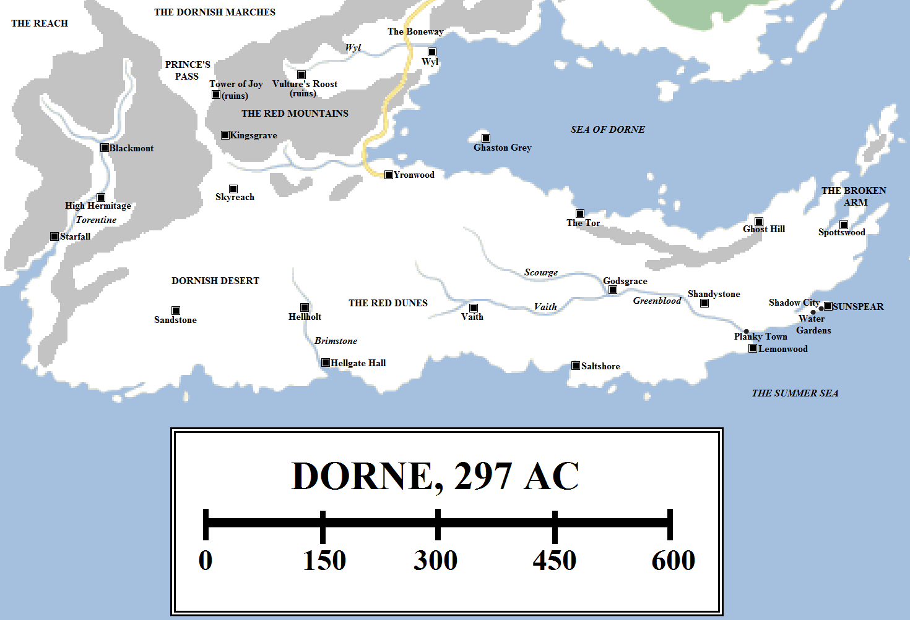
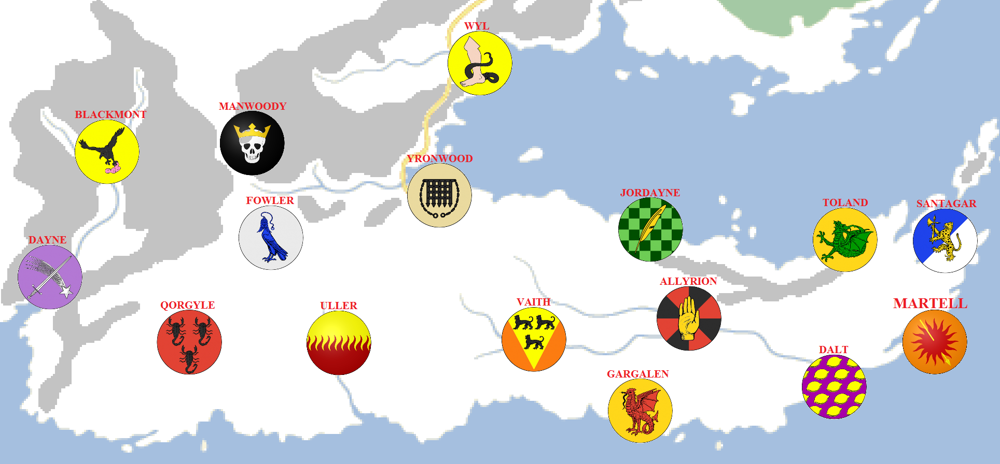

The southernmost of the Seven Kingdoms is the most distinct in culture, history and its people. Walled off from the rest of the continent by the Red Mountains and the sea, the fiercely independently peninsula of Dorne spent thousands of years in strife before being unified by Prince Mors Martell of Sunspear and his ally-turned-wife, Princess Nymeria of the Rhoynar. The kingdom inflicted two devastating military defeats on the Targaryen dynasty before finally joining the Seven Kingdoms thanks to the peaceful, shrewd diplomacy of King Daeron II. But Dorne has retained its distinctive character.

Dorne in 297 AC (click for a larger version). Some locations are speculative.

Dorne is hot, dry and rocky. It is the most arid part of the continent of Westeros and it is home to the continent’s only true desert. However, both the coastlines and the mountain valleys in the north and west are more comfortable and home to the majority of the Dornish people.

The population of Dorne is disputed. Some maesters of the Citadel have pointed out that although Dorne is sizable (measuring 1,000 miles from east to west and 400 miles from north to south in the west of the region), a large chunk of the landmass is effectively uninhabitable and certainly infertile. King Daeron I Targaryen undertook a thorough military assessment of Dorne during his invasion and concluded that Dorne’s population is far higher than it first appears, with its armed might apparently equal to that of the North or the Vale. The tenacity of the Dornish in continuing to field armies capable of fighting invaders late in both the First and Second Dornish Wars also contributes to this argument, although the maesters also point out that the Dornish neutralised the most dangerous enemy army, that of the Reach, very early on in both wars and afterwards practiced hit-and-raid warfare that hid their true numbers. In the absence of detailed demographic information, most now accepted Daeron’s assessment of Dornish population, which the Dornish themselves support.

The kingdom is divided into three distinct regions: the peninsula and the coastlines in the east, including the lands watered by the Greenblood and its tributaries; the deep desert in the west; and the mountains in the north-west. Respectively, these regions are home to the three kinds of Dornishmen: the salty Dornish of the coasts, the sandy Dornish of the desert and the stony Dornish of the mountains.

**The Red Mountains**

Rising in the north-west of Dorne, the Red Mountains extend in a huge arc for almost a thousand miles, from just north of Sunhouse (in the Reach) to north of Griffin’s Roost (in the Stormlands). The mountain chain is longer than the Mountains of Moon which separate the Riverlands from the Vale of Arryn, but the peaks are less impressive in height. Only the tallest mountains ever see snow, and most of the time the peaks are bare. Sandstone is common in the mountains, giving them their distinct red hue.

The Red Mountains are tall and rugged enough to severely restrict travel between Dorne and the Reach and Stormlands to the north. There are only two significant passes through the range. The Prince’s Pass is the larger of the two and permits the passage of very large hosts numbering in the tens of thousands between the Dornish Marches, the Reach and Dorne itself. The Stormland castle of Nightsong guards the northern entrance to the pass, whilst the Dornish fortresses of Kingsgrave and Skyreach guard the southern stretch. In the northern foothills, near the Prince’s Pass, can be found a strange sight: a tumble of quarried rocks and eight graves. This is the famous Tower of Joy, where Prince Rhaegar Targaryen allegedly imprisoned Lyanna Stark of Winterfell, triggering Robert’s Rebellion and the downfall of the Targaryen dynasty.

To the east lies the coastal pass, the Boneway, which links Dorne to the Stormlands. This pass starts in the north, near the ruins of Summerhall, and process south through the mountains to the north-western corner of the Sea of Dorne. It then proceeds down the coast, past Wyl, before terminating near Yronwood. The Boneway is narrower than the Prince’s Pass and easier to bottle up armies between the peaks and the sea. However, it is also easier to resupply and support from the sea as well.

**The Torentine Valley**

Lying at the far western end of Dorne, 900 miles from Sunspear, is a relatively fertile river valley cutting a swathe through the Red Mountains. The River Torentine rises in the far north-western Red Mountains, with two large streams joining at the castle of Blackmont to form a larger and more substantial river. This river flows south for about 150 miles, past the peaktop castle known as the High Hermitage, before emptying into the Summer Sea. The castle of Starfall, the seat of the storied House Dayne, overlooks the river mouth.

There are mountain passes leading to the Prince’s Pass and the deep Dornish desert to the east. There is also a narrow coastal track leading towards Sunhouse and the far south-western stretch of the Reach. This was used during the First Dornish War in a daring raid by the Daynes on the lower Reach, but is not suitable to the movement of very large armies.

The Torentine Valley is a remote and isolated part of Dorne, but its people are formidable and fierce. The Blackmonts and Daynes have both played key roles in the history of Dorne, the latter notably for their tradition of raising great knights. The greatest, known as the Swords of the Morning, are permitted to wield Dawn, one of the most famous swords in the history of Westeros.

**The Desert**

The Dornish desert begins just south of the Prince’s Pass and extends for over 250 miles south to the rocky coast of the Summer Sea. The desert spreads from east to west for about 400 miles, starting in the hills bordering the Torentine and terminating along the banks of the three great rivers of eastern Dorne, the Scourge, the Vaith and the Greenblood. Stretches of the desert extend south of the rivers almost as far as Lemonwood, and to the north almost as far as the Broken Arm.

The desert is modest compared to the vast Red Waste of Essos (which measures 800 miles from north to south and 600 miles from east to west), or the Grey Waste and Cannibal Sands of far eastern Essos (on the very fringes of the known world), but it is almost more inhabited. The castle of Sandstone sits in the middle of the western desert, built on top of the only well of any notable size for 150 miles in any direction. The people who hold fealty to House Qorgyle are the true sandy Dornish, desert nomads who know how to find water, how to cross the burning sands safely and how to fight under the unrelenting Dornish sun.

Further east lies the Brimstone. This is an acrid, bitter river barely worthy of the name by northern standards. Its water is sulphurous and unpleasant. House Uller, founded by Andal adventurers, built the castle known as the Hellholt along the river. Soon a small town and docks followed. The Ullers were long overshadowed by the Drylands of Hellgate Hall, located further south towards the river mouth, until Princess Nymeria destroyed House Dryland in battle and sent their last king in golden fetters to the Wall. The Ullers then ascended to become lords of the entire river.

Between the Brimstone and the Vaith lies the eastern desert, known as the Red Sands. This stretch of the desert is slightly rockier and more inhabitable than the west, but it remains sparse, dry and unpleasant.

**The Sea of Dorne**

The Sea of Dorne is an immense gulf of the Narrow Sea, bordered by Cape Wrath (in the Stormlands) to the north, the Dornish peninsula to the south and the Stepstones in the east. Dorne is not a major sea power and never really has been one, due to the lack of good harbourages on its tremendously long coastline, but the sea does provide some measure of security and fast passage to the rest of Westeros.

The castle of Wyl is located in the far north-west of the Sea of Dorne, at the mouth of the River Wyl. 170 miles south lies Yronwood, the seat of House Yronwood. For centuries the Yronwoods were the strongest house in Dorne until the Rhoynar gave the Martells the manpower they needed to conquer the kingdom. Today the Yronwoods are the Martells’ most important and powerful vassals, guarding the mountain passes and helping defend the coast.

Off the coast, sitting on a barren rock in the southern Sea of Dorne, is Ghaston Grey. Of old a watchtower and fortress designed to defend the coastline, it has since been converted into a forbidding prison for prisoners and enemies of Sunspear.

Further east the coast becomes hillier. The Tor, the seat of House Jordayne, sits above the sea. So does Ghost Hill, with its chalk-white walls. There are also docks below Ghost Hill which permit passage across the mouth of the Sea of Dorne, some 200 miles to the Weeping Town of the Stormlands to the north.

Further east the coastline becomes rugged and more dramatic, with sheer cliffs that drop into the crashing sea. This is the Broken Arm, the remnants of an ancient landbridge linking Westeros to Essos. According to tradition, the Children of the Forest raised a great spell, the Hammer of the Waters, to shatter the Arm of Dorne, leaving behind the broken islands known as the Stepstones. This is the point where Westeros comes closest to Essos, with the western-most of the Disputed Lands lying less than 160 miles away. Inbetween lie pirate-infested waters. This is a cooler part of Dorne, home to castles such as Spottswood. Further south the tumultuous weather of the Broken Arm give way to the more placid waters of the far northern Summer Sea.

**Sunspear**

Sunspear is the largest and most impressive castle in Dorne. A thousand years ago it was a more modest stronghold, shaped by a cunning and gifted stonemason like a great ship, its prow jutting out over the sea. The Sandship, as it was then called, was the seat of the Martells, then just one of dozens of families feuding for control of Dorne. The several thousand ships of Nymeria, Princess of Ny Sar, landed on the coast near the Sandship. Exhausted by four years and over 4,000 miles of sailing through hostile waters, Nymeria agreed to ally with Prince Mors Martell in return for aiding him in the conquest of Dorne. They succeeded.

In the centuries since then, the Sandship was re-fortified and expanded. Towers and domes in the Rhoynish style were added to the castle, most notably the Spear Tower which juts into the sky over 150 feet above the ground. The nearby Tower of the Sun acts the seat of Dornish government. An entire settlement, the so-called Shadow City (although by northern standards it is merely a large town, with a population in the thousands), spread out around the Sandship and its new towers, with three great walls providing an impressive degree of protection, along the winding alleys and streets of the city itself.

Nine miles to the west, the Water Gardens were established as a place of rest and recuperation away from the (sometimes vicious) politics of Sunspear itself.

**The Summer Coast**

The south coast of Dorne is immense, extending from the tip of the Broken Arm to south-west of Starfall. The Dornish have a tendency to exaggerate and often say that the coast of Dorne is four hundred leagues (1,200 miles) long. In reality, this is the width of the entire south coast of Westeros, including the Reach (Oldtown is almost 1,200 miles to the west and slightly north of Sunspear). It’s still a considerable distance, most notable for its utter lack of good harbourages or ports, or even landing spots for pirates or raiders. Between the port of Sunspear – and that is a poor thing compared to the great harbours of Oldtown or King’s Landing – and Oldtown there are almost no decent ports at all. It is possible to land at the Planky Town or sail up the Greenblood or Brimstone, but mostly landing on this coast means putting a rowboat ashore and hoping it doesn’t get smashed to kindling on the rocks.

Just under a hundred miles south and west of Sunspear lies the mouth of the Greenblood. The Greenblood is the largest and most impressive river of Dorne. It extends for 200 miles inland, where it is formed by the confluence of the Scourge and the Vaith under the shadowed walls of the castle Godsgrace. The Greenblood is a poor thing compared to the Mander or Blackwater Rush, but certainly compared to the immense Rhoyne of Essos. However, some of the descendants of the Rhoynar have taken to living on boats on the river in remembrance of their lost homeland, calling themselves the Orphans of the Greenblood and worshipping Mother Rhoyne as a goddess. At the mouth of the river they have lashed together ships and wooden buildings with planks to form a rough settlement, the Planky Town, the closest thing that Dorne has to a major port.

Just south of Planky Town lies the castle of Lemonwood, rearing above the Summer Sea. South of Lemonwood the coast turns west. The coast is barren, rocky and featureless until the castle of Saltshore is reached, sitting above the sea at the edge of the southern Dornish desert. It is a further 330 miles or so west to the mouth of the Brimstone. West of there the coastline becomes savagely inhospitable, with the burning deep desert of Dorne lying to the north. Ship captains and passengers usually breathe a sigh of relief when, just over 400 miles to the west, the coast turns abruptly northwards and they find themselves in open water, heading west for the Arbor and Oldtown.

That, then, is Dorne, one of the most storied and hostile parts of Westeros, but home to a noble and passionate people.

The noble houses of Dorne in 297 AC (click for a larger version). Some house locations are speculative.

**Houses of Dorne**

**House Martell** rules Dorne from the castle of Sunspear. House Martell came from modest origins to build the castle known as the Sandship on the south-east coast, but the house’s fortunes were made when fate and currents conspired to bring the thousands of ships of the exiled Rhoynar princess Nymeria and her followers to their shores.

The second-most powerful house in Dorne is certainly **House Yronwood**, the Wardens of the Stone Way and whose lords still style themselves the Bloodroyal. The Yronwoods are tasked with guarding the Boneway and leading the defence of north-western Dorne. The Yronwoods have several vassal houses, but the most notable of them is **House Drinkwater**.

The next tier of powerful Dornish houses is made up of **House Dayne** of Starfall, which dominates the lower Torentine Valley (and a cadet branch, based at High Hermitage); **House Allyrion** of Godsgrace, **House Blackmont**, **House Fowler** of Skyreach, **House Gargalen** of Saltshore, **House Jordayne** of the Tor, **House Manwoody** of Kingsgrave, **House Qorgyle** of Sandstone, **House Toland** of Ghost Hill, **House Uller** of Hellholt, **House Vaith** and **House Wyl** of the Boneway.

Lesser houses of Dalt include **House Dalt** of Lemonwood, **House Ladybright**, **House Santagar** and House **Wells** (not related to the House Wells of the North).

**Notes**

Dorne comes from a variety of influences and inspirations, including medieval Italy (in the peninsula shape) and Moorish Spain, with perhaps a tiny dash of the Fremen of Frank Herbert’s _Dune_ thrown in for good measure.

For many of years George R.R. Martin said that Dorne had a similar population to the North and the Vale, ahead of the Stormlands. In _A Feast for Crows_ this was revealed to be a clever deception by the Princes of Dorne. Dorne is actually the “least populous of the Seven Kingdoms”, although many fans and commentators believe this is a reference to the mainland kingdoms; it seems highly implausible that Dorne has a lower population than the Iron Islands.

House Jordayne of the Tor is one of several nods to Robert Jordan’s **Wheel of Time** fantasy series – published in the USA by Tor Books (who also published Martin’s long-running **Wild Cards** superhero anthology series) – in **A Song of Ice and Fire**. Martin has praised Jordan for opening the door for the longform fantasy series, which allowed his own to be published, and for Jordan’s critical praise for his books, which he credits with driving early sales of the series.

**Credit**

The map above uses heraldry designs (under [Creative Commons](https://creativecommons.org/licenses/by-sa/3.0/)) from the excellent [Wiki of Ice and Fire](http://awoiaf.westeros.org/index.php/Main_Page) and [La Garde de Nuit](http://www.lagardedenuit.com/wiki/index.php?title=Accueil), the ultimate English and French-language guides to the **Song of Ice and Fire** novels.

_Thank you for reading The Atlas of Ice and Fire. To help me provide better content, please consider contributing to [my Patreon page](https://www.patreon.com/user?u=4370220) and [other funding methods](http://thewertzone.blogspot.co.uk/2017/01/support-wertzone-on-patreon.html), which will also get you exclusive content weeks before it goes live on my blogs._
