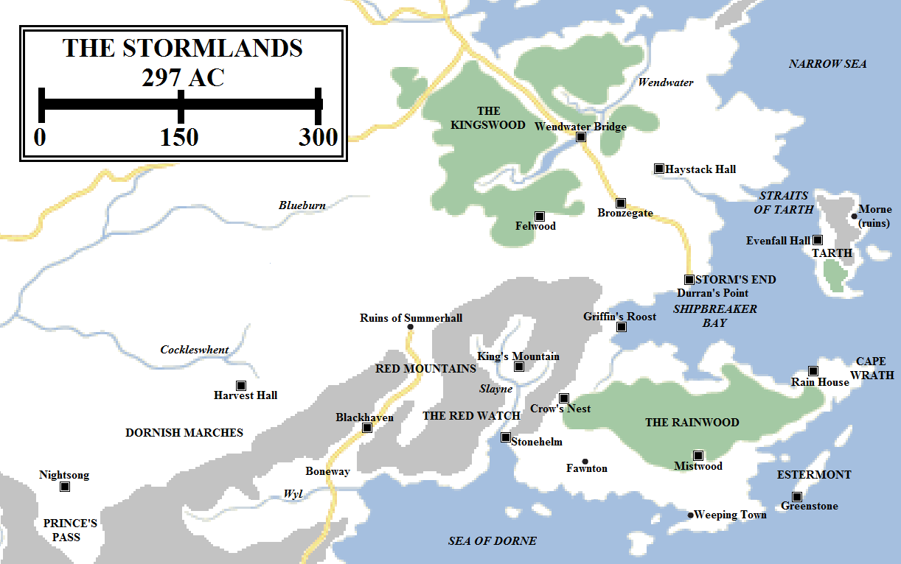
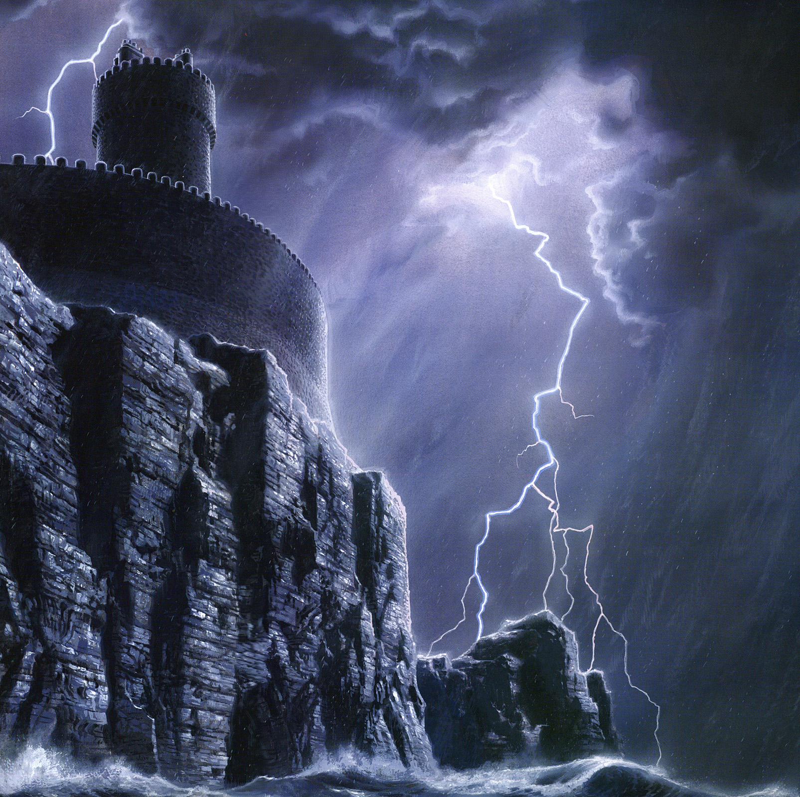
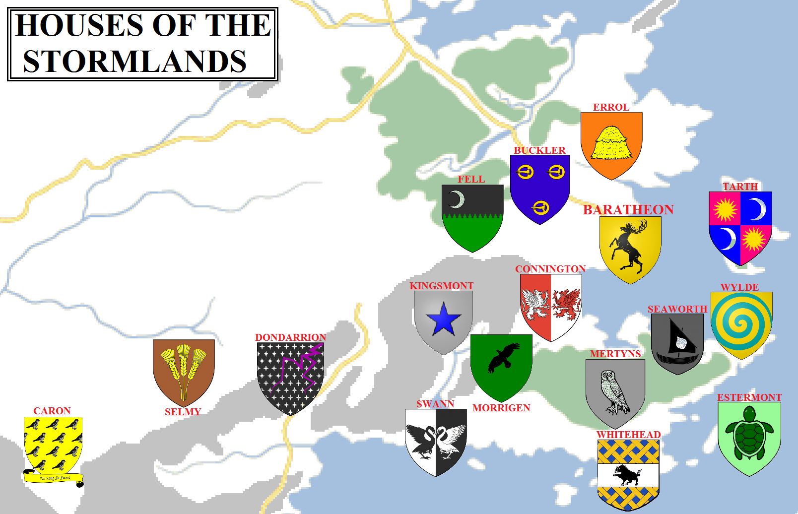

The south-eastern coast of the Seven Kingdoms lies along the shores of the Narrow Sea, the great body of water separating Westeros from the vast continent of Essos to the east. The sea is, as its name states, relatively narrow, with only a few days of voyaging separating the Seven Kingdoms from the great cities of the east.

The Stormlands in 297 AC (click for a larger version). Some locations are speculative.

The Narrow Sea also acts as a funnel for the great storms that build on the Shivering Sea to the north and the Summer Sea to the south. Whilst all the coastal lands of the Narrow Sea can be affected, particularly during autumn and winter, the worst of the storms break on the rocky and windswept stretch known as the Stormlands.

The Stormlands extend from the Kingswood and the lower end of Massey’s Hook all the way to the Sea of Dorne, over 400 miles to the south. They also extend from the coast to the easternmost plains of the Reach, varying from 300 to 500 miles, and also include a significant number of islands in the Narrow Sea and the Sea of Dorne, most notably Tarth and Estermont. Finally, the Stormlands also control a sizeable salient of territory extending south and east, between the Reach and the Red Mountains. This salient, known as the Dornish Marches, extends just over 400 miles to the south-east of Summerhall. From the south-eastern tip of the Marches, at the castle of Nightsong, to the north-eastern corner on the coast near Massey’s Hook, the Stormlands extend for over 900 miles. For an area that is often overlooked by history and chroniclers, it is a surprisingly large region.

Although large, the Stormlands are not hugely populous. The region lacks a major city and the land can be damp and dismal. The Stormlands certainly field less soldiers than the Westerlands, the Vale, the Reach, the North or the Riverlands, but they have a reputation for fierceness and valour.

**The Dornish Marches**

For thousands of years, the kingdoms of the Reach, the Stormlands and Dorne battled one another in near-constant border skirmishes. Dornish raiders would descend from the mountains to pillage the border castles before pulling back behind their formidable natural defences. Attempts by the Storm Kings and Kings of the Reach to invade Dorne would founder in the mountains or desert. Fortresses and towns along the borders have swapped rulers many times.

As centuries passed, the borders stabilised. The Stormlands were left with a large swathe of territory along the feet of the mountains and extending into the coastline along the Sea of Dorne, forming an effective buffer between Dorne and the Reach.

The Marcher Lords, as they are known, are among the most martial lords of the Seven Kingdoms. As well as officially-sanctioned wars against the Dornish in the past, they have fought bandit kings and rebel lords hiding in the mountains. Many of the Marcher castles have been besieged or even destroyed several times over in previous conflicts, only to be rebuilt stronger and more formidable than before.

Most remote of these strongholds is Nightsong, located at the mouth of the Prince’s Pass. Nightsong has been besieged thirty-seven times in the last thousand years and was partially destroyed by Lord Fowler of Skyreach during the First Dornish War. Nightsong was restored and remains the main stronghold of House Caron. Further east and north, near the headwaters of the Cockleswhent, lies Harvest Hall. A less grandiose fortress, Harvest Hall is the seat of House Selmy, a house of landed knights who have become more notable with time. Their most famous son, of course, is Ser Barristan Selmy, Lord Commander of King Robert’s Kingsguard.

Further east still, at the northern end of the mountain pass and road known as the Boneway, lies the ruins of Summerhall. Summerhall was built by King Daeron II Targaryen in 188 AC as a great summer palace, located symbolically where the borders of the Reach, the Stormlands and Dorne were closest together. However, the castle was destroyed seventy-one years later, burned to the ground during an ill-fated attempt to hatch dragon eggs. King Aegon V Targaryen lost his life to this firestorm. The ruins were abandoned and the castle was never rebuilt, its ruins left as a warning of the folly of meddling with forces best left to history.

South of Summerhall, in the Red Mountains, lies Blackhaven. The seat of House Dondarrion, the castle is strong with black basalt walls and a deep, dry moat. Located north of the River Wyl, and the cruel Wyls of Wyl, Blackhaven has, like Nightsong, had to resist multiple attacks from the south before Dorne joined the Seven Kingdoms. The current lord of Blackhaven is Beric Dondarrion, a young and vital knight, popular with the commons for his tourney skills.

East of Blackhaven, the Dornish border turns south to meet the Sea of Dorne. A further stretch of the Marches remains along the coast, however, guarding against possible attacks by sea. This stretch of the Marches is known as the Red Watch, for the Red Mountains that extend north of the Sea of Dorne. The River Slayne cuts a swathe through the mountains here, the only part of the mountain range which is located entirely with Stormland territory. King’s Mountain, the seat of noted knights such as Ser Patrek, lies in this region.

The most impressive castle of the Red Watch is Stonehelm, the seat of House Swann. The Swanns are possibly the most ancient house of the Stormlands following the now-extinct Durrandons, their names mentioned in the most ancient histories of the Marches. They are formidable soldiers, with many of their number serving in the Kingsguard, including the current Ser Balon Swann.

**Cape Wrath**                                               

East of the Dornish Marches lies Cape Wrath, an enormous peninsula extending for almost 400 miles into the Narrow Sea and measuring around 150 miles from north to south. The cape is dominated by the Rainwood, a large, damp and, during the summer, humid forest. The Rainwood and the surrounding lands tend to be rainy but are also quite fertile, and a large proportion of the Stormlands’ population lives in this region.

Notable castles in this area include Crow’s Nest, located at the western edge of the cape in the foothills of the Red Mountains, Mistwood on the southern edge of the Rainwood, and Rain House near the north-eastern tip of the cape. The island of Estermont lies just off the cape, ruled by the noble house of the same name from the castle of Greenstone.

Cape Wrath is also home to two of the Stormlands’ towns. Fawnton lies near Stonehelm, and occasionally suffered Dornish raids before Dorne was brought into the realm. Larger and more significant is the Weeping Town, the largest port of the Stormlands, under the rule of the redoubtable House Whitehead. The coasts of the Stormlands tend to be rocky and poor, with offshore rocks making landings difficult. The Weeping Town has one of the few good harbours in the area.

At the far north-western edge of Cape Wrath, sitting at the far western end of Shipbreaker Bay, lies Griffin’s Roost, the seat of House Connington. House Connington was once a powerful and influential house, its young Lord Jon rising to the rank of Hand of the King to Aerys II before being exiled following his defeat during Robert’s Rebellion. The Conningtons retain control of the castle, but have suffered significant reductions in lands and wealth.

Storm’s End, the seat of House Baratheon. Artwork by Ted Naismith for _The World of Ice and Fire_.

**Storm’s End**

The storms that rage across the Narrow Sea are, through some quirk of fate or geography, often squeezed between the tip of Cape Wrath and the south coast of the island of Tarth, resulting in them smashed into the fifty-mile-wide gulf north of Cape Wrath. This gulf is known as Shipbreaker Bay, as the sea floor is littered with the wrecks of hundreds and possibly thousands of ships that were caught in the bay at the wrong moment. The coasts of the bay are rocky and dangerous even in good weather. When storms lash the region, lives are frequently lost. Most famously, Lord Steffon Baratheon, his wife and many loyal retainers were killed when their ship was smashed to kindling on the rocks and only a single survivor, a fool sent insane by the experience, was pulled from the wreck.

On the northern coast of Shipbreaker Bay there is a headland extending slightly over the bay: Durran’s Point. On this seat sits Storm’s End, one of the most famous castles in Westeros.

Storm’s End is massive, consisting of a single huge, curving curtain wall and a single massive drum tower. According to legend, six castles were raised on the site of Storm’s End, only for the storms and the winds to destroy each one. The current castle is the seventh, built with cunning stonework and, according to rumour, the expertise of Brandon the Builder, who later would construct the Wall. However, this is regarded as fanciful by maesters, as Storm’s End would have to be as old as Winterfell and this does not appear to be the case.

Storm’s End was built by King Durran; his line, House Durrandon, ruled the Stormlands for millennia until King Argilac the Arrogant was slain by Ser Orys Baratheon during the War of Conquest. Following this victory, Orys took Argilac’s daughter to wife and was granted the castle, the sigil and the words of House Durrandon as his own. House Baratheon became a stalwart supporter of the Targaryen dynasty until Robert’s Rebellion, when Lord Robert raised the banners of war and unseated the Mad King. King Robert Baratheon removed himself to King’s Landing to rule, appointing his younger brother Stannis as Lord of Dragonstone. His youngest brother, Renly, was given command of Storm’s End.

**The Sapphire Isle**

Tarth, the Sapphire Isle, sits 100 miles off the east coast of the Stormlands, in the Narrow Sea. It forms the eastern and north-eastern edge of Shipbreaker Bay. It is separated from the mainland by the 30-mile-wide Straits of Tarth, off the island’s northeastern coast. The island is fairly sizeable, measuring 100 miles from north to south and is between 40 and 50 miles wide.

The island is ruled from Evenfall Hall, located on the island’s west coast, by House Tarth. The Tarths used to rule as independent kings but were brought into the Stormlands through marriage. At some point, petty rebel kings established themselves at Morne on Tarth’s east coast before the Storm Kings rooted them out and destroyed them. Tarth was the first part of the Stormlands to be conquered by the Andals, who used the island as a redoubt and stronghold before invading Cape Wrath.

Tarth is among the most peaceful and tranquil of the Stormlands, aside from when its southern shores are battered by the storms of Shipbreaker Bay. The waters are warm and dazzling, giving the island its nickname. The island itself is home to towering mountains were marble is quarried (some of which was used in the construction of the Eyrie, according to legend) and fertile high meadows which feed the inhabitants. The last time Tarth saw violence was when a pirate fleet from Myr seized control of the east coast in 92 AC. Prince Aemon Targaryen, Jaehaerys I’s son and heir, was slain driving them back into the sea.

**The Northern Stormlands**

The Stormlands extend north and west from Storm’s End to the Kingswood and the River Wendwater, which mark the border with the Crownlands to the north. These northern marches are dominated by three strong castles: Felwood, Bronzegate and Haystack Hall, which guard the approaches to Storm’s End. The northern Stormlands are cooler and less storm-wracked than the southern, and make for more pleasant country to travel through. The Kingsroad extends north from Storm’s End, through Bronzegate and over the river at Wendwater Bridge.

The noble houses of the Stormlands in 297 AC (click for a larger version). Some house locations and sigils are speculative.

**Houses of the Stormlands**

**House Baratheon** rules the Stormlands from Storm’s End. They are the youngest of the great houses, having only been founded during Aegon’s Conquest by Orys Baratheon, although they inherited the arms, castle and words of House Durrandon, whose blood still flows in the Baratheons since Orys married the daughter of the last of the Durrandon Storm Kings.

The Marcher Lords are among the most powerful Baratheon vassals. These are **House Caron** of Nightsong, **House Durrandon** of Blackhaven and **House Swann** of Stonehelm. Less powerful but still formidable and respected is **House Selmy** of Harvest Hall.

Other significant houses of the Stormlands include **House Buckler** of Bronzegate, **House Cafferen** of Fawnton, **House Errol** of Haystack Hall, **House Estermont** of Greenstone, **House Fell** of Felwood, **House Grandison** of Grandview, **House Mertyns** of Mistwood, **House Morrigen** of Crown’s Nest, **House Musgood**, **House Peasebury** of Poddingfield, **House Penrose** of Parchments, **House Penrose** of Amberly, **House Staedmon** of Broach Arch, **House Tarth** of Evenfall Hall and **House Wylde** of Rain House.

Lesser houses of the Stormlands include **Bolling**, **Gower**, **Hasty**, **Herston**, **Horpe**, **Kellington**, **Kingsmont** of King’s Mountain, **Lonmouth**, **Seaworth** of the Rainwood, **Swygert**, **Toyne**, **Trant**, **Tudbury**, **Wagstaff**, **Wensington** and **Whitehead** of the Weeping Town.

**Notes**

I have to beg an indulgence for this entry. George R.R. Martin named two Stormland houses for notable SFF bloggers, including myself. Ser Patrek of King’s Mountain, who plays a role in _A Dance with Dragons_ (ending with him being dismembered by the giant Wun Wun), is based on Patrick St. Denis of the [Pat’s Fantasy Hotlist](http://fantasyhotlist.blogspot.co.uk/) blog, whilst Ser Addam Whitehead is mentioned in the forthcoming _Winds of Winter_ as being a knight of the Weeping Town. Although the location of Ser Patrek’s home is fairly logical (in the part of the Red Mountains wholly within the Stormlands), I had to make a slight logical leap for his house name (“Kingsmont”), which is not mentioned in the novel.

For the arms of House Whitehead, I utilised the coat of arms of my maternal ancestors, the McCanns of Northern Ireland (their motto, “Virtue Thrives Under Oppression”, would also be a totally awesome **ASoIaF** motto), but perhaps George will come up with something more appropriate for the books.

House Tudbury is also a nod to George’s earlier iconic character, Thomas Tudbury aka the Great and Powerful Turtle in the **Wild Cards** superhero series.

**Credit**

The map above uses heraldry designs (under [Creative Commons](https://creativecommons.org/licenses/by-sa/3.0/)) from the excellent [Wiki of Ice and Fire](http://awoiaf.westeros.org/index.php/Main_Page) and [La Garde de Nuit](http://www.lagardedenuit.com/wiki/index.php?title=Accueil), the ultimate English and French-language guides to the **Song of Ice and Fire** novels.

_Thank you for reading The Atlas of Ice and Fire. To help me provide better content, please consider contributing to [my Patreon page](https://www.patreon.com/user?u=4370220) and [other funding methods](http://thewertzone.blogspot.co.uk/2017/01/support-wertzone-on-patreon.html), which will also get you exclusive content weeks before it goes live on my blogs._
