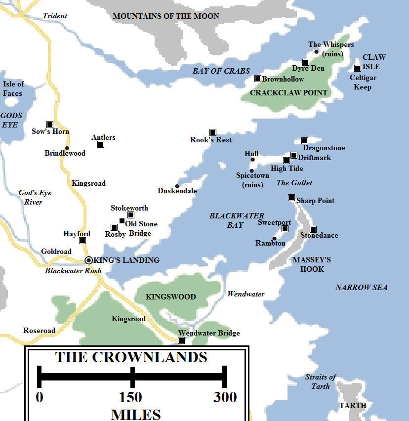
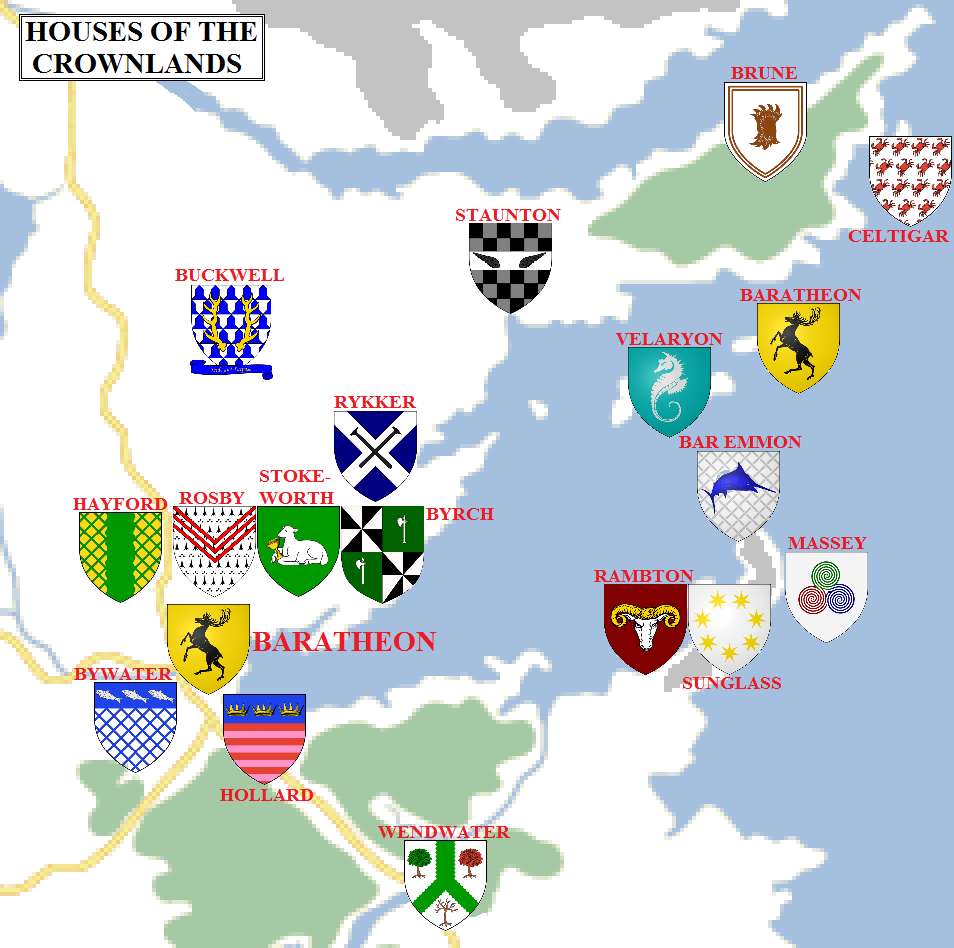

The stretch of coast between the Bay of Crabs and the Kingswood has long been one of the most marginal areas of Westeros. Relatively fertile, it had the misfortune at lying close to four other great powers: the Kingdom of the Vale to the north, the Kingdom of the Rivers and the Hills to the north-west, the Kingdom of the Reach to the south-west and the Storm Kingdom to the south. The area passed between the control of these regions several times before gradually being left alone to its own lords and petty kings.

The Crownlands in 297 AC (click for a larger version). Some locations are speculative.

When Aegon the Conqueror invaded Westeros, this was where he landed and where he secured his first allies on the mainland. Later his great capital city was built here and the area became directly administered by the Iron Throne itself. The informal term “Crownlands” fell into regular use, referring both to the lands directly administered by the king and the islands off the coast.

The Crownlands extend for approximately 400 miles from the Bay of Crabs to the Wendwater, and for close to 450 miles from the western border (near Gods Eye) to the Narrow Sea at the tip of Crackclaw Point. The Crownlands are geographically dominated by Blackwater Bay, an immense inlet of the Narrow Sea, and also include the offshore islands of Driftmark, Dragonstone and Claw Isle, amongst others. The Crownlands are economically and politically controlled by King’s Landing, the largest city in Westeros.

**King’s Landing**

King’s Landing is the capital city of the Seven Kingdoms. It is built around three tall hills overlooking the mouth of the Blackwater Rush, where it opens into the bay. It is also the youngest city of the Seven Kingdoms, being formally founded only around 300 years ago by Aegon the Conqueror.

The tall hills overlooking the bay have made a natural place for habitation and settlement for millennia, and the ruins of villages and watchtowers in the region of the city could be seen even when Aegon arrived. However, the ever-changing borders between the surrounding kingdoms prevented a long-term settlement from taking root. When Aegon landed at the river mouth he quickly fortified the tallest hill overlooking the bay and built a wooden stronghold there, nicknamed the “Aegonfort” by his troops. After he completed his conquest, he expanded the Aegonfort and decreed that a greater city would take shape around it. When word arrived that a pirate fleet had sacked the Summer Islands he realised the city was vulnerable to a naval assault and commanded that walls should be raised, which were completed by 26 AC. He also ordered the rebuilding of the Aegonfort as a larger and more formidable stone fortress. This was completed during the rule of his second son, Maegor I. Built of red stone, the castle was named the Red Keep. Crowning Aegon’s High Hill, it is one of the most distinctive buildings in the Seven Kingdoms.

The other two hills have their landmarks as well. Atop the Hill of Rhaenys sits the Dragonpit. Once the hill was crowned by the impressive Sept of Remembrance, but this was destroyed during the Faith Militant Uprising, burned to the ground by King Maegor using the dragon Balerion. The Dragonpit, a home for the Targaryen dragons, was raised in its stead. This in turn was destroyed during the Dance of Dragons. The building has been left in ruins ever since.

Sitting atop Visenya’s Hill is the Great Sept of Baelor, the largest sept in the Seven Kingdoms and the centre of the Faith of the Seven, supplanting the older Starry Sept of Oldtown.

When the city walls were built, lots of space was left over for future construction and growth. But the city grew faster than expected. Today the city inside the walls is full to bursting and buildings have overflown outside the walls, along the roads and the banks of the Blackwater. The population of the city is hard to estimate, given seasonal variations in trade and travel, but some maesters have estimated that around 400,000 people can usually be found in or near King’s Landing, somewhat more than Oldtown. King’s Landing covers less area than Oldtown and the streets have not been paved, resulting in a city that’s busier, more crowded and distinctly muddier (and certainly more aromatic).

King’s Landing’s harbour is one of the most extensive in Westeros, stretching for several miles along the mouth of the Blackwater. The harbour usually bustles with ships from all over the known world, as well as ferries carrying people back and forth to the far side of the river where the southern Kingsroad from the Stormlands terminates (it resumes again on the north side of the city). The harbour is somewhat ad hoc in nature, consisting of wooden shanties built up against the city wall, representing a significant danger of fire and disease. The City Watch occasionally clears out the shanties of people and pulls the buildings down, but they soon encroach back again.

There are seven gates into the city. Clockwise from the south-east, these are the River Gate, the King’s Gate, the Lion Gate, the Gate of the Gods, the Old Gate, the Dragon Gate and the Iron Gate. Several major highways meet at King’s Landing: the Rosby Road leading to Rosby and thence to Stokeworth and Duskendale; the northern Kingsroad, leading north to Hayford, Darry and the Trident (and eventually Winterfell, some 1,500 miles to the north); the Gold Road, leading to the Deep Den and Lannisport (about 800 miles to the west); and the southern Kingsroad, leading to Storm’s End some 400 miles to the south. Thirty miles or so to the south-east of the city, the Roseroad splits off from the Kingsroad, leading to Bitterbridge, Highgarden and, about a thousand miles to the south-west, Oldtown.

**The Kingswood**

South of King’s Landing lies the Kingswood, the largest and most extensive forest in Westeros south of the Neck. The forest sprawls on either side of the Wendwater and extends north and west to the banks of the Blackwater Rush, as well as north and east to the end of Massey’s Hook and west towards the plains of the Reach. The forest south and south-east of the Wendwater lies in the Stormlands, but most of its extent lies in the Crownlands under the direct authority of the Iron Throne.

The Kingswood has been partially tamed, with villages and farms found nestled between the clusters of trees. But, at the crown’s command, vast stretches of the forest have been left untamed. Fierce wild boar, proud pheasants and deer can be found in the forest, ready prey for one of the king’s hunting trips.

Despite its proximity to King’s Landing, the inhabitants of the Kingswood have not always greatly loved the crown. Less than a generation ago, a band of rebels and marauders won the support of the woodsfolk and rebelled against the Iron Throne, raiding surrounding lands and waylaying traffic on the Kingsroad. It fell to Ser Arthur Dayne, the Sword of the Morning, to win back the allegiance of the woodsfolk and defeat the so-called Kingswood Brotherhood in a military campaign lasting months, during which the young warrior Jaime Lannister rose to prominence and fame.

The most notable house of the Kingswood is House Wendwater, which commands much of the length of the river from its castle near Wendwater Bridge.

**The Crownland Castles**

Located in the shadow of King’s Landing are several notable castles, home to houses far older than the capital itself, who in ancient times were subject to the Storm Kings or River Kings or Dusk Kings of Duskendale, or served for a time as petty-kings themselves.

The Hayfords of Hayford are the closest to King’s Landing: their castle is less than a day’s brisk ride from the city along the Kingsroad. A smaller road splits off the Kingsroad and leads north-west into the southern Riverlands, below Gods Eye. Hayford sits atop a hill surrounded by a small stream, making it a formidable defensive redoubt.

Located somewhat further away to the north-east of King’s Landing, maybe 65 miles or so, is Rosby. Rosby is a small castle surrounded by a village, a watering hole on the way from the capital to Duskendale. A further 40 miles or so to the north-west is Stokeworth, a proud and stalwart castle belonging to a family noted for their long-term allegiance to the crown. Between Rosby and Stokeworth lies the Old Stone Bridge, an inn and common waystop on the Rosby Road.

Located about 180 miles north-east of King’s Landing lies the large town of Duskendale. Duskendale sits at the head of a long inlet of Blackwater Bay, with a large headland to the east that keeps the worst of the sea storms away from the town. Duskendale used to be the largest port on the eastern coast of Westeros between Gulltown and Dorne, and it bore the loss of that position to King’s Landing with less than good grace (ultimately culminating in the Defiance of Duskendale and the breaking of House Darklyn). Now controlled by House Rykker, Duskendale remains a large port with healthy trade with the Blackwater islands and the Free Cities, but it seems condemned to remain in the shadow of the capital.

**The Northern Crownlands**

The Kingsroad runs north from King’s Landing through Hayford and on towards the Riverlands. Small villages such as Brindlewood lie on this road, providing rest and succour to travellers and merchants. East of the Kingsroad lies the castle of Antlers, the home of House Buckwell. The Buckwells used to be a strong family in the Crownlands, but made the mistake of backing the Targaryens during the rebellion. Although the family kept their castle, they lost some lands and some of their members were forced to take the black afterwards.

The northern Crownlands are large and covered by farms, smallholdings and minor noble lands. These lands form the breadbasket of King’s Landing, sending food and goods to the capital.

**Crackclaw Point**

North and east of Duskendale lies the castle of Rook’s Rest, the seat of House Staunton. The site of a major battle during the Dance of Dragons, Rook’s Rest also marks the south-western end of Crackclaw Point. An immense peninsula, Crackclaw Point divides the Bay of Crabs to the north from Blackwater Bay to the south. The tip of the peninsula is 300 miles to the north-east of Rook’s Rest, whilst its width varies from about 70 miles to around 90 and then back down again as the peninsula narrows.

Crackclaw Point is covered in hills, bogs and barrens, with forests crowding the north-eastern part of the peninsula. The northern coast, east of Maidenpool, is the most heavily-populated. Brownhollow and the Dyre Den are two of the largest castles on the peninsula, but the headland is crowded with ancient ruins, such as the castle known as the Whispers. The people of Crackclaw Point are fractious, boisterous and uncouth by the standards of many of the surrounding lands. For centuries the headland was battled over by the Celtigars of Claw Isle (which lies off the peninsula’s south-eastern coast), the Darklyns of Duskendale and the Mootons of Maidenpool, amongst others. During Aegon’s Conquest the inhabitants of Crackclaw made alliance with Queen Visenya Targaryen in return for being allowed to govern themselves. After Aegon completed his conquest, he lived up to his word and refused to put any other lords in charge of Crackclaw Point. It is said that the area is a hotbed of Targaryen loyalism even today, but its remoteness means it is paid little heed.

**Blackwater Bay**

Blackwater Bay is a very large body of water, with the island fastness of Dragonstone lying 400 miles north-east of King’s Landing. The massive extent of water inbetween is patrolled by the royal fleet, with 50 ships based at King’s Landing and 160 at Dragonstone (including 80 war galleys), making this one of the most heavily-defended stretches of water in the known world. Pirates know better than to even attempt to enter the bay.

They are two ways into Blackwater Bay. The safer is the Gullet, a 60-mile-wide strait between the tip of Massey’s Hook and the island of Driftmark. Between Driftmark and Dragonstone and the mainland of Crackclaw Point is a narrower strait, about 30 miles wide, but this seems to be less well-travelled, possibly due to the rocky coast.

The most famous stronghold on Blackwater Bay is the castle of Dragonstone sitting on the island of the same name. Dragonstone is a mountain of volcanic origin, jutting dramatically out of the Narrow Sea. The island was the home and birthplace of dragons for centuries, but in recent centuries the dragons have disappeared. However, the island is still home to a formidable castle. Fashioned by the Valyrians of the lost Freehold, the castle is carved out of the very volcanic stone of the island and resembles a serpentine mass of dragons and firewyrms. Since Robert’s Rebellion and the defeat of House Targaryen, the island has been held by Lord Stannis Baratheon, the king’s brother.

Just south and west lies the island of Driftmark. Driftmark is considerably larger than Dragonstone, but much less dramatic in appearance. House Velaryon, also of Valyrian origin, commands the island from the castle of Driftmark. The Velaryons were once one of the most powerful houses in Westeros, commanding a vast fleet and exerting immense influence, particularly during the days of Corlys Velaryon, the “Sea Snake” who undertook many great voyages of discovery and exploration in the Shivering Sea and Jade Sea before playing a key role in the Dance of Dragons. Their influence waned considerably in later years, but Driftmark remains a sizable centre of travel and trade on Blackwater Bay. The Velaryons command both Driftmark Castle and the partially-ruined castle of High Tide, along with the town and port of Hull. Another port, Spicetown, was destroyed during the Dance of Dragons and never rebuilt.

120 miles to the north-east of Dragonstone, along the coast of Crackclaw Point, sits Claw Isle. This is a small rock, still called Crab Isle by the inhabitants of the peninsula. Claw Isle is the seat of House Celtigar, another ancient house of Valyrian origin.

Another key stronghold on the bay is Sweetport Sound, the seat of House Sunglass. The Rambtons of Rambton are important vassals of Sweetport. The two houses are noted for their piety to the Seven.

**The Hook**

Forming the south-eastern edge of Blackwater Bay is the narrow peninsula known as Massey’s Hook. The Hook extends for about 130 miles from the mainland, north and east of the mouth of the Wendwater. The Hook is narrow, mountainous and difficult to attack. Two castles can be found on the hook: Stonedance, the seat of House Massey, and the fortified lighthouse known as Sharp Point of House Bar Emmon, located at the very tip of the Hook. A great fire burns on Sharp Point, warning ships traversing the Gullet away from the rocky shore.

In ancient times the Hook was part of the Stormlands. The Masseys rebelled against Storm’s End but were ultimately defeated. However, during the Targaryen stewardship of Dragonstone, both the Masseys and Bar Emmons allied with them and supported their military campaign to win control of Westeros.

The noble houses of the Crownlands in 297 AC (click for a larger version). Some house locations are speculative.

**Houses of the Crownlands**

The Crownlands owe their fealty to **House Baratheon**. Most of the mainland houses are sworn directly to King Robert Baratheon, who sits the Iron Throne in King’s Landing, but many of the islands in Blackwater Bay and some of the surrounding coasts are instead sworn to Dragonstone and Lord Stannis Baratheon, the king’s younger brother who serves as Lord Admiral of the Royal Fleet and Master of Ships on the small council. The king’s youngest brother is Renly Baratheon, who now serves as Lord of Storm’s End.

Major houses sworn to King’s Landing include **House Brune** of Brownhollow and the Dyre Den, **House Buckwell** of the Antlers, **House Hayford** of Hayford (and their vassals, **House Hogg** of Sow’s Horn), **House Rosby** of Rosby, **House Rykker** of Duskendale, **House Staunton** of Rook’s Rest, **House Stokeworth** of Stokeworth (and their allies, **House Byrch**), **House Wendwater** of Wendwater.

Minor houses sworn to King’s Landing include **House Blount**, **House Boggs**, **House Bywater**, **House Cave**, **House Chelsted**, **House Crabb** of the Whispers, **House Cressey**, **House Dargood** of Duskendale, **House Darke** of Duskendale, **House Darkwood** of Duskdendale, **House Edgerton**, **House Gaunt**, **House Hardy**, **House Harte**, **House Hollard**, **House Kettleblack**, **House Langward**, **House Mallery**, **House Pyle**, **House Pyne**, **House Rollingford**, **House Thorne**,

Houses sworn to Dragonstone include **House Bar Emmon** of Sharp Point, **House Celtigar** of Claw Isle, **House Chyttering**, **House Farring**, **House Follard**, **House Manning**, **House Massey** of Stonedance, **House Sunglass** of Sweetport Sound (and their vassals, **House Rambton**) and **House Velaryon** of Driftmark.

**Credit**

The map above uses heraldry designs (under [Creative Commons](https://creativecommons.org/licenses/by-sa/3.0/)) from the excellent [Wiki of Ice and Fire](http://awoiaf.westeros.org/index.php/Main_Page) and [La Garde de Nuit](http://www.lagardedenuit.com/wiki/index.php?title=Accueil), the ultimate English and French-language guides to the **Song of Ice and Fire** novels.

_Thank you for reading The Atlas of Ice and Fire. To help me provide better content, please consider contributing to [my Patreon page](https://www.patreon.com/user?u=4370220) and [other funding methods](http://thewertzone.blogspot.co.uk/2017/01/support-wertzone-on-patreon.html), which will also get you exclusive content weeks before it goes live on my blogs._
