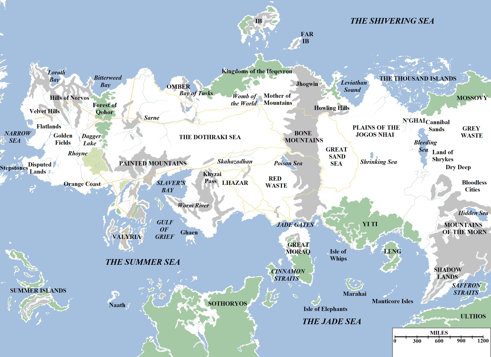

Essos is the largest continent in the known world. To its inhabitants it is the birthplace of civilisation, the probable birthplace of humanity and, to all intents and purposes, it _is_ the world, Westeros less than an afterthought.

The explored regions of the continent of Essos.

Essos is a land of great extremes: its great rivers (such as the Rhoyne and the Sarne) dwarf the largest rivers in Westeros and its tallest mountains are far beyond the tallest peaks of the Sunset Lands in size. Its cities are larger and its merchants richer, by far, than their western cousins.

It is also a much more fractious and violent land. Whilst almost all of Westeros (barring the northern fringes) is united as a single polity, Essos is divided between dozens of city-states and kingdoms, as well as several large empires and nomadic warriors whose territories extend over thousands of miles.

It is also a land of mysteries and the unknown. Even its geographic constraints have not been measured: beyond the forests of Mossovy, the plains of the Grey Waste, the peaks of the Mountains of the Morn and the mist-shrouded waters of the Saffron Straits, all knowledge of the continent abruptly ceases. Expeditions seeking to explore the lands to the east of Carcosa and the Shadow Lands – even by the ancient Valyrians on dragonback – have simply all vanished without a trace. Even the famed Sea Snake of Westeros, Corlys Velaryon, chose to turn back at Nefer rather than risk further travel through uncharted seas.

The mapped portion of Essos, stretching from the western-most promontory in the Disputed Lands to the eastern shores of the Hidden Sea, extends across a distance of approximately 6,335 miles. At its widest in the far east, the continent extends for approximately 2,600 miles from Nefer on the Shivering Sea to Asshai on the Jade Sea. The continent is divided into several informal cartographic regions by maesters when discussing its geography, for ease of debate.

The western-most region is known as the **Free Cities**, for it is dominated by nine great city-states and the large regions of territory each control. These cities are Braavos, Lorath, Lys, Myr, Norvos, Pentos, Qohor, Tyrosh and Volantis. This is the area that has the most traffic with Westeros, lying as it does just a few days sail across the Narrow Sea.

East of the Free Cities lies the vast region known as the **Dothraki Sea**, consisting mainly of the vast grasslands that give it its names, as well as the lands watered by the River Sarne.

South of this region lies **Slaver’s Bay**, formerly the heartland of the vast Valyrian Freehold and the Ghiscari Empire before that, but today divided between the ruined lands of Valyria and the Lands of the Long Summer (over both of which the Doom still holds sway) in the west and the resurgent cities of the harpy to the east: Meereen, Astapor, Yunkai and New Ghis. Immediately neighbouring them to the east is the kingdom of Lhazar.

East of Slaver’s Bay lies the forbidding **Red Waste** and the great city-state of Qarth, as well as the immense offshore island of Great Moraq. The gateway between east and west, this region sees immense wealth flowing between the Summer Sea in the west and the Jade Sea in the east.

North of the Dothraki Sea lies the island of **Ib** (sometimes called Ibben), which also controls stretches of the nearby mainland as well.

East of the Dothraki Sea lies the immense **Bone Mountains** and the **Plains of the Jogos Nhai**, home to a formidable, nomadic warrior-race as well as the surviving city-states of the ancient, long-fallen Patrimony of Hyrkoon.

South of the Plains of the Jogos Nhai lies the **Golden Empire of Yi Ti**. Probably the most populous nation in the known world, Yi Ti is ancient (some might say decadent), rich beyond reckoning and home to a hundred quarrelsome cities, each larger than King’s Landing or Oldtown. The wealthy island of Leng lies just off its coast.

In the far south-east of the world lies the **Jade Sea**, a vast, circular ocean whose shores teem with great cities, forbidding jungles and dark mysteries. Hundreds of islands fill the Jade Sea, chief among them fire-shrouded Marahai and the exotic Island of Elephants.

East of the Jogos Nhai lies the **Far East**, home to the Thousand Isles, the heavily-forested realm of Mossovy and the disturbing Bleeding Sea. This region is home to the Cannibal Sands, the Land of the Shrykes and the Cities of the Bloodless Men. The Mountains of the Morn loom over the landscape, in a hidden valley of which is said to lie the Hidden Sea, the homes of the fabled winged men and the forbidding, mysterious city of Carcosa. Knowledge fails us in this land and reality and myth become entwined.

Finally, south of the Mountains of the Morn and east of the Jade Sea lies the **Shadow Lands**, a land of towering mountains so high that they block out the sun, plunging the surrounding valleys into utter darkness even during the day. This is the land of ghost grass, the brackish waters of the River Ash and the corpse-city Stygai, where even the greatest sorcerers of the Shadow refuse to tread. At the mouth of the Ash lies the largest city (but most heavily under-populated) in the known world, Asshai-by-the-Shadow, mostly left in derelict ruins where sorcerers practice foul rites and hungry merchants lust for gold.

The population of Essos is hard to estimate, although maesters suggest it is considerably more than the (conservative) estimates of forty-five million for Westeros. Yi Ti is densely populated and the Free Cities almost all dwarf the largest cities in Westeros in population.

Due to its huge size, Yi Ti is home to numerous disparate factions and forces. The **Free Companies**, or mercenary sellswords, are considerably influential. Many of the city-states cannot afford to maintain standing armies, so they instead hire swords for coin to fight their battles for them. Although traditional, this has been cited as ineffective, since sellswords are untrustworthy and may turn their cloak if another city offers a better price. The **Unsullied** of Astapor, famed warrior-eunuchs with a reputation for absolute loyalty and fearlessness, are popular for their staunch reliability in battle, but this comes with a price. The warrior-nomads of both the **Dothraki** and the **Jogos Nhai** are feared for their skill and savagery in battle.

In matters of religion, Essos is home to almost as many faiths as there are stars in the sky. Rising in popularity is the cult of the red god, **R’hllor, Lord of Light**, which has gained vast numbers of followers in recent centuries. The centre of this faith is in far Asshai, but there is also a significant temple to him in Volantis. The **Moonsingers** are the most popular religious sect in Braavos, as they helped found the city, but temples to almost every deity under the sun can be found in the city. Also popular are the **Great Shepherd** of Lhazar, the **Lion of Night**, the **Many-Faced God**, the **Stone Cow** of Faros, the **Weeping Lady**, **Trios**, **Bakkalon** the Pale Child, the **Hooded Wayfarer** and the **Black Goat** of Qohor, amongst many, many others.

Essos then is a vast land of many different peoples, gods and lands, a teeming and confusing morass of cultures and races whose beliefs are very alien to those of the Seven Kingdoms.

_Thank you for reading The Atlas of Ice and Fire. To help me provide better content, please consider contributing to [my Patreon page](https://www.patreon.com/user?u=4370220) and [other funding methods](http://thewertzone.blogspot.co.uk/2017/01/support-wertzone-on-patreon.html), which will also get you exclusive content weeks before it goes live on my blogs._
