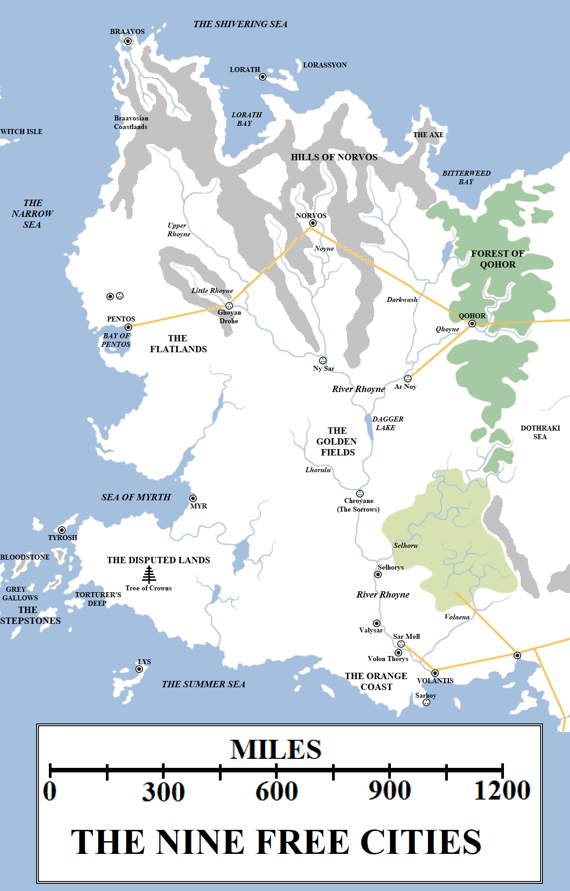

To the people of Westeros, “beyond the Narrow Sea” is a phrase promising exotic new locales, adventures in remote and interesting lands and a reference to rich cities specialising in exotic gods, heathenism and corruption. They refer to the Nine Free Cities of Essos, often talking about them in the same terms when each city is remarkably different in tone, character and history. The Free Cities share a history – they were founded by or in response to the actions of the Freehold of Valyria – but culturally and economically each stands alone.

The region covered by the Free Cities is vast, matching the entire South of Westeros in size. It extends for approximately 1,800 miles from north to south and for over 1,300 miles from east to west. The Free Cities region is bordered by the Shivering Sea to the north, the Narrow Sea to the west, the Summer Sea to the south and the Dothraki Sea and Painted Mountains to the east.

Internally, the Free Cities region consists of large and fertile plains watered by numerous rivers. Several rivers rise in the hills and mountains of the north. Generally referred to as the “Hills of Norvos”, although many of these “hills” rival mountains in Westeros in size, these highlands give rise to the rivers which rush down to the plains and forests, forming the mighty Rhoyne along their way. The Rhoyne sweeps south for almost 1,350 miles, from the source of the Upper Rhoyne all the way to the river delta just below Volantis, watering the Flatlands, the Golden Fields and the Volantene hinterlands along the way.

Other areas of interest in this region include the Disputed Lands, Orange Coast, the ruins of the Rhoynar cities and the numerous offshore islands.

**The Hundred Isles of Braavos**

The northern-most of the Free Cities is Braavos. Braavos is located in a lagoon at the far north-western tip of the Essosi continent, where the Narrow Sea meets the Shivering Sea, surrounded by ridged islands which keep the worst of the winter winds and storms away from the city. Braavos itself is said to sprawl over a hundred islands, although the real number is fewer, due to some of the islands having sunk beneath the waves since the city’s founding eight centuries ago.

The isles of Braavos are enclosed in a brackish, saltwater bay open to the sea through channels through the outlying islands. Treacherous reefs and rocks dot these channels, leaving only one, in the north-west between Sellagoro’s Shield and a neighbouring island, large enough for ocean-going ships. This channel is guarded by the Titan of Braavos, a colossal combination of statue, lighthouse and fortification. The Titan, which is at least 300 feet tall and possibly more, has fires burning within its eyes to guide ships home and an immense horn (sometimes called the Titan’s Roar) which can be blown to alert the city to the approach of vessels. Just inside the bay is the Arsenal, an island where Braavosi war galleys can be constructed in a day from pre-fabricated components. The Arsenal itself is heavily defended and Braavosi warships patrol both the bay and the surrounding waters in impressive numbers.

Behind the Arsenal is the Chequy Port, a small island containing a customs inspection port. Ships passing the port will be waved to their destinations: foreign ships are directed south to the Ragman’s Harbour and Braavosi vessels are directed east to the Purple Harbor. Just south of the Chequy Port is the entrance to the Canal of Heroes, a broad waterway guarded by the statues of great Braavosi warriors and rulers. This canal leads to the bay at the heart of the city, where the Isle of Gods and Palace of Truth are located. The Long Canal leads south from this bay, leading to the fishmarket and south side of the lagoon, whilst the Green Canal extends eastwards.

Braavos is a city of canals, rivers and small lakes, all spanned by many hundreds of bridges. Although the city technically consists of many islands, it can be divided into three primary districts. The northern-most is the richest, being the home to many of the city’s nobles and richest merchants. The Sealord’s Palace is located at the north-eastern edge of the city, with the Moon Pool and the Iron Bank just to the south. To the south-west lies the most bustling district of the city, home of the Ragman’s Harbor, the biggest markets and many of the most popular taverns and places of business. The Drowned Town, the oldest part of the city which has subsided into the lagoon, can also be found here.

To the south-east lies the city’s poorest district, the Silty Town, although some noble houses (like the Antaryons, current rulers of the city) have taken up residence here due to favourable prices. The Sweetwater River, an immense aqueduct, extends from north-eastern part of the city south before swinging south-west to meet the mainland, thus supplying all three main districts of the city with fresh water.

In the centre of the city lies the Isle of Gods and many other places of worship: the Temple of the Moonsingers (the largest, in recognition of their role in founding the city), the Temple of the Lord of Light, the Sept-beyond-the-Sea and the feared House of Black and White, the reputed headquarters of the Faceless Men.

The mainland of the lagoon is brackish and swampy, so there appear to be no settlements immediately adjacent to the city itself. However, Braavos has claimed the coast of the Narrow Sea southwards from Braavos for approximately 450 miles, as well as the entire western shore of Lorath Bay. This region surrounding the city is dotted with mines, villages and some more substantial towns, all keeping Braavos supplied with food, timber and iron and, combined with trade, all allowing Braavos to maintain its position as the richest and most militarily powerful of the Free Cities.

The population of Braavos is unknown, although [some speculate](https://atlasoficeandfireblog.wordpress.com/2016/03/19/the-population-of-the-free-cities/) that maybe twice as many people live in and near the city as in King’s Landing in Westeros.

**The Islands of Lorath**

Located approximately 375 miles east of Braavos, at the northern mouth of Lorath Bay, Lorath is the most remote of the Free Cities; nothing lies to its east for over two thousand miles until hardy sailors reach the island of Ib, although a few ports can be found on the north coast of Essos. Lorath is the poorest, smallest and least populous of the Free Cities, but remains viable due to the rich waters around the Lorathi Isles, which teem with fish, walruses and whales.

The Lorathi claim dominion over both the islands and entire coastline of Lorath Bay. They do control the islands, most notably Lorath Island itself and Lorassyon, the second-largest island, as well as a score of smaller islands and rocks that no-one else wants, but at best they control only the east coast of the bay and the peninsula located immediately to the south of the islands themselves; the west coast is held by Braavos and the effortless superiority of the Braavosi navy means that the Lorathi are unable to press their historical claims. Their only major recent success has been the founding of the colony city of Morosh at the mouth of the River Sarne. However, the distance between the two cities (Morosh lies approximately 1,000 miles east of Lorath, almost halfway to Ib) precludes direct rule and the colony-city is left to its own course in most matters.

A curious feature of the Lorathi Isles are their mazes. An unknown and ancient people constructed mazes across the three islands and the nearby mainland. The largest covers three-quarters of the island of Lorassyon and extends for four levels underground, over 500 feet. According to tradition, the maze-makers were wiped out by a threat from the sea many millennia ago.

**Norvos**

Norvos is located on the mainland of Essos, almost 750 miles south-east of Braavos. The tall peaks of the Hills of Norvos separate Norvos from the north coast and provide the city with its wealth via immense mines stretching under the limestone hills surrounding the city. Dark forests of pine and beech can also be found near the city.

The city is located on the banks of the River Noyne, a tributary of the Rhoyne, and this defines the layout of the city. The Low City sits next to the river and contains docks, a port and trading establishments. It is rude, rowdy and bustling. The High City, surrounding by tall stone walls, is located 300 feet above and is the home to rich nobles and the city’s religious caste, who act as _de facto_ rulers. The two districts are linked by the Sinner’s Steps, which are guarded so only people with business in the High City are permitted entry.

Norvos is a theocracy ruled by the enigmatic Bearded Priests, who have no interest in explaining their religion to outsiders. The worship of other gods is not permitted in the High City and the city’s merchant council is appointed by the Priests. Although the Priests guard the independence of Norvos jealously, they are also pragmatic enough to collect tribute for when Dothraki _khalasars_ ride out of the east along the impressive Valyrian highway leading from ruined Sarnath to Pentos. Norvos’s formidable walls and the ability to evacuate and reinforce by river make the city a tough nut to crack, even for the Dothraki, so the Norvosi tribute is helpful in persuading Dothraki _khals_ not to expend the tens of thousands of lives it would take to seize the city.

Norvos controls a wide swathe of surrounding territory, extending some 350 miles north-east to the Axe (where Norvos holds several mines), north and west into the hills and south along the Noyne as far as Ny Sar. Norvos controls a small fleet of warships which it occasionally deploys against river pirates, sometimes in conjunction with (or in opposition to) the forces of Qohor to the east.

**The Forest City of Qohor**

Qohor is located 450 miles south-east of Norvos and almost 1,200 miles south-east of Braavos. The city is also located over 900 miles due north of Volantis.

The city rests on the banks of the River Qhoyne, just as it enters the forbidding Forest of Qohor. Much of Qohor’s wealth and riches come from the forest, which it has logged extensively over the centuries. The forest is over 700 miles long from north to south and 300 miles at its widest point. It is thick and dark, home to wolves and other dangerous animals. Travel through the forest is largely restricted to boating along the Qhoyne or by using the Valyrian road which leads from Qohor due east to long-fallen Essaria and Sarnath (and, across the open plains, beyond to distant Vaes Dothrak and the Bones).

Whilst this road allows trade caravans to pass the city, to its enrichment, it also provides an unfortunately easy route of access for Dothraki _khalasars_ to the city. During the Bleeding Years, Qohor came under a massive assault by the Dothraki which it beat off by deploying a garrison of Unsullied warrior-eunuchs from distant Astapor. Qohor barely survived the onslaught. The Dothraki have chosen not to attack the city again, especially since the Free Cities are happy to provide them with tribute instead, but Qohor lives in caution of the day that a bold _khal_ against chooses to try to sack the forest city.

Qohor is also called the City of Sorcerers, for it is reported that warlocks and self-styled wizards spend their time in the city trying to recreate the fallen arts of lost Valyria. This extends to metalworking, where the Qohorik smiths are said to have re-discovered at least some of the secrets of forging Valyrian steel. The city is united in its worship of the Black Goat, a deity that hungers for blood (of animals, but sometimes human sacrifice is reported in the city) and is regarded as a demon by some of the other Free Cities.

Despite something of a dark reputation, Qohor is also immensely rich, as it stands as a self-styled gateway between the worlds of the west and east.

**Pentos**

Pentos is located on the west coast of Essos and is a mighty port. It sits at the head of the Bay of Pentos, a body of water almost completely enclosed by a mountainous peninsula, with a wide channel leading out into the Narrow Sea proper. Smaller than Volantis or Braavos, but larger than most of the other cities, Pentos is seen as the gateway to Essos and is located conveniently close to King’s Landing, the capital of the Seven Kingdoms, which lies about 800 miles to the west. Braavos lies almost exactly 750 miles to the north, Qohor 900 miles to the east and Myr some 450 miles to the south and east, giving Pentos (in theory) domination over a wide swathe of territory.

However, this is not the case. On paper, Pentos claims the Flatlands, the immense and fertile countryside of plains and rivers extending east from the city to the Rhoyne, north to the Velvet Hills and south to the Golden Fields. In practice, the Pentoshi hesitate to build towns and villages out on the plains from fear of the Dothraki. The Dothraki often visit Pentos, aware of the riches in tribute they can gather from its magisters and the wealth that flows into the city by sea. Although the Dothraki are unlikely to ever destroy the city itself (it being too useful as a source of slaves and tribute), settlements out on the plains are a different matter. Some magisters maintain expansive manses out on the Flatlands, but will generally retire behind the walls of Pentos when they hear of a _khalasar_‘s approach.

Pentos is also an ally – if sometimes a reluctant one – of Braavos. 190 years ago Pentos lost a sixth bloody war with the former Secret City and was forced to give up its claims to the coastlands to the north and also abolish the slave trade. Formally, slavery is as illegal in Pentos as it is in Braavos, but in practice the city employs a bewildering legal structure of “bond-servants” and “indentured servants” to get around this proscription.

Pentos’s submission to both the Dothraki and Braavos have given the city a reputation for cowardice and political expediency over ideology or strength. As a result the city lacks the formidable reputation of most of the other Free Cities, and is not widely respected (especially by the honour-obsessed nobles of the Seven Kingdoms). However, the merchant princes of the city can scheme and plot with the best of them, and should not be underestimated.

**Myr**

Myr is located some 450 miles south of Pentos and commands an impressive harbour at the eastern end of the Sea of Myrth, a significant inlet of the Narrow Sea. The city controls a wide swathe of territory, extending inland for several hundred miles and south to the river that marks the northern perimeter of the Disputed Lands. Despite this, it is not one of the larger cities and has spent time in previous centuries as a vassal of Volantis before re-establishing its freedom.

Myr is a practical city, less concerned with religious matters than with trade and with science. Myrish artisans build some of the finest clocks in the world, and their lens-makers are inarguably the finest in the world in the field of optics, impressing even the maesters of Oldtown.

Myr is well-situated for trade, with its trading fleets paying frequent visits to the Seven Kingdoms to the west and Pentos and Braavos to the north. Its merchants also strike out inland, helped by a Valyrian dragonroad which leads towards the Rhoyne; however, this road was never finished and soon gives way to a ruder network of roads and tracks traversing the Myrish hinterland and leading east to the Rhoyne and south-east towards Volantis, almost 800 miles distant.

**Tyrosh**

Tyrosh is located on the north-eastern most island in the Stepstones, 400 miles south-west of Myr and 450 miles north-west of Lys. It dominates the northern part of the island and started life as a Valyrian military outpost, with walls of fused black dragonstone. Later, the inhabitants discovered a unique species of sea snail on the islands nearby which produced a remarkable dye. Tyrosh built its reputation and its riches on both this dye and controlling the treacherous trade routes through the Stepstones.

Tyrosh is also the nearest of the Free Cities to the mainland of Westeros; the coast of Dorne lies barely 200 miles south-west of the city. There are friendly ties between Tyrosh and Dorne going back many years, with the Prince of Dorne and Archon of Tyrosh (the head of the city’s merchant council) frequently exchanging visits, but Tyrosh’s reputation elsewhere is mixed. In particular, the relationship between Tyrosh and the fleets of corsairs and freesails which infest the Stepstones is open to question, with many in both Westeros and Essos accusing the Tyroshi of employing the corsairs to raid ships for its own enrichment. The Tyroshi sometimes sponsor fleets to “clear” the Stepstones of raiders, which sometimes leads to a few years of peace, but always the pirates return.

Tyrosh has also often been at odds with Braavos, especially its brazen use of slavers (occasionally sailing even beyond the Wall in search of wildling slaves). The distance between the two cities (over 1,300 miles) precludes a major military confrontation, but the prospect of a merchant war between the two cities has usually seen Tyrosh back down.

**Lys**

Lys is the southern-most of the Free Cities. It is located on an island in the Summer Sea and commands the sea lanes leading north to the Narrow Sea, south to the Summer Isles and east to Volantis and the Jade Sea, all of which combine to make it immensely rich. It is also well-known as the most beautiful of the Free Cities, with graceful buildings and walls. Its pleasure houses are the finest in the known world and its origins as a retreat for Valyrian nobles is well-known.

Lys is not a soft target, however. It commands a formidable fleet and its walls may be beautiful but are also strong and thick. The Lyseni are devoted to pleasure but fearful when roused to battle, and they are rich enough to hire fleets of sellsails and armies of sellswords quite quickly.

**The Disputed Lands**

Myr, Tyrosh and Lys are often called “The Quarrelsome Daughters of Valyria”, for the near four centuries of blood and violence that have unfolded between them. Under the stewardship of Valyria, the three cities had a relatively peaceful existence, but in the wake of the Freehold’s fall they fell into conflict with both one another and Volantis, which attempted to establish an empire to inherit the authority of the dragonlords.

Once the chaos of the Century of Blood was over, the three cities found themselves clashing over the fertile “Heel of Essos”, a wide promontory at the south-western tip of the Essosi continent. This peninsula is the eastern end of the former land bridge that once joined Westeros to Essos, with the Stepstones all that remains of the intervening land. The Heel was balmy, fertile and beautiful, a land of rolling hills, fast-flowing rivers and numerous towns and villages which had endured for centuries under the rule of Valyria.

This rapidly changed. The three cities clashed repeatedly for control of this rich land, sometimes joined by Volantene adventurers from the east, and found themselves unable to conquer the region altogether. Simply put, the three cities have always been too well-matched and any attempt by two of the cities to join forces has always failed in backstabbing and recrimination. The three cities have established more permanent footholds in the territory – Myr from the north, Lys on the south coast and Tyrosh on the west coast – but have never been able to break out and conquer the entire territory.

The Free Companies of Essos were born in the Disputed Lands some permanently base themselves there; indeed, some towns and settlements have been under the rule of one or other of the mercenary armies far longer than they ever have been by any of the Free Cities.

The Disputed Lands are not quite as fertile as they once were. Scores of battles have seen towns, villages and even small cities completely destroyed and the ground where they stood salted. Some rivers and wells have been poisoned by one retreating army or another. Over the course of almost three centuries of warfare, much of the peninsula’s population has fled, leaving behind those too poor or weak to attempt the journey, or those brave enough to try to take advantage of the conflicts for their own enrichment.

Landmarks in the Disputed Lands are relatively few and far between, but most notable is the Tree of Crowns, a massive tree on a tall hill near the centre of the territory, and a commonly-used neutral meeting and parley ground. Most famously, it was here that the Band of Nine formed its alliance and struck out to conquer Tyrosh and the Stepstones before it was smashed by Westerosi armies during the War of the Ninepenny Kings forty years ago.

**The Stepstones**

The Stepstones are a group of islands located between the peninsula of Dorne, in Westeros, and the Disputed Lands, in Essos. According to tradition, the Stepstones are the remnants of a land bridge which once linked the two continents. The land bridge was destroyed by the Children of the Forest in the event known as the Hammer of the Waters, which allegedly occurred ten thousand years ago during the war of the Children and the First Men. Maesters are divided on the issue, some believing this is a garbled account of a more gradual and natural rising of ocean levels due to the melting of remote ice caps, and some believing it never happened at all.

There are approximately sixteen islands large enough to appear on maps, but there are many more rocks, archipelagos and islets too small to appear on such maps. The islands are treacherous, with reefs and rocks located just below the surface. Most sailors know the safest channels to use to travel between the Narrow Sea to the north and the Summer Sea to the south, but so do pirates and corsairs. The Stepstones span a relatively small area – 200 miles east to west and 300 north to south – but a surprising amount of pirate activity takes place in this region, some of it attributed to the actions of Tyrosh, Myr and Lys, some of it to reavers from the Basilisk Isles or the Iron Islands of Westeros.

Only two of the islands have names which are well-known to history: Bloodstone, one of the larger islands, was once the seat of Daemon Targaryen, the briefly-reigning King of the Narrow Sea, and was also the site of the final battle of the War of the Ninepenny Kings, where the young Ser Barristan Selmy slew Prince Maelys Blackfyre in combat, ending the line of the Blackfyre Pretenders after five generations of blood. A third island name is known, Torturer’s Deep, but its location is open to speculation.

**Volantis**

Volantis is the oldest, largest and most populous of the Free Cities, and some say the most corrupt and decadent. Located at one of the several mouths of the River Rhoyne on the far south coast of Essos, the city is an immense metropolis, one of the biggest cities in the known world. Its vast, crescent-shaped harbour extends for many miles and the entire city of Braavos could fit within its confines with room to spare. Its population may exceed one million, certainly when the surrounding farms, villages and towns are included.

Volantis is located approximately 750 miles east of Lys and is almost 1,900 miles to the south-east of Braavos. Meereen on Slaver’s Bay lies approximately 1,650 miles to the east. Most forbiddingly, the ruins of Valyria lie just 800 miles to the south-east of the city, a relatively nearby reminder of the heritage lost to the city.

Volantis controls a significant swathe of surrounding territory and, almost uniquely among the Free Cities, commands the authority of several settlements also large enough to be called cities: Volon Therys, located 75 miles upriver; Valysar, located a further 80 miles or so the north; and Selhorys, located about 120 miles even further north. Each of these cities exceeds Oldtown in population and maybe King’s Landing, putting their population at around 300,000-450,000 each. Volantis’s influence also runs approximately 225 miles to the east, where the so-called “demon road” reaches the top of the Valyrian Peninsula, and 300 miles to the west, along the so-called Orange Coast where some Volantene families have coastal retreats when they wish to avoid the city.

The city itself is divided into two halves by the River Rhoyne. The western half is newer and of more recent construction. The docks and ports for foreign visitors are located along the coast here and markets, taverns and housing extend for many miles inland. To the east of the Rhoyne lies the older and more up-market part of the city, with sprawling noble estates and higher-quality housing. Dominating the eastern district are the 200-foot-tall Black Walls, a large, circular construction extending for miles and including the most ancient parts of the city. Only those of noble Volantene blood may set foot inside the Black Walls.

Officially, the city keeps to the worship of the gods of Old Valyria, but many other places of worship can be found. Most notable is the massive temple to the Lord of Light, the largest outside Asshai. Thrice the size of the Great Sept of Baelor, the temple is seen as the centre of R’hllor worship in western Essos and commands tremendous loyalty from both freedmen and slaves in the city, to the growing disquiet of the nobility.

Although it is still the largest and most populous of the Free Cities, Volantis’s population is much reduced from what it once was; entire districts of the city have fallen into ruin and disrepair. Part of the reason for Volantis’s decline may be its reputation for corruption, but also its uncomfortable climate (the city was once a swamp, and outbreaks of disease make that clear) and its remoteness from the other Free Cities. However, Volantis’s position athwart the main shipping land east to the Jade Sea will ensure its continued prosperity for centuries to come.

**The Rhoyne**

The Rhoyne, also known as Mother Rhoyne, is the greatest river in the known world. It is born in the high valleys of the Hills of Norvos as the Upper Rhoyne. From its remote source, in the high peaks some 300 miles south of Braavos, the Upper Rhoyne flows south-east for some 430 miles before it meets the Little Rhoyne, a tributary flowing out of the Velvet Hills to the west. The ruined Rhoynar city of Ghoyan Drohe, which carries the main Valyrian dragonroad from Pentos to Norvos, can be found near the confluence.

From the meeting of the two rivers, the Rhoyne flows south-east for some 230 miles before it meets the Noyne, itself a mighty river having flowed for 500 miles from its south in the high hills north of Norvos. At the meeting of the two rivers lies the great Rhoynar city of Ny Sar, the home of the infamous Princess Nymeria who led her people in exodus to Dorne.

The river flows south for some 150 miles before reaching Dagger Lake. Almost 80 miles long and a dozen miles wide at its widest point, Dagger Lake is a notable landmark on the river. It is often shrouded in mist, allowing ships to slip past one another. The Qhoyne, another major tributary, also flows into Dagger Lake from the north-east, having already flowed for 300 miles south-west out of the Forest of Qohor. Another tributary, the Darkwash, flows south from the Hills of Norvos and the mountains south of the Axe for 500 miles before joining the Qhoyne.

South of Dagger Lake the Rhoyne becomes wider and faster-flowing. It is already miles wide at this point. About 130 miles south of Dagger Lake the river reaches the colossal ruins of Chroyane. Today called the Sorrows, the ruins of the once-greatest city of the Rhoyne stretch for miles along the river. Many of the people still living in the city are afflicted with greyscale, and ships are advised to pass through the ruins quickly lest they are overrun by “stone men”. At Chroyane, the river is joined by the Lhorulu, which itself has flowed for over 200 miles out of the Golden Fields to the west. The Golden Fields were once the breadbasket of the Rhoyne, feeding several of the cities, but today their remoteness from any of the major cities has left them wild and untamed.

170 miles south of Chroyane the river is joined by the Selhoru, at which point it is so wide the other side of the river can barely be seen. The river now enters the territory of Volantis and becomes faster-flowing. The city of Selhorys is located a few miles south of the confluence. Almost 300 miles to the south, after being joined by the Volaena and flowing past the ruined Rhoynar city of Sar Mell, the Rhoyne finally splinters into four major (and many smaller) branches as it opens into a wide delta. Volantis sits on one of the eastern-most branches, whilst one of the western branches loops around to flow into the Summer Sea at the ruins of Sarhoy, a once-great city of the Rhoynar obliterated by Valyria.

The Free Cities form a vast amount of territory, home to many millions of people and a competing morass of cultures more diverse than those in Westeros. It is merely the western-most part of the vast continent of Essos; further east lie peoples, cities and places stranger still.

_Thank you for reading The Atlas of Ice and Fire. To help me provide better content, please consider contributing to [my Patreon page](https://www.patreon.com/user?u=4370220) and [other funding methods](http://thewertzone.blogspot.co.uk/2017/01/support-wertzone-on-patreon.html), which will also get you exclusive content weeks before it goes live on my blogs._
