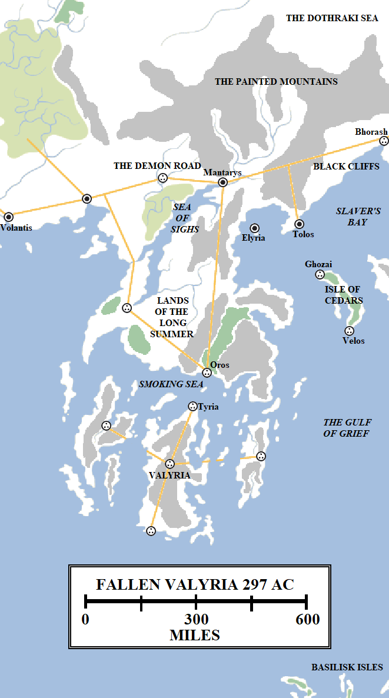

Of old, Valyria was the greatest power in the known world. Its empire, the Freehold, stretched from Dragonstone in the Narrow Sea to almost the Straits of Qarth, from the Shivering Sea to the sweltering coasts of plague-ridden Sothoryos. Its armies were the most formidable, its riches beyond imagining and its reach, through the thousands of dragons it commanded, was all-encompassing.

For nigh on five thousand years Valyria was the most formidable power in the world until its might was checked by a force it could not reckon against: that of the earth itself. In a single day and night of fire, fury and tears the Valyrian Freehold was obliterated, its great cities swamped in fire and ash, its people immolated by the millions and the very land rent asunder by earthquakes and tidal waves. Valyria was shattered, never to recover. Its ruined, devastated landmass survives today as a broken peninsula and a jumble of islands separated by smoking waters, the land shunned by travellers. Only the bravest and the most foolish venture in the ruins of Valyria. Few return.

The Valyrian Peninsula lies to the south-east of the Free Cities. The peninsula measures approximately 550 miles in width and roughly 450 miles in length from north to south, although this is substantially less than before the Doom. Before the Doom Valyria extended almost twice as far into the Summer Sea, but the devastating earthquakes saw the southern part of Valyria separated from the mainland by the sea, which came rushing into the lowlands along the neck of the peninsula. The southern half of Valyria now consists of three large islands, at least twenty-one of intermediate size, hundreds more too small to appear on most maps and yet more treacherous reefs and peaks lying just under the waves, ready to tear the bottom out of any ship trying to pass over. The lands commonly referred to as “Valyria” encompass all of these islands, the peninsular and all of the lands up to the Painted Mountains to the north and the Black Cliffs to the east.

**The Painted Mountains and the Demon Road**

Located at the northern end of the Valyrian Peninsular, the Painted Mountains form a barrier between the open grasslands of the Dothraki Sea and the coastlands to the south. The Painted Mountains are tall and fierce, not easy to climb or cross. The mountains were no obstacle to the dragonriders of old, but they were a barrier to settlers, funnelling them west into the Free Cities or east into the older, more decadent lands of Slaver’s Bay instead.

Running through the southern foothills is a straight Valyrian road linking the Free City of Volantis to the west with the lands of Slaver’s Bay, although the road itself terminates at the ruins of Bhorash atop the Black Cliffs, with only tracks and lesser roads extending further east to Meereen. This road is called the “Demon Road” because it has a fearsome reputation.

The city of Mantarys sits on the Demon Road at the top of the Valyrian Peninsula, just under 600 miles from Volantis and 450 miles from Bhorash. Founded by Valyria as a great crossroads settlement between east and west, north and south, Mantarys was once a great, bustling trade city. People from a hundred nations could be found there, Sarnori, Valyrians, Westerosi and Ghiscari hawking their wares and taking a well-earned rest on their way to other cities. The Doom changed Mantarys. The city survived, but became jammed with refugees fleeing from the south. In the past three centuries, the city has acquired a fell reputation and is now said to be a place of savagery and grotesques. Two-headed children, people afflicted with greyscale and other monstrosities are said to dwell there in vast numbers. The City of Monsters, as it is now called, is shunned. Those travelling overland from the Free Cities to Slaver’s Bay try to slip around the city to the north, but the geography makes this difficult. Many who brave the Demon Road through Mantarys do not return. Now the majority of trade and travel between the west and east takes place by ship, giving Mantarys and the Valyrian Peninsula a wide berth.

**The Sea of Sighs and the Lands of the Long Summer**

Of old, the Lands of the Long Summer were the breadbasket of the Valyrian Peninsula. Smaller than the Reach of Westeros but even more fertile, this region extends for approximately 400 miles from north to south and for almost 300 miles from east to west. The towering volcanoes known as the Fourteen Fires lay along this region’s southern and south-eastern border, with ash from the flames proving surprisingly beneficial to the growing of crops. Vast farmsteads dotted the landscapes, with bustling market towns lying athwart the great Valyrian roads leading north to Mantarys, north-west to Volantis and south to Valyria. In the north-west of this region lay the Sea of Sighs, a tranquil inland sea fed by rivers descending from the Painted Mountains.

The Doom changed all of this. The southern part of the Lands of the Long Summer was destroyed, simply falling into the sea. Vast amounts of ash fell across these lands, annihilating the towns and farms that used to sprawl across them. The waters of the Sea of Sighs turned red, poisoned by the filth falling from the skies. Formerly the greatest growing fields in the known world were turned into a wasteland. In the far south, overlooking the Smoking Sea, lies the ruins of Oros, formerly a great city located at the northern end of the pass leading into Valyria proper.

**The Smoking Sea**

The Smoking Sea is the youngest sea in the known world, formed during the Doom of Valyria. The Smoking Sea was once the southern part of the Lands of the Long Summer and a mountainous region dominated by the Fourteen Fires. The eruption of the mountains collapsed the lands, millions of tons of rock falling into the sea which came rushing in from east and west. Several of the Fourteen Fires appear to have been completely destroyed. Several survive on islands (said to be rapidly growing in size again) and several remain part of the mainland and the islands.

The Smoking Sea is so-called because the waters are often warm and strange mists float across the surface. It is said that whoever breathes in these fumes dies instantly. Some sailors claim that these mists are demons and the Smoking Sea is haunted. Maesters claim that they are natural, if noxious, gases resulting from volcanic activity. Despite theoretically cutting travel time from the Free Cities to Slaver’s Bay by a week or more, the Smoking Sea is shunned by almost all sailors. Only the hardiest (or most foolish) brave their waters.

**Valyria**

The city of Valyria was once the greatest sight in the whole world. A city of slender towers sitting above lava channels flowing from the southern volcanoes, dragons were required to fly safely between the buildings. This was the seat of the conclave of the Lords Freeholder, the meeting place of the Valyrian fire mages and the home of the dragonriders. It was a sight to behold, but it was all lost in the Doom. A veritable storm of ash fell on the city out of the sky, killing almost the entire population (human and dragon alike). Valyria was abandoned, but according to some the ash had the unusual effect of also preserving the city at the very moment of its destruction. For those brave enough to cross the Smoking Sea, reach the ruins and begin digging, great treasures are said to be just waiting. Most who make this attempt die or disappear in the attempt, but a few have survived, bearing treasures of the Freehold which attract immense prices in the markets of the Free Cities (especially Volantis).

**The Isle of Cedars and the Gulf of Grief**

The Doom triggered a vast series of tidal waves which reached across the seas to the east of Valyria, smashing against the coasts of the old Ghiscari Empire. The destruction would have been far worse along Slaver’s Bay if the Isle of Cedars had not arrested the waves, at terrible cost.

The Isle of Cedars is about 150 miles long and 30 miles wide. It is located between the coasts of the Valyrian Peninsula to the west and the coast of the lands held by Astapor to the east, whilst it also divides Slaver’s Bay to the north from the Gulf of Grief to the south. The island is steeply hilled and mountainous, their slopes inundated with tens of thousands of cedar trees. Of old the island was called the Isle of a Hundred Battles, as the great Ghiscari port of Ghozai lay at the northern end of the island the Valyrian city of Velos was located at the southern end. Located between the two empires, the isle was the site of many great naval engagements, sea battles and aerial assaults using dragons until Old Ghis was finally destroyed. Ghozai became a Valyrian city and both it and Velos prospered until the Doom destroyed both with a wave of water said to be three hundred feet tall. Only a few Valyrian soldiers manning watchtowers on the tallest hills survived.

The Isle of Cedars was never resettled and today is filled with animals, including wild boar and monkeys. The isle’s animal life is remarkably hostile and lacks a fear of man, so it is largely avoided. Over the years cities such as Elyria, Tolos and Astapor have mused on resettling the island, but have never done so.

**Elyria and Tolos**

Elyria and Tolos are, along with Mantarys and Volantis, the only cities directly founded by Valyria to have survived the Doom, as their location put them out of the reach of the waves that destroyed Velos and Ghozai. The two cities are relatively small, but both seem to have found a way of surviving by aligning themselves with the slave trade and establishing ties with feared Mantarys to the west.

Elyria, located on an island just off the coast of the Valyrian Peninsula, south-east of Mantarys, is obscure. It is off the main trade route from Slaver’s Bay to the Free Cities, so it has to survive on trade with Tolos. More famous Tolos, located the mainland about 120 miles to the east, is larger and better-known, with a significant hinterland. Tolos is known for its slingers, highly-trained soldiers who use powerful slings to hurl projectiles with devastating accuracy.

Both cities are beacons of civilisation – if of a rough and brutal kind – in a region still recovering from the greatest cataclysm the world has ever seen. Further east lies much larger and greater cities, if also cities that are more decadent and more corrupt: the great Ghiscari cities of Slaver’s Bay.

_Thank you for reading The Atlas of Ice and Fire. To help me provide better content, please consider contributing to [my Patreon page](https://www.patreon.com/user?u=4370220) and [other funding methods](http://thewertzone.blogspot.co.uk/2017/01/support-wertzone-on-patreon.html), which will also get you exclusive content weeks before it goes live on my blogs._
