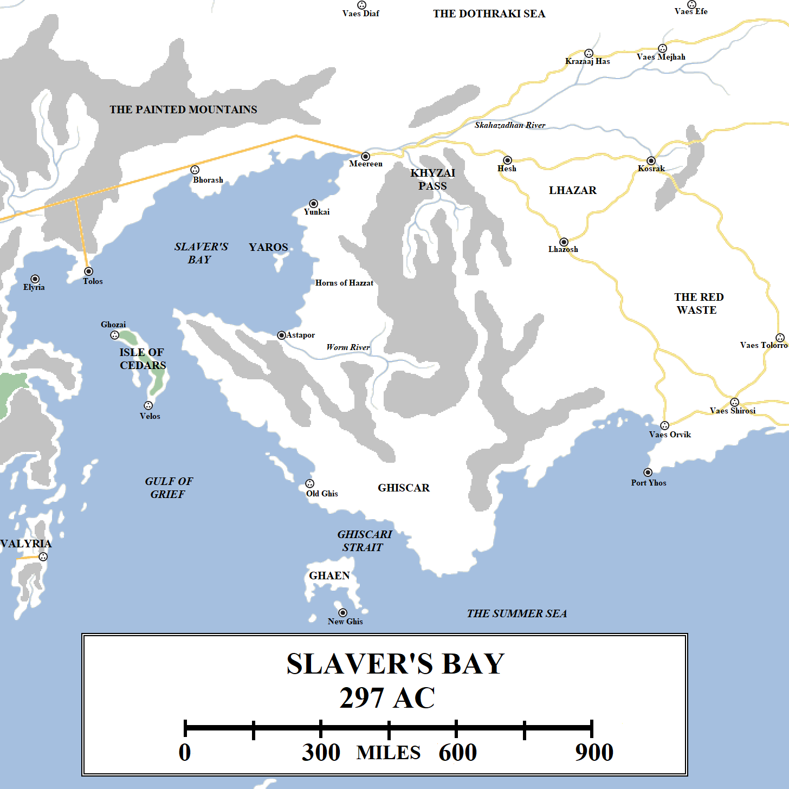

It is said that to “sail beyond Valyria is a fearsome thing”. For those living in Westeros and the Free Cities, the prospect of sailing around the broken Valyrian peninsula is daunting. There are no safe ports between Volantis and Elyria, a distance of eighteen hundred miles by sea. Being caught in storms off the Valyrian coast is a terrifying prospect for sailors, who believe that to come in sight of that fire-wracked coast where the Doom still holds sway means death. There is also the risk of being swept by storms out into the Summer Sea and towards the Basilisk Isles and Sothoryos, where corsairs and plague are common.

Slaver’s Bay and the surrounding lands. Click to embiggen.

For those who take the risk, riches are to be found: the great trade cities of the Jade Sea, the remote and mystery-shrouded port of Asshai and, most profitable for many, slaves. The centre of the known world’s slave trade  are the three great cities of Slaver’s Bay, where everything from pleasure slaves to the feared eunuch soldiers known as the Unsullied can be purchased.

More than 600 miles wide, Slaver’s Bay is more of a small sea than just a bay. The far west coast lies against the Valyrian Peninsula, where the still-extant cities of Elyria and Tolos can be found. The north coast is bleak and mostly unsettled. The only good harbour is at Bhorash, but that city was destroyed after the Doom of Valyria and the ruins are shunned. The east coast is home to the great slaver cities. To the south, beyond the Isle of Cedars, Slaver’s Bay becomes the Gulf of Grief, a great body of water so-called for the centuries of conflict between Valyria and Old Ghis that raged across its waters. The Doom of Valyria saw a wave of water hundreds of feet high slam across the gulf, destroying every ship in its path and devastating towns all along the coasts, giving the name fresh meaning. To the east the coast turns along the Summer Sea towards the Straits of Qarth.

**A Note on the Ghiscari**

Slaver’s Bay is dominated by the culture of Old Ghis, the great Ghiscari Empire which ruled this region for over three thousand years before it was laid low by the might of Valyria. Valyria kept a chokehold on Slaver’s Bay for well over four and a half thousand years (according to tradition) before it was destroyed in the Doom. In the four centuries since then, Ghiscari traditions and culture (or a modern version thereof) have reasserted themselves. However, a distinction should be drawn between the spreading power of New Ghis, which claims to be the Old Empire come again, and the cities of Astapor, Yunkai and Meereen, which are culturally Ghiscari but wish to maintain their political and economic independence.

**Astapor**

Astapor, the Red City, is the southern-most of the three main slave cities. Its rooftops and many of its buildings are red in colour, derived from the crumbling old red bricks that the city was built from, giving the city its name. The air is also often heavy in red dust.

Like most cities of Ghiscari origin, its ruling class living in great stepped pyramids. The tallest in Astapor, located along the waterfront, is about 400 feet tall. Further down the coast is the port and the mouth of the Worm River, where pleasure barges can be found. The city’s rulers, the so-called Good Masters, are often found taking their ease on these barges, fanned and fed by well-fed slaves. Elsewhere in the city are far darker sights: the fighting pits where slaves battle one another to the death for the entertainment of the rich, and the Plaza of Pride and Plaza of Punishment where slaves are put on display.

Astapor is famed as the home of the Unsullied, warrior-eunuchs trained from birth to fight and die for their owners. The Unsullied are utterly formidable in battle and a popular choice for bodyguards and household guards. Astapor has a long-standing contract with the Free City of Qohor, which has exclusively used Unsullied as its front-line troops since defeating the Dothraki in the Battle of Qohor over three centuries ago.

Beyond the city lies its hinterland, which runs along the coast for a hundred leagues to the west and south and half that to the north. There are tall hills, more like low mountains, to the south, where the Worm River is born and flows down to the sea. Beyond these mountains likes the resurgent power of the Ghiscari Empire, which Astapor regards warily.

**Yunkai**

Yunkai, the Yellow City, lies a hundred leagues to the north of Astapor. A sister-city of Astapor, founded in the same wave of Ghiscari expansion well over five thousand years ago, Yunkai is built to a similar design, except the bricks used in its construction are yellow rather than red. Yunkai is the possibly the smallest and most obscure of the three slave cities, lacking Meereen’s enormous strength and influence or Astapor’s reputation built on its Unsullied slave-soldiers.

Yunkai’s rulers, the so-called _Wise_ Masters, seem to compensate for this by giving themselves and their city flamboyant titles, such as the Queen of Cities. Yunkai has a good harbour but is otherwise unremarkable, few of its pyramids approaching the size of Astapor’s and its reputation is built on pleasure slaves rather than soldiers like the Unsullied. Yunkai’s hinterland runs east to the mountains and south along the coast for a good hundred miles or so.

**Yaros**

Yaros is a sizeable island located just off the coast claimed by Yunkai. The island appears to be mostly uninhabited, with a rocky coast characterised by towering cliffs. The island’s main use is as a shelter for storms, with ships sometimes choosing to pass through the straits between the island and the mainland rather than swinging west into the open sea. However, this sometimes makes the straits a popular spot for pirates.

**Meereen**

Meereen is the largest city on Slaver’s Bay and possibly one of the largest cities in the known world, outstripped only by Volantis, Asshai, possibly Qarth and some of the cities of Yi Ti. This means that the better part of a million people live in the city and the surrounding area. Meereen is larger than Astapor and Yunkai combined and its bricks are of many colours, giving the city a more colourful feel than its its two smaller sister-cities.

The rulers of Meereen are known as the Great Masters, who rule from the Great Pyramid. Over 800 feet tall and one of the tallest structures in the world (taller than the Wall, rivalled by the High Tower of Oldtown and outstripped only by the Five Forts of Yi Ti), the Great Pyramid dominates the skyline of the city and the surrounding countryside for miles. The next-tallest pyramids in the city are less than half the height. Also imposing is the Temple of Graces, the centre of religion in the city and the surrounding region.

Meereen’s walls are tall, studded with towers and significant bastions. With the Dothraki Sea located just to the north, across the river, and the city being located on the frontier between Old Ghis and Valyria, it has always had a need for a strong defence. The walls have been kept in good order (unlike Astapor and Yunkai’s, which have fallen into disrepair over the years) and the city remains formidable. No outside army has taken the city since Valyria overthrew Old Ghis, and even the Dothraki seem to have been daunted by the city’s sheer size. The Great Masters have wisely never given them cause to try to take the city, instead offering them good prices for slaves herded downriver to the city’s fleshpots.

Meereen sits on bluffs on the south side of the River Skahazadhan where it meets Slaver’s Bay. The Skahazadhan provides rapid travel eastwards towards Lhazar and the Dothraki Sea, but this can also be a weakness. During the ancient wars with Valyria, the Meereenese built immense wells to draw water from sources that could not be easily polluted by besiegers. Meereen’s hinterland extends south and east through the sandstone mountains towards the Lhazareen border. Estates can be found in these hills, although the territory is not as verdant as it once was. History records large numbers of cedar trees and olive groves studding the shores of the bay and extending into the hills, but the Valyrians burned most of these out. Farms, tended to by vast numbers of slaves, are located where the ground is fertile enough to turn a good crop, so to help feed the city. However, the land is harsh and in a prolonged siege, not able to bring in food by road or sea, Meereen would likely starve.

**The Khyzai Pass**

The Khyzai Pass is the name given to a mountainous pass linking the coast of Slaver’s Bay to the kingdom of Lhazar further inland. The Khyzai Pass has been hewn out of the sandstone mountains by the passage of the Khyzai River, a tributary of the Skahazadhan. The pass permits relatively easy travel between Meereen and central and southern Lhazar. There is a road that outflanks the mountains to the north, following the Skahazadhan more closely, but this road also passes through regions that the Dothraki raid on a fairly frequent basis. The pass is a safer and more secure route.

**Lhazar**

Lhazar is a small kingdom located to the east of the sandstone mountains and south of the Skahazadhan. The nation is noted for its non-warlike, non-expansionist nature. The people of Lhazar are peaceful, placid and value good, honest trade with its neighbours. Many of those neighbours – the Meereenese to the west and the Ghiscari to the south – are unreliable and take advantage of the Lhazareen pliability at almost every turn.

The bulk of the kingdom of Lhazar lies in a triangular region, its boundaries marked by three cities: Hesh in the north-west, Kosrak in the north-east and Lhazosh, the nation’s nominal capital, in the south. The Lhazareen are followers of a deity known as the Great Shepherd, whose priests and priestesses teach in trusting the winds of fate and not doing violence. Some Lhazareen reject these teachings and do take up the ways of fighting for themselves and their people, and have even been known to journey west to Slaver’s Bay and enter the fighting pits, although these are rare.

North of the river that flows from the hills beyond Kosrak, the countryside becomes more dangerous all the way north to the Skahazadhan. The Dothraki do not enjoy crossing the water, but there are several major fords across the river that allows Dothraki _khalasars_ to strike into the Lhazareen borderlands, between the two rivers. Lhazareen villages and towns dot this landscape, becoming rarer in the east as the relatively fertile and green lands around the river give way to the parched desert known as the Red Waste. The Lhazareen of this land still follow the Great Shepherd, but rumour claims that witches and _maegi_ also dwell in these lands, ready to bring curses and disaster on even the formidable Dothraki.

**Ghaen, New Ghis and the New Empire**

Located just over a hundred miles off the coast, the island of Ghaen was a Ghiscari stronghold for millennia, and latterly an annexed Valyrian colony. The island’s geography protected it during the Doom of Valyria, preventing its population from being wiped out like the Isle of Cedars. Subsequent to the Doom, the people of Ghaen broke away from Valyrian control and declared themselves the true heirs of Old Ghis, the sons of the harpy come again.

The city of New Ghis rose on an island off the coast of Ghaen. Smaller than Astapor, Yunkai or Meereen, but far newer and more dynamic, New Ghis has established itself as a vital waystop and trading centre. The city is strategically located on the main sealanes leading west to the Free Cities, Summer Isles and Westeros, north to Slaver’s Bay and east to Qarth and the Jade Sea. A boom town, New Ghis has increased in size, power and population quite remarkably in the last four centuries. Its location renders it vulnerable to attack by corsairs out of the Basilisk Isles to the south, but the Ghiscari have struck both alliances with the pirates (some say paying them off to seek prey elsewhere) and also trained their own formidable military, spearheaded by the Iron Legions, to defend themselves. The power of New Ghis has spread to the mainland nearby, the territory of old Ghiscar, and continues to grow, to the disquiet of Astapor to the north.

The region of Ghiscar is large, spreading for well over 300 miles to the north and east to the sandstone mountains, as well as along the coast of the Summer Sea. This was the old heartland and core territory of the Ghiscari Empire, its breadbasket and the location of its major cities. Almost five thousand years ago, Valyria devastated this region with dragonfire on an epic scale. So complete was the destruction that most of the Ghiscari towns and villages that once dotted this landscape have simply vanished, with nothing left standing above ground to indicate they were ever there.

An exception are the ruins of Old Ghis, the ancient capital of the Ghiscari Empire. Once one of the greatest cities in the world, Old Ghis spread for miles along the coast of the Summer Sea, along a fine harbour and sheltered from the storms and harsher tides of the open sea by a series of offshore islands. The city was obliterated at the end of the Fifth Ghiscari War, the Valyrians destroying the city in detail and salting the earth. However, the tallest buildings of Old Ghis, the pyramids, were too difficult to destroy altogether and so were simply abandoned. Over millennia they have started to fall back into the ground, but the ruined Great Pyramid of Old Ghis (the inspiration for the near-identical Great Pyramid of Meereen, some 700 miles to the north) still stands, over 800 feet tall.

That then is Slaver’s Bay, a land famed for corruption and decadence. To the north lies a much vaster area commanded by a force that keeps both the slave lords and the rulers of the Free Cities to the west in check: the horse lords of the Dothraki.

_Thank you for reading The Atlas of Ice and Fire. To help me provide better content, please consider contributing to [my Patreon page](https://www.patreon.com/user?u=4370220) and [other funding methods](http://thewertzone.blogspot.co.uk/2017/01/support-wertzone-on-patreon.html), which will also get you exclusive content weeks before it goes live on my blogs._
