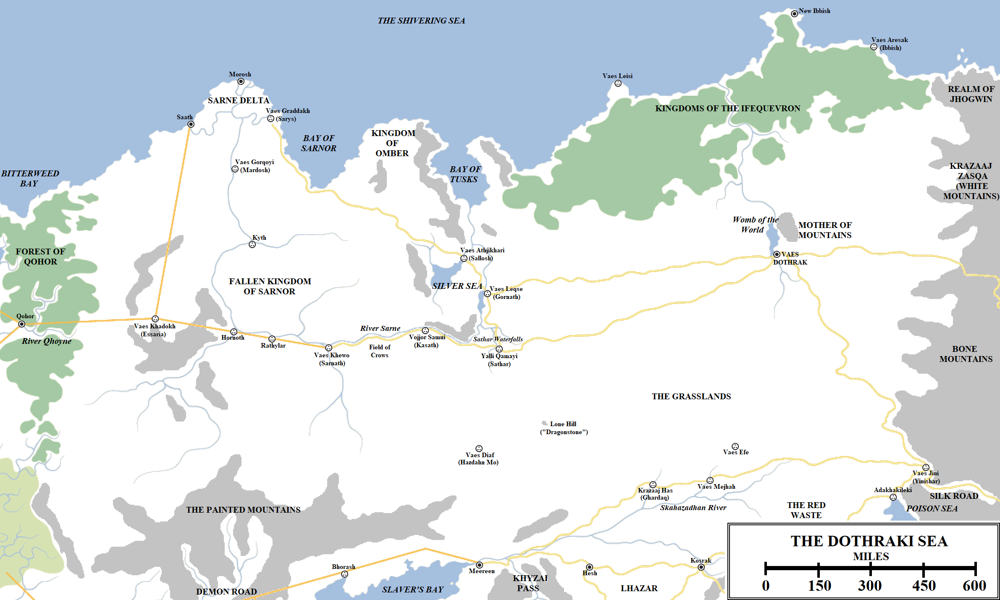

East of the Free City of Qohor, beyond the great forest that gives the city its name, the terrain abruptly changes. A flat plain extends to the horizon, broken only by low hills in the north but completely covered in grass. This grassplain extends east for _two and a half thousand miles_, almost rivalling the distance from the Wall to the Summer Sea in Westeros, before abruptly ending in the foothills of the towering Bone Mountains. This flat plain, when viewed from the mountains or hills, looks like a green sea, which gives it its name.

The Dothraki Sea and surrounds. Click to embiggen.

The term “Dothraki Sea” is a relatively new one, displacing the simple name “The Grasslands” that used to apply to this vast region and was used by the Valyrians, the Ghiscari and the ancient Qaathi for millennia. The term came into use between three and four centuries ago when Khal Mengo united the disparate and scattered tribes of the far eastern Grasslands and swept west in a crusade of blood and fire. In the Century of Blood the Dothraki destroyed no less than twenty-one major cities, tore down the ancient kingdom of Sarnor and destroyed the Valyrian cities of Essaria, Hazdahn Mo and Ghardaq. Their advance was turned back at the Battle of Qohor and the expansion of the Red Waste in the south. During the Bleeding Years the Dothraki established an area of control bigger than the Empire of Yi Ti and almost rivalling the Seven Kingdoms in size.

For outsiders, the Dothraki Sea can appear featureless, a monotonous slog of never-ending grass that has to be endured for the weeks it takes to cross to Vaes Dothrak. But the Dothraki have many names for different parts of the sea, and for the ruins that dot its expanse.

**Ruins of Valyria**

In the far west of the Dothraki Sea, the flat plains are interrupted by one regular feature: a Valyrian road extending east from Qohor. 400 miles east of Qohor, the road passes through an immense ruin, a shattered series of stone buildings, torn-down city walls and collapsed wells. Essaria was once a great caravan and trading city, founded by the Valyrian Freehold to facilitate trade with the Kingdom of Sarnor to the east. It was self-governing within the wider structure of the Freehold and, in the immediate aftermath of the Doom of Valyria, it declared itself a tenth Free City. However, almost a century later the city was overrun and destroyed by the Dothraki _khalasar_ under Khal Temmo. The Dothraki renamed the city _Vaes Khadokh_, “The City of Corpses”, for the death toll in the city was staggering even by Dothraki standards. In the west it is prosaically known as the “Lost Free City”.

Two great Valyrian roads lead out of Essaria. One runs north for 600 miles to Saath on the Shivering Sea. The other runs east for about 230 miles until it reaches the banks of a great and magnificent river, a blue snake cutting through the western and central Dothraki Sea. This is the Sarne, the jewel of northern Essos, and once the lifeblood of the great Kingdom of Sarnor.

**Fallen Sarnor and the Sarne River Basin**

The Sarne is one of the greatest river networks of Essos, second in size and importance only to the Rhoyne. In ancient times the Sarne was born from the Silver Sea, a large lake or small inland sea in the east of this region, just south of the Bay of Tusks. The Silver Sea began drying up several thousand years ago and is now two large lakes and a number of smaller ones, linked by myriad rivers and streams which join to become the Sarne. The river is fed further by waterways running out of the hills and joined by numerous smaller rivers which feed the western Dothraki Sea and keep it fertile.

This land of fertile fields and rivers, all linked by the Sarne, gave rise to one of the most ancient kingdoms of Essos, that of the Fisher Queens. They ruled a great nation from a floating palace that circled endlessly around the shores of the Silver Sea. They were overthrown in a revolution, their subjects freeing themselves to establish Sarnor, the Realm of the Tall Men. Huzhor Amai was the first High King of Sarnor, uniting the Fisher Queens, Gipps, Cymmeri and Zoqora into one people.

Sarnor was an immense kingdom, stretching for some 1,200 miles from Bitterweed Bay to the Silver Sea, and then beyond for at least 150 miles into the eastern Grasslands. It extended for a similar distance from the Shivering Sea in the north to the Painted Mountains in the south, which separated it from the Valyrian Peninsula and Slaver’s Bay. Sarnor’s capital city was storied Sarnath, but other great cities were founded. These included Saath and Sarys on the immense Sarne Delta; Mardosh, Kyth, Hornoth and Rylathar upriver; and Sallosh, Gornath, Sathar and Kasath on the Silver Sea. These great cities, once among the most glorious cities ever built by men, now all lie in ruins, the works of thousands of years thrown down by the Dothraki. The sole exception is Saath.

Saath lies on the western-most mouth of the Sarne, sitting on the Shivering Sea. The geography of the region, with a network of rivers separating Saath from the Dothraki Sea to the south, prevents easy access to the city by land, helping to save the city from the Dothraki’s wrath. Saath is a relatively small port, a city of 20,000 living behind tall white walls surrounding a good harbour. Saath survives as an important waystop on the sealanes leading from Ibben in the east to Lorath and Braavos to the west. The Saathi are the last of the Sarnori, still calling themselves Tall Men, the last 20,000 survivors of a civilisation that once consisted of teeming millions. Saath can be a maudlin and nostalgic city for this reason.

200 miles to the north-east, on the northern most mouth of the Sarne behind a veritable maze of rivers, streams and marshes, lies Morosh. A colony of Lorath, founded after the fall of Sarnor, Morosh is a mining and trading port. Roughly 130 miles to the south-east of Morosh, about 240 miles due east of Saath, is the former port of Sarys, the sister-city of Saath. Sarys was the last city of Sarnor to be destroyed during the Century of Blood. Unlike Saath, Sarys was built on the southern side of the Sarne and was thus easily accessible by the Dothraki. Khal Zeggo and his _khalasar_ destroyed the city in an orgy of violence and fire, but to their disappointment most of the population had already evacuated to Saath. The Dothraki now refer to the ruins as _Vaes Graddakh_, the “City of Filth”.

Further ruins lie upriver: Kyth, Mardosh the Unconquerable (before the Dothraki proved otherwise), Hornoth and Rathylar. But most legendary is Sarnath. The ancient capital of Sarnor, Sarnath of the Tall Towers was once one of the largest, most populous and richest cities in the known world, a city to rival Qarth, Volantis or Valyria itself. The Palace With a Thousand Rooms was one of the Wonders of the World, a building of breathtaking beauty. The city’s renown was so great that the Valyrians extended one of their famous straight roads from Essaria (520 miles to the west) to its gates, a rare honour for a city not of Valyrian origin or conquered by them. The city was obliterated after the Dothraki victory on the Field of Crows, when they destroyed the combined armed might of Sarnor in a day of carnage and blood. Its extensive ruins are now known as _Vaes Khewo_, the “City of Worms”.

Further east lie those cities which were destroyed earlier in the war, when the individual cities fought piecemeal: Kasath (now _Vojjor Samui_, “The Broken Gods”), the Waterfall City of Sathar (_Yalli Qamayi_, “The Wailing Children”), Gornath (_Vaes Leqse_, the “City of Rats”)) and Sallosh (_Vaes Athjikhari_, the “City of Sickness”), once the great City of Scholars whose library was the envy of the entire known world.

The Sarne River Basin keeps the western grasslands fertile and well-fed. Since the fall of Sarnor, this region has become the western Dothraki Sea, where many _khalasars_ range with their herds of thousands of horses.

**The Kingdom of Omber**

Omber is a small, pastoral kingdom located in the north of the Dothraki Sea. It lies to the north of the Sarne, on a 250-mile wide headland located between the Bay of Sarnor and the Bay of Tusks. The country consists of fertile plains and fields in the west and tall hills in the east, along the Bay of Tusks.

Omber consists of no major cities, but instead numerous small towns and villages whose leaders rather grandiosely refer to themselves as princes. The Omberi princes survive by paying annual tribute of grain, wine, women and gemstones, mined from the nearby hills, to the Dothraki. The Dothraki could overrun the small kingdom in weeks if they choose, but they find getting the Omberi to do the hard work of mining gemstones for them to be more agreeable.

**The Southern Grasslands**

650 miles divide ruined Sathar from the city of Meereen on Slaver’s Bay. This region is seen by some as the “true” Dothraki Sea, an endless quilt of green grass, blowing in the winds. Small streams keep these lands fertile but there are no major rivers like the Sarne. During the summer this is an endless emerald sea, but during the winter the grass can wilt and die, turning the landscape brown.

In the midst of this region can be found more ruins. Hazdahn Mo was once a great Ghiscari trading city, established as a colony of Meereen thousands of years ago to trade with Sarnor. The great hill city was annexed by Valyria after the fall of Old Ghis. After the Doom, the city unexpectedly found itself as a hub for slaves: the Dothraki brought Sarnori captives taken in the north for the Hazdahni to sell on to Meereen and Slaver’s Bay. This splendidly profitable arrangement abruptly ended when the Dothraki, on a whim, obliterated Hazdahn Mo and turned it into _Vaes Diaf_, the City of the Skull.

To the east, beyond a curiously tall, lone hill rising out of the grasslands, lies more Ghiscari ruins: Ghardaq (_Krazaaj Has_, “Sharp Mountains”, for its pyramids), _Vaes Mejhah_ (the “City of Whores”) and _Vaes Efe_ (the “City of Shackles”, another great slave city). These cities lie north of the River Skahazadhan, down which the Dothraki herd captives to sell in the flesh markets of Meereen. South of the river, which the Dothraki can ford in several places, lies the northern hinterland of Lhazar, which the Dothraki frequently raid for fresh slaves and plunder.

South and east of the Skahazadhan the countryside becomes bleak and desolate, giving way to the Red Waste, a harsh desert that the Dothraki will not cross for lack of water. Instead, they skirt the desert along its northern fringes to pass east to the towering Bone Mountains and the Poison Sea. Further ruins can be found here: _Adakhakileki_ (“The Cannibals”) and Yinishar, a former frontier outpost of the Patriarchy of Hyrkoon reduced to rubble, now called _Vaes Jini_, the “City of Goats”.

**The Great Northern Forest**

A vast region of woodland extends along the coast of the Shivering Sea, sprawling for 1,300 miles from the Bay of Tusks to the Bone Mountains. At its thickest, the forest extends 350 miles inland. This utterly vast forest, dwarfing any in Westeros, is known as the Kingdom of the Ifequevron, the latter meaning “woods-walkers”. According to both Dothraki and Sarnori legend, the woods-walkers were a strange, peaceful race living in the deepest forest. Even the Dothraki seem to fear and respect them. Maesters and scholars have drawn comparisons between the woods-walkers and the Children of the Forest of Westerosi legend, but any similarity between these stories is theoretical at best. The forest coastline is habitable and Corlys Velaryon, the Sea Snake, put in along the coast to conduct a survey during his great northern voyage. He reported that the woods were silent and strange, with odd carvings in the trees.

Strangest of all is the ruined settlement on the coast. Located eleven hundred miles east of Morosh, the city does not appear to have been built by humans. The Dothraki theorise it was a city of the woods-walkers, abandoned thousands of years ago. If this is true it may cast doubt on the idea that the woods-walkers were an eastern colony of the Children of the Forest, who did not build cities as we know them. The ruins are called _Vaes Leisi_, the “City of Ghosts”, and are shunned.

550 miles to the north-east lies the town of New Ibbish. A small port located at the northern end of a peninsula, partially sealed off from the rest of Essos by geography and the rest by a lengthy wall, this is a colony of Ibben, which lies just off the coast to the north across the Bay of Whales (and we will explore further at another time). New Ibbish was founded after the Century of Blood, when the Dothraki destroyed the city of Ibbish. Located 250 miles to the south-east, Ibbish was built around a very impressive harbour and was heavily fortified. It survived for centuries before the Dothraki destroyed the city and its impressive Whalebone Gates. The city repulsed several Dothraki attacks before it was evacuated in secret, to the fury of the Dothraki who named it _Vaes Aresak_, the “City of Cowards”.

To the east and south-east of the forest lies the forbidding stone mass of the Bone Mountains, marking the boundary between western Essos and the lands of the further east beyond. South, however, lies the heartlands of the Dothraki themselves.

**Vaes Dothrak**

Vaes Dothrak, the City of Riders, is the only permanent Dothraki city, a great sprawling mass of buildings that looks more like a temporary caravan stop then the sole habitation of note between the Bones and Saath, 1,800 miles to the west. Vaes Dothrak is a remarkably isolated city: its nearest neighbours are Meereen, 1,250 miles to the south-west; Kosrak in Lhazar, 950 miles to the south; New Ibbish, almost exactly 700 miles to the north; and Kayakayanaya, about 800 miles to the east, through the Bones.

The city is huge, extending for miles along the shore of the Womb of the World, an immense lake sprawling for about a hundred miles. The Womb feeds a series of rivers which cut north through the northern forests before reaching the Shivering Sea. To the east of the lake is the Mother of Mountains, a sheer mass of stone rising out of the flat Dothraki Sea to dominate the surrounding landscape. Both the Womb and the Mother are considered holy by the Dothraki, who punish any trespassers with lethal force.

Vaes Dothrak has one large entrance, the Horse Gate, less of a gate than two immense statues of horses rearing in battle. From the Horse Gate a huge thoroughfare, the Godsway, extends across the length of the city. It passes the Western and Eastern Markets, both of which are bustling and cosmopolitan, with traders from across the known world meeting and mingling. The Western Market is home to traders from the Free Cities, Slaver’s Bay and the occasional Westerosi or Summer Islander who braves the journey. The Eastern Market is the place of trade for those from Yi Ti, Asshai, the Jogos Nhai and other remote lands of the far east.

Although huge, Vaes Dothraki has relatively little few permanent inhabitants. Most of the population is transitory, meeting to trade or feast. Only the crones known as the _Dosh Khaleen_ and their servants and bodyguards permanently live in the city. Several Dothraki _khalasars_ may be present at any one time, but the city is big enough to hold all of them – the entire Dothraki civilisation – if required. A gathering of the entire Dothraki horde has not happened in living memory, and will only come again if a _khal-of-khals_ arises, a warlord powerful enough to unite all the Dothraki against a common foe.

The largest current Dothraki _khalasar_ is that of Khal Drogo, a fierce warlord and canny general. More than 100,000 people live in his _khalasar_, over 40,000 of them warriors. How many more _khalasars_ there are is hard to estimate, as they merge, break apart and fight one another with bewildering frequency. What is likely is that there are more Dothraki warriors than there are potential soldiers in all the Seven Kingdoms. It is fortunate that that width of the Narrow Sea and the Free Cities divides the Dothraki from Westeros; the Dothraki fear the poison salt water and will not cross it under any circumstances.

_Thank you for reading The Atlas of Ice and Fire. To help me provide better content, please consider contributing to [my Patreon page](https://www.patreon.com/user?u=4370220) and [other funding methods](http://thewertzone.blogspot.co.uk/2017/01/support-wertzone-on-patreon.html), which will also get you exclusive content weeks before it goes live on my blogs._
