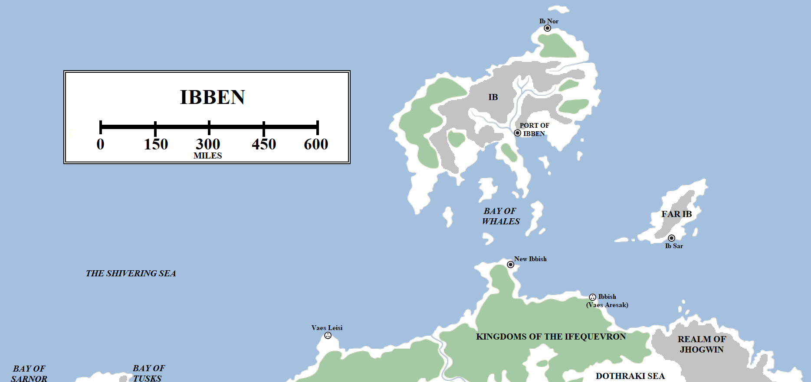
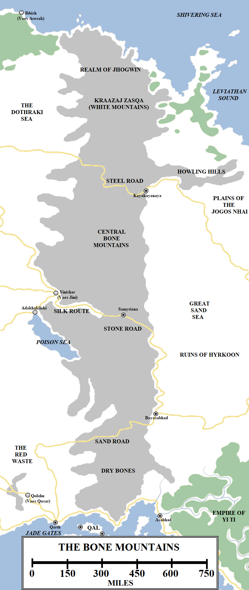

East of the Dothraki Sea lies the edge of the known world, where true and reliable knowledge gives way to increasingly outlandish fables and legends. Part of the reason for this is a towering barrier that splits the continent of Essos in two: the Bone Mountains. Bisecting the continent from north to south, the Bones stand as a daunting barrier to travel and commerce. Difficult to traverse and unrelentingly hostile, the Bones force a lot of travel to the south, through the Jade Sea, and to the north, through the island nation of Ibben.

The island and territories of Ibben. Click to embiggen (or embibben).

**Ibben**

Ibben is a kingdom which sprawls across several islands in the Shivering Sea and colonies on the northern coast of Essos. In ancient times, when Ibben was ruled by a God-King, the nation controlled a vast swathe of territory extending far to the east and west, reaching as far as the Lorathi islands and the Axe. Ibben’s power has waned. Since the Doom of Valyria, Ibben has been ruled by the Shadow Council and has pursued a policy of mercantile trade.

The homeland of the Ibbenese is Ib, one of the largest islands in the known world. Located off the north coast of Essos, near the Dothraki Sea, Ib measures 600 miles from the north-east to the south-west. It is about 300 miles across from the north-west to south-east, but with several peninsulas extending further into the Shivering Sea.  The mainland of Essos is about 200 miles to the south. The island is mountainous, particularly in the north, and the Ibbenese have great mines built into the hills where they mine and smelt gold, iron and tin. There are also extensive forests, allowing the Ibbenese to trade in timber, animal pelts and amber. Giants are said to have once lived on Ib, but were hunted to extinction. Shaggy unicorns, kin to those on distant Skagos, may also live on Ib.

There are two major cities on Ib. Ib Nor, on the north coast, is home to many whalers and traders. The Port of Ibben on the south coast is the largest port on the Shivering Sea east of Braavos. It is a bustling trade city where whalers, merchants and travellers mingle. Foreigners are permitted to stay in the Port’s trade quarter, but are not allowed in the rest of the city, or the island, without the protection of an Ibbenese host. The Ibbenese who live inland, in the hills and forests, are said to be deeply suspicious of outsiders.

The Ibbenese are the greatest and most prolific whalers in the known world. Their whaling ships can be found as far east as the Thousand Islands and as far west as the Bay of Seals off the north-eastern coast of Westeros, three thousand miles away. The Ibbenese are also among the finest sailors in the world, braving storms that even the ironborn (who live in more clement seas) would balk at. North of Ibben lies nothing but empty grey seas, often wracked by storms, until the endless ice walls of the White Waste appear, over 1,500 miles north of the island. Vast ice floes and icebergs sometimes pass close to Ib, and the Ibbenese treat the northern polar waters with respect.

Given the eastern location of Ib and the undoubted Ibbenese proficiency at sea, some maesters theorise that the Ibbenese must have explored the eastern Shivering Sea in much greater detail than any other Essosi or Westerosi sailors (even the mighty Corlys Velaryon, the Sea Snake, had to turn back a thousand miles or so to the east of Ib), and may even have reached the legendary far eastern coast of the continent. If so, the Ibbenese have refused to release charts of these waters or confirm what other kingdoms and peoples may exist in that direction.

300 miles to the south-east of Ib lies the island of Far Ib. Almost 250 miles long and about 100 miles wide, Far Ib is dominated by an inland mountain chain which the Ibbenese have extensively mined. The small port of Ib Sar exports these minerals back to Ib and to other markets along the Shivering Sea.

South of Ibben, across the Bay of Whales and on the mainland, lies the small port town of New Ibbish. New Ibbish is located on a passable harbour at the northern tip of a small peninsula, which the Ibbenese have walled off from the rest of the continent. The Ibbenese had once colonised more of this coastline, including the much larger city of Ibbish, but that was destroyed by the Dothraki during the Century of Blood.

The Bone Mountains and surrounds. Click to embiggen.

**The Realm of Jhogwin and the White Mountains**

The Bone Mountains are the tallest and most extensive mountain range in the known world. They extend from north to south for just over 2,000 miles and, including lesser chains and foothills, are well over 300 miles thick for much of that length (in some areas, closer to 500 miles)

The great Bone Mountains begin at the Shivering Sea, although some maesters theorise that the mountains may continue under the waves, with Ib Sar directly to the north being the protrusion above the waters of some of the taller peaks. The northern-most Bones are known as the _Krazaaj Zasqa_, the White Mountains, for these mountains are covered in snow even during the hottest and longest winters. The tallest peaks in the range – and maybe the world – may be found here, peaks that dwarf even the Giant’s Lance of Westeros. Winds howl through the peaks, glaciers can be found nestling in the highest valleys and the land is desolate and unrelentingly hostile.

According to myth the Jhogwin, or stone giants, once dominated the northern Bones and ranged both west and east, hunting both the ancestors of the Dothraki and the Jogos Nhai. Gharak Squint-Eye, a great _jhattar_ of the Jogos Nhai, is said to have unified the zorse-riders and destroyed the last of the Jhogwin at the Battle of the Howling Hills some centuries before the Doom of Valyria. The White Mountains themselves are believed to be uninhabited, but the Howling Hills to the south-east, at the north-western fringes of the Plains of the Jogos Nhai, are home to bandits and exiles.

The northern Bone Mountains are divided by a great pass, through which a road has been driven. This road extends west to Vaes Dothraki and south-east to Yi Ti. The Steel Road is so-called because of the great battles that have raged along its length. Several times, Dothraki _khalasars_ have braved the pass to assault the great city of Kayakayanaya which sits athwart the trade route, but each time they have been thrown back. The Jogos Nhai have also assaulted the city from the east, seeking revenge for their ancient losses to the Patrimony of Hyrkoon. The city’s massive basalt walls have thrown back countless assaults from both directions (but never both simultaneously, the only eventuality which might trouble the imposing fortress-city) without falling.

Kayakayanaya consists of towering black basalt walls studded with black iron and yellow bones. The city is ruled by the Great Fathers and defended by formidable warrior-women, since the Hyrkoonish religion states that only those who can give birth are allowed to take life in battle. Peaceful traders are allowed to pass through Kayakayanaya (after paying suitable tribute) but are carefully watched to make sure they are not working to undermine the city from within. Kayakayanaya is not the only Hyrkoonish survivor-city in the mountains, but it is located far closer to the centre of both Dothraki and Jogos Nhai power and is thus the most commonly assailed.

**The Great Sand Sea**

South of the Steel Road lies the central Bones. Less wild than the White Mountains, but still tall and utterly formidable, the mountains are fringed with fertile foothills to the west, through which the Dothraki race their horses. The eastern side of the mountains is more dramatic, with the mountains falling through ragged hills into a desolate land of canyons and deserts: the Great Sand Sea. The Great Sand Sea was once a jumbled lowland area of lakes, rivers and fertile fields, divided into small kingdoms and city-states. This was the heartland of the Patrimony of Hyrkoon, a great nation-state which arose in the aftermath of the Long Night. According to legend, the hero Azhor Azhai, _Hyrkoon_ in the local language, came from this region and it was here that he forged the sword Lightbringer before taking it into battle against the darkness, eventually proving victorious and lifting the Long Night.

The accuracy of this story is uncertain, but it is clear that the legend left behind a powerful legacy, with the Patrimony of Hyrkoon surviving for thousands of years before the Dry Times descended. The lakes and rivers dried up and became a wasteland. The Patrimony collapsed, its people retreating behind the walls of Kayakayanaya, Samyriana and Bayasabhad.

The Great Sand Sea measures approximately 1,000 miles from north to south and is around 400 miles wide at its widest point. The ruins of ancient cities can be found in its depths, along with river beds. Maesters believe that at one time the Great Sand Sea may have been an inland sea. By the time of the Long Night it had already dried up somewhat into many smaller lakes and seas, but since that time has become completely barren. Similar processes may also be responsible for the Shrinking Sea to the east and the Red Waste and the disappearance of the Silver Sea to the west, across the Bones.

The Great Sand Sea is mostly uninhabited, but for the bold there is one track that leads from Samyriana to Trader Town on the borders of Yi Ti, right across the heart of the wasteland. This route is not recommended, but brave merchants desperate to shave weeks off their travel times often make the attempt, with the survivors greatly enriched.

**Samyriana and Bayasabhad**

South of the Steel Road and Kayakayanaya lies its sister fortress-cities of Samyriana. Samyriana is less immediately-imposing than Kayakayanaya with the bulk of its defences oriented against an attack by the Dothraki to the west; the Jogos Nhai lie too far to the north-east across the Great Sand Sea to be as imminent a threat. Samyriana lacks Kayakayanaya’s formidable basalt and iron walls, instead being built directly into the mountain rock itself.

Squatting across the the Stone Road 550 miles south of Kayakayanaya, Samyriana remains a rich and notable settlement, even if its golden age as the greatest city on the Silk Route is millennia in the past. At one time trade caravans made their way from Slaver’s Bay, the Free Cities and even Westeros east through Samyriana towards the Patrimony of Hyrkoon and the Empire of Yi Ti. Although longer than the sea route via the Jade Sea, it was safer and less threatened by pirates. The Doom of Valyria made this route even more appealing, but the emergence of the Dothraki, the destruction of the Patrimony and the spread of the Red Waste combined to make it a less practical route. The Dothraki destroyed Samyriana’s partner-city of Yinishar which guarded the western entrance to the Steel Pass, making the route feel even less secure.

Further south lies the Sand Road. This pass splits the central Bone Mountains from the far southern end of the range, the Dry Bones. Bayasabhad, 450 miles south of Samyriana, is located near the eastern end of the Sand Road Pass. Like its two northern sister-cities, Bayasabhad guards its route through the mountains and is a formidable fortress, but the city is also less martial. The Red Waste has effectively sealed off the trade routes to the west and is never troubled by the Dothraki, whilst to the south-east lies the more peaceable neighbour of Yi Ti. Roads lead south to Asabhad, a port on the far north-western Jade Sea, and east to Tiqui and the northern fringes of the Yi Ti Empire.

The Dry Bones fall into the sea in another jumbled mass of peaks and islands, with Qal and the other islands of the Straits of Qarth (or Jade Gates) potentially being an extension of the mountain range under the waves.

To the south and west of the Dry Bones lies a forbidding land which even the Dothraki fear to enter: the Red Waste and, beyond it, the rich lands of Great Moraq and the Jade Sea.

_Thank you for reading The Atlas of Ice and Fire. To help me provide better content, please consider contributing to [my Patreon page](https://www.patreon.com/user?u=4370220) and [other funding methods](http://thewertzone.blogspot.co.uk/2017/01/support-wertzone-on-patreon.html), which will also get you exclusive content weeks before it goes live on my blogs._
