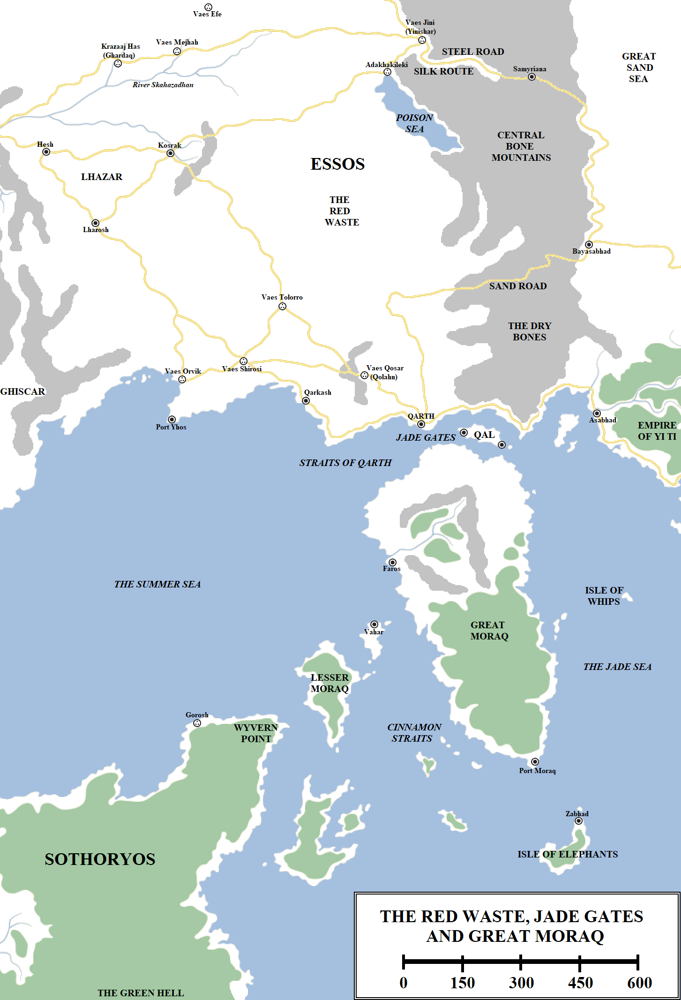

The continent of Essos was once home to a long-lived and remarkably enduring people and civilisation: the Qaathi. They are mentioned in the oldest legends of the east, contemporaries of the Fisher Queens and the Great Empire of the Dawn, older even than the first flowering of Old Ghis. The lived in the western shadow of the Bone Mountains, ranging far and wide across the eastern Grasslands and along the banks of the Skahazadhan.

The Red Waste and Western Jade Sea. Click to embiggen.

At some point in the remote past they were displaced from their ancestral homelands, forced south and east by the rise of Sarnor, Old Ghis and the first nomadic incursions by the ancient ancestors of the Dothraki. They found a new homeland, located south and west of the Bones. This was a vast stretch of countryside, fed by numerous rivers and running along the coast of the verdant Summer Sea. Here, on an excellent harbour on the straits linking the Summer Sea to the Jade Sea, they founded what would become the greatest of all their settlements: Qarth, the Queen of Cities.

The Qartheen built other cities, including Qolahn, Qarkash and Yhos, along with numerous towns in the interior. A network of roads was constructed, linking the Qaathi cities with the Ghiscari Empire to the west, the Sarnori city-states (and, later, Lhazar) to the north-west and the great Great Empire and its successor, Yi Ti, to the east along the coast. In the wake of the Long Night the Patrimony of Hyrkoon was founded and expanded west of the Bone Mountains, establishing Yinishar at the mouth of the Steel Pass on the northern fringes of Qaathi territory. It is possible that conflict may have erupted, but instead the two powers chose trade. When Ghis was laid low by Valyria, the Qaathi welcomed the dragonlords as trading partners and potential allies. The Valyrians had little interest in the Qaathi, aside from ensuring that they did not attempt to tax or levy Valyrian ships passing through the Jade Gates on their way to the fabled east.

Several centuries before the Doom of Valyria, the Qaathi noticed that the lands were becoming less fertile. The inland salt lake to the north-east, which the Dothraki forebears already called the Poison Sea, may have been responsible for this, but some believe that the repeated toll of long winters and long summers had simply sapped the life out of the land. Whatever the cause, the Qaathi heartlands began to dry up and then experienced desertification. In a remarkably swift period of time the Qaathi had to begin abandoning the interior, drifting south towards the coast.

This would have likely been a more leisurely and natural exodus, but then the Doom of Valyria took place and the Dothraki rode out of the east to destroy mighty Sarnor. Several Dothraki _khalasars_, seeing that the chances of booty in the west were reduced due to numbers, instead swept south into the Qaathi lands. They obliterated several cities, reducing them to _Vaes Orvik_ (“City of the Whip”, due to the number of slaves taken in the sacking) and _Vaes Shirosi_ (“City of Scorpions”). They also destroyed mighty Qohlan, renaming the ruins _Vaes Qosar_ (“City of Spiders”). _Vaes Tolorro_ (“The City of Bones”) was likewise abandoned, but its walls and many of its buildings are said by some explorers to still be intact, suggesting it was evacuated ahead of the Dothraki advance or was spared and later abandoned due to the encroaching desert.

The Dothraki turned back from the coast, sparing Qarth, Qarkash and Yhos. The reasons for this are unclear, but the Dothraki were far from home and the horse-riders feared the deep desert to the east. Thanks to the blood spilled as well as the colours of the sands, it was given a new name: the Red Waste.

**The Red Waste**

The Red Waste is the largest desert in the known world, although some ancient Valyrian records claim that much vaster areas of wasteland and desert exist further south in Sothoryos. The desert measures at least 1,000 miles across from north to south and around 800 miles across from east to west, although its size is debatable. The desert does not have sharp margins, with instead the land very gradually turning more desolate and barren from the fringes inwards.

Still, the borders of the Red Waste are held very roughly as the hills of south-eastern Lhazar to the north-west, the Poison Sea to the north-east, the Bone Mountains to the east and the coast to the south. To the west the land becomes more fertile until it opens into the sheep-farming country of southern Lhazar, beyond which lies the Ghiscari hills and mountains.

The Red Waste is dry, barren and virtually uninhabitable. A few intact wells can still be found, particularly in the ruins of some of the towns and cities sacked by the Dothraki or abandoned to the desert, but crossing the Waste is a formidable and difficult and task. Its presence, along with the possibility of encountering hostile Dothraki _khalasars_ to its north, has routed a lot of trade and travel by sea to the south instead, through the Straits of Qarth.

**The Jade Gates**

The Jade Gates or Straits of Qarth (although some suggest that the two names are not synonymous, the Gates instead being the narrowest part of the gap, which is less than 30 miles wide) divide the Summer Sea to the west from the Jade Sea to the east and the continent of Essos to the north from the island of Great Moraq to the south. More than four hundred miles long, they form one of the busiest waterways in the known world, with ships from the Summer Islands, the Free Cities, Slaver’s Bay and even remote Westeros (which is located more than 3,900 miles to the west) passing through on their way to the Empire of Yi Ti, the islands of the Jade Sea and, of course, remote, foreboding and threatening Asshai-by-the-Shadow.

The straits are controlled by Qarth, which has a monopoly – or stranglehold – on all travel and trade along their route. Qarth once held the strait with a lighter touch, fearing the power of Valyria to the west and Yi Ti to the east, but with Valyria destroyed in the Doom and Yi Ti more concerned with internal affairs, the Qartheen built a huge fleet to enforce their control of the straits. They conquered the island of Qal in the middle of the strait and fortified it with two fortress-harbours. The Qartheen exact a toll on all ships passing through the Straits, giving them immense riches and allowing them to maintain their city.

**Qarth**

Qarth is one of the greatest and largest cities in the known world. Only Volantis, Meereen and the cities of Yi Ti can rival it in population and power, and only Asshai is known to be significantly larger (although far less populous). The city is built around an excellent harbour midway along the Straits of Qarth, on the very Jade Gates where the coasts of Essos and Moraq come closest together. On a very clear day the Moraqi coast can be just discerned as a distant line on the horizon.

Qarth is defended by its famed Triple Walls, three enormous, semi-circular fortifications of 30, 40 and 50 feet in height. The walls are inscribed with images of animals, war and lovemaking, respectively. The Triple Walls are one of the man-made [Wonders of the World](https://atlasoficeandfireblog.wordpress.com/2016/04/08/wonders-made-by-man/) as noted by Lomas Longstrider.

The city is noted for its wide thoroughfares, with great statues of Qaathi and Qartheen heroes standing on top of marble blocks. There are fountains in almost every square, many of they carved into the shape of beasts such as dragons and lions. Dominating the skyline is the Hall of a Thousand Thrones, from where the Pureborn of Qarth dispense laws and justice. Far less ostentatious – but far more feared – is the House of the Undying, sometimes called the Palace of Dust, which is the home of the Warlocks of Qarth. Numerous large estates are located within the walls, one of the most notable of which belongs to the merchant lord Xaro Xhoan Daxos. Three merchant guilds – the Thirteen, the Tourmaline Brotherhood and the Ancient Guild of Spicers – control trade in the city, as well as skirmishing with one another for influence and power. Other notable locations in the city include the Temple of Memory, Warlock’s Way and the Garden of Gehane.

Qarth is an enormous city but also a vulnerable one: the landward side of the city gives way very quickly to the Red Waste. Although the Waste protects the city from the Dothraki better than any walls, it also makes travelling to the city overland difficult. It also prevents a hinterland of farms and market towns from being established to help feed the city. As a result Qarth has to import its food by sea from the coast of Moraq and from other cities to the west and east, as well as by caravan from places such as Lhazar. This is a vulnerable supply chain; if the city was blockaded by sea, it would starve in short order. The Qartheen maintain a huge fleet which guards against this eventuality; no other power on the Summer or Jade Sea has a large enough fleet to challenge them (Yi Ti certainly could if it chose, but it would take years to build).

Qarth’s direct control extends to Qal, a hundred-mile-long island in the east of the Straits of Qarth, and the cities of Qarkash and Port Yhos. Qarkash is located 300 miles to the west of Qarth, and Port Yhos a further 350 miles west of Qarkash. The two settlements provide food and supplies to Qarth itself, as well as acting as waystops for ships less willing to brave the deeps of the Summer Sea as they head west or east.

**Great Moraq**

Great Moraq is the largest island in the known world (possibly save Ulthos, the status of which remains debatable). 900 miles long from north to south and 450 miles wide at its widest extent in the north, the island acts as a massive barrier between the Summer Sea and the Jade Sea. It is separated from the continent of Essos 30 miles to the north by the Straits of Qarth and Jade Gates, and from the continent of Sothoryos 400 miles to the south-west by the Cinnamon Straits, which are packed with islands large and small.

Great Moraq is relatively fertile and green compared to the Red Waste located across the straits to the north. The northern half of the island is covered by rolling fields and low hills, where many farms spread which feed both the island’s population and the city of Qarth to the north. The north of the island is dominated by Faros, a large city-state located on the west coast near the mouth of a great river. Faros is a notable trade settlement, but it is less powerful than Qarth; prevailing winds and currents carry ships clockwise around the Jade Sea on the the great “trader’s circle”, which  means that ships have no choice but to enter the Jade Sea via Qarth, which has a monopoly on transit, but can come out via Faros, Vahar to the south or braving more westerly routes through the islands closer to Sothoryos. Faros thus lacks Qarth’s monopoly on travel. The people of Faros worship a god known as the “Stone Cow”, and have erected a massive statue to this deity in the city. It is an impressive, if slightly incongruous, monument.

The southern half of Moraq is covered in dense jungles and forests. At the southern tip of the island, more than 650 miles from Faros, is Port Moraq, a thriving and bustling trade city.

Moraq’s west coast is more densely populated than the eastern; due to currents and prevailing winds there is no call for ships to pass along the east coast. The island is reasonably populous but not rich in resources. It was conquered by the Empire of Yi Ti under Jar Joq, one of the sea-green God Emperors, but there was relatively little profit in doing so and many of the Moraqi simply faded away into the jungle until the invaders abandoned the effort.

**Other Islands of Note**

The island and city of Vahar lies about 170 miles south of Faros. It is an important centre of the world spice trade and gives the Cinnamon Straits their name. South-west of Vahar lies Lesser Moraq. A sizeable island (270 miles long, 150 miles wide), Lesser Moraq is covered in dense jungle and does not appear to be inhabited, at least not be civilised men. Less than seventy miles separates Lesser Moraq from Wyvern Point on the far north-eastern coast of Sothoryos. Although the waters between the island and the mainland appear to be traversable, ships usually stay well to the east out of fear of the plagues and savage creatures said to inhabit the southern continent.

An even larger island lies about a hundred miles to the south of Lesser Moraq, but curiously it has never been given a name (at least one that has stuck). Beyond this island the cost of Sothoryos extends southwards (and possibly somewhat eastwards) for, allegedly, thousands of miles, with both the ancient Valyrians and the more contemporary Qartheen claiming to have never found a bottom to the continent.

200 miles south-east of Port Moraq lies Zabhad, another trading city located on the north coast of the Isle of Elephants. According to sailors, the isle is ruled by a _shan_ from the so-called Palace of Ivory. Elephants, unsurprisingly, are commonly found on the island.

600 miles to the north, located some 250 miles off the coast of Great Moraq in the western reaches of the Jade Sea, is the Isle of Whips. The island is a noted slaver trading post and a waystop for ships heading east; the coast of Yi Ti lies only 300 miles to the north-east.

South and west of this region lies a land with a name that means only one thing: fear. The southern continent of Sothoryos is a land of burning deserts, thick jungles, boiling plagues, shrieking monsters and unrelenting mystery.

_Thank you for reading The Atlas of Ice and Fire. To help me provide better content, please consider contributing to [my Patreon page](https://www.patreon.com/user?u=4370220) and [other funding methods](http://thewertzone.blogspot.co.uk/2017/01/support-wertzone-on-patreon.html), which will also get you exclusive content weeks before it goes live on my blogs._
