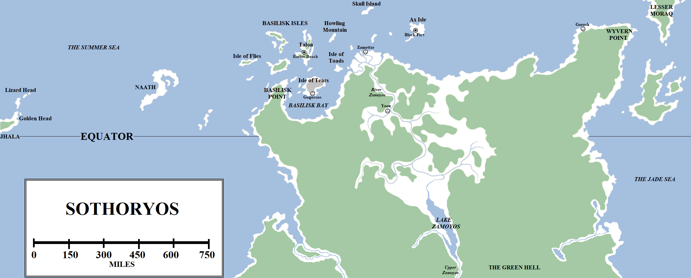
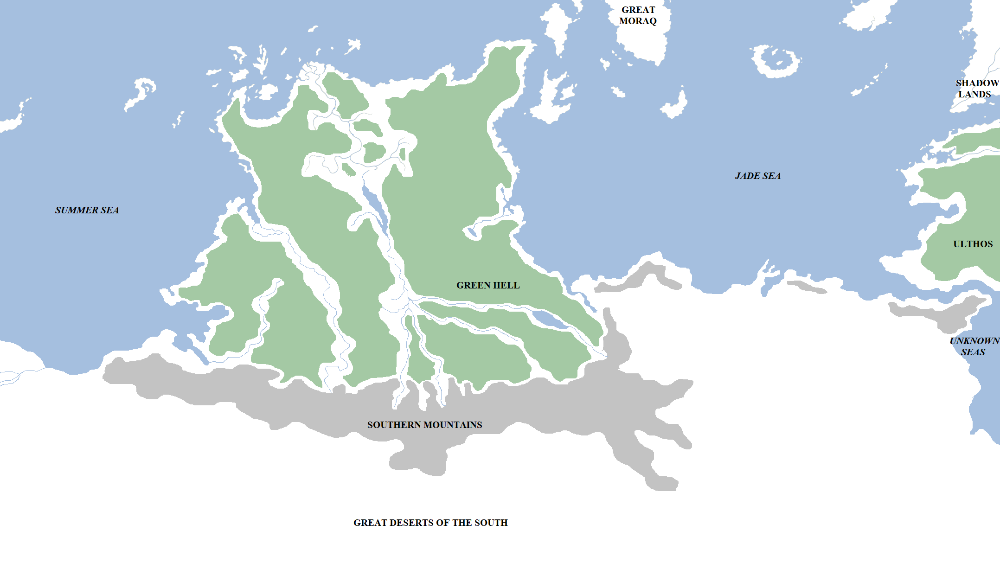

To the south of Essos and far to the south-east of the Seven Kingdoms lies a savage, desperate and highly dangerous land. This is a world alien to that of men, a land of fierce, unrelenting heat, endless jungles, vast deserts and savage creatures, not to mention plagues that erupt without warning and kill indiscriminately. This is the remote, mostly unexplored and forbidding third continent of the known world and the most southerly location we know of: Sothoryos.

The explored region of Sothoryos. Click to embiggen.

Sothoryos is located some 2,600 miles south-east of the eastern tip of Dorne, and about 750 miles south of central Essos. The far northern coast of Sothoryos lies south of Ghiscar and Slaver’s Bay, and south-east of Valyria. The continent is bordered by the Summer Sea to the north and presumably west, and the Jade Sea to the north-east. The southern and eastern-most boundaries of the continent have not yet been measured by any reliable reports.

The explored portion of Sothoryos measures some 1,750 miles from east to west and 1,100 miles from north to south. Despite its proximity to Essos, the continent has never been thoroughly mapped. Ancient Qartheen maps depicted Sothoryos as an island twice the size of Great Moraq, but this was clearly guesswork. The Ghiscari undertook surveys of the coast and concluded that Sothoryos was comparable to Westeros in size, suggesting a north-south oriented continent 3,000 miles or more in length. Later, the Valyrians undertook an exploration of the interior of the continent, flying on dragons far over the interior and to the south. Unfortunately this mission seems to have been more for amusement than for the purposes of exacting topographical exploration, to the frustration of many maesters. The Valyrian exploration suggested a continent comparable in size to Essos, meaning truly vast and apparently without end. The Qartheen have undertaken more recent explorations of the eastern coast of Sothoryos but have never found the bottom of the continent, whilst the Summer Islanders have likewise explored the west coast in their formidable swan ships, but have declined to share their discoveries with outsiders.

**Northern Sothoryos**

The northern portion of Sothoryos straddles the equator, which maesters believe should be the hottest part of the entire world. This region is covered in jungle and woodlands. The temperature in Sothoryos is stifling, the jungle moist and humid beyond belief, to the point where simply walking around is an incredible effort. The attraction of shedding clothes and going bare-chested is clear, but is also extremely dangerous, due to ticks, blood-sucking leeches and parasites capable of dropping from trees and burrowing into the skin. More than one exploration of the continent has ended in madness, plague, dehydration, starvation and death.

Dense jungle covers most of the explored portion of Sothoryos, but the foliage does break and fall back in the centre of the landmass, where the great River Zamoyos meets the Summer Sea in a vast, many-branched delta. The source of the Zamoyos is unknown: several expeditions launched deep upriver by the Ghiscari simply failed to return. The most successful mission reported that the river runs south for some 700 miles before opening into a large and substantial lake, which is fed by several lesser waterways. The lake is massive, more than 300 miles long and more than 50 miles wide. The Zamoyos is assumed to continue at the southern end of the lake, where a wide river extends south for another hundred miles or so. However at that point the relatively light jungle of the north gives way to the horrific landscape known as the Green Hell, so the explorers turned back and wisely lived to tell the tale.

The Zamoyos Delta is the most habitable part of the mainland of Sothoryos, although it is still hot, humid and unpleasant, with marshlands and swamps extending for dozens of miles along the coast. Crocodiles dwarfing even the formidable lizard-lions of the Neck in Westeros can be found in these waters. One part of the coast is elevated slightly above the rest, forming an effective island between several arms of the Zamoyos which is marginally more tolerable than the land around it. It was here, over five thousand years ago, that the Ghiscari founded the city of Zamettar. The city was the springboard for the Ghiscari exploration of the continent, but very few other colonisation efforts succeeded, apart from the settling of Gorosh to the east and Gorgai to the west.

Still, Zamettar endured, possibly more through stubbornness than sense. The city finally fell during the Fourth Ghiscari War, when the dragons of Valyria, escorting a fleet, captured the city in battle. The Valyrians were initially pleased with their conquest and planting their banner on a new continent, but rapidly discovered what the Ghiscari had before them, that the southern continent was a land of great promise but almost lethal danger. The Valyrians strove to tame Sothoryos for a time, the legendary explorer Jaenaera Belaerys taking her dragon Terrax on a daring three-year exploration of the lands to the south, but even she failed to find any sign of civilisation, or even the far end of the continent. Eventually the Valyrians abandoned Zamettar as more trouble than it was worth, the last dragonlords departing circa 1700 BC. The city was briefly repopulated around 700 BC by Nymeria and her Rhoynar followers, but they found the land far too hostile and they soon moved on, set on the course that would lead them to Dorne.

**Wyvern Point**

Wyvern Point is a peninsula in the far north-east of Sothoryos. This region extends along the Jade Sea and Summer Sea, with the island of Lesser Moraq located just off the coast. Wyvern Point is also covered in jungle and swamps, but is so-named for the large numbers of wyverns located within the treeline. Wyverns are smaller and far less dangerous relatives of dragons, but they are still extremely dangerous creatures, best-avoided.

Wyvern Point is lacking in interesting features apart from one excellent habourage. The Ghiscari established a port on the harbour, Gorosh, which they used as a penal colony during the days of the Old Empire. However, like so many other colonies in Sothoryos, it could not survive the harsh climate and harsher inhabitants, and was eventually abandoned.

**Basilisk Point**

Located in the far north-west of Sothoryos, Basilisk Point is a peninsula forming the west coast of a very wide (200 mile) bay. Basilisk Point is – marginally – more habitable than the jungles to the south and east, and there have been several attempts to colonise it. The Valyrians settled a colony in this region but it was soon destroyed. The Rhoynar founded two towns during Nymeria’s flight from Essos, but both were sacked by corsairs and the people taken into slavery.

**Yeen**

Yeen is a ruined city, located 300 miles upriver from Zamettar. It is a very curious ruin, however, consisting of buildings built out of a curious black stone which is oily and disturbing to the touch. The blocks are enormous, each requiring a dozen elephants or more to move, but seem to have been cut, lifted and fused together by means unknown. Even more curious is the fact that the city has no discernible point of origin. It appears to be older, by far, than any human city in the known world, far older than even Old Ghis or the oldest stones of Moat Cailin or the oldest cities in Yi Ti or Sarnor. Only Asshai, the origins of which are likewise mysterious, can challenge Yeen as the oldest city in the world.

Every attempt to resettle Yeen has resulted in horror. Located far inland, with only the Zamoyos providing any kind of easy approach to the city, the jungle surrounds it on all sides, although, curiously, the jungle has never fully reclaimed it. But sickness, plague, heat and the dangerous inhabitants of Sothoryos, the so-called “Brindled Men”, are a constant threat to the ruins. Every Ghiscari and Valyrian attempt to claim the ruins failed. The last known attempt was by the Rhoynar, who founded a new settlement amongst the ruins of Yeen. The settlement seemed to flourish for several months but then went quiet. A ship sent by Nymeria to investigate found that the settlement had been abandoned, every man, woman and child living there simply gone without a trace.

A highly speculative and dubious map of Sothoryos, taking into account the discoveries of the Valyrian exploration of the continental interior. Click for more detail.

**The Green Hell and Southern Sothoryos**

Beyond Yeen and the lake of the upper Zamoyos, the jungle abruptly becomes thicker, hotter and more savage. This region is called the Green Hell, and makes the jungles to the north – which are still extraordinarily dangerous – look safe and inviting by comparison. The Green Hell is packed with dangerous insects, snakes big enough to kill wolves, the feared vampire bats (which can drain the blood out of a fully-grown man in minutes) and is the home of the Brindled Men, the immensely large, strong and vicious humanoid inhabitants of Sothoryos. They are distinctly non-human, and would be considered a myth save for the occasional specimen who shows up in the fighting pits of Slaver’s Bay. The Brindled Men are intelligent, after a fashion, but display a love for violence, killing and savage perversity that is deeply disturbing.

The landscape of the Green Hell is unmapped in detail since no sane person would venture far into it, and every attempt which has been made has ended in slaughter. This danger seems to extend to the coasts, with ships that make landfall generally not surviving to return home again. The only way past the Green Hell is by air, with the Valyrian expedition led by Jaenaera Belaerys on dragonback passing far overhead and managing to just about traverse the region before landing to the south. This suggests that the Green Hell might be over a thousand miles across, given the known distances that dragons can traverse with riders before requiring rest.

South of the Green Hell, far beyond the edge of any reliable map, the jungles of Sothoryos seem to terminate at a titanic series of mountain ranges. Beyond this lies a region of utterly vast deserts, dwarfing the Red Waste of Essos and the the deep deserts of Dorne in size. Barren and lifeless, this desert region extends in all directions for tremendous distances. At the fringes of the desert the Valyrians found more mountains and, more jungles (presumably giving way to more temperate forests in the south, far away from the equator). Three years into their mission, the Valyrians gave up the effort and turned for home.

**The Basilisk Isles**

Lying off the north-western coast of Sothoryos lies the Basilisk Isles, very occasionally called the Corsair Isles. These islands are so-called for the basilisks which can be founded in the wild. The forbidding name is also apt for the pirates and corsairs who infest the islands.

The islands extend in an arc for roughly 800 miles, from the Isle of Flies in the far west to Ax Isle in the far east.

The largest and most southerly of the islands is the Isle of Tears, which is roughly 100 miles wide. This island consists of steep valleys, studded with dark bogs and rugged flint hills. On the south coast is a good anchorage, where, well over five thousand years ago (according to tradition), the Ghiscari founded the city of Gorgai. The Valyrians seized the city in the Third Ghiscari War and renamed it Gogossos, using it as a penal colony for centuries. After the Doom of Valyria, Gogossos grew powerful and rich on the slave trade, corsairs seizing captives from nearby Naath and the mainland of Sothoryos to sell in their thousands. After the fall of Essaria to the Dothraki, Gogossos was nicknamed the “Tenth Free City” and may have even become that in truth. But, seventy-seven years after the Doom of Valyria, the Red Death erupted on the Isle of Tears. Nine out of ten of the population was wiped out by a horrific plague and the city of Gogossos and the entire island was abandoned.

North and east of the Isle of Tears is the Isle of Toads. This island is inhabited by strange people with fishlike faces and webbed fingers and toes. There are many small villages and towns on the island, but the strangest feature is the Toad Stone, a forty-foot-tall statue made of the same black, oily stone found in Yeen. The statue represents a toad of unpleasant aspect. It is considered cursed and shunned by outsiders, explaining how the isle and its people survive despite being surrounded by pirates and corsairs.

North of the Isle of Tears is Talon, the second-largest of the islands, so-named because it resembles a claw from above, 150 miles long with several peninsulas and headlands extending into the surrounding sea. It is the home of many of the pirates, with the largest pirate stronghold, Barter Beach, located on its shores. It is a rough and ready place, very dangerous to visit, but profitable for those with the stomach and the will. To the west, on the open sea, lies the Isle of Flies, presumably named for the insects which crowd the island in numbers. The island is the home of a rough alliance of pirates, the Brotherhood of Bones, which troubles the Summer Sea west to the Summer Islands and north to the Free Cities.

East of Talon lies the Howling Mountain, an island consisting of a single tall peak. There are several pirate bases on its shores. North-east lies Skull Island, the home of the most savage pirates who sacrifice captives to a dark god and collect their skulls in vast piles. Finally, in the east lies Ax Isle, one of the most heavily-fortified pirate isles. The Qartheen raider Xandarro Xhoare established a base on the island a century after the Red Death and built a new, formidable stronghold out of the strange black stones found on the Isle of Toads (and several of the other islands in smaller numbers). This stronghold still stands and is still frequently used to export terror and misery to the surrounding seas.

**Naath**

Naath, the Isle of Butterflies, lies to the west of the Basilisks. More than 200 miles long, it is only 300 miles west of the Isle of Flies and about 350 miles from the Sothoryosi mainland. The island is the home of the Naathi, the Peaceful People, a race of men and women who believe in accepting their fate, never making war, and worshipping their god, the Lord of Harmony.

Naath would certainly have been despoiled and depopulated millennia ago if it wasn’t for a special force protecting it. The island is home to millions of butterflies and caterpillars, who weave the fine silks the Naathi used to sell to traders to take across the known world. However, these are also the source of an infection, the butterfly plague. The plague is unusual in that it doesn’t strike immediately, instead building up for several months before striking. In ancient times, the Ghiscari seized Naath three times before their occupying force was wiped out by the plague. Slavers, corsairs, Valyrians and a sellsword company have at one time or another “conquered” the island only to be wiped out in less than a year. Knowledge of the curse of the butterfly plague became widespread and Valyria warned its sailors never to land there. This resulted in the island being left alone for centuries and possibly millennia. The Naathi, of course, are immune to this plague.

However, it also became known that the plague struck briefly and only after a long period of exposure. As a result, following the Doom of Valyria, the corsairs returned in force. They only allowed their crews to land for a single night, commanding them to take as many captives as possible in brief raids before taking them off. The Naathi responded by withdrawing from the coasts into the interior of the islands. Bolder raids followed, but fear of the plague limits how far the pirates and invaders are prepared to go before turning back to their ships. Naath is still periodically raided, as after long periods without raids the Naathi tend to drift back to the shores, but many of its people remain safe in the deep interior of the island.

Almost 600 miles to the west of Naath lies another land of – mostly – peace, plenty and beauty: the Summer Islands.

_Thank you for reading The Atlas of Ice and Fire. To help me provide better content, please consider contributing to [my Patreon page](https://www.patreon.com/user?u=4370220) and [other funding methods](http://thewertzone.blogspot.co.uk/2017/01/support-wertzone-on-patreon.html), which will also get you exclusive content weeks before it goes live on my blogs._
