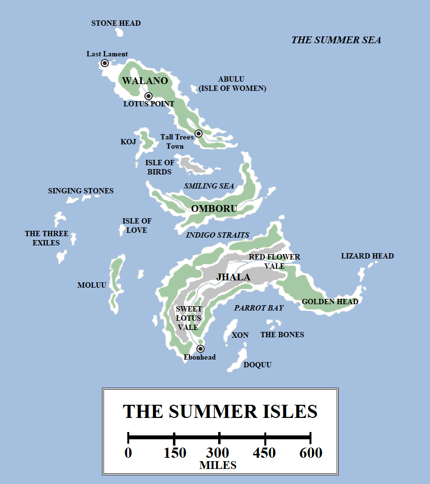

The Summer Isles lie far to the south of Westeros and the Free Cities. A land of unrelenting summer, beautiful wildlife and friendly (but not foolish) natives, the Summer Isles sound like a paradise.

Map of the Summer Isles. Click for more detail.

The Summer Isle archipelago consists of over fifty islands. There are three major islands, (Walano, Omboru and Jhala), over twenty intermediate-sized ones and more than twenty-five which are too small to appear on maps but are large enough to host colonies of birds or small tribes of men. The northern-most island, Stone Head, lies approximately 750 miles south of the south coast of Dorne and about the same south-west of Lys, whilst the island of Naath lies some 500 miles east of Jhala. The coast of Sothoryos lies an unclear distance to the south-east of Jhala. From north to south the archipelago spans just over 1,200 miles and some 1,100 miles from west to east.

The Summer Isles are divided into numerous small kingdoms, each ruled by its own prince or princess. These rulers sometimes come into conflict with one another, but do not fight wars. Instead they engage in ritualised combat resembling Westerosi tourneys, with the losers sent into exile. The Summer Isles have occasionally banded together as one people, most notably in the Slavers’ Wars when they turned back the pirates of the Stepstones and Basilisk Isles who sought to turn the islands into a source of slaves, but these periods are rare.

**Walano**

The most populous of the Summer Isles, Walano is the northern-most of the three main islands. 500 miles long and over 100 miles wide, the island is sizeable and home to the archipelago’s most notable settlements. Lotus Point, the largest city and main trading hub of the islands, is located on the south-western coast. Tall Trees Town, home to the largest collection of knowledge in the isles (via the vast grove of Talking Trees, which have the history of the islands carved into their trunks), is located 200 miles to the south, on the south-western coast of the island. The town of Last Lament is located on the north-western coast of the island, so called because it is the last port of call for Summer Islands before they cross the Summer Sea towards Oldtown and Dorne.

Walano may be the oldest-settled of the islands; the Ghiscari record the island as being inhabited well over five thousand years ago, when an expedition landed on the island after being blown off course and were forced to flee by the natives. This led to Walano being shunned as the “Island of Demons” for several centuries, until the Summer Islanders themselves ventured beyond their shores and made peaceful contact with Valyria to the north-east and Dorne to the north-west.

**Omboru**

The island of Omboru is located to the south of Walano, across the Smiling Sea. The smallest of the three major islands (at around 350 miles across and less than 100 miles wide), it consists of densely-packed jungle and appears to be the most lightly-inhabited of the three main isles as well, with no major cities or towns.

**Jhala**

Jhala is the largest of the Summer Isles, measuring over 600 miles from tip to tip and over 200 miles in width. It is located south of Omboru, across the Indigo Straits. Jhala is dominated by two towering mountain ranges which run along the coasts, dividing the interior into several pleasant river valleys. Sweet Lotus Vale is located in the west of the island and Red Flower Vale in the east. Red Flower Vale was recently the site of a major power struggle, which ended with Prince Jalabhar Xho being sent into exile. He has since taken up residence in the Red Keep of King’s Landing in Westeros, where he regularly petitions King Robert Baratheon for aid in retaking his homeland.

The city of Ebonhead lies at the mouth of the Sweet Lotus River, on Parrot Bay. This was once the seat of Xanda Qo, the famed warrior-princess who united the Islands and helped drive off the slavers. Her daughter Chatana inherited her crown and ended the wars with a decisive victory, but was unable to maintain the unity of the islands, which later fragmented into independent kingdoms.

The south-eastern part of the island is a peninsula, the Golden Head, extending into the Summer Sea. The small island of Lizard Head lies off the coast, so-named for the lizards that bask in the sun on its shores.

**The Lesser Islands**

The island of **Stone Head** lies off the north coast of Walano. It is named for the large carved face which stares north across the seas towards Westeros.

The **Singing Stones**, located west of Omboru, are so-called for their jagged mountain peaks and curious rock formations which cause the winds to make “singing” sounds as they pass over the isles.

**Koj**, located between Walano and Omboru in the Smiling Sea, is the centre of the isles’ shipbuilding efforts. The Pearl Palace, seat of the Princes of Koj, is home to a remarkable map collection, access to which is strictly rationed.

**Abulu**, better-known as the **Isle of Women**, is located off the north-eastern coast of Walano. The island is small but habitable. It was settled by the Rhoynar during their flight from the Valyrians. The island was too small for the hundreds of thousands of refugees, so Princess Nymeria led them on to Dorne, but a small number remained behind. Their inhabitants continue to live on the island to this day, a fierce and proud people of mixed Summer Islander and Rhoynish blood.

Other named islands include **Xon**, the **Bones**, **Doquu**, **Moluu**, the **Three Exiles**, the **Isle of Love** and **Isle of Birds**.

According to the Summer Islanders, at one time they attempted to colonise the western coast of Sothoryos, which lies to the south-east of their islands (far south of Basilisk Point). However, these attempts were all defeated by the same misfortune and bad luck which destroyed other colonies on the continent. It is believed that the Summer Islands have explored and chartered the west coast of Sothoryos for thousands of miles far to the south, but, if so, they have refused to share these maps with others. Presumably they remain, under heavy guard, in the Pearl Palace of Koj.

_Thank you for reading The Atlas of Ice and Fire. To help me provide better content, please consider contributing to [my Patreon page](https://www.patreon.com/user?u=4370220) and [other funding methods](http://thewertzone.blogspot.co.uk/2017/01/support-wertzone-on-patreon.html), which will also get you exclusive content weeks before it goes live on my blogs._
