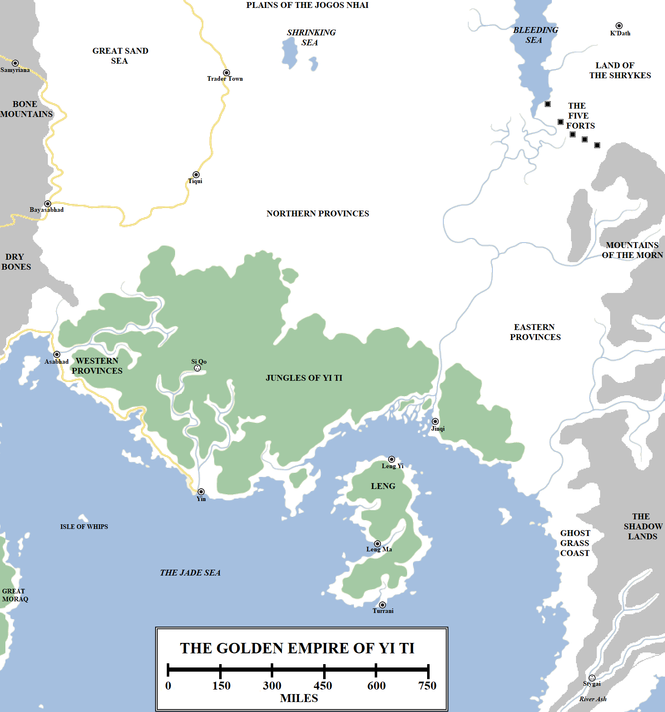

In the far east of the known world lies land of myth and legend. Little news of it comes to Westeros, save in the form of tales too incredible to be believed and the reports of those few sailors brave enough to visit the Jade Sea. This land is Yi Ti, the Golden Empire, the Land of a Thousand Cities and bearer of many other grandiose titles.

The Golden Empire of Yi Ti. Click for a larger version.

Separating fact from fiction is hard, but it is known that Yi Ti lies on the northern shores of the Jade Sea, east of Qarth and the Jade Gates. The Golden Empire expands across a colossal area, measuring some 1,800 miles from east to west and 1,700 miles from north to south. However, these measurements are inexact, given that the borders of Yi Ti are constantly shifting depending on who makes the maps and which emperor is sitting on the throne at any time. The current borders are generally held to be the Dry Bones and the Great Sand Sea in the far north-west, the Shrinking Sea and Bleeding Sea in the far north, the Mountains of the Morn in the north-east and the Shadow Mountains and their ghost grass-swathed foothills in the far east. Yi Ti is the second-largest nation-state in the known world, outstripped in size only by the Seven Kingdoms of Westeros. The Dothraki claim more territory, although they do not rule it as a coherent nation-state.

Despite its name, the Golden Empire is far reduced in size compared to its glorious heyday of several centuries ago, when its borders stretched much further north into the Plains of the Jogos Nhai and south to encompass the island of Leng and several other isles of the Jade Sea, including the east coast of Great Moraq. It is smaller still than the Great Empire of the Dawn, a vast nation which stretched from the Bones to the furthest east beyond the Shadow Lands and Grey Waste and from the Jade Sea to the Shivering Sea. The Great Empire of the Dawn collapsed in the Long Night and Yi Ti emerged as its successor state, suggesting that the current Golden Empire may approach eight thousand years in age, predating Valyria and maybe even Old Ghis.

**The Western Provinces**

The western provinces of Yi Ti are where most travellers and traders first encounter the Golden Empire. The city of Asabhad is the gateway to Yi Ti, sitting at the mouth of a river on the main road leading west to Qarth (about 500 miles distant) and north to Bayasabhad (450 miles distant). Given the naming convention, Asabhad may have been a city of the Patrimony of Hyrkoon in origin rather than Yi Ti; the city’s modern status is ambiguous, with a strong YiTish influence but also numerous outlanders living within its walls.

From Asabhad, a road leads down the coast for some 600 miles. This stretch of the coast is populous, with numerous small towns and ports dotting the shores. Cultivated farmland extends inland, to where the great jungles and forests of Yi Ti begin.

**The Jungles of Yi Ti**

Yi Ti’s southern half is dominated by a vast region of jungle and woodland. The maps of this region can be deceptive: rather than one vast unbroken canopy of trees, the jungles are divided by open areas, hills and fields surrounding towns and small cities. The jungles are warm, but they are not the boiling, plague-ridden hell of Sothoryos or the thick, balmy jungles of the Summer Isles. The jungles of Yi Ti are very hospitable, giving rise to Yi Ti’s enormous population. The jungle region of Yi Ti extends for 1,400 miles along the northern coast of the Jade Sea and extending for over 700 miles inland.

The great city of Yin sits on the coast of the Jade Sea, where a mighty river flows into the sea. Yin is the traditional capital of Yi Ti and is (usually) the largest city of the Empire. A vast, sprawling metropolis, the only city of the west that can rival it in size is Volantis and maybe Qarth. More than a million people appear to live in and around the city, from where the 17th Azure Emperor Bu Gai rules over the Empire. In practice Bu Gai’s remit does not extend that far from the city itself, and his rule is challenged by the rival Pol Qo of Trader Town, the 1st Orange Emperor, and the Sorcerer-Lord of Carcosa, who claims the title of 69th Yellow Emperor.

Hundreds of miles upriver and inland, deep in the heart of the jungle, lies the ruined city of Si Qo, from where the Scarlet Emperors of Yi Ti ruled for centuries before they were pulled from power following several disastrous expeditions against the Jogos Nhai.

**The Eastern Provinces**

The eastern provinces extend from the delta of a vast river into the fabled Shadow Lands. This region is ruled from Jinqi, an extensive and large city located on the river delta. The Maroon Dynasty established its capital in Jinqi at a time when Yi Ti’s borders were hard-pressed by raiders out of the Shadow Lands. Wearing red, lacquered masks, the raiders tested the boundaries of Yi Ti until the Maroon Emperors decisively defeated them, driving them back into the mountainous Shadow Lands. However, the Emperors forbade punitive expeditions, fearing that their armies could not return from the shadow-drenched lands of the mysterious east.

The eastern provinces are dominated by jungle in the south and vast areas of cultivated farmland in the north, extending for over 400 miles to the towering Mountains of the Morn. To the south-west, a river divides the Yi Ti frontier from the Shadow Lands. This region is infested with ghost grass, a form of white grass which poisons other crops and kills them. According to the Dothraki of the far west, ghost grass will one day consume the entire world. Given the remoteness of the Dothraki Sea from this region (between 2,500 and 3,000 miles away), it is curious that they have even heard of ghost grass, let alone developed legends around it.

**The Northern Provinces**

The northern provinces of Yi Ti cover fully half of the Empire. This region is dominated by utterly immense, cultivated farmlands which extend across colossal distances. The better part of a thousand miles separate the Great Sand Sea from the Bleeding Sea, and this space is filled with farmsteads, towns and small cities, linked by numerous roads. This is the breadbasket of Yi Ti, the food supply for the huge, hungry coastal cities of the south.

The largest city in this region is Tiqui, the seat of the old Purple Emperors. Tiqui is a vast, thriving metropolis linked by good roads to Bayasabhad (450 miles to the west, around the fringes of the Great Sand Sea) and Trader Town (300 miles to the north).

Trader Town is another large city, located near the northernmost territory reliably claimed by the Empire. The city lies athwart the Steel Road which leads north and west around the Great Sand Sea, through the Howling Hills and into the Bone Mountains, to the city of Kayakayanaya. Trader Town is so-named for its reputation for trade and commerce with the lands to the west. It is also heavily fortified due to the threat of the Jogos Nhai, whose territory lies not far north of the city. General Pol Qo has recently seized Trader Town, proclaimed himself the first emperor of the Orange Dynasty and laid claim to all of Yi Ti, but has so far not moved against the southern provinces.

Not far east of Trader Town lies the Shrinking Sea. Once an immense lake, this body of water has driven up over the millennia, leaving behind just two shallow lakes and a lot of mud. Some maesters believe that the Shrinking Sea has shrunk due to the long impact of the unpredictable seasons, a similar fate to the Silver Sea of western Essos and the Great Sand Sea, although of course this does not explain how the sea formed in the first place.

Almost 600 miles separate the Shrinking Sea from the Bleeding Sea. This is the northern-most frontier of Yi Ti, patrolled by imperial armies and defended by infrequent forts. The frontier is frequently raided by the Jogos Nhai, but it is some centuries since a _zhattar_ unified a really large army to trouble the Empire.

The Bleeding Sea is a large lake, 100 miles wide and over 500 miles long from north to south. Only the southern-most part of the lake lies within YiTish territory, and it is a remote, sparsely-populated region. The lake is ill-omened for its red waters, although these are caused by a simple and harmless blooming plant. More impressive is what lies on the south-eastern edge of the sea, a colossal network of fortifications to rival that of the Wall of Westeros.

**The Five Forts**

Located on the far north-eastern frontier of the Golden Empire are the Five Forts, a name given to five immense bastions and a network of smaller garrisons and walls between them. Each one of the Five Forts is made of fused black stone and extends reportedly 1,000 feet into the sky, making them the tallest man-made structures in the world, out-topping even the Wall and the High Tower of Oldtown in Westeros. Each one of the Five Forts is reported to be able to garrison 10,000 men. This array of fortifications stretches for about 250 miles, from the south-eastern coast of the Bleeding Sea to the Mountains of the Morn, forming a near-impassable barrier to travel between Yi Ti and the lands beyond.

The origin of the Five Forts is unclear. They certainly predate the Golden Empire and the Long Night. Some historians date their construction to the Pearl Emperor of the Great Empire of the Dawn, who built them to defend against the armies of the Lion of Night in the Dawn of Days, but maesters cast scorn on this story. Some similarities between the Five Forts and the dragon-forged structures of Valyria have been reported, but they long predate the Valyrian Freehold and, despite rumours of dragons in the Shadow Lands to the south-east, no reliable stories or histories place dragons in this region.

Beyond the Five Forts lies a 300-mile-wide region of wilderness inhabited by tribes of men called “Shrykes”. The Shrykes wear the skins of lizards and are hostile raiders, but they certainly do not represent a major threat to Yi Ti or to the Five Forts. It is assumed that whatever threat the Five Forts were built to defend against is long dead.

South and east of the Five Forts, on the other side of the Mountains of the Morn, lies a hidden valley, a hidden sea and a mysterious city where a sorcerer-king has recently proclaimed himself the 69th Yellow Emperor of Yi Ti. Again, this individual has made no move against the imperial heartlands so far.

**Leng**

The island of Leng lies just off the coast of Yi Ti. Until 400 years ago it was ruled by the emperors, but it threw off the shackles of conquest and became independent once again. However, the Lengii maintain strong ties with Yi Ti and try to avoid open warfare.

The island of Leng is 450 miles long from north to south and about 200 miles wide. It sits in the eastern Jade Sea, with less than 50 miles separating it from the mainland.

Leng is covered by jungle, within which sit curious, ancient ruins. According to Lengii tradition, great caves lead to fathomless depths, from where a race known only as the “Old Ones” ruled the island and commanded the native inhabitants. The YiTish collapsed most of these caves and banned any further worship of the Old Ones, but the tradition of following their teachings remains.

The northern two-thirds of Leng is dominated by the descendants of YiTish colonists; the southern third is dominated by the original Lengii. The ruler of Leng, who styles herself the God-Empress, rules in a line of matriarchal descent but takes two husbands, one from the Lengii area of the island and one from the YiTish, to maintain balance.

There are three major cites on Leng: Leng Yi on the north-eastern coast, 180 miles or so south-west of Jinqi in Yi Ti; Leng Ma on the west coast, some 250 miles south of Leng Yi; and Turrani on the south coast. Leng Yi and Leng Ma are YiTish cities in origin whilst Turrani is Lengii. Turrani also has the intriguing honour of being the closet major city to the fabled and feared metropolis of Asshai, located just 600 miles further south and east across the eastern reach of the Jade Sea.

North of Yi Ti lies another land of mysterious legends and myths, ruled by the zorse-riding warriors of the Jogos Nhai.

_Thank you for reading The Atlas of Ice and Fire. To help me provide better content, please consider contributing to [my Patreon page](https://www.patreon.com/user?u=4370220) and [other funding methods](http://thewertzone.blogspot.co.uk/2017/01/support-wertzone-on-patreon.html), which will also get you exclusive content weeks before it goes live on my blogs._
