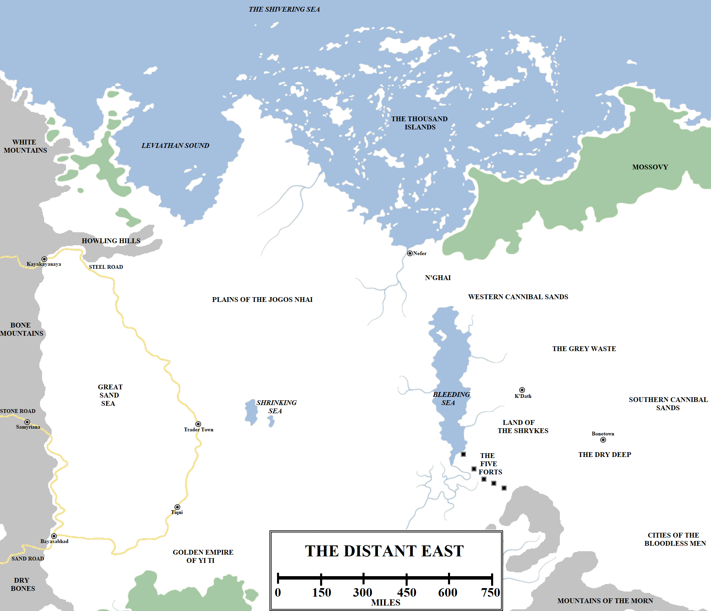

Beyond the Bone Mountains and Jade Sea, reliable information on the known world becomes more fragmented and dubious. History and geography become intertwined with invention, myths and fables. The distances involved are tremendous and travelling to those lands to learn the truth and back again may take years or decades, and along the way all sorts of unreliable information might be picked up. Thus the maesters of the Citadel have only been able to put together the most general of accounts of the lands of the furthest or most distant east. Still, we must report what is known.

The far north-east of the known world. Click for a larger version.

**The Plains of the Jogos Nhai**

Lying to the east of the northern Bone Mountains and the Howling Hills are an area of grasslands and plains not immediately dissimilar to the Dothraki Sea west of the mountains. This area of grassplains is extensive, although not as large as the Dothraki Sea, extending for over 1,000 miles from the Shrinking Sea to the furthest north extending up the eastern shores of Leviathan Sound. The area measures between 800 and 1,000 miles across from east to west, extending from the Great Sand Sea to the Bleeding Sea.

This region is the home of the Jogos Nhai, a curious people who bind the heads of their infants for the first two years of their life, resulting in pointed skulls. They are warlike, considering themselves to be at war with all other peoples (although individually they can suspend this conflict to justify some elements of trade), but they do not engage in internecine warfare, which is forbidden by their gods. The Jogos Nhai are nomadic, living in mobile tents known as yurts, and are divided into small bands, each led by a _jhat_ (or chieftain) and a Moonsinger, a priestess. Occasionally the Jogos Nhai are led by a _jhattar_ or jhat-of-jhats, but this has not occurred for some centuries.

The border between the Jogos Nhai lands and the northern frontier of Yi Ti is fiercely debated, with the lack of a major geographic feature to define the frontier. The latitude of the Shrinking Sea running east to the Bleeding Sea is generally considered the border, but this is an imprecise measurement. The Jogos Nhai raid the frontier incessantly, with the Empire sometimes sending retaliatory forces into the Jogos Nhai lands, but there hasn’t been a major war between the two powers for a long time.

**N’Ghai**

N’Ghai is a small kingdom located on the Shivering Sea, east of the Plains of the Jogos Nhai. In ancient times N’Ghai was much larger, extending far to the west. Its western borderlands were destroyed by the Jogos Nhai, who have pushed the border back to the river and a single city of note, Nefer.

Nefer is the only known port on the Shivering Sea east of New Ibbish and the Port of Ibben. There are literally no known safe harbours or ports on the north coast of Essos for a thousand miles or more to the east, and no ships come sailing out of the east from whatever nations or cities which may lie at the far eastern end of the continent. As a result of this Nefer is the end-point for voyages out of the east and the start for bold merchants sailing west to Ib, or even further west to the Free Cities.

Nefer is built around a reasonably-sized harbour, but the geography of the region is difficult, with a rocky shore and towering chalk cliffs nearby. For this reason, as well as defence, most of the city is built underground, making it a dark and ill-omened place. Nefer is reported to be a haunt for necromancers and torturers, although how much of this ill reputation is earned is unknown.

**Leviathan Sound and the Thousand Islands**

Leviathan Sound is a wide bay on the north coast of Essos, more than 400 miles wide. The immense bay is home to fish but also to whales, who gather here in their tens of thousands. The Ibbenese see these waters as fertile hunting grounds, sending whalers into the waters in large numbers. The shores are claimed by the Jogos Nhai, so the Ibbenese prefer to make landfall on the islands that dot the bay.

Further east lies an absolutely immense archipelago stretching for over 1,200 miles from east to west and 800 miles north to south. This region is called the Thousand Islands, but the total number of large islands is believed to be no higher than three hundred. The Ibbenese have charted the islands and even made attempts to colonise them in the past, but were dissuaded by the inhabitants of the islands.

The natives of the Thousand Islands are strange, with green-tinged skin. The women file their teeth and shave their heads. Statues of obscene, fish-faced gods can be found on many of the island shores. They are utterly xenophobic, attacking strangers on sight. They have a deep fear of the sea, refusing to set foot on ships even on pain of death. The waters and islands are also dotted with strange ruins. According to myth this entire region was once above the water, but a cataclysm in the Dawn Age saw the sea waters rise and drown the entire kingdom. Some maesters date this event to the Hammer of the Waters that drowned the Arm of Dorne between Essos and Westeros, which some claim was a result of polar ice melting beyond the Shivering Sea, but this is speculative at best. What is known is that the Thousand Islands are hostile, unpleasant and dangerous.

**Mossovy**

Mossovy is a large region located east of the Thousand Islands. It is the eastern-most region of Essos to appear on maps, extending as it does right off the edge of the known world. What lies beyond, or how large Mossovy is, is unknown.

It is known that Mossovy’s coastal region is heavily forested for at least a thousand miles, starting not far east of Nefer. These forests extend for between 200 and 300 miles inland and are thick, dark and cold. Shapechangers and demon-hunters are said to dwell in Mossovy. There is no record of any Mossovite cities or towns existing.

**The Cannibal Sands and Grey Waste**

The Grey Waste is a vast desert region located south of Mossovy and east of the Bleeding Sea. It appears to be utterly uninhabitable, being cold, grey and utterly lacking in forests, rivers or habitable lands. It is likely that this region continues for some distance to the east, and its utter hostility may be a key reason why the eastern-most part of Essos remains unknown to us.

The fringes of the Waste are known as the Cannibal Sands and are reportedly home to rapacious tribes of flesh-eating men and women. Maesters are doubtful of this story – tribes of cannibals would presumably eat themselves to death very quickly – but there are enough stories of savage, barely-human tribes in this region that some credence is given to them.

**K’Dath and the Land of Shrykes**

The city of K’Dath stands alone on the plains south-west of the Grey Waste and Cannibal Sands, some 200 miles east of the Bleeding Sea. The K’Dathi claim to be the oldest people in the known world, with their city existing since the dawn of time, but this is again doubted by learned men. K’Dath is reportedly a place of bizarre and obscene rites designed to appease the depraved desires of mad gods, with even the cannibals and Shrykes fearing to approach the city.

South-west of the city lies some 300 miles of wasteland, inhabited by the Shrykes, a race of men wearing lizard skins who occasionally test themselves against the Five Forts on the border of Yi Ti, to little avail.

**Bonetown and the Dry Deep**

The city of Bonetown lies approximately 350 miles south-east of K’Dath, south of the Cannibal Sands and east of the Land of the Shrykes. Bonetown is a ramshackle city perched on the edge of the Dry Deep, a large canyon. A hundred leagues long, the Dry Deep is a parched, steeply-walled valley, dotted with the remains of large animals. The bones of these creatures are collected for trade at Bonetown (which itself is said to be partially built out of bones).

**The Cities of the Bloodless Men**

South-east of the Dry Deep, along the north-eastern fringes of the Mountains of the Morn, lies the Cities of the Bloodless Men. The natives of this region are curiously pale. Some claim the natives of this region are in fact dead and have been resurrected by foul rites. Maesters outright reject this story, considering it fanciful at best.

South of this region lies one of the most redoubtable areas of the known world: the Shadow Lands, the Hidden Sea and, beyond them, the forbidding and secretive city known only as Asshai-by-the-Shadow.

_Thank you for reading The Atlas of Ice and Fire. To help me provide better content, please consider contributing to [my Patreon page](https://www.patreon.com/user?u=4370220) and [other funding methods](http://thewertzone.blogspot.co.uk/2017/01/support-wertzone-on-patreon.html), which will also get you exclusive content weeks before it goes live on my blogs._
