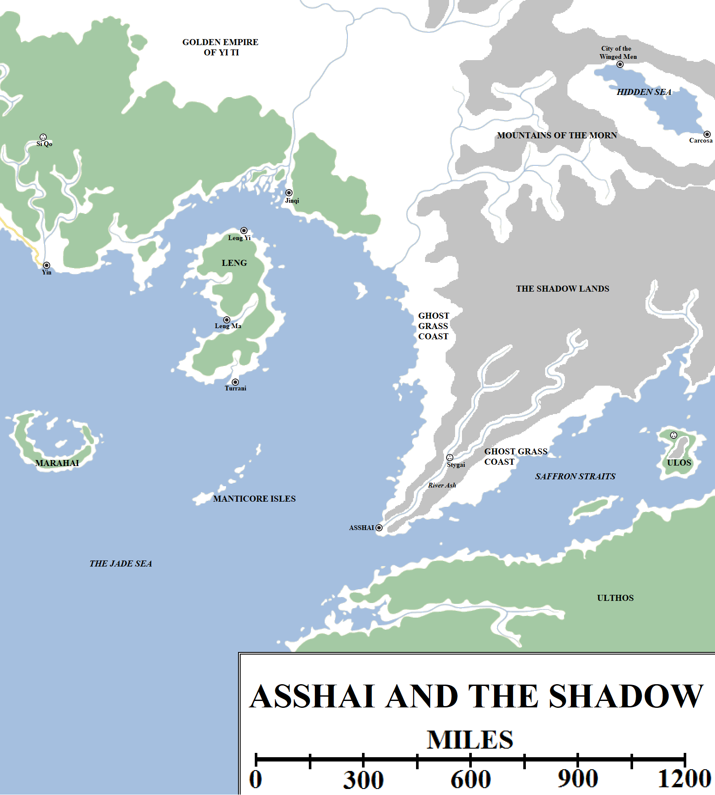
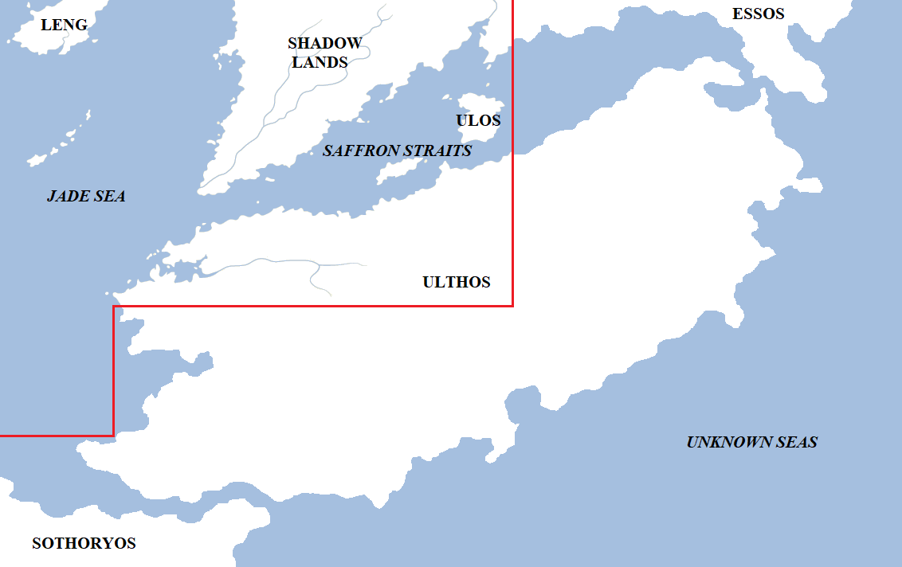

Knowledge is believed to have no limits: students should be able to learn all there is to learn, seek out the mysteries of the world and of science and determine all that can be determined. But if there is a barrier to knowledge, a place where all of a maester’s training may falter, it lies in the far south-east of the known world, on the edge of what is certain. All our knowledge fails us at the Shadow.

But before the Shadow there are still lands on the fringes of our maps which have not been visited.

Asshai, the Shadow Lands and the eastern Jade Sea. Click for a larger version.

**Marahai**

Marahai is a large island in the middle of the Jade Sea, located roughly 400 miles due south of Yin in Yi Ti. Marahai is a long, crescent-shaped island, 200 miles across but never more than 50 miles wide. In fact, the island is more of a circle than a crescent, with only an 80-mile-wide gap in the north breaking the line of symmetry. Within the vast bay of Marahai are two islands, both volcanic, occasionally spewing lava into the sky.

Some maesters studying the mysteries of lava and the earth suggest that Marahi was once a single, whole island that was destroyed in a volcanic explosion many thousands of years ago and is slowly recovering, similar to what is happening around some of the Fourteen Fires in Valyria. However, for this to be true the scale would have had to have been titanic, the explosion dwarfing even the Doom in scale and bringing destruction to the shores of all the Jade Sea. If this did happen, it must have been long ago, before man first came to the shores of the sea.

**The Manticore Isles**

The Manticore Isles are a small archipelago of seven islands in the eastern Jade Sea, 300 miles east of Marahai and 200 miles south-east of Turrani in Leng. The isles are small, remote and it appears uninhabited by humans, due to the dangerous creatures that live there in very large numbers. Manticores are small, scorpion-like insects with disturbingly human faces and a lethal sting that can kill a man in minutes. Manticores are valued as tools of assassination by organisations such as the Sorrowful Men of Qarth.

**The Mountains of the Morn**

The Mountains of the Morn are a very large and extensive mountain range in eastern Essos, on the edge of the known world. They lie south of the Dry Deep and Grey Waste, south-east of the Bleeding Sea and Five Forts and east of the Golden Empire of Yi Ti, whose borders reach into their foothills. The mountains are at least 800 miles long from east to west and are divided into several sub-ranges. The mountains are not as tall as the Bones further west, but are still an imposing barrier to travel in eastern Essos.

**The Hidden Sea, the Winged Men and Carcosa**

In the middle of the Mountains of the Morn is a large vale, at least 400 miles long and over 200 miles wide. In the middle of the vale is a vast inland sea, the Hidden Sea, so-called because it is difficult to find except through tricky passes leading west into Yi Ti.

Located at either end of the sea are two cities whose existence is highly disputed. On the north-western shore is the City of Winged Men, home to a species of men who have leathery wings like a bat and can fly. Maesters believe such reports to be apocryphal, and ponder if the inhabitants of this city have created artificial wings of some fashion, or perhaps ride wyverns or even dragons in the Valyrian manner.

At the south-eastern end of the sea is Carcosa, a city even more mysterious and bizarre (but far less well-known) than Asshai. Carcosa is ruled by a sorcerer-warlord who claims to be the 69th Yellow Emperor of Yi Ti, and has claimed the Imperial Throne in Yin. However, as yet he has made no overt move against Yi Ti. Given that Carcosa is said to lie just over 2,000 miles east of Yin, it is not an effective base of operations for a military operation against the Empire, nor does the area seem conducive to the raising of a large army. How this matter will unfold remains to be seen.

**Asshai**

When it comes to stories of the far east, one place is mentioned more than any other as a place of mystery, magic, wonders…and terrors beyond counting. Asshai, or Asshai-by-the-Shadow, is a great sea port on far eastern coast of the Jade Sea, the most southerly known location on the continent of Essos and a place of fell repute.

Asshai lies on the mouth of the River Ash. It is located 400 miles east of the Manticore Isles. The nearest major cities are Turrani in Leng, 600 miles to the north-west, and Jinqi in Yi Ti, almost exactly 1,000 miles to the north. According to the best estimates we have, Asshai lies almost exactly 6,000 miles south-east of King’s Landing in Westeros.

The border with Yi Ti lies about 750 miles north of Asshai. Almost the entire coast between the YiTish border and Asshai consists of ghost grass, a mysterious type of grass which poisons and kills all other forms of plant and animal life. Asshai and the surrounding region is eerily quiet, with no birds, insects or animals of any kind and the only fish to be found in the Ash and nearby waters of the Jade Sea are deformed, misshapen, unpleasant to look upon and unsafe to eat.

Travelling to Asshai is an ordeal: due to the ghost grass, it is necessary to carry fodder for pack animals all the way from Yi Ti to the city and back again, which makes trade caravans rare and expensive. For this reason most travel to the city is undertaken by sea.

Asshai itself is enormous. Thick black walls surround an area which could comfortably swallow Volantis, Qarth, King’s Landing and Oldtown combined. Thousands and perhaps tens of thousands of stone buildings fill the interior space of the city, most built of the same black stone, slightly oily to the touch. It is similar to the oily black statues of the Isle of Toads in the Basilisk Isles, the ruined city of Yeen in Sothoryos and the curious foundation stones of the High Tower in Oldtown.

The origin of Asshai is unknown, although the black stone and its similarities to other ruins across the world has hinted at the possible existence of a prehistoric civilisation annihilated long, long before even the Dawn of Days and the coming of the First Men to Westeros. But maesters dislike such flights of fancy. All that can be said for sure is that Asshai has existed almost unchanged through all of human history, predating the Old Empire of Ghis and perhaps even the Great Empire of the Dawn.

Asshai is vast, but it is barely inhabited. An estimate of the permanent population of the city puts it in the low tens of thousands at best. One in ten of the buildings are inhabited, if that, and these are mostly clustered around the mouth of the Ash where it opens into the Jade Sea, forming a natural harbour. Ships from across the Jade Sea and the known world can be found in Asshai’s harbour, where the traditional trappings of a city can also be found: merchant houses, taverns, inns, temples and so on. It is here that laughter and enjoyment can be had and heard, but only for a time. There is something oppressive and sinister in the atmosphere of Asshai, something that makes it a relief for the crew of a ship to leave.

Further into the city, away from the more public areas near the port, are more remote and sinister temples and palaces where black magic is said to be practised. Libraries hold forbidden lore and visitors from across the known world are permitted to undertake whatever obscene rites and foul rituals they wish, for nothing is forbidden in the City of Shadows. The only price is that the shadowbinders, the sorcerers of Asshai, are allowed to learn and gather intelligence from visitors, and in doing so their own power grows.

**The Shadow Lands**

On the north-eastern side of Asshai it is said that a single track leads east and north into the mountains. Closely following the course of the River Ash, the path rises into the jagged peaks, whilst the river below is plunged into shadow, the sun only visible briefly at midday. This is the Vale of Shadows, a place that strikes fear into the hearts of all who hear of it. Only the shadowbinders of Asshai and the natives of the Shadow Lands are allowed to travel along this road into the heart of the darkness.

Asshai and the Shadow Lands are oft-mentioned in the same breath, but are two distinct cultures and societies. The Asshai’i are pale but recognisably human. They have their own language and culture, but they are also sociable (in a strange way), dealing with outsiders from other lands on a regular basis. They are relatively few in number, and are found solely in Asshai itself. The people of the Shadow are different, more secretive and much more rarely seen. Those of the Shadow wear red lacquered masks and never let their faces be seen in public. It is unknown where they live – there are neither towns nor villages close to Asshai or marked on any map – or what they seek. Very occasionally, people of the Shadow venture out of their homeland and traverse the known world. They often speak in riddles and sometimes attach themselves to people of import at moments of great crisis.

300 miles north-east of Asshai, in the very heart of the Shadow Lands, is the corpse-city, Stygai (sometimes called “the Stygai”). The City of the Night lies high up in the mountains, overlooking a fork in the Ash, but it is dwarfed by the mountains around it and exists in near-constant shadow and night. The gates of the city conceal its size, extent and current status (although maps show the city as a ruin, this may be more guesswork than based on intelligence). Only the shadowbinders are allowed within its walls. According to legend, dragons and even demons dwell in the mountains around the city. The Shadow Men themselves claim to have taught the original art of taming dragons to the Valyrians, but this is considered a boast by maesters, who point out that if dragons were native to the Shadow, the people there would have likewise used them to conquer and rule, like the Valyrians. The alternative – that those of the Shadow may be instead using their powers to protect or defend something threatening or valuable within the corpse city – is even more disturbing.

The Shadow Lands cover a much vaster area of mountains, of course, extending a further thousand miles to the north-east where they blend into the Mountains of the Morn. Distinguishing between the regions is difficult, but the Shadow Lands can be identified from the ghost grass growing everywhere and the tall, jagged peaks hiding the sun giving way to a more traditional and less dramatic landscape. How far east the Shadow Lands extend, however, is unknown.

A _highly_ speculative map of one possible configuration for the island/continent of Ulthos. The red line marks the edges of canonical knowledge, the rest is speculative. Click for a larger version.

**The Saffron Straits and Ulos**

Asshai sits on the Jade Sea, but also just north of the entrance to the Saffron Straits. The entrance to the straits is a 90-mile-wide channel, relatively calm and inviting-looking. Relatively few ships will enter the straits willingly. East of Asshai, there are simply no ports known to exist. It isn’t even known if the straits are traversable by large ships, or if they open into a further eastern ocean or if they are actually part of a massive bay enclosing the island-continent of Ulthos. Attempted explorations in this direction have simply vanished without a trace. Some ships have managed to return after exploring the coast of the straits for a thousand miles: they report that the Shadow Lands and ghost grass continue along the shores to the north, and two large islands can be found in the straits. One of these has been dubbed Ulos and is large enough (150 miles across, roughly) to host a series of mountainous peaks, as well as thick jungle. Just inland from the north shore is a curious ruined city of unknown origin. What destroyed the city is also unknown.

**Ulthos**

The straits separate the continent of Essos from the island-continent of Ulthos to the south. Ulthos is covered in an incredibly dense jungle, reportedly of strange, purple-black trees. These reports are contradictory and bizarre; maesters point out that the saffron plant is purple in colour, so this may be a reference to large amounts of the plant growing along the coast. This would also give the straits their name.

The coast of Ulthos has been explored eastwards for over a thousand miles, but no further; ships that have travelled further east to chart the shore have disappeared. The current and prevailing winds on the Jade Sea have made exploring the coast southwards also extremely difficult, and overland expeditions have foundered due to a lack of fresh water. About 250 miles south of Asshai, an immense and spectacular harbour has been discovered, a good site for a port, but the hostile landscape and the lack of other cities to trade with on the south coast of the Jade Sea has meant that there has been no enthusiasm for the venture.

The size and status of Ulthos remains highly debatable. Some believe it is an island somewhat larger than Great Moraq; others believe it is a continent in its own right. Others have suggested it is an extension or part of Essos to the north and east or Sothoryos to the west and south. Until more reliable expeditions can be launched, the truth of this matter will remain unknown.

**Beyond**

This brings our exploration of the geography of the known world to a close. We have travelled some seven thousand miles, from the Lonely Light in the Sunset Sea to the isle of Ulos in the Saffron Straits, beyond even fabled Asshai, and spanned the globe from the northern polar seas beyond the Lands of Always Winter to the steaming equatorial jungles of the mysterious continents of Sothoryos and Ulthos. Yet even this vast region is but part of the world: astonishingly, it makes up just under one-quarter of the estimated surface area of the planet.

What lies beyond the boundaries of the known world is unclear. From Qartheen and Valyrian explorations, we know that Sothoryos extends southwards for a vast distance, deep into the southern hemisphere where sailors say even the stars are strange. Attempts to circumnavigate Ulthos and determine its true dimensions have failed, but some believe it to be a vast landmass on the dividing line between island and continent. And how far further east Essos extends remains a mystery, the unforgiving Grey Waste, Cannibal Sands and Shadow Lands blocking attempts to further explore that vast continent.

We know our world is a globe, so it should be possible to instead traverse the Sunset Sea and come to the far eastern shores of Essos from the east. Maesters estimate the distance to the eastern edge of the known world travelling west from the Seven Kingdoms to be almost 18,000 miles, a distance unfathomable to most and certainly not survivable in the best ships currently afloat (apart, maybe, from those of the Summer Islanders). But the Sunset Sea is vast, storm-wracked and inhospitable. Beyond the Lonely Light the ocean appears vast and infinite. The Farwynds of the Lonely Light claim to have found hints of other lands – islands, maybe even the coast of a continent as-yet unknown to science – but these claims remain to be confirmed.

What is clear is that the lands currently known to us contain enough dangers, wonders and adventurers to fill a million lifetimes, and it is in these lands that the cycle of war and peace, life and death, summer and winter will continue.

_Thank you for reading The Atlas of Ice and Fire. To help me provide better content, please consider contributing to [my Patreon page](https://www.patreon.com/user?u=4370220) and [other funding methods](http://thewertzone.blogspot.co.uk/2017/01/support-wertzone-on-patreon.html), which will also get you exclusive content weeks before it goes live on my blogs._
