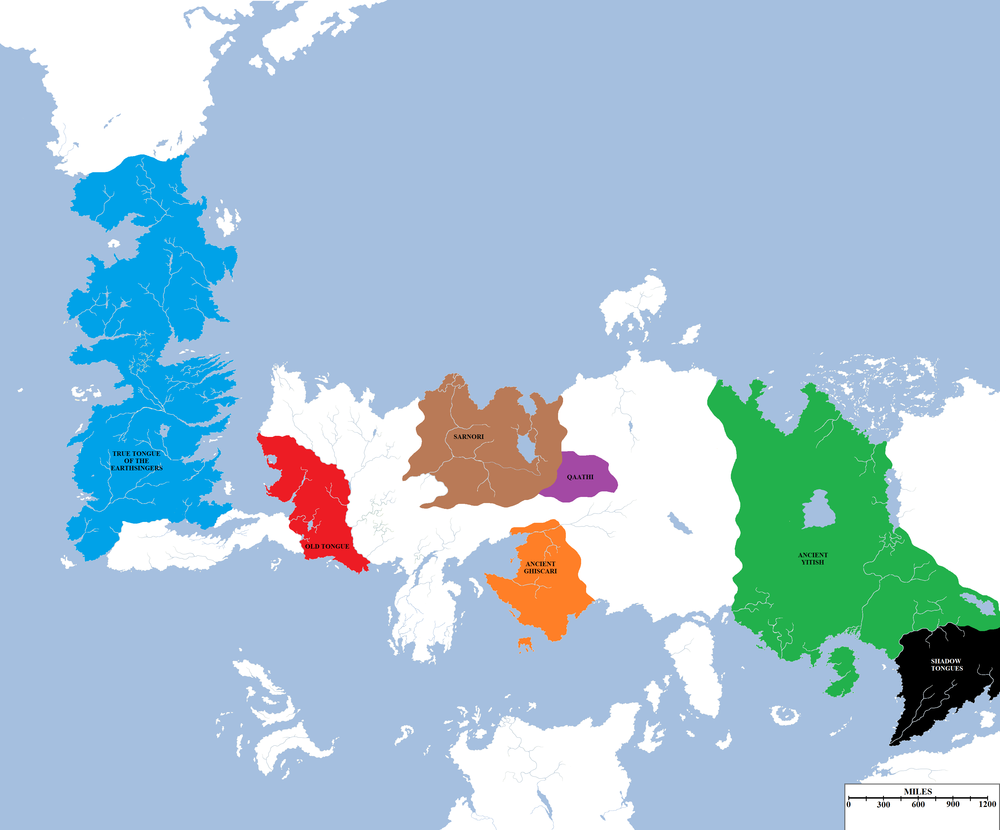
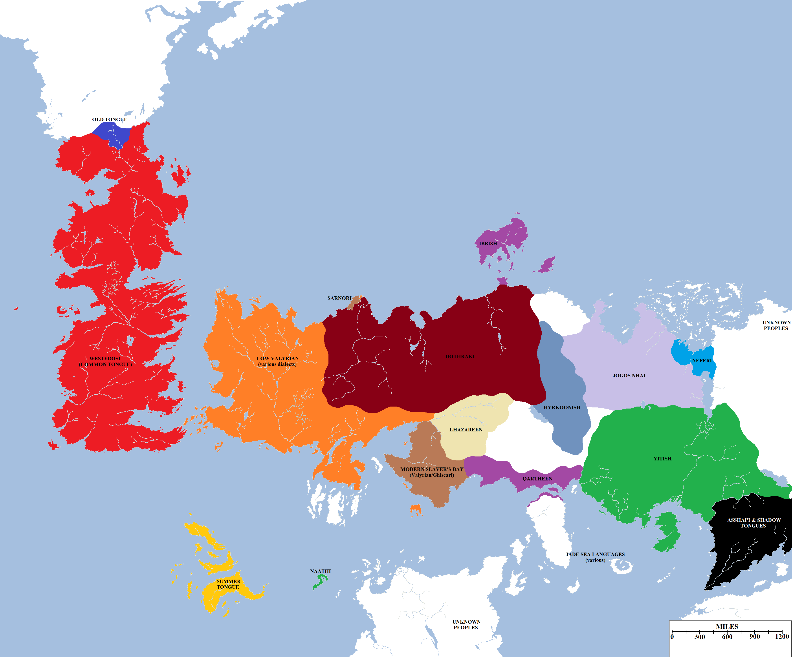
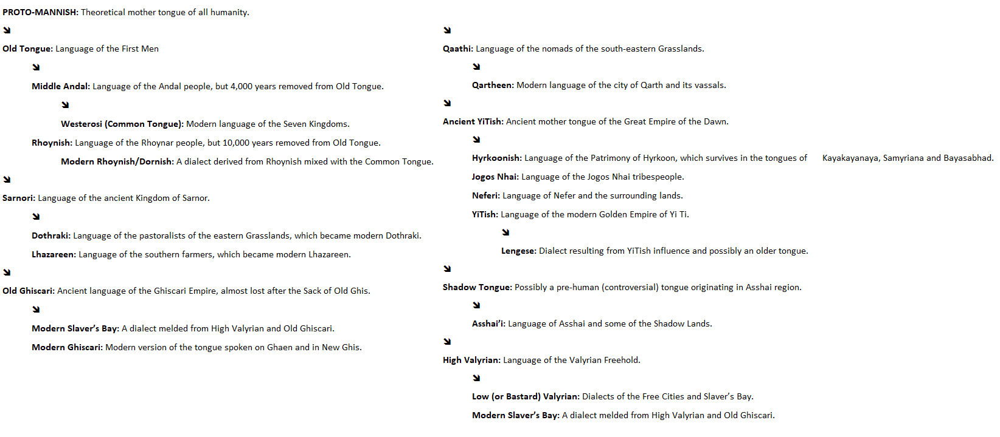

Dozens of languages are spoken in the known world, from the Common Tongue of Westeros to the mysterious speech known as Assha’i, one of the Shadow Tongues from the edge of the world. These languages have descended from other, more ancient forms of speech such as the Old Tongue of Westeros, the ancient language of the Great Empire of the Dawn and High Valyrian.

The ancestral languages of Westeros and Essos in the Dawn of Days (c. 12,000 BC), just before the First Men began their migrations into Westeros.  Click for a larger version.

**Descent of Languages**

Maesters theorise the existence of one original human language (“Proto-Mannish” in some unimaginative studies), spoken by all men and women before a diaspora spread them across all the known world (and perhaps to lands as yet unknown beyond the borders of our maps). Our earliest records suggest, however, that all modern speech descends from seven base language groups derived from this original mother tongue.

The **Old Tongue** was the language of the First Men, spoken in their original tribal homelands in what are now believed to be the Disputed Lands and the lower Rhoyne. The First Men carried the Old Tongue to Westeros, but those who remained behind are believed to have continued speaking it. The Old Tongue diverged over millennia, but maesters believe it may be the ancestral mother tongue of both the Andal and Rhoynar languages, which developed in succeeding millennia.

**Sarnori** was the speech of the ancient empire of Sarnor which extended across much of what is now the Dothraki Sea. The Sarnori tongue may have influenced surrounding languages, most notably Ibbish, ancient proto-Dothraki and Lhazareen.

**Old Ghiscari** was the language of the Ghiscari Empire. The language was widely spoken until the final defeat and sack of Old Ghis by the Valyrian Freehold. Knowledge of the language was banned and the vassal Ghiscari cities were forced to speak High Valyrian. However, even the passage of thousands of years could not completely extinguish knowledge of the tongue, and it seems to have continued to be spoken in secret and in remote regions as well as influencing naming conventions (which even at the height of the Freehold seem to have differed in Slaver’s Bay from Valyria proper). Since the Doom of Valyria, the cities of Slaver’s Bay and New Ghis have developed a hybrid tongue consisting of High Valyrian and Ghiscari words which have survived.

**High Valyrian** is the most recent of the base languages, apparently developing in isolation at the tip of the Valyrian Peninsular (although some have cited evidence of language influences from the Old Tongue, Rhoynish and Ghiscari, but this is debatable). When the Valyrian Freehold began its expansion across the known world, they carried the language to all corners of Essos, sometimes subsuming local tongues, at other times tolerating them. High Valyrian is the mother tongue of most languages spoken in western Essos today.

**Qaathi** was the language of the people of the same name, who lived on the Grasslands east and south of Sarnor. They were displaced by Sarnor to south of the Skahazadhan, where they became the forerunners of the modern Qartheen, with Qaathi likely being the mother tongue of the modern language of Qarth and its vassal holdings.

**Ancient YiTish** was the language of the Great Empire of the Dawn and influenced the languages of all the surrounding lands and successor states. Modern YiTish (and the Lengese off-shoot dialect), Hyrkoonish and the islands of the Jade Sea likely had their tongues influenced by this ancient tongue as well, and possibly the Jogos Nhai as well.

**The Shadow Tongues** or **Ancient Asshai’i** are the languages hailing from the uttermost east. Little is known of these languages, as the natives of Asshai and the Shadow do not teach their tongue to anyone who does not swear loyalty to their unknown causes. According to some travellers, the Asshai’i and related languages descend from the tongue of the unknown and possibly pre-human people who founded Asshai in time immemorial, leaving behind strange markings on oily black stones. However, this is considered fanciful at best by the learned.

Approximate modern language groupings of the known world. Click for a larger version.

**Modern Languages of Essos**

The dominant and most widely-spoken language in the known world is probably **Low Valyrian**, sometimes called **Bastard Valyrian**. This language is derived from **High Valyrian**, but combined with local variants, dialects and influence from surrounding areas. Low Valyrian is a language slowly fragmenting into lesser tongues, so in a thousand years each of the Free Cities may be speaking a different tongue altogether, but for now the languages are mutually intelligible. This language grouping is spoken in the Free Cities, the Stepstones, the Lands of the Long Summer and Slaver’s Bay, as well as at Morosh (the colony-city of Lorath, located at the mouth of the Sarne).

The Slaver’s Bay variant of Valyrian, particularly that spoken in Meereen, Astapor and Yunkai, shows a very strong Ghiscari influence.

Another major language grouping is **YiTish**, spoken in the Golden Empire of Yi Ti, with an offshoot variant spoken on the offshore island of Leng (resulting from an ancient invasion and occupation of Leng by its mainland neighbour). This language’s influence extends to the borderlands of the Jogos Nhai, who speak their own tongue (possibly derived from Ancient YiTish, when the Great Empire ruled all of the plains as well as the modern imperial heartland), and north-eastwards towards Nefer and N’Ghai, whose own tongue is also likely descended from Ancient YiTish.

**Hyrkoonish** is spoken in the mountain cities of Kayakayanaya, Samyriana and Bayasabhad, the remains of the ancient Patrimony of Hyrkoon which emerged from the Long Night and the collapse of the Great Empire, so its tongue derived from Ancient YiTish but has developed in a different direction.

**Dothraki** is surprisingly widely-spoken, due to Vaes Dothrak’s development into an unofficial trade centre between the lands of east and west and the Dothraki’s wide-ranging _khalasar_s bringing knowledge of the tongue to all the lands from the Narrow Sea to the Bones and from the Shivering Sea to Slaver’s Bay. The language is believed to have been derived from ancient Sarnori, who dominated the Grasslands ere the Doom and the Dothraki’s rise to power in the Bleeding Years.

**Modern Sarnori**, the direct descendant of the ancient tongue, is spoken today only in the city of Saath, sole surviving remnant of the ancient Sarnori empire. Only twenty thousand now speak a language that was once spoken by millions.

**Qartheen** is the language spoken in Qarth and by its vassal cities, Port Yhos and Qarkash, as well as in the smaller trade towns and villages located along the coast of the Jade Gates. The language is also widely spoken along the coasts of Great Moraq, where Qartheen traders frequently put in for resupply. The language is derived from ancient Qaathi.

**Lhazareen** is spoken in the nation of Lhazar. The language is believed to have derived most directly from Sarnori, but over the millennia strong Valyrian, Ghiscari, Qaathi and, more latterly, Dothraki, influences have come to play a role.

**Ibbish** is spoken on Ib and its vassal states, including Far Ib and the colony of New Ibbish. Ibbish is not believed to have a human progenitor tongue (some maesters believe that the Ibbish are a related but different species, others believe that they are a hybrid race resulting from a union between humans and a vanished non-human people).

The **Summer Tongue** and the possibly-related **Naathi** are spoken on the islands of those names. The origin of these tongues is less clear, given the geographic isolation of the islands.

**Asshai’i** and the **Shadow Tongues** are spoken in and around Asshai and the Shadow Lands. Allegedly, these languages hold great magical power and this is why knowledge of these tongues is carefully guarded by those who speak them. The Citadel is of the opinion that this is simple superstitious nonsense.

Many other languages are spoken in the east, although not widely and their origins are highly disputed. These include the languages spoken in the Basilisk Isles, which are a hodgepodge of every tongue in the known world, and on the islands of the Jade Sea, which exhibit both unique characteristics and strong influences from Qarth, Yi Ti and possibly Asshai.

A very rough and approximate language tree for Westerosi and Essosi tongues. Click for a larger version.

**Languages of Westeros**

The Seven Kingdoms of Westeros span some three thousand miles from the Wall to the south coast of Dorne, incorporating numerous offshore islands and a mixed religious and cultural heritage, with the influence of the First Men and the old gods of the forest being strong in the North and the descent of the Andals and the Faith of the Seven dominating the rest of the continent. However, despite numerous regional accents, one language holds sway over the entire nation, the Common Tongue, also called _Westerosi_ by outsiders, and has done for many centuries. The language has evolved and changed in that time of course, but the changes have occurred across the entire landmass, more or less in step with one another.

This is highly unusual given how language drift can be observed occurring on a smaller distance and timescale in Essos: the unified language of the Valyrian Freehold beginning to fragment (after only four centuries) into regional dialects which are likely the prototypes for future separate Braavosi, Tyroshi, Volantene and Meereenese languages (amongst others). However, Westeros has some distinctive elements which help explain why such language drift has not occurred.

The first language spoken in Westeros was the True Tongue of the Children of the Forest, the language of earth, forest and sky. The First Men invaded Westeros across the Arm of Dorne, by tradition, some twelve thousand years ago and brought with them the Old Tongue. The Children and the First Men fought one another to a standstill, although it took the sinking of the Arm of Dorne and the flooding of the Neck (both, allegedly, by magic) to do so. The Pact was agreed on the Isle of Faces and the Children and the First Men learned to live together in peace. The First Men abandoned their ancient rituals and took up the worship of the old gods of the forest.

How close the relationship between the First Men and the Children was seems to vary according to the account, but it seems at least that some men were trained by the Children in their religious ways, becoming the Green Men. It is likely that there was some language interchange at this time, and some elements of the True Tongue may have entered the Old Tongue. Records are spotty because the Old Tongue was not written down on paper or in books, but instead inscribed as runes on rock. The lack of easy written communication probably led to a great divergence of languages during the period (lasting between two and four millennia) between the swearing of the Pact and the onset of the Long Night.

The Long Night and the War for the Dawn were a catastrophe unprecedented in Westeros. It is theorised that a large proportion of the population of the continent was wiped out during the winter that lasted a generation and the resulting famine that ravaged the lands. Stories of invading “Others” riding ice-spiders can be discounted as a fancy, but may relate to an ancient conflict for resources that resulted in the splitting of the original wildlings from the First Men of the North. Although Westeros recovered after the Long Night, it seems to have been a long process.

During this period it is believed that the Hightowers arose to power, raised the foundations of what became the High Tower and the city of Oldtown, and allowed the founding of the Citadel and the order of maesters. The precise dating of this is unclear and may be lost to legend, but it seems to have predated the Andal invasion by at least centuries.

The Andal invasion, when it came, was absolute and devastating for the native cultures of Westeros. The South was subdued, although the North resisted successfully, and the Andals imposed their technology (including the working of iron and the riding of horses in battle), their religion (the Faith of the Seven) and their language upon the conquered nation. This unifying event seems to have begun the unification of Westeros’s language into one cohesive tongue.

The language that that the Andals brought with them is given various names, but most simply it was the direct ancestor of modern Westerosi, the Common Tongue of the Seven Kingdoms. The Old Tongue was apparently proscribed and disappeared in a surprisingly short period of time, as the language of the superstitious First Men whose primitive religion was no longer tolerated. Whilst a determined – and evidently successful – effort to wipe out the Old Tongue is possible as an explanation for this, it is not entirely convincing. The Andals lacked the numbers to impose their will on the First Men completely by force of arms, and their invasion was mainly achieved by local military victories followed by winning the loyalty of the native First Men population and turning them against their neighbours (who’d often been their enemies for centuries or millennia anyway). The relative ease with which the southrons abandoned the old gods suggests that perhaps of the worship of the old gods was waning anyway, with the Children having disappeared centuries earlier, and the people were eager for a different religion with more comprehensible rules and comforting rituals.

In terms of language, the answer may be simpler still: the Old Tongue appears to have been a harsh and guttural mode of speech, with a relatively limited lexicon and unimaginative naming conventions (_Skagos_ as “land of stone”, for example, or _Magnar_, “lord”, being used as a title, a name or both). Its primitiveness was an asset when scratching runes into slate or rocks, but limiting when it came to the development and spreading of ideas across distances. This may also explain the relatively slow development of the First Men compared to the more dynamic technological development occurring with the Andals and Rhoynar, among others, in Essos The Andalese language was simply much more sophisticated, capable of transmitting far more information. The Andals also brought with them the art of writing with ink and parchment, and the earliest books and scrolls in Westeros date from this time.

The spread of the Common Tongue across the continent of Westeros can thence be explained as a combination of several factors: the fact that the language was far more sophisticated and useful as a mode of communications; its status as the official language of the Faith of the Seven, which was undergoing a huge surge in popularity; and its adoption by the maesters of the Citadel.

This last part is likely key. Every lord in Westeros, even in the North, had by this time adopted a maester to provide advice, act as a conduit for communication (via the Citadel’s famously effective network of messenger ravens) and tutor their children, and sometimes other members of their household. The result was a continent-spanning network at the highest level of information exchange, all using the same language.

This is how the languages of Westeros were homogenised from the top down. It is possible that local and regional variations still occurred, possibly enough in isolated areas to start moving towards a completely different language (such as on Skagos), but the rule of law and methods of communication were imposed by the nobility who were linked, even across different kingdoms and regions, by their shared religion (apart from in the North, aside from a couple of toeholds) and, more decisively, by the communication and education skills of the maesters. This situation remained unchanged until the Rhoynar arrived in force in Dorne. Although the Rhoynar learned the Common Tongue, some Rhoynish terms and accent influences seeped into the Dornish people, giving them a distinct dialect from the rest of the continent, although the shared religion and influence of the maesters prevented too much language drift.

The final unification of the languages of the Seven Kingdoms took place when the Targaryens invaded and unified the continent under the Conqueror. Despite their Valyrian heritage, the Targaryens adopted the Faith of the Seven, the practice of using maesters and the language of Westeros with enthusiasm. Apart from some of the more remote wildling tribes, one language took hold from the Summer Sea to far beyond the Wall, and this remains the case today.

_Thank you for reading The Atlas of Ice and Fire. To help me provide better content, please consider contributing to [my Patreon page](https://www.patreon.com/user?u=4370220) and [other funding methods](http://thewertzone.blogspot.co.uk/2017/01/support-wertzone-on-patreon.html), which will also get you exclusive content weeks before it goes live on my blogs._
