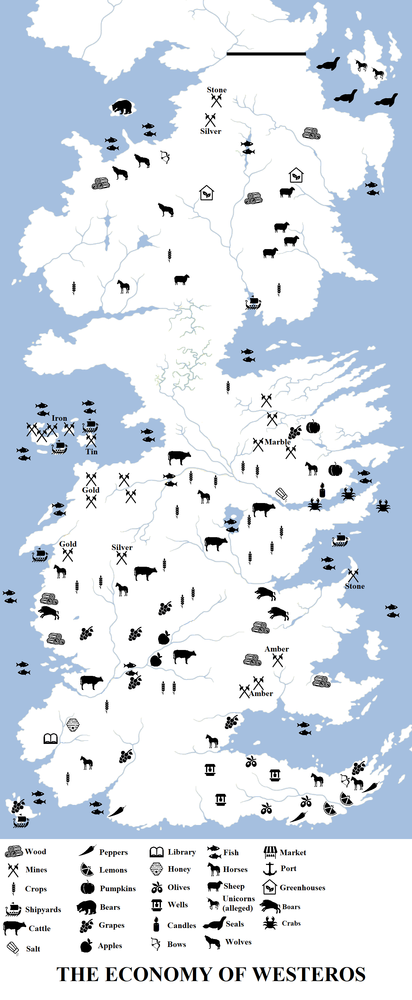
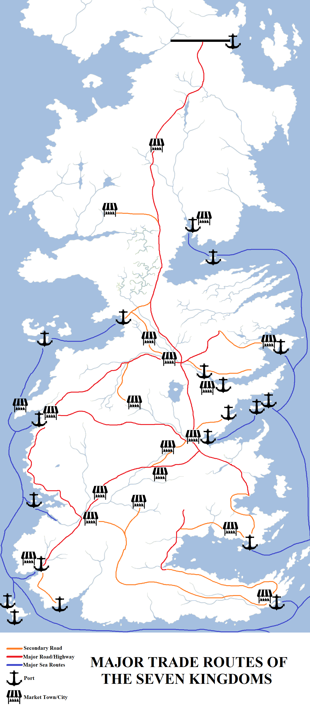

The continent of Westeros is home to immense natural resources. Gold and silver is found under the hills of the Westerlands, whilst marble is quarried in the Mountains of the Moon. Amber is mined from the Red Mountains, whilst lemon groves dot the Dornish shores of the Summer Sea. The great forests of the North are rich with game, whilst lumber from those woods give rise to powerful longbows. Proud horses are reared on immense ranches on the Reach, whilst the Riverlands’ fertile, well-watered fields yield barley, corn and wheat in immense amounts. Iron mines dot the islands named for them, and vast fish shoals can be found off the shores of the Seven Kingdoms.

Trade is the lifeblood of the Seven Kingdoms, merchants carrying goods and news from Castle Black to Saltshore and sometimes beyond, across the Narrow Sea to the Free Cities and Slaver’s Bay, sped on their way by steed and ship. The constant wheel of growing, harvesting, trade and travel keeps life in the Seven Kingdoms ticking over, and when it is interrupted by war, religious strife and piracy, chaos and sometimes famine results.

The major trade goods of the Seven Kingdoms. Click for a larger version.

**The North**

**Primary Export:** Lumber, timber.

**Other Resources:** Silver mines, stone quarries, fishing, hunting (bears, wolves, seals), mutton & wool, agriculture, silversmithing, shipbuilding.

Making up approximately one-third the total land area of the continent (by some measures), the North is the largest region of Westeros. It is also one of the richest in resources, with the vast forest of the Wolfswood fairly teeming with game (and not just its namesake). Sheep can be found the aptly-named Sheepshead Hills, whilst fish crowd the Bay of Ice. The Bay of Seals is home to many of the same creatures and bears can be found on the island of the same name (northerners not being the most imaginative in naming conventions).

Whilst the North is rich in resources, it is also poorly-equipped to exploit them: its population is small, roughly the same as the Riverlands or the Vale but spread across a much vaster area.

The most important export of the North is lumber. The Wolfswood and the forests along the White Knife and its tributaries have been heavily forested over the centuries. Great cargo skiffs ferry the lumber downriver to White Harbor, from where it is shipped all over Westeros. A key export market is the (relatively) nearby Free City of Braavos, which hungers for wood to maintain its mighty fleet.

Other key exports are stone and silver. Mines and quarries up in the Northern Mountains extract the material and again it is moved downriver, via Long Lake and the White Knife, to White Harbor. White Harbor has a thriving silversmith trade, as well as a modest shipyard.

The North’s weather is unpredictable and dangerous, particularly during the long winters, so the people also have to look to their own survival. Ice-fishing on the major rivers, off the coasts and on Long Lake is a key industry, as is the use of greenhouses. It is no coincidence that the two strongest fortresses of the North are Winterfell and the Dreadfort, both built over natural sources of heat: the hot springs under Winterfell and the volcanic vents under the Dreadfort. Both of these resources have been tapped to allow food to be grown and harvested even during the longest and deadliest winters.

The Kingsroad is a vital trade link between the North and the rest of the continent, allowing goods to be carried at relative speed from Winterfell to King’s Landing, some 1,500 miles to the south. There are no other major roads of note, only tracks and local roads. White Harbor is the region’s most important trade link, connecting the North to the south and the Free Cities by sea. The lack of a major port on the west coast of the North (most of which is lightly-habited) has inhibited the economic development of the coast, as such a port would link to the North with the rich markets of Seagard, Lordsport, Lannisport and even Oldtown down the west coast of the continent.

**The Iron Islands**

**Primary Export:** Iron and tin.

**Other Resources:** Fish, lead.

The Iron Islands are the poorest region of the Seven Kingdoms. The islands are small but relatively densely populated, putting a strain on local food supplies (although fish are abundant in the waters surrounding the islands). In ancient times it is believed that the islands’ lack of riches encouraged the Ironborn to develop their raiding culture, and since the rich plunder of the coasts of Westeros were denied to them by the Targaryens, their economic situation has deteriorated.

Still, the Iron Islands are not completely lacking in resources. Great iron mines dot several of the islands, most of them on Great Wyk, and tin is also produced on the islands in significant amounts, as is (to a lesser amount) lead. Those houses who have been canny enough to exploit these resources and sell them to the mainland have seen their fortunes rise compared to those houses which have disdained such pursuits as weak or unmanly.

The Iron Islands have a voracious appetite for wood to build, repair and maintain their fleets. The largest forests on the islands were destroyed centuries ago, so the Ironborn set out to defoliate the surrounding coasts. The large, well-forested but sparsely-populated Cape Kraken to the north has been the favoured site of such deforestation expeditions, although more recently the Ironborn have had to pay or enter into trade with the Northern houses holding the peninsula for such resources.

**The Riverlands**

**Primary Export:** Cattle.

**Other Resources:** Fish, grain.

The Riverlands lie at the centre of Westeros and enjoy a wide variety of terrain types, with numerous rivers keeping the land fertile, numerous smallholdings dotting the landscape and more open areas proving to be effective crop and grazing land. Cattle-rearing is common in the Riverlands and provides the region with a strong income, with the swift rivers providing merchants with a fast and reliable method of shipping goods to the coast or the capital. Fishing in the rivers and on Gods Eye also provides another source of food.

The Riverlands also enjoy a sizable economic advantage with small ports located on both the east and west coasts of the continent: Saltpans and Maidenpool to the east and Seagard to the west, with the swift River Trident providing convenient travel between them. There also major large market towns, including Lord Harroway’s Town, Fairmarket and Stoney Sept.

There are also other, more localised resources: the town of Saltpans is named for the substance of the same name, which is exported up and down the coast.

The Riverlands’ primary economic weakness is the same as its military and political one: its central location at the heart of the continent. Almost every major war in the history of Westeros has swept across the borders of the Riverlands and left parts of it a smoking wasteland, most recently during Robert’s Rebellion, and it takes years or even decades to fully recover. The Riverlands have also traditionally not been held by a strong, central government. Frequent shifts in authority and long-simmering feuds (most famously that of the Brackens and Blackwoods, which according to legend has endured for millennia) have left the region with a strong independent streak. Although the Tullys rule from Riverrun, many houses do all but disdain them (most notably the Freys) and it is questionable if all of the region’s taxes are accurately tallied. Still, Lord Hoster Tully has been a stronger ruler than most and under his rule the Riverlands have become somewhat more unified.

**The Vale of Arryn**

**Primary Exports:** Grain, marble.

**Other Resources:** Wheat, corn, barley, fruit, pumpkins, candles.

The Vale of Arryn holds a strong economic position upon the continent of Westeros, with the Mountains of the Moon proving a fortification more daunting than the Wall and the port at Gulltown giving the region each access to both foreign and domestic markets.

The mountains themselves are not particularly rich in minerals, with gold and silver rare (or quarried out in extremely ancient times) but marble is quarried in significant amounts among the peaks. The multiple valleys leading down from the mountains to the sea are also rich and fertile, giving rise to large farmsteads and landholdings. Fruit grows in the hills in prodigious amounts, and pumpkins are a surprisingly lucrative export from the region. Some parts of the Vale have started making wine, finding both the climate and geography suitable to it, but as yet the dominance of the Arbor and the Reach is not in jeopardy.

On the south coast of the Vale is Wickenden, where beeswax has been cultivated in great quantities. The castle and surrounding region is a rich source of scented beeswax castles which are sold to the Free Cities and the rest of Westeros.

Gulltown has transformed itself from a modest settlement to a larger city, a waystop for ships travelling the Narrow Sea between Braavos and Pentos. Under Lord Petyr Baelish’s stewardship (before his removal to King’s Landing to serve the king as Master of Coin), tax revenues on the port increased prodigiously. These factors have combine to make the Vale one of the richer regions of Westeros. Its primary weakness is the unruly hill tribes of the Mountains of the Moon, who sometimes close the high road through the mountains to the Bloody Gate, inhibiting travel and trade into the region by land.

**The Westerlands**

**Primary Exports:** Gold, silver.

**Other Resources:** Fishing along the coast. Shipbuilding, some horse-rearing and crop-growing.

The Westerlands are the richest region of Westeros, at least in terms of the amount of money per head of population. Massive gold and silver mines dot the western hills, at least half a dozen (at Casterly Rock, the Golden Tooth, Castamere, Nunn’s Deep, the Pendric Hills and Silverhill) of impressive note. Gold and silver are mined in larger quantities in the Westerlands than in the rest of Westeros combined, and the riches of the Rock are spoken of as far away as Qarth and even Asshai.

Other industries also exist: vast shoals of fish can be found off Fair Isle and the Kayce Peninsula. Boars fairly infest the forested highlands just inland from Crakehall. The southern parts of the Westerlands brush against the north-western-most plains of the Reach, and in this region, horses are reared and crops raised.

A key part of the economy of the Westerlands is the city of Lannisport. The third-largest city on the continent, the city undertakes trade with Oldtown and even the Summer Islands to the south, and Dorne and the Free Cities to the far south-east, as well as more limited trade with the Iron Islands to the north (memories of the Greyjoy Rebellion, when Lannisport’s harbour was razed by Euron and Victarion Greyjoy, remain fresh). The mouth of the Mander, not far to the south, also provides a ready means of access to the interior of the Reach.

The major trade routes of the Seven Kingdoms. Click for a large version.

**The Crownlands**

**Primary Export:** Grain.

**Other Resources:** Fishing and farming, woods and orchards. Shipbuilding. Metalsmithing, alchemy at King’s Landing.

The Crownlands are a divided into two regions: a very fertile inland plain running across the border with the Riverlands towards God’s Eye, which is dominated by farms and (along the Kingsroad) market towns, and the coastal region which is wilder and craggier (especially along Crackclaw Point). Crabs can be found along the coast of Crackclaw Point, in the Bay of Crabs and on Claw Isle, whilst Blackwater Bay is home to many varieties of fish.

Grain is the primary export of the region, although an enormous amount of it makes its way south to King’s Landing. The largest city in Westeros, King’s Landing’s 400,000 residents require vast amounts of food by both land and sea. King’s Landing’s resources are immense, with shipbuilding along the Blackwater Rush, metalsmithing, weapon-smithing and horse-trading also being key industries. The Kingswood is home to huge amounts of game, most notably boar, but hunting is strictly controlled as the stretches of the forest nearest the capital form the king’s private hunting reserve.

Duskendale is also a major port, although it has been eclipsed by both the growth of the capital over the last 300 years and the town’s reduction in fortunes since the Defiance of Duskendale twenty years ago.

The remains of once-impressive ports and shipyards can be found on Driftmark, although the island’s heyday is long in the past. The island enjoys a more modest level of success today. Obsidian is found on the volcanic island of Dragonstone in notable quantities, but the value of this substance as a trade item is dubious.

**The Stormlands**

**Primary Exports:** Lumber, amber

**Other resources:** Fish, game animals.

The Stormlands are relatively sparsely-populated considering their size and the storms which lash the coast do not make them an inviting arena for trade. The lack of a major port on the east coast is another problem, as is the thin and stony soil which gives rise to only modest crop yields. The Stormlands are said to have a lot of trees and rain and not much else.

Nevertheless, the Stormlands are not totally lacking in resources. Amber is quarried in the Red Watch (the north-eastern protrusion of the Red Mountains) and the immense forests on Cape Wrath and further north are exploited for lumber. The Weeping Town on the south coast is relatively obscure, but is still the best harbourage in an area lacking in good ports.

**The Reach**

**Primary Exports:** Grain and wine.

**Other Resources:** Melons, fireplums, peaches, apples (red and green), grapes.

The Reach is the second-largest region of Westeros, after the North, and the most fertile and populous, with a population estimated at between 10 and 12 million souls, more than twice that of any other region. The immense River Mander and its tributaries feed an immense plain packed with farms, smallholdings, market towns and pastures. Horses and cattle are reared on steadings, fruit trees dot the coasts and fishing ships can be found offshore. The Arbor, a large island off the south coast, is home to immense shipyards and inland vineyards, where the fabled Arbor Gold is made.

The Reach is dominated economically by Oldtown. The second-largest city in Westeros (although only just), it commands an impressive harbour and is a vital trade link between the Free Cities, Summer Islands and Lannisport. Oldtown has shipbuilding industries and hosts religious pilgrims making the journey to see the Starry Sept, the ancestral home of the Faith of the Seven in Westeros. Oldtown is also a centre for knowledge, with the Citadel being a repository of knowledge and wisdom unmatched by any in the known world (save perhaps distant, storied Asshai), and is a centre for the sciences, arts and industries.

In terms of the sheer amount of money that passes through the region, the Reach is likely richer than the Westerlands, but the Westerlands are significantly richer-per-head of population and have a stronger, more unified central authority which gives them more gold immediately to hand. Still, one would challenge the economic might of the Reach only at their peril.

**Dorne**

**Primary Exports:** Olives and wine.

**Other Resources:** Wells, lemons, pomegranates, plums, cloth, spices, blood oranges, sand steeds, yew bows.

Dorne, at first glance, is a poor land. Located at the southern-most end of the Westerosi continent and dominated by an immense inland desert, Dorne lacks vast forests, significant rivers or minerals. However, the land is richer than it first appears. The coast of the Summer Sea is balmy, giving rise to orange and lemon groves, rich spices (including the fabled dragon peppers, said to be challenge the fortitude of both a man’s tastebuds and his digestive tract) and plums. Olive groves dot many of the coasts and river banks and are one of the country’s primary exports.

Dornish wine is – arguably – not as storied as Arbor Gold but it has an acquired taste and the Dornish export significant quantities of it to the nearby Free Cities.

Also much in demand are the Dornish sand steeds, noted for their speed, their agility and their ability to endure on limited amounts of food and water. Although not useful for massed combat, their value to scouts, messengers and outriders is remarkable. The Dornish are reluctant to part with them to outsiders but the trade in horses is a notable part of the peninsula’s internal economy, as does the trade in Dornish yew bows (a most formidable missile weapon).

A carefully-guarded resource in Dorne is water. Wells dot the deserts and badlands, and guides and merchants who know their way between the wells can travel across Dorne much more rapidly, linking the capital at Sunspear with the rest of the continent at surprising speed.

_Thank you for reading The Atlas of Ice and Fire. To help me provide better content, please consider contributing to [my Patreon page](https://www.patreon.com/user?u=4370220) and [other funding methods](http://thewertzone.blogspot.co.uk/2017/01/support-wertzone-on-patreon.html), which will also get you exclusive content weeks before it goes live on my blogs._
