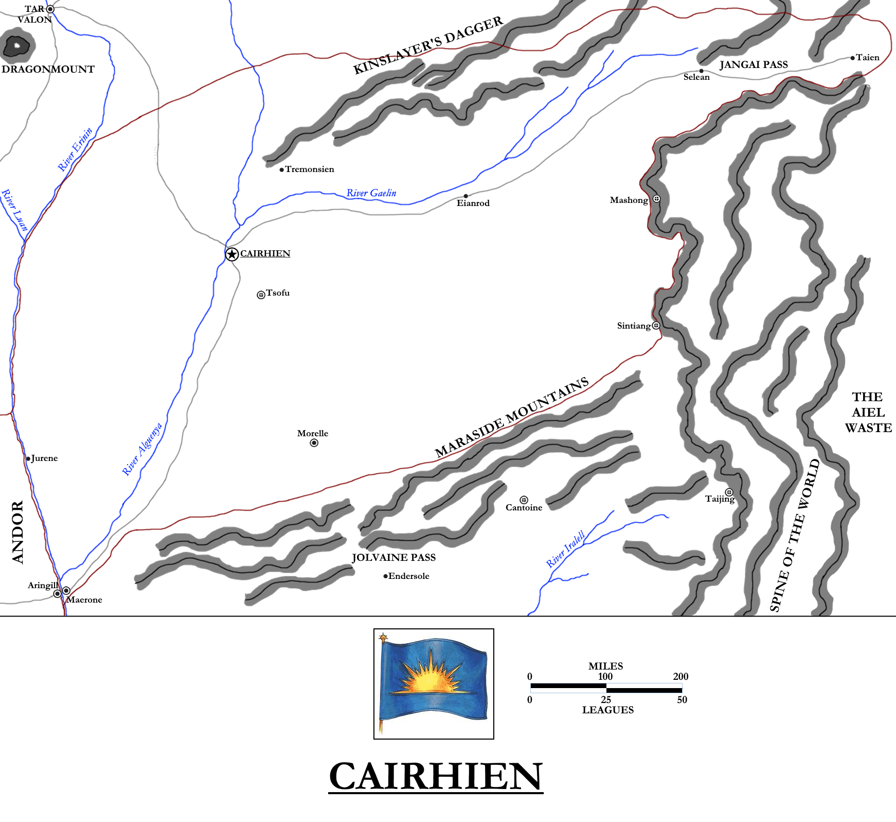
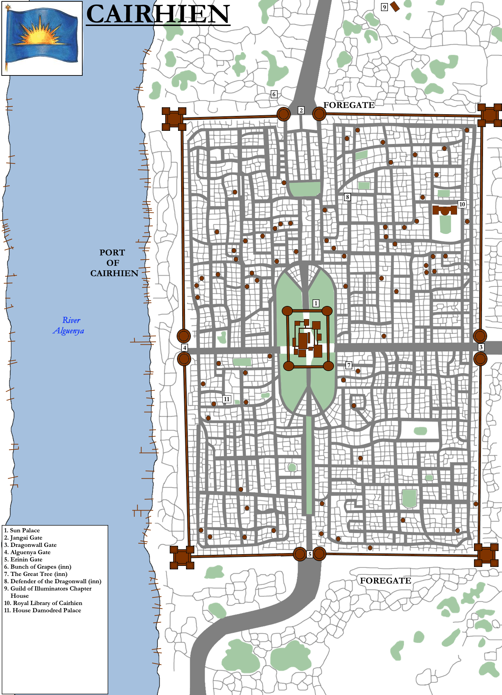

Cairhien is one of the largest and, until recently, one of the most powerful of the modern nations. It lies in the far east of the subcontinent, hard against the Spine of the World, and the largest pass through those mountains lies on Cairhien’s border, linking the Westlands to the Aiel Waste and the mysterious lands of Shara beyond. Cairhien itself is a land of squabbling nobles dominated by political intrigue taken to the extreme of an artform, known as the Game of Houses.

A map of the Kingdom of Cairhien. Please click for a larger version.

**History**

The origins of Cairhien lie in the Breaking of the World. Near the end of that period of chaotic upheaval, one well-organised band of survivors founded a city on the banks of a great river. This city became known as Al’cair’rahienallen, the “Hill of the Golden Dawn”. Just before the building of the city, a caravan of battered refugees sought shelter with the same band of survivors. They were given water and shelter before being allowed to pass onwards to the Jangai Pass and the Aiel Waste, becoming the ancestors of the modern Aiel.

Al’cair’rahienallen grew into a great city and then a kingdom, Almoren. Stretching from Haddon Mirk to north of Kinslayer’s Dagger and from the River Erinin to the Spine of the World, Almoren was a great and powerful kingdom. King Coerid Nasar brought Almoren into the Compact of the Ten Nations and it endured for over eight centuries until the eruption of the Trolloc Wars. Almoren was overrun and destroyed during the conflict.

Following the end of the war, Almoren’s former territory was divided between the kingdoms of Tova, Shandalle, Ileande, Hamarea and Khodomar. These nations endured in relative peace for over nine centuries until rise of the false Dragon, Guaire Amalasan, in Darmovan on the west coast of the continent, three thousand miles away. Amalasan’s armies swept eastwards across the southern nations in a tide of steel and fire, bringing almost half the continent under his rule before he launched an invasion of Khodomar in FY 943. King Artur Paendrag Tanreall, the youthful ruler of Shandalle, had already fought Amalasan to a standstill several times but had not managed to defeat him due to poor logistics and support from allies. This time, fighting much closer to home with stronger lines of supply and support, Artur “Hawkwing” (as he was already nicknamed) defeated Amalasan at the Battle of the Jolvaine Pass, in the Maraside Mountains. His Aes Sedai allies shielded and captured Amalasan and spirited him north to Tar Valon for gentling. Amalasan’s armies pursued and Hawkwing defeated in battle on the streets of Tar Valon itself.

The Aes Sedai were indebted to Hawkwing for their deliverance, to the utter fury of the Amyrlin Seat, a particularly vindictive sister of the Red Ajah known as Bonwhin Meraighdin. Bonwhin encouraged other nations to attack and destroy Hawkwing, starting with proud Tova, which bordered Shandalle to the east and held the great city of Cairhien (formerly Al’cair’rahienallen) as its capital. Hawkwing defeated Tova’s much larger army and captured the capital, forcing Tova to submit to his rule. Over the next twenty years, Hawkwing conquered all of the Westlands, uniting them into one empire.

Upon Hawkwing’s death in FY 994, the empire collapsed. A group of nobles seized control of Cairhien and held a great ball, declaring the refounding of Tova. They were brutally assassinated, sparking months of fierce fighting and intrigue. At the end of the process, Matraine Colmcille emerged as the first King of the Kingdom of Cairhien. Over the course of more than a century of warfare, Cairhien’s borders spread to approximately their modern boundaries.

In the succeeding centuries, Cairhien prospered. After the collapse of the kingdoms of Hardan to the north and Mar Haddon to the south, Cairhien extended its borders to rival those of ancient Almoren. However, it could not hold this territory gradually returned to its current levels.

In 509 NE, the Cairhienin were unexpectedly visited by a delegation of Aiel, from the wastelands beyond the Jangai Pass. The Aiel had realised that the Cairhienin were the descendants of those who had given their ancestors water and shelter during the Breaking. The Aiel declared peace with the Cairhienin and granted them a sapling of _Avendesora_, the Tree of Life. The sapling was placed in front of the Sun Palace and grew to become _Avendoraldera_, the first chora tree outside the Aiel Waste in over three thousand years. The Aiel also granted the Cairhienin the Gift of Passage, allowing them to cross the Waste to trade with distant Shara. The Aiel had always allowed individual merchants, peddlers and gleemen to make the crossing, but the Cairhienin alone were allowed to send immense trade caravans across the Waste. Soon exotic goods such as ivory, silk and spices were flowing back west. Cairhien grew immensely rich from this trade.

Cairhien’s great rival was – and remains – Andor to the west. As large and possibly more populous, with much greater natural resources, Andor dominated the centre of the continent and was the only kingdom with major ports on both the Arinelle-Manetherendrelle river network and the Erinin basin to the east, greatly enriching trade. Cairhien and Andor clashed several times over trading rights along the Erinin, and several times went to war, although never conclusively. The two nations were too well-matched and both found war to be a distraction from their internal politics.

In 965 NE Andor and Cairhien clashed once again, resulting in a three-year conflict marked by political manoeuvring, assassinations and fraught diplomacy, but only brief military action. In 968 Queen Mordrellen Mantear of Andor and King Laman Damodred of Cairhien agreed to suspend hostilities and usher in a new era of peaceful cooperation. To this end, Mordrellen’s daughter and heir Tigraine married Laman’s nephew Taringail. The match was political, and Tigraine’s dislike for Laman became clear. Despite this, they managed to have a son, Galadedrid, born in 970. The following year, Tigraine’s brother Luc disappeared and was believed dead, having been urged to seek his destiny fighting on the Blightborder. Tigraine, bereft, disappeared herself in 972. Mordrellen, bereft, died from grief and the stress of it. The brief Third Succession War raged for several months afterwards, until the young Lady Morgase of House Trakand gained enough power to take the Lion Throne. Morgase married Taringail to appease Cairhien, but where Tigraine was timid, Morgase was formidable and strong. Taringail found his bullying that had proved so effective against Tigraine was ineffectual on Morgase, and his power and influence at court – and that of Cairhien – waned.

Frustrated, King Laman began scheming anew to strengthen his house’s position. As a minor part of his planning, in 976 he cut down _Avendoraldera_ and used it to create a great throne, one that was the envy of all. But when word of this made its way across the Dragonwall to the Aiel Waste, they were incensed. Four full clans of the Aiel crossed the Jangai Pass and invaded Cairhien in force. The Cairhienin military responded piecemeal and was cut to pieces. The city of Cairhien was besieged and then sacked, its topless towers set alight and half the city burned (although the Aiel took steps to protect the Great Library). Laman himself fled with as much of his army as he could assemble. Moving at speed, they fled south and played cat-and-mouse with the Aiel in Haddon Mirk for months before being flushed out. The High Lords of Tear, alarmed at the Aiel horde Laman was bringing down on them, gave him the means to cross the Erinin and escape, but the Aiel (despite their fear of any water too large to jump across) pursued. Fighting raged along both banks of the Erinin, with Laman fleeing north again, embroiling Andor in the fighting.

These delaying tactics gave the Aes Sedai time to convince many of the Westland nations to send troops to stand against the Aiel at Tar Valon itself. In the final month of 978 NE the Battle of the Shining Walls took place. The Aiel, despite being heavily outnumbered by the assembled might of the west, defeated the Cairhienin forces and King Laman was summarily beheaded. Satisfied, the Aiel undertook a strategic withdrawal back to the Waste.

Laman’s death triggered the Fourth War of Cairhienin Succession, which ended by mid-979 NE with King Galldrian of House Riatin seizing the Sun Throne. This was something of a poisoned chalice: large swathes of Cairhien were a smouldering wasteland, left burning by the Aiel War. Over the next nineteen years, Cairhien would be rebuilt and old animosities would resume, particularly after Lord Barthanes rose to lead House Damodred with the ambition of retaking the Sun Throne.

A map of the city of Cairhien. Please click for a larger version.

**Geography**

Cairhien is located in the far east of the Westlands, hard against the Spine of the World. It lies between two smaller mountain ranges running out of the Spine, Kinslayer’s Dagger to the north and the Maraside Mountains to the south. The western border is defined by the River Erinin. Cairhien shares a border with only one other nation, Andor along the Erinin. It’s attempts to secure more territory north (to Shienar) and south (to Tear) have failed for a lack of people and troops to hold these territories.

Cairhien measures approximately 860 miles across from west to east (aside from in the north, where it extends further east into Jangai Pass) and approximately 570 miles across from north to south. It is exceeded in size in the Westlands only by Andor, and is rivalled by Saldaea. The countryside is hilly and mountainous along the northern, eastern and southern borders, but flatter and more fertile in the central regions and especially the western, along the great Erinin, Alguenya and Gaelin rivers and numerous lesser bodies of water.

The River Gaelin rises in the north-east of Kinslayer’s Dagger, near its meeting with the Spine, and flows south and west for over 660 miles before it meets the Alguenya. The Alguenya’s source is in the open countryside beyond the Dagger, from where it flows south for over 800 miles before it meets the Erinin. These two rivers dramatically increase the flow of water into the Erinin (which starts to widen noticeably south of Cairhien) and also act as formidable defensive lines to the west and north.

Cairhien lies in the shadow of the Spine of the World, the largest and most impressive mountain range in the known world. It runs from north to south for over 2,500 miles and is consistently more than 200 miles wide, with numerous smaller ranges running from it eastwards into the Aiel Waste. In the west there are two such “child ranges”, Kinslayer’s Dagger and the Maraside Mountains. The Spine defies easy categorisation. It is made up of multiple mountain chains running in parallel to one another, building one upon the other to truly staggering heights. Snow glistens on the peaks of the Spine even in the hottest and longest summers at its southern end, and very few people who have tried to scale the peaks of the Spine have returned alive; those who do report that even breathing becomes difficult the higher one climbs.

The Spine is breached by three major passes (along with Tarwin’s Gap, the wide pass between the northern end of the Spine and the Mountains of Dhoom where the two meet in the far north): the Niamh Passes in south-eastern Shienar; the wide Jangai Pass on the eastern border of Cairhien; and a little-known pass that runs from the southern headwaters of the River Iralell to the Ogier Stedding Shangtai (beyond which lies the Waterless Sands).

The Jangai Pass is approximately 200 miles long, running from the town of Selean to Taien, the fortress-town at the southern feet of the pass on the very edge of the Aiel Waste. Both settlements were destroyed in the Aiel War and have been resettled reluctantly, but the lure of gold for supplying the merchants and peddlers bound for Shara is strong.

Both Kinslayer’s Dagger (so named as it seems to point from the Spin towards distant Dragonmount, where the Kinslayer Lews Therin Telamon died at the end of the War of the Shadow) and the Maraside Mountains are considerably smaller and less impressive than the Spine, but both are formidable enough to block easy travel north and south. Northbound merchants take the river or skirt the Dagger to the west, whilst southbound merchants can brave Jolvaine Pass through the Maraside Mountains.

Cairhien’s capital city is also called **Cairhien**. A large, square city built to a grid-like pattern, it lies on the River Alguenya just south of the confluence with the Gaelin. A road links Cairhien all the way to Jangai Pass, with the town of **Eianrod** located roughly halfway along the road. The town of **Tremonsien** lies to the north of the capital, in the foothills of Kingslayer’s Dagger. It is a trade centre for miners and merchants braving the long journey through the wilderness to Shienar. **Morelle** lies to the south, roughly halfway from the capital to the Iralell. Small fishing villages like **Jurene** dot the banks of the Erinin. Cairhien’s biggest port on the Erinin is **Maerone**, located opposite the Andoran town of Aringill. This is a site for trade between the two nations, but also for military tensions during times of conflict between the two kingdoms. Also notable is **Stedding Tsofu**, located very close to Cairhien. It is the closest Ogier _stedding_ to a major city. The Ogier have been engaged in rebuilding the Topless Towers of Cairhien, along with other structures destroyed in the Aiel War, but it is slow going due to Cairhien’s economic woes since the end of the war.

**Government**

Cairhien is ruled by a single King or Queen. The position is hereditary, but it is not unknown for houses to lose the right to rule by being displaced either in war or through political intrigue.

The noble houses of Cairhien are constantly engaged in what they call _Daes Dae’mar_, the Game of Houses. The houses constantly ally, split apart and form new alliances in a bewildering, ever-shifting landscape of allegiances and agreements. Military action, in the form of civil war, is rare (Cairhien has only endured four in a thousand years, each relatively brief) and possibly considered uncouth. The Cairhienin instead practice politics like an art form; forcing an enemy to capitulate and accept defeat is considered far more difficult – and thus a greater accomplishment – then simply killing them. That said, assassination is also an expected part of the Game.

**Military and Population**

Cairhien’s military potential is believed to be greater than Illian, Shienar or Tear, although perhaps not as much as Andor. However, the Aiel War saw most of Cairhien’s army destroyed piecemeal before it could consolidate, and much of the rest slaughtered in the two gruelling years of combat that followed. Barely 7,000 men survived to reach Tar Valon, and were no match against the Aiel.

Cairhien’s disunity, due to its fractious and unpredictable internal politics, and the lack of a major military opponent apart from Aiel, means that Cairhien has never deployed the bulk of its military in one place for assessment. Cairhien has no standing elite military formation of note either, and the nation has not produced a Great Captain in some time either. That said, some of the Cairhienin houses produce troops of a higher quality and follow the military arts closely. Of these, House Taborwin probably possesses the finest and most disciplined soldiers.

Cairhien’s population is difficult to assess, but it is believed that Cairhien is more populous than Tear or Illian but not as populous as Andor, putting its population somewhere between 10 and 15 million.

**Economy**

Cairhien is a large country with a potentially rich, diversified economy, including mines in Kinslayer’s Dagger and the Spine of the World, fishing on the country’s numerous rivers and food production on the immense fertile plains between the mountains and the rivers. However, the country’s economy was destroyed in the Aiel War of twenty years ago and it has only barely started to recover.

For almost five hundred years, immense caravans were allowed to cross the Aiel Waste from Cairhien to Shara and back again, carrying wealth beyond imagining: exotic birds, jade, ivory, silks and precious gemstones unknown in the west. These items commanded stiff prices on the open market and allowed the Cairhienin to undercut the Sea Folk (who otherwise were the only people able to trade freely with the Sharans, by sea), who had to traverse a much greater distance to the trade ports at the far southern end of Shara.

The wealth this brought to Cairhien was fabulous, and may have discouraged the nobles from pursuing other sources of income. At the outbreak of the Aiel War, the Aiel shut down the silk route and prevented Cairhienin merchants from crossing the Waste. Along with the depredations of the Aiel War, this caused the Cairhienin economy to collapse. Famine was only averted when Tear started selling grain to Cairhien up the Erinin. The Cairhienin nobility has been slow to enter the food production business (perhaps seeing it as less honourable than their former ties to trade), resulting in the nation still being dependent on these grain shipments even as vast amounts of prime farmland go unexploited in the interior of the country.

With firmer leadership Cairhien could again become one of the richest countries in the Westlands, but this seems unlikely at present.

**Culture**

Cairhienin tend to be shorter in stature than most and favour order. They are reserved in dress and speech, often preferring to follow conversations rather than lead them. They are a wary people, sometimes suspicious and occasionally paranoid. The Game of Houses is drilled into them, the nobility especially, and thus they spend a lot of their time analysing every situation for every possible advantage and disadvantage before committing themselves.

Cairhien clothing is reserved and dark in colour for the nobles, although commoners prefer more colourful and less reserved colours. Commoners also tend to enjoy revels and parties more, and sometimes nobles will join in such parties, letting their guard drop. This is most notable during the Feast of Lights, a particularly free-spirited celebration given the dour nature of many Cairhienin.

_Thank you for reading The Atlas of Ice and Fire. To help me provide better content, please consider contributing to [my Patreon page](https://www.patreon.com/user?u=4370220) and [other funding methods](http://thewertzone.blogspot.co.uk/2017/01/support-wertzone-on-patreon.html), which will also get you exclusive content weeks before it goes live on my blogs._
