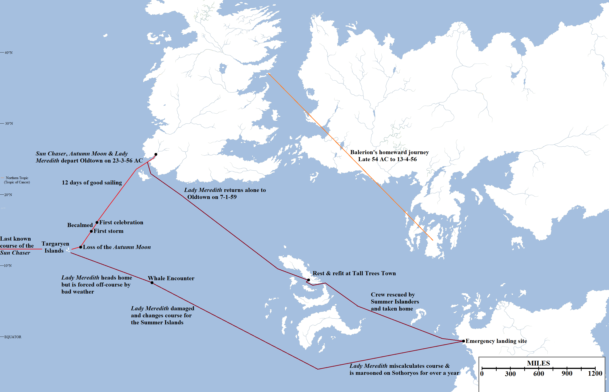

Two of the more remarkable, if relatively minor, episodes in the history of the Seven Kingdoms  took place during the reign of King Jaehaerys I Targaryen, the Conciliator, the Westerosi king who sat the Iron Throne longer than any other.

The voyage of the _Sun Chaser_ and _Lady Meredith_ (56-59 AC), and the journey of Balerion the Black Dread to Valyria and back again (54-56 AC). Please click for a larger version

Elissa Farman was the middle child of Lord Marq Farman of Fair Isle. Born in 29 AC, she had an elder brother, Franklyn, and a younger, Androw. From a young age Elissa loved the sea and learned to sail by the age of 14, circumnavigating Fair Isle to show her skill. By the age of 20, she had sailed her own ship as far north as Bear Island and as far south as the Arbor.

Fair and athletic, Elissa was a strong match for any noble house, but to Lord Marq’s regret, she seemed uninterested in marrying to strengthen the family’s fortunes. Her forthright manner seemed to “scare off” potential suitors, many of whom were unwilling to indulge her interest in the sea (and many of them came from castles inland, far from the sea, to Elissa’s horror). In 49 AC Elissa’s younger brother Androw married Princess Rhaena Targaryen, the widow of King Maegor the Cruel. Elissa and Rhaena became close, with more fanciful maesters speculating on the nature of their relationship. Lord Marq died in 50 AC and Franklyn became Lord of Faircastle, ordering Rhaena to leave (as he personally disliked her and the cost of maintaining her household and her dragon had become exorbitant). Elissa chose to leave with Rhaena; when Franklyn tried to stop her, ordering her to marry for the good of the family, he and his men were overpowered by Rhaena’s supporters (not to mention fear of her dragon). Elissa sailed Rhaena and her household to Dragonstone, a daring voyage right around Westeros, and remained there with her.

However, a rift had opened between Princess Rhaena and Elissa. Elissa, free of the responsibilities to her family, now expressed her heart’s desire: the fastest and greatest ship ever built, with the goal of crossing the Sunset Sea to find whatever lay on its far shores. Rhaena refused to indulge Elissa and they quarrelled. Elissa found in Princess Aerea, Rhaena’s younger daughter also kept likewise close to Rhaena’s side against her will, a kindred spirit. By 54 AC Elissa could no longer be kept cooped up and angrily petitioned Rhaena to be allowed to leave. Rhaena agreed, but Elissa’s departure was more dramatic than expected: shortly after taking ship for Pentos from Driftmark, it was discovered that she had stolen three dragon eggs from the clutch of Rhaena’s own steed, Dreamfyre. Learning of this event, King Jaehaerys was apoplectic with rage and sent hunters and representatives to the four corners of the known world searching for the dragons, to no avail.

The true story did not become clear until years later. Taking the name “Alys Westhill”, Alissa Farman had travelled by ship to Pentos and then overland to Braavos, itself an impressive feat (the overland route through the tall mountains north of the Velvet Hills is not for the faint-hearted). In Braavos she has gained an audience with the Sealord of Braavos, offering him the three dragon eggs in return for his help in building the greatest ship ever to set sail. The Sealord was unable to resist the lure of having his own dragons to defend the former Secret City, built to defy the Valyrian slavers and their dragons, and accepted.

The Braavosi ship builders, claiming to be the greatest in the world, bent themselves to the task of building a ship which had to be fast but also capable of carrying provisions for an extended trip away from land and surviving on the open ocean; the latter was unusual given that most captains hugged the coasts between destinations for safety and succour. Only the Summer Islanders and their great swan ships dared the open ocean away from the sight of land. It took over a year, but eventually the task was done and the great carrack _Sun Chaser_ was completed. “Captain Westhill” took the ship south through the Stepstones, turning west for Oldtown.

By this time, Elissa’s departure had had unforeseen consequences. Princess Aerea Targaryen was heartbroken from her friend’s departure and traumatised when Androw Farman poisoned a large contingent of the castle in a jealous rage. Aerea begged to be allowed to leave Dragonstone for King’s Landing, and Queen Alysanne was happy to accept but Princess Rhaenys refused in a fury. Aerea’s anger finally broke. She made her way to the Dragonmont where the unclaimed dragons of House Targaryen laired and there seized a dragon mount for her own. But not just any dragon, but the greatest in the history of House Targaryen: Balerion the Black Dread, the former steed of King Aegon Targaryen the Conqueror and his son Maegor the Cruel, one of the largest and most powerful dragons to have ever flown. Although advanced in years, even by dragon standards, Balerion was still a great beast. He submitted to Aerea, and then took to the skies, bearing her away from Dragonmount late in 54 AC. The Targaryen dragonriders took to the skies to find Aerea and Balerion, but no trace could be found. They scoured both Westeros and Essos for news, but a few wild rumours aside, there was no credible lead.

The arrival of the _Sun Chaser_ in Oldtown harbour late in 55 AC attracted some considerable comment, for “Captain Westhill” had a deep purse and a crazy ambition, to cross the Sunset Sea and return. The maesters of the Citadel were intrigued, as they agreed that the world was round and that it should be possible to cross the Sunset Sea to land on the far side…and even keep sailing and thus come to the lands of the Jade Sea and thence Essos and Westeros from the east, a total circumnavigation of the globe. The length was staggering (the maesters quibbled over the figures, but it was estimated to be well over twenty thousand miles and possibly much more) but it was at least possible. The fact that Westhill’s ship design was unproven and that no Westerosi ship had even made the much more modest 12,000-mile trip to Asshai and back in one voyage (and wouldn’t until Corlys Velaryon and the _Sea Snake_, roughly twenty-five years later), however, caused severe doubts amongst would-be crewmen.

As a result of these vacillations, it took Elissa several months to both crew and outfit her ship for the voyage. This was enough time for Lord Donnel Hightower to become suspicious (given that Jaehaerys had warned all his lords to be on the lookout for a rich female sailor with a hankering for the deep sea) and send his grandsons Eustace and Norman to investigate. Rather than arrest Farman, they instead became enamoured of her plan and pledged to support it, raising the funds for their own ships, the _Lady Meredith_ and _Autumn Moon_, to join the expedition. The small fleet finally set sail from Oldtown on the 23rd day of the third moon of 56 AC. It did not take long for word of the expedition to reach the king, who realised what had happened.

The expedition’s departure was soon followed the resolution of the mystery of Princess Aerea and Balerion. Approximately three weeks later, on the 13th day of the fourth moon of 56 AC, Balerion the Black Dread’s unmistakable shadow fell over the city of King’s Landing. The dragon landed in front of the Red Keep and, to the considerable shock of all who saw him, was clearly wounded. A massive jagged gash a full nine feet long was visible in his side, still bleeding smoking blood. Aerea was clinging to Balerion’s back, but was gaunt and clearly dying. She was treated by Septon Barth and Grand Maester Benifer, but they had seen nothing like her symptoms before. She was being cooked from the inside out, and attempts to lower her temperature by putting her in a bath of ice did not prove effective. More disturbing were the “things” moving under her flesh, which seemed to be trying to burrow their way out. As Aerea died, these worm-like creatures succeeded in breaking out of her body…only to die smouldering in the ice. Barth and Benifer had all trace of the creatures destroyed and Aerea was cremated with rapid haste. Balerion was retired to the newly-built Dragonpit and put under guard whilst his own wounds were treated.

Meeting with the king and the small council, Barth and Benifer proposed an answer to the mystery. Aerea had had no destination in mind when fleeing Dragonstone, only an urgent desire to escape and find a home. It was known that dragons responded to their rider’s whims in a manner not fully understood, and Balerion may have responded by taking her home…_his_ home, the smouldering volcanoes of Valyria under their ashen skies. Balerion had hatched in one of the Fourteen Fires, the great volcanic chain across the neck of the Valyrian Peninsula. When still young, he had travelled with the Targaryen family to distant Dragonstone, and thus survived the Doom, the simultaneous eruption of all of the Fourteen Fires, the greatest cataclysm in the history of the world. The destruction of Valyria had obliterated its empire in a single afternoon of blood, fire and death. Legends and stories of Valyria made mention of firewyrms, strange, horrible and hostile creatures lurking in the mines under the Fourteen Fires. The destruction of Valyria may have allowed these creatures to roam free across the surface of Valyria, where it was known that the Doom still held sway. Aerea had been “infected” with the creatures in some fashion and even Balerion had been injured by _something_ in the ruins of the Freehold. It was a miracle that Aerea had survived long enough to reach home.

Whether this was the answer to the mystery was unclear, but King Jaehaerys soon issued a proclamation that has never been rescinded: no ship that has landed on or near Valyria, or sailed through the Smoking Sea, is permitted entry to any port in Westeros. Subjects of the Iron Throne are forbidden, on pain of absolute death, from trying to sail to Valyria, or from returning to Westeros thereafter. The ban was arguably not necessary – almost no captain in the known world was willing to go anywhere near Valyria – but it was cemented in law, and defied but rarely (Gerion Lannister, on his mad quest to find the lost Lannister sword Brightroar, may have been the last to try in 291 AC).

The fate of the _Sun Chaser_ and Elissa Farman was less clear, but eventually the mystery was resolved. On the 7th day of the 1st moon of 59 AC, the _Lady Meredith_ made landfall back in Oldtown harbour. The ship was battered and much-patched, and Ser Eustace Hightower and his crew were gaunt and clearly traumatised from all that they had seen. The crew had been augmented by sailors from the Summer Isles, to replace those lost earlier in the voyage. After seeking refreshment, Eustace told the tale to his grandfather.

The expedition had left Oldtown on the 23rd day of the 3rd moon of 56 AC, sailing south by southwest out of Whispering Sound. The voyage had been blessed with fair weather and good winds, and they had passed numerous fishing vessels and even, curiously, a whaler out of distant Ib. By the 12th day out of port, the flotilla was estimated to be as far south as the Summer Islands and further west than any sailor had sailed before. Celebrations were held, but these soon turned sour. For two weeks the fleet lost the wind and had to be towed by row boats, for slow and tedious progress. Then a massive storm broke, followed by another two days later, and then another. The _Autumn Moon_ was destroyed in that third storm, set aflame by lightning and then swallowed by a monstrous wave (that some of the sailors on _Lady Meredith_ swore blind was hiding a kraken within it). Ser Norman Hightower died in that catastrophe. _Lady Meredith_ survived, but severely damaged. The _Sun Chaser_ returned and helped the _Meredith_ limp to a small group of three islands located just to the west. Elissa had discovered the islands several days earlier (_Sun Chaser_ was considerably faster than the Hightower ships) and named them Aegon, Rhaenys and Visenya.

The three islands were beautiful. Blessed with fruit and food never before tasted by Westerosi, they were a genuine new discovery. Ser Eustace declared this was a discovery enough and vowed to return to Westeros. Elissa was incredulous; the three islands were small, the largest only a third or so the size of Dragonstone, and although impressive they were not going to justify the enormous cost of the trip, or the ruinous loss of life. She was pressing on. Ser Eustace wished her well, but knew his crew would never tolerate a further adventure, having seen the fate of their sister ship. The last Ser Eustace saw of the _Sun Chaser_ it was fitting its name, sailing directly into the setting sun.

Ser Eustace’s voyage home, however, was far more traumatic even than the voyage out. One useful piece of new knowledge established by the expedition was that the prevailing current and winds on the southern Sunset Sea were oriented to the west; beating into the wind and current, _Lady Meredith_ made miserable time heading north and east. A whale crashed into the ship, doing structural damage so severe that Eustace was unwilling to chance the long voyage to Oldtown, instead turning east for the Summer Islands. Finally, some months after leaving Aegon Island, _Lady Meredith_ made landfall…on the north-western coast of Sothoryos. Their reckoning had been off and they had passed south of the Summer Islands, instead washing up on the shores of the ill-omened and barely-explored southern continent. It took more than a year to patch up _Meredith_ sufficiently for the voyage home, and during that year most of the original crew died from horrible fevers, tick bites, wild animal attacks and other means to horrible to recount. It would not have been possible for them to leave, had a Summer Islander ship not happened across the stricken vessel and helped them limp to the islands. After a further refit (lasting months) at Tall Trees Town, the _Meredith_ had finally left for home.

The tale spread across Westeros and was the wonder of the moon. A genuine voyage of adventure, discovery and exploration! For a time there was talk of claiming the three islands in the name of King Jaehaerys, or even sending other ships west after the _Sun Chaser_, but then the idea faded, replaced by some other news. The Hightowers and Targaryens both considered further adventures and dismissed them; reaching the islands was possible but it would be too easy to founder in storms or suffer the fate of the _Autumn Moon_ and its crew.

The fate of the dragon eggs was a more pressing concern: in 57 AC, a year after the _Sun Chaser_ expedition had set out but almost two before _Lady Meredith_ returned, Septon Barth had been named Hand of the King and sent to Braavos; that _Sun Chaser_ was of Braavosi manufacture was clear and it was also abundant clear that “Captain Westhill” was really Elissa Farman. Barth demanded that the Sealord of Braavos return the three dragon eggs immediately. The Sealord demurred any knowledge of said eggs, and threats were made, of dragonfire scouring the Free City of Braavos from the face of the known world, of cloaked figures with shifting faces stalking the streets of King’s Landing and the halls of the Red Keep. A compromise was made, whereby the Sealord of Braavos would ensure that no dragons would ever hatch from these eggs and the Iron Bank would forgive the Iron Throne’s (extremely considerable, at this time) debts, in return for the Seven Kingdoms agreeing not to visit fire and blood on the hundred isles of Braavos. The deal was struck and made, and the dragon eggs passed out of history…for two hundred and forty-one years. But that is another story.

One last interesting _coda_ to this story. Corlys Velaryon, the heir to Driftmark, was but two years old when Elissa Farman struck out across the Sunset Sea. He grew up fascinated by the story, and by the design of the _Sun Chaser_, which he studied at some length and, some say, may have influenced the design of his own vessels, the _Ice Wolf_ and later the more impressive _Sea Snake_. He took his ships north into the White Waste beyond even the Lands of Always Winter, searching for a way around the northern end of Westeros only to find none. He sailed the Shivering Sea to the Thousand Isles and Nefer, and became the first Westerosi to pass the Jade Gates and explore the Jade Sea. On his second voyage on the _Sea Snake_ he sailed all the way to Asshai, the eastern-most port of the known world, some 6,000 miles east of King’s Landing. There, in that vast and strange harbour, crowded with ships from hundreds of ports, he spied a decrepit, battered and old ship that, he swore, could only be the _Sun Chaser_. He was unable to find the ship again or learn who owned it or what had become of his crew, but until his dying day he swore that Elissa Farman’s ship had – somehow – found its way to the far side of the known world, some 8,000 miles and more from where it was last seen, a quarter of a century or more later. How it got there we do not know…but we can speculate.

A highly speculative map of the planet of the **A Song of Ice and Fire** series (the red line marks the limit of the canonical maps). This map shows the vast amount of ocean between the west coast of Westeros and the eastern part of Essos. Click for a larger version

**Mapping the Story**

The Targaryen Islands – a new discovery in **ASoIaF** worldbuilding, courtesy of the book _Fire and Blood_ – are three small islands located in the Sunset Sea. The islands are located south-by-southwest out of Oldtown and Whispering Sound. The _Sun Chaser_ and her companion ships sailed on this bearing for twelve days, by which time they believed themselves to be further south than the Summer Islands, before being becalmed for two weeks. After three huge storms in four days, the surviving ships made landfall on the islands.

The ships travelling on the voyage were two older, more conventional vessels and the _Sun Chaser_, which is notable as it is described as a “carrack”. Carracks were built for speed and for durability, for long stays on the open sea, in contrast to earlier designs which were mean to stay close to the shore. They were relatively fast, travelling 80 miles per day, and were the predecessor to the later galleon. The _Santa Maria_, Columbia’s flagship for crossing the Atlantic, was a carrack (the two other ships in the fleet were caravels, considerably faster ships which may be more technologically advanced than any design in **ASoIaF**). The _Lady Meredith_ and _Autumn Moon_‘s class of ship is not readily identified, but we know they were slower; _Sun Chaser_ kept outdistancing them and having to stop to let them catch up. Due to reasoning that will become clear, I think it’s best to assume that _Lady Meredith_ and _Autumn Moon_ are “standard carracks” capable of hitting 80 miles per day and that the _Sun Chaser_ is a “super carrack” capable of much faster speeds, maybe comparable to a caravel at 90-100 miles per day.

This creates a problem, as the southernmost tip of the Summer Islands is 1,800 miles south of the south coast of Dorne. To reach that far, the ships would have to be travelling at 150 miles per day, or considerably faster than even the fastest caravel afloat in the 15th Century. We _might_ stretch that (a lot!) for the _Sun Chaser_, but for two ordinary Oldtown ships, that’s clearly impossible. More likely is that Eustace and Norman got the location of the Summer Islands wrong and thought they were either much smaller or further north (or both) than they really are. After all, although Summer Islanders visiting Westeros is noted as being commonplace, the reverse seems to be much less frequent, and their charts could be wrong.

Also slightly challenging is the description of the islands being “south by southwest” of Oldtown: there is no such cardinal direction. I’m assuming GRRM meant “southwest by south” as south by west, the other possibility, is so close as to dead south that it would not put the fleet as far west as the Lonely Light, although it helps get the ships further south towards the Summer Islands.

On this basis, I have placed the Targaryen Islands approximately 1,450 miles southwest-by-south from Oldtown. This puts them approximately 2,300 miles due west of the northern-westernmost tip of the Summer Islands. The nearest  known landfall is the Arbor, about 1,100 miles to the north-east.

Ser Eustace’s later attempts to return to Westeros suggest that he may not be the greatest sailor to ever set sail across the world’s oceans, although the misfortune he encountered did not help.

The question of how the _Sun Chaser_ ended up in Asshai is an interesting one. Based [on our](https://atlasoficeandfireblog.wordpress.com/2016/02/29/the-size-and-extent-of-essos-sothoryos-and-ulthos/) previous [explorations](https://atlasoficeandfireblog.wordpress.com/2016/02/28/so-how-big-is-the-world-anyway/) of the size of the planet, the distance from the western edge of the known world map – which is pretty much where the _Sun Chaser_ vanishes, not far north of the equator – and the eastern edge of the map at the Saffron Straits, just east of Asshai, is approximately 18,500 miles, assuming no landmass in the way. Could the _Sun Chaser_ make such a journey? Perhaps. Carracks could cross the Atlantic and later circumnavigated Africa, although such journeys were risky. Assuming good weather for a majority of the voyage and stops for resupply, _Sun Chaser_ could do such a journey in about 200 days, let alone ~25 years. I think the inference Martin is leading us to make is that there are other landmasses out there in the Sunset Sea between Westeros and the far east of Essos, and Elissa Farman and her crew had many exciting adventures before the _Sun Chaser_ made its way west, past the southern coast of Essos and to Asshai via the Saffron Straits. Whether it was Elissa who piloted it there or someone else, is something we are unlikely to learn the truth of any time soon.

There are other possibilities, though. _Sun Chaser_ could have run into bad luck, the crew killed, and the ship swept south and east past Sothoryos and then up through the Jade Sea to Asshai that way, or captured by pirates and sailed on the Summer Sea as a raider before ending up in Asshai in a different manner, but that’s an altogether less interesting story.

As for the story of Aerea Targaryen, she and Balerion flew from Dragonstone to Valyria and back again, a distance of about 2,600 miles and 5,200 for the round trip. It is interesting that the firewyrms – if that’s what they were – hatched in Aerea on the day she returned to King’s Landing. This may have been a dramatic conceit but it may have also been triggered by the proximity to other living beings: the firewyrms waited until she was near other people and then tried to escape and infect others. Luckily Barth and Benifer’s attempts to save Aerea killed the firewyrms before they could be a threat to anyone else. The story does have interesting ramifications for other elements of the **ASoIaF** saga (including Euron Greyjoy’s claim to have walked ruined Valyria, which now seems unlikely at best).

_Thank you for reading The Atlas of Ice and Fire. To help me provide better content, please consider contributing to [my Patreon page](https://www.patreon.com/user?u=4370220) and [other funding methods](http://thewertzone.blogspot.co.uk/2017/01/support-wertzone-on-patreon.html), which will also get you exclusive content weeks before it goes live on my blogs._
