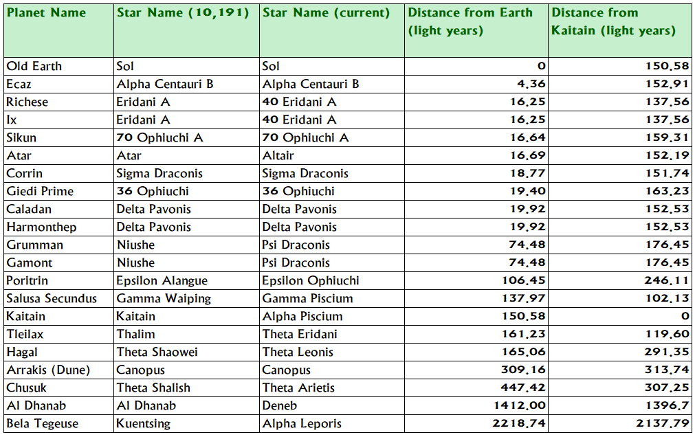
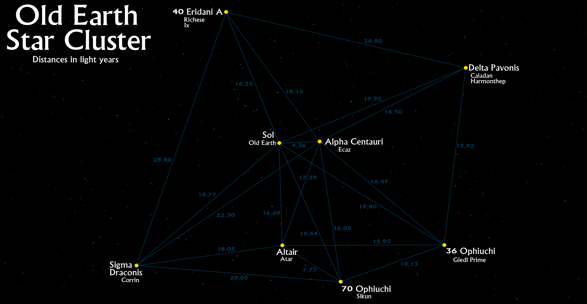
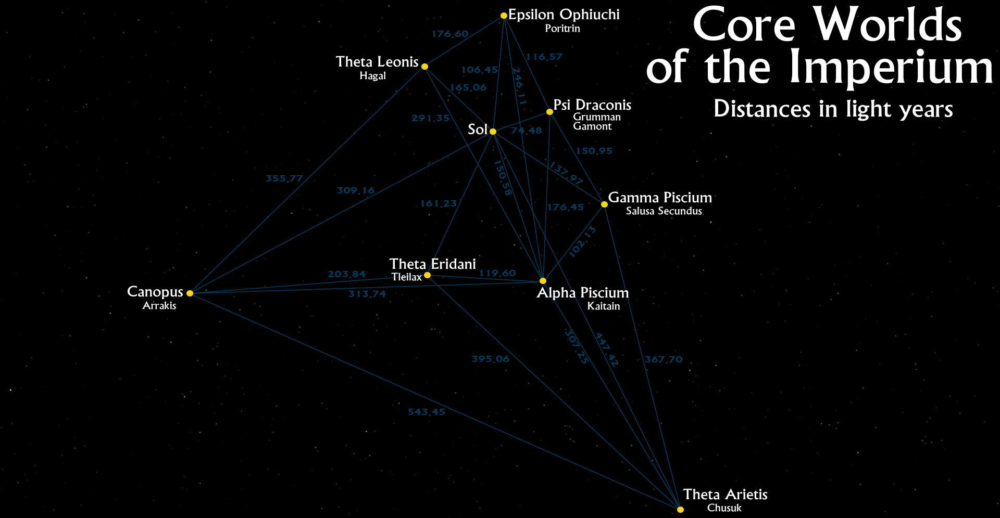
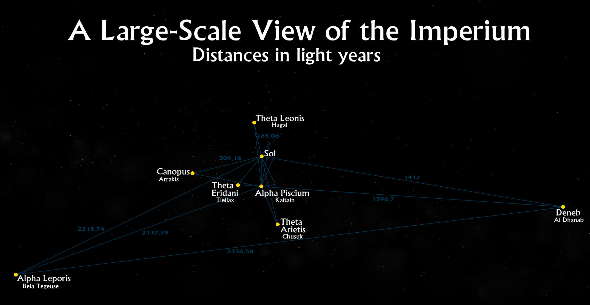

**Overview of the Imperium**

The Imperium is the name given to the cluster of worlds inhabited by humanity at the time of the **Dune** novels. The six novels of the **Dune Chronicles** cover a period of approximately five thousand years, during which time the definition of the Imperium changes dramatically. These maps show the Imperium as it is at the start of the **Dune Chronicles**, in the Year of the Guild 10,191, almost 22,000 years into the future.

**A Brief History of the Imperium**

The Imperium can trace its ancestry back to when humans first managed to successfully leave their homeworld and start exploring the Sol system. This took place approximately 11,000 years (one hundred and ten centuries) before the founding of the Spacing Guild (BG, Before Guild). Humanity initially left their home system in slower-than-light sleeper ships, and later developed a primitive FTL system that allowed them to traverse the stars in a reasonable timeframe, but still achingly slow. It was during this period that the stars within 50 light-years or so of Old Earth were explored and settled. Giedi Prime, Ecaz, Caladan, Harmonthep, Richese, Ix and Atar were likely colonised in this initial period of exploration and settlement.

Exploration beyond this initial cluster of worlds was difficult and slow, due to the crippling low speed of FTL travel. Scientists bent all their efforts to discovering ways of travelling faster, or of even “folding space” through artificial wormholes to travel instantaneously from one point in the universe to another. The latter was theoretically doable, but science alone could not find a way of achieving this.

Despite the slow pace of colonisation and expansion, it nevertheless continued until thousands of worlds had been settled. By 2000 BG the Landsraad League had been founded, an alliance of the thousands of worlds useful for trade and diplomacy.

Over the next two thousand years, a schism appeared in humanity, one that gradually grew more pronounced. Many humans believed in the primacy of human spirituality and the soul (such as the Zensunni sect, founded in 1381 BG), but others had gradually supplanted themselves with technology and the pursuit of artificial intelligence, AI, the “thinking machines” of legend. Gradually the two sides grew further apart and more fearful of the other, until the only result could be war. The Great Revolt, the Butlerian Jihad, erupted in 201 BG and concluded in 108 BG with the epic Battle of the Bridge of Hrethgir (where a general of House Atreides had a Harkonnen banished for cowardice, beginning ten thousand years of enmity). Billions died, entire worlds were put to the flame, but at the end of it the spiritualists and humanists stood triumphant. The machine cults were overthrown and the development of AI was halted everywhere. Only on Ix and Richese was technological development permitted to continue, and this under strict restrictions. In the wake of the victory, the 13,333 worlds then in the Landsraad League agreed to come together to create a new spiritual imperative for mankind, resulting in the writing of the controversial Orange Catholic Bible.

What happened in the succeeding century is a matter of conjecture. It is known that the Battle of Corrin, fought in 88 BG near Sigma Draconis, established a new primacy, with the noble House Corrino rising to rule over the entire Landsraad League from Salusa Secundus. It is also known that several of the companies and corporations engaged in interstellar travel suddenly and abruptly discovered a new form of space travel, the much-vaunted method of “folding space” instantly. How this was accomplished was, at the time, unknown, save that it heralded an explosion of exploration and colonisation. 88 years after the Battle of Corrin, the corporations who knew this secret amalgamated into the Spacing Guild. The coalescence of the Guild and the rise of House Corrino and the beginning of the reign of the Padishah Emperors happened near enough simultaneously for them to both be credited with establishing the founding of the Imperium.

For ten thousand years, the Imperium swept through the galaxy, colonising thousands upon thousands of worlds. Dozens and then hundreds of Houses Minor arose to join the Landsraad, but the real power remained concentrated in the Major Houses, the old houses which had survived the Great Revolt: Corrino, Atreides, Harkonnen and maybe a few dozen others. Supreme was House Corrino, from where the line of Emperors was derived. Several times, attempts were launched to unseat House Corrino, but all came to nothing. One incident reportedly rendered Salusa Secundus too hostile to comfortably inhabit (the records are vague), but the Imperial Court simply removed itself to another holding, Kaitain, and had Salusa Secundus redesignated as the Imperial Prison Planet.

At some point, it became known that the Spacing Guild had achieved its ability to fold space through the use of a drug, _melange_, a spice. Its origins were unclear, and jealously guarded, until the truth was revealed: the drug was native to Arrakis, a small desert planet circling Canopus. Emperor Shakkad Corrino assigned the Imperial Chemist to investigate the drug in full. Yanshup Ashkoko’s report confirmed the geriatric properties of spice, allowing those who ingested it to extend their lifespan by decades and improve their health during that longer lifespan. The mysterious sisterhood of the Bene Gesserit, who had used various poisons and chemicals to improve their bodies and gain prescient powers, also found that the spice worked far better than any of their normal chemicals, giving them tremendous powers. Thus, humanity entered a new golden age of living longer, travelling further and seeing more than it ever had before…but also faced decadence, a crushing apathy brought about by the oppressive power of the factions of the Imperium: the Emperor, the Landsraad, the Guild and the Bene Gesserit.

For thousands of years the wheel turned and humanity went about its business. House Atreides took possession of the verdant garden world Caladan and prospered for twenty-six generations, its riches and fortunes improving until it could even rival that of House Corrino. But elsewhere, there was great oppression. Old Earth became uninhabitable and was abandoned. The Zensunni people were persecuted, forced to flee from world to world. They were enslaved on Poritrin and forced to colonise and work on Bela Tegeuse and Salusa Secundus, and from there to Thurgrod, Rossak and Harmonthep. Harmonthep was destroyed for reasons still unknown, and the Zensunni thence fled to Arrakis. There they disappeared into the desert, becoming the rumoured and rare “Free Men”; the Fremen of Dune.

In 10,111 the Emperor ordered the Harkonnens to take possession of Arrakis to mine the spice. The Harkonnen way was brutal, sadistic and cruel. Under their stewardship, spice production first rose but then fell. The Fremen declared the Harkonnens their enemies and scarcely could any Harkonnen soldier leave his barracks alone without being killed. The Landsraad grew unhappy with the situation, and eighty years later, in 10,191 the Emperor, Shaddam IV, was forced to remove the Harkonnens and replace them with the Atreides. This was a dangerous move, for Duke Leto Atreides had become a great leader, a wise humanitarian, canny politician and formidable general, the darling of the Landsraad. Shaddam saw in Duke Leto an enemy that he had to crush. Thus was set in motion a chain of events that would change the fate of the galaxy.

A map of the stars surrounding Old Earth. Please click for a larger version.

**Map 1: The Old Earth Cluster**

This map shows the old core of the Imperium. Sol, location of Old Earth, is shown near the centre, although the abandonment of Old Earth has rendered it more or less irrelevant to modern galactic affairs. The Spacing Guild’s ability to fold space and travel from any point in the universe to any other instantly has rendered the physical distances between stars moot (although some believe the difficulty of such jumps increases with range; the Guild Navigators are silent on this), but this map reflects the pre-Guild expansion of humanity through near space, using ancient sleeper ships and then a more primitive form of FTL travel which still required physical movement through space.

Shown are the ancient names for the stars, some of which were later changed. 40 Eridani A, the star of Richese (the fourth planet) and Ix (the ninth), is more colloquially known just as “Eridani A,” for example.

A map of the Core Worlds of the Imperium. Please click for a larger version.

**Map 2: Core Worlds of the Imperium**

This map shows many of the more familiar worlds of humanity. They represent something of the extent of known travel using pre-Guild space travel methods (although with almost thirteen and a half thousand settled planets by the time of the Guild’s founding, the majority are not shown on this map). Settled later than the Old Earth Cluster, these stars have moved even further from their original names. Gamma Waiping, the star of storied Salusa Secundus, is a corruption of Gamma Wae Ping, itself a fusion of Greek and Chinese nomenclature for the constellation of Pisces. Thus Gamma Waiping would be known to the ancients as Gamma Piscium.

A large-scale view of the Imperium. Please click for a larger version.

**Map 3: A Large-Scale View of the Imperium**

This map shows a large-scale view of the Imperium, including its most far-flung stars (at least during the early years of the Imperium), Alpha Leporis (the star of Bela Tegeuse) and Deneb (Al Dhanab). On this scale the longest axis of the Imperium is 3,336.58 light-years. Many, many thousands of other settled stars and planets exist in this volume as well.

During more recent millennia, Spacing Guild Navigators have carried the flag of the Imperium clears across the galaxy, and in some cases to neighbouring satellite galaxies. With absolutely no sign of intelligent life arising elsewhere in the universe, the limits of human expansion appear boundless.

**Notes on the Maps**

These maps show stars and planets directly mentioned by Frank Herbert in the six canonical volumes of the **Dune Chronicles**: _Dune_ (1965), _Dune Messiah_ (1969), _Children of Dune_ (1976), _God-Emperor of Dune_ (1981), _Heretics of Dune_ (1984) and _Chapterhouse: Dune_ (1986). Neither _The Dune Encyclopedia_ by Willis E. McNelly nor the authorised tie-in work by Kevin J. Anderson and Brian Herbert (both of dubious canonicity) have been used in the preparation of these maps.

_[The Stars and Planets of Frank Herbert’s Dune: A Gazetteer](http://www.projectrho.com/DuneGazetteer.txt)_ (1999) by Joseph M. Daniels proved a supreme reference whilst researching these maps. However, the gazetteer does draw a lot on _The Dune Encyclopedia_ for its information. Given Frank Herbert’s declaration that the Encyclopedia was non-canon (if fun), I had to drop several star locations that relied solely on the _Encyclopedia_ as a primary source. However, his arguments for many other star locations and designations were often highly convincing.

**Old Earth Star Cluster**

All of the stars and planets on this map are drawn from _Dune_’s appendix. The exception is Atar, a world mentioned in _Dune Messiah_ as being a low-gravity world visited by the Fremen jihad. The name, to me, is a clear corruption of Altair. Given Altair’s proximity to Earth and its brightness, it is a logical candidate for settlement.

Joseph Daniels’ _Stars and Planets of Dune_ article makes a persuasive argument for “Eridani A” being actually 40 Eridani A. Ix and Richese being in the same system is an assumption based on the fact that, throughout the Chronicles, it is rare to hear one planet being mentioned without the other and the two worlds seem linked at almost all times, which would be odd without physical proximity. Epsilon Eridani may have been a preferred candidate due to being much better-known and a common star used in science fiction (as the location of the titular space station in **Babylon 5**, for example), but it is not part of a multi-star system (thus the “A” is meaningless). Recent observations have also shown that the star is in the early stages of planetary formation and doesn’t yet have any planets circling it, which also makes it a less appealing candidate (for the most part I have ignored post-1965 astronomical discoveries since Frank Herbert would of course have been unaware of these).

**Core Worlds of the Imperium**

All of the stars and planets on this map are drawn from _Dune_’s appendix. The naming conventions are argued for strongly by Daniels and I have in most cases agreed, although several conclusions of his were drawn from _The Dune Encyclopedia_ alone and these stars (including Rossak and Wallach IX) have thus been omitted for a lack of hard information.

**A Large-Scale View of the Imperium**

This incorporates the previous map and expands outwards to include Alpha Leporis, the star of Bela Tegeuse. Daniels’ argument for placing Bela Tegeuse’s star (named “Kuentsing” in the appendix) in Lepus is strong and Arneb/Alpha Leporis is one of the more notable choices. However, at the time that Daniels wrote his article, no proper distance measurement to Alpha Leporis had been made. More recent observations have confirmed that Alpha Leporis is more than twice the distance first thought.

Some observers have suggested that Bela Tegeuse may be a corruption of “Betelgeuse” and that star might serve as a superior choice for Kuentsing. However, Betelgeuse is on the verge of going supernova (which might have in fact already happened and we have not observed the light of the event yet), and certainly should have taken place by 22,000 years in the future, making it a highly improbable candidate for colonisation (the equivalent of building a house inside the caldera of an active and unstable volcano).

All of the stars are mentioned in _Dune_ and its appendix, apart from Al Dhanab, a clear corruption of “Deneb”, which is mentioned in _Heretics of Dune_ as the site of a Bene Gesserit stronghold.

**Book Timeline**

10,191-10,193 – _Dune_

10,205 – _Dune Messiah_ (twelve years after _Dune_)

10,214 – _Children of Dunes_ (nine years after _Messiah_)

13,723 – _God-Emperor of Dune_ (3,509 years after _Children_)

c. 15,223 – _Heretics of Dune_ & _Chapterhouse: Dune_ (c. 1,500 years after _God-Emperor_)

_Thank you for reading The Atlas of Ice and Fire. To help me provide better content, please consider contributing to [my Patreon page](https://www.patreon.com/user?u=4370220) and [other funding methods](http://thewertzone.blogspot.co.uk/2017/01/support-wertzone-on-patreon.html), which will also get you exclusive content weeks before it goes live on my blogs._
