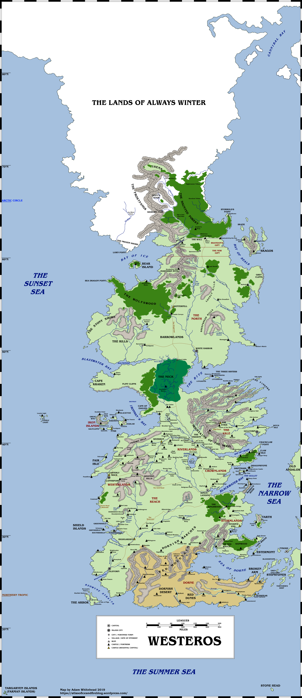

[As related previously](https://atlasoficeandfireblog.wordpress.com/2019/09/07/the-noble-houses-of-westeros/), I’ve been planning to update my older Atlas of Ice and Fire maps focusing on Westeros and Essos, which are looking a bit low-res and long in the tooth ese days. To start with, I’ve been creating a new map of the entire known world. Although lots of work remains to be done on that, I have (more or less) completed the portion containing Westeros, which is now available to view below.

The continent of Westeros. Please click for a (much) larger version.

There is some work still to be done. I need to clean up some of the name placements. I also still need to find a better way of depicting mountains and especially hills, which I realised a bit late in the day on this map look more like valleys or canyons.

Still, this is a vast improvement over my old maps and work continues to improve the material.

_Thank you for reading The Atlas of Ice and Fire. To help me provide better content, please consider contributing to [my Patreon page](https://www.patreon.com/user?u=4370220) and [other funding methods](http://thewertzone.blogspot.co.uk/2017/01/support-wertzone-on-patreon.html), which will also get you exclusive content before it goes live on my blogs._
