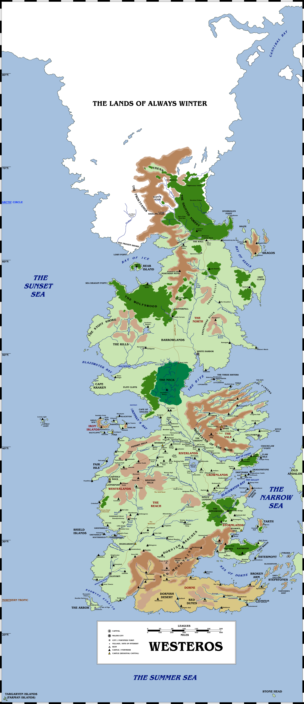

This is a sequel to an article [I originally posted four years ago](https://atlasoficeandfireblog.wordpress.com/2016/02/28/the-size-and-extent-of-westeros/) when we looked at the size of Westeros. In that article I made arguments for the placement and location of Westeros on its planet and its extent in the hemisphere.

Those arguments all still stand, but I thought it might be interesting to revisit the map with a view to looking at the size and area of the Seven Kingdoms and their constituent regions, a matter of some debate on fan forums and Reddit for many years.

Working out the area of the Seven Kingdoms is pretty straightforward, using the Wall as a scale bar (the Wall is almost exactly 300 miles long) and tracking this with the other distances given in the books (Deepwood Motte to Winterfell being 300 miles, Westeros being roughly 1,200 miles wide in the south around Dorne, etc). By “lassoing” each area in Westeros in turn in a painting program, you can discover how many pixels fall in each area. This can then be converted via the scale into square miles.

Although a precise figure is given, these figures are certainly **approximate** and should not be taken to be 100% accurate. I spoke to Elio Garcia (co-author of _The World of Ice and Fire_) who had undertaken a similar exercise over a decade ago and his figures were very similar, but not 100% the same.

A map of Westeros. Please click for a larger version.

This gives us the following values for the Seven Kingdoms and its nine major regions. Note that these numbers include the offshore islands relevant to each region.

**The Seven Kingdoms: 3,062,967 miles² (square miles)**

*   The Gift: 63,347 miles²
*   The North: 1,132,154 miles²
*   The Vale: 255,016 miles²
*   The Iron Islands: 11,136 miles²
*   The Riverlands: 268,881 miles²
*   The Crownlands: 130,148 miles²
*   The Westerlands: 192,720 miles²
*   The Reach: 479,135 miles²
*   The Stormlands: 201,967 miles²
*   Dorne: 328,472 miles²

To contrast with real-world equivalents, the Seven Kingdoms as a whole is larger than Australia (2,947,336 miles²) but smaller than Brazil (3,266,584 miles²). If the Seven Kingdoms were real, they’d be the fifth-largest country in the world.

The North is smaller than European Russia (1.5 million miles²) but larger than Argentina (1,056,640 miles²).

The Reach is often compared to France (247,270 miles²), but in fact is almost twice the size in area.

Dorne is often compared to Spain (192,660 miles²) but is only almost twice the size in area.

This also allows us to list the areas of Westeros in order of size:

1.  The North: 1,132,154 miles²
2.  The Reach: 479,135 miles²
3.  Dorne: 328,472 miles²
4.  The Riverlands: 268,881 miles²
5.  The Vale: 255,016 miles²
6.  The Stormlands: 201,967 miles²
7.  The Westerlands: 192,720 miles²
8.  The Crownlands: 130,148 miles²
9.  The Gift: 63,347 miles²
10.  The Iron Islands: 11,136 miles²

As we can see from this, the North is about one-third the total size of the Seven Kingdoms (King Robert’s geographic assessment that the North is as big as the other kingdoms combined is erroneous, although perhaps not on a quick eyeball of the map) and the Reach is the second-largest region. Dorne is surprisingly large, for its relative lack of population, and the Westerlands is surprisingly small for what appears to be the second-most-populous region of the continent.

A few notes:

“Westeros” and “the Seven Kingdoms” are often used interchangeably in the books, but there is a strong technical distinction between them: Westeros is the name of the entire continent, including the Seven Kingdoms, the Lands Beyond the Wall (the home of the wildlings) and the Lands of Always Winter (the home of the Others).

The size and extent of Westeros is considerably greater than that of the Seven Kingdoms, probably twice the size, explaining Martin’s oft-quoted statement that Westeros is “the size of South America” (6,890,000 miles²) when the mapped portion in the books is more like half that size.

In a future entry, I’ll be looking at the relative size of areas in Essos, Sothoryos and Ulthos.

**_Thank you for reading The Atlas of Ice and Fire. To help me provide better content, please consider contributing to [my Patreon page](https://www.patreon.com/user?u=4370220) or by [other funding methods](http://thewertzone.blogspot.co.uk/2017/01/support-wertzone-on-patreon.html), which will also get you exclusive content weeks before it goes live on my blogs._**
