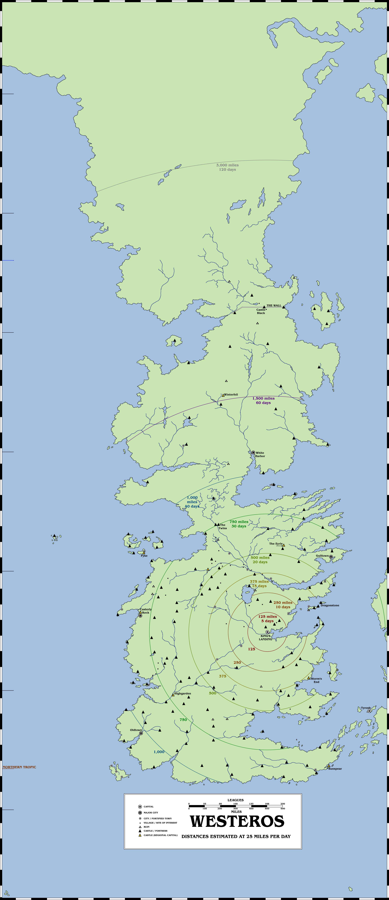
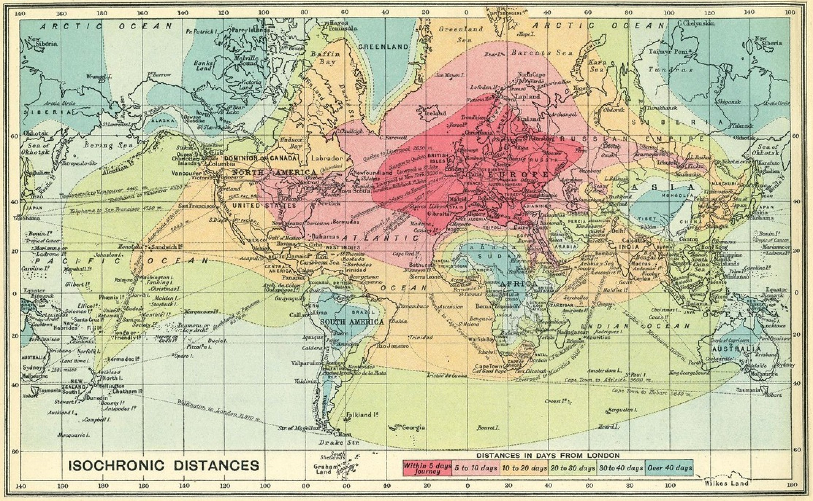

A while ago, I received [a request for an interesting idea](https://twitter.com/zionius/status/1306634815215554562?s=20): isochronic maps of fantasy worlds.

A distance map of Westeros. Please click for a larger version.

Isochronic maps show time over distance, and are very useful if the specific distance is less useful than knowing how quickly you can get somewhere. The scale might tell you that a location is 300 miles away in a straight line, but an isochronic map can tell you how long it will take to travel that distance given various factors (time of year, weather conditions, mounted or on foot, on good roads or across country, terrain etc).

I started looking at doing an isochronic map of Westeros but ran into problems that sorting through the morass of geographical factors would take a considerable amount of time, requiring a huge number of judgement calls on how good quality the Kingsroad is versus the Ocean Road, how impassable the Mountains of the Moon are in autumn and so on. For the time being I switched to doing a much more simple distance map which does not take account of geographical obstacles at this stage. The distance map is centred on King’s Landing, the capital city of the Seven Kingdoms.

The distance map is based on the idea of someone being able to travel 25 miles in one day. This would typically be someone travelling on horseback with moderate baggage and able to swap horses maybe once a week or fortnight (otherwise you could assume 2 days of rest for every 5-7 days travelled and extend the days required to travel accordingly). The journeys would be slightly faster on an excellent highway like the Kingsroad, and a lot slower in bad weather.

A full isochronic map would take account of such features. Historically they were more useful for ocean travel, given the more dependable regularity of ship speeds as technology improved, but land-based ones exist as well.

An isochronic map of the world in 1914, centred on London.

A fully accurate isochronic map is impossible, due to the number of variables being very high (pleasingly, for an author who hasn’t necessarily put this amount of thought into things), but it’s something to definitely consider for a future entry.

_Thank you for reading The Atlas of Ice and Fire. To help me provide better content, please consider contributing to [my Patreon page](https://www.patreon.com/user?u=4370220) and [other funding methods](http://thewertzone.blogspot.co.uk/2017/01/support-wertzone-on-patreon.html), which will also get you exclusive content before it goes live on my blogs._
